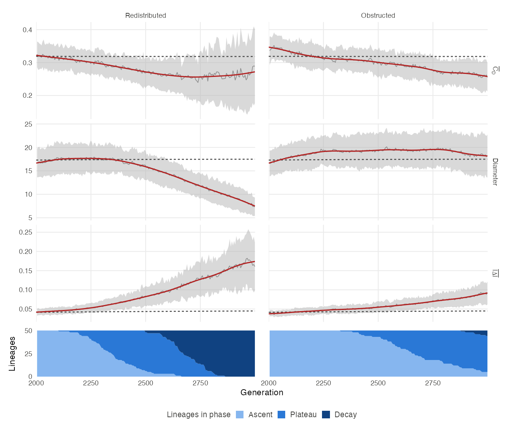
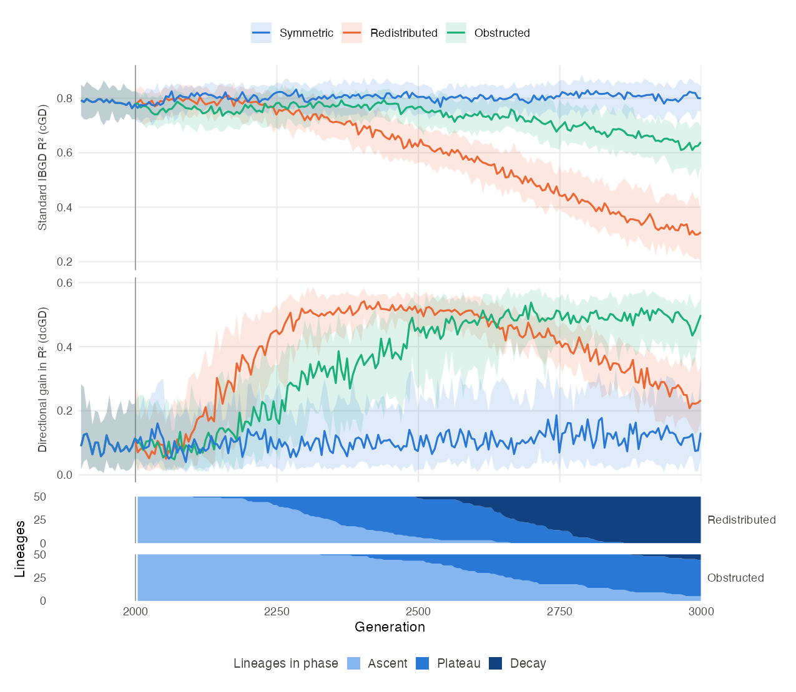

# Genetic Gravity: Extracting Directional Gene Flow from Population Graphs

**Rodney J. Dyer** · School of Life Sciences and Sustainability, Virginia Commonwealth University

📄 **[Read the manuscript](https://dyerlab.github.io/Genetic_Gravity/)** · [Supplementary Materials](https://dyerlab.github.io/Genetic_Gravity/supplemental.html) · [gstudio Computer Note](https://dyerlab.github.io/Genetic_Gravity/computer_note/index.html)

The site is rebuilt from `index.md` and `supplemental.md` on every push to `main`.

---

## Summary

Winds, currents, river networks, source–sink gradients and range expansions all bias the direction of gene flow, yet most summaries of genetic connectivity are symmetric. *Genetic gravity* is an extension of Population Graphs that reads direction from conditional genetic covariance, without a demographic model or an assumption of equilibrium. Each edge is read from the neighborhoods of both populations it joins; the difference, $\Delta_{i\rightarrow j}$, is summarized as a source–sink score $S$ that orders populations from genetic sources to sinks. Two single-graph tests ask whether that ordering has a direction: a source–sink gradient test along a population-level covariate, and a comparison of directional (dcGD) and symmetric (cGD) isolation by graph distance. The method was evaluated with individual-based simulations of a 25-deme stepping stone under *Symmetric*, *Redistributed* and *Obstructed* migration, subsampled to test sampling intensity, and applied to the Sonoran Desert bark beetle *Araptus attenuatus*.

<p align="center">
  <a href="https://dyerlab.github.io/Genetic_Gravity/">
    
  </a>
</p>

## Key Findings

1. **Directional signal follows an *ascent* → *plateau* → *decay* sequence.** After migration becomes asymmetric, each lineage reorganizes (*ascent*), holds a stable directional structure (*plateau*), and in this closed, mutation-free system eventually loses the among-population variance needed to read it (*decay*, after the informative horizon). The net directional bias sets how quickly a lineage reaches the *plateau*, not how strong the signal is once there: *Obstructed* lineages took about twice as long but reached nearly the same asymmetry.

   <p align="center"></p>

2. **A calibrated source–sink gradient test.** With a Moran spectral null built on each census's own Population Graph, the test held its nominal rate under symmetric migration (2.9–4.2% at α = 0.05) across a ten-fold range of migration. On the *plateau* it rejected in 45–65% of single censuses, and every lineage placed the sources upstream when its *plateau* censuses were averaged. Nulls that permute or resample parts of a single graph were anti-conservative.

   <p align="center"></p>

3. **Directional isolation by graph distance recovers structure that cGD loses.** Under asymmetric migration, standard isolation by graph distance weakened. On the *plateau*, directional conditional genetic distance (dcGD) fit better than cGD (R² 0.74 vs. 0.63), the directional model was preferred in 78–89% of censuses, and every detection in a phase core recovered the imposed direction. Under strong drift the decision rule fired in 12–15% of symmetric censuses, and cGD remains the right distance for ordinary isolation by distance.

   <p align="center"></p>

4. **The degree-neutral bandwidth (γ = ½) removes the topological floor.** At the local mean (γ = 1), degree explained about half the variance in $\Delta$ under symmetric migration, so hubs read as sources. At γ = ½ it explained 2–4%, and both tests were more powerful. This held in a second, independently simulated set of 50 lineages.

5. **Population-level inference is robust; individual edges are not.** Roughly a quarter of edges changed sign between bandwidths, but the population-level ordering of sources did not. Individual arrows have no calibrated test and are leads, not findings.

6. **Comparison with `divMigrate`.** The neighborhood weight $w_{j\mid i}$ matched the true migration matrix more closely than `divMigrate`'s *Nm* (Spearman ρ 0.52–0.55 vs. 0.39–0.45), mainly by separating true corridors from pairs with no direct exchange. *Nm* oriented individual adjacent links slightly better, but became undefined as loci fixed, well before the Population Graph lost information.

   <p align="center"></p>

7. **Sampling intensity.** The number of populations sets the power of the source–sink test, which stays calibrated; the uncalibrated rule ΔR² > 0 becomes anti-conservative in small graphs, so the directional isolation comparison needs a cutoff calibrated by simulating symmetric migration for the study's own design. Individuals per population decide whether the graph holds together: about five expected heterozygotes per locus per population (about 30 individuals in the simulations) kept graphs intact, whereas the allocation that is optimal for estimating differentiation (about 1/Φ individuals per population) is far too thin.

   <p align="center"></p>

8. **Case study.** In *Araptus attenuatus*, the directional model recovered isolation by graph distance in the central component that the symmetric model missed (ΔR² = 0.20; significant against a cutoff calibrated for the study's design, one-sided p = 0.008). Its direction matched a southward expansion from the refugium, with the strongest sources beside it. The northern component showed strong isolation by distance but no directional signal.

   <p align="center"></p>

## Software

Every method here is implemented in the R package [**gstudio**](https://github.com/dyerlab/gstudio): Population Graph construction, neighborhood weights at a chosen bandwidth, gravity and the source–sink score, dcGD, both directional tests, gravity-field plots and source–sink surfaces (exportable as rasters in graph or geographic space), and a generator of design-matched symmetric-migration data sets with diagnostics of sampling intensity for calibrating the tests.

```r
library(gstudio)
data(gravity)
plot(gravity_field(gravity))
```

## Building the PDFs

`make` builds `pdf/index.pdf` and `pdf/supplemental.pdf` with pandoc and XeLaTeX (`make index`, `make supplement`, `make clean`).

## Repository layout

| Path | Contents |
| :--- | :--- |
| `index.md` | Main manuscript |
| `supplemental.md` | Supplementary Materials |
| `*.meta.yml` | Title and author metadata for the site build |
| `media/` | Figures |
| `R/` | Simulation and analysis scripts |
| `Makefile`, `pdf/` | PDF build (pandoc filter and preamble) and built PDFs |
| `data/` | Simulation output and empirical data (`data/derived` is not tracked) |
| `.github/workflows/publish.yml` | Builds and deploys the manuscript site |
