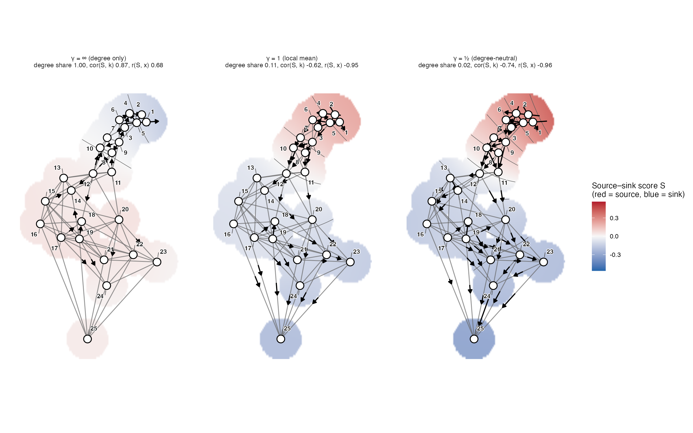
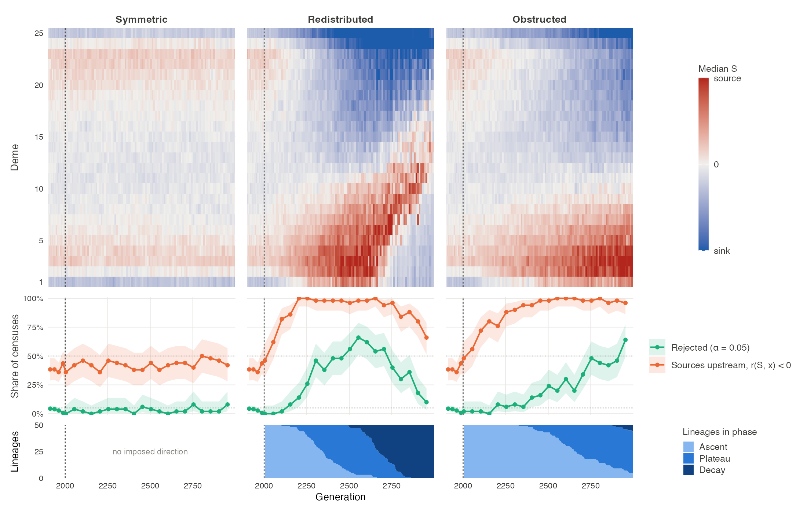
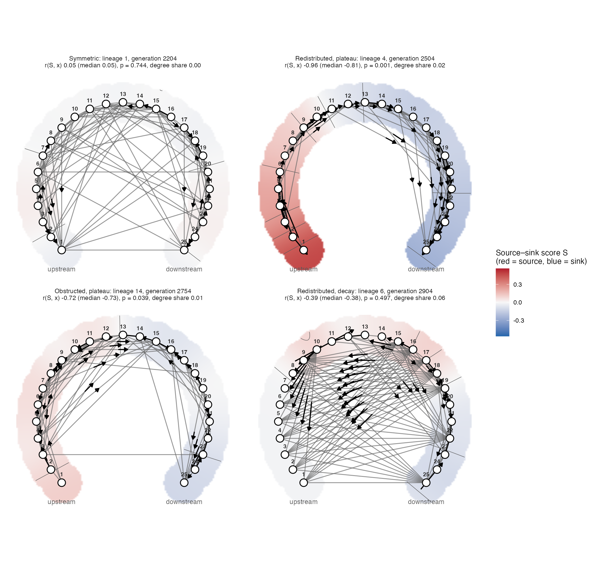
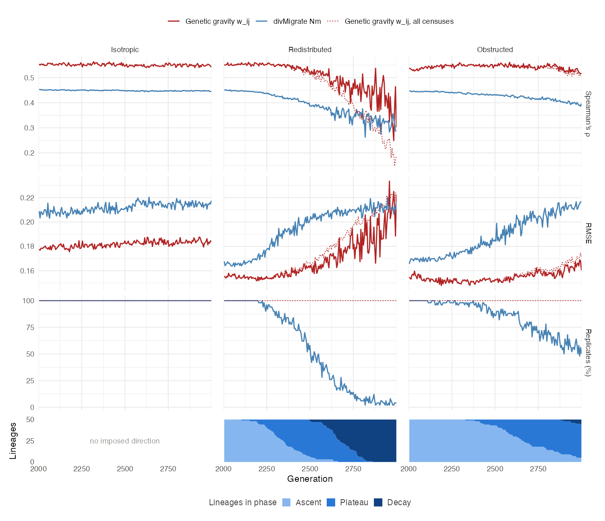
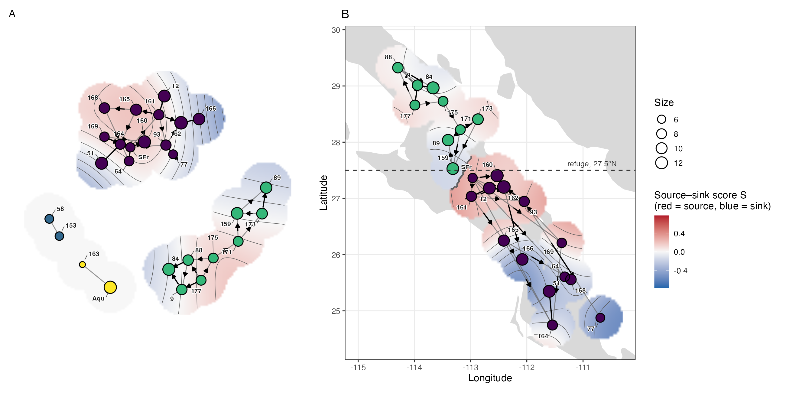

# Genetic Gravity I: Extracting Directional Gene Flow from Population Graphs

**Rodney J. Dyer** · School of Life Sciences and Sustainability, Virginia Commonwealth University

📄 **[Read the manuscript](https://dyerlab.github.io/Genetic_Gravity/)** · [Supplementary Materials](https://dyerlab.github.io/Genetic_Gravity/supplemental.html)

The site is rebuilt from `index.md` and `supplemental.md` on every push to `main`.

---

## Summary

Pairwise $F_{ST}$ and similar statistics give one symmetric value for each pair of populations. That hides the direction of gene flow that colonization, source–sink dynamics and dispersal by wind or water create. *Genetic gravity* reads direction from the conditional topology of a Population Graph. Each undirected edge combines two neighborhood relationships, one seen from each end. The difference between them, $\Delta_{i\rightarrow j}$, becomes a signed field of directional influence. Summed at each node, it gives a source–sink score $S$. The method needs no demographic model and no equilibrium assumption, and it works from a single snapshot. It was evaluated with forward-time individual-based simulations of a 25-deme stepping stone under *Symmetric*, *Redistributed* and *Obstructed* migration, then applied to an empirical case study.

<p align="center">
  <a href="https://dyerlab.github.io/Genetic_Gravity/">
    
  </a>
</p>

## Key Findings

1. **Directional signal follows a reorganize → plateau → decay sequence.** Under asymmetric migration, each lineage goes through an *ascent*, a *plateau* and a *decay* phase after an informative horizon. The net directional bias sets how quickly a lineage reaches the *plateau*. It does not set how strong the signal is once there: *Obstructed* lineages took about 2× longer but reached nearly the same asymmetry.

   <p align="center"></p>

2. **A calibrated source–sink gradient test.** With a spectral null built on each census's own Population Graph, the test held its nominal rate under symmetric migration (2.9–4.2% at α = 0.05) at every level of drift. On the *plateau* it rejected in 45–65% of single censuses. When a lineage's *plateau* censuses were averaged, every lineage placed the sources upstream. Plain permutation nulls were anti-conservative (10–18%).

   <p align="center"></p>

   <p align="center"></p>

3. **Directional isolation by graph distance recovers structure that cGD loses.** Under asymmetric migration, standard cGD isolation by graph distance weakened. On the *plateau*, partitioned conditional genetic distance (pGD) fit better than cGD (R² 0.74 vs. 0.63). Detection was 78–89% on the *plateau*, and every detection in a phase core recovered the imposed direction. Under strong drift the false-positive rate rose to 12–15%, so cGD remains the right distance for ordinary isolation by distance.

   <p align="center"></p>

4. **The degree-neutral bandwidth (γ = ½) removes the topological floor.** At the local-mean bandwidth, degree explained about half the variance in $\Delta$ under symmetric migration, so hubs read as sources. At γ = ½ degree explained 2–4%, and power was higher. This held up in 50 independently simulated lineages.

5. **Population-level inference is robust; individual edges are not.** Roughly a quarter of edges changed sign between bandwidths, but the population-level source ordering did not. Individual arrows have no calibrated test and should be treated as exploratory.

6. **Compared with `divMigrate`.** The neighborhood weight $w_{j\mid i}$ matched the true migration matrix more closely than `divMigrate`'s $N_m$ (Spearman ρ 0.52–0.55 vs. 0.39–0.45). This mostly reflects how well each separates true corridors from pairs with no direct exchange. $N_m$ oriented individual links slightly better, but it became undefined well before the Population Graph lost information.

   <p align="center"></p>

7. **Case study.** In the Sonoran Desert bark beetle (*Araptus attenuatus*), the directional model recovered isolation in the central component that the symmetric model missed (ΔR² = 0.20). The direction matched a southward expansion from the refuge. The northern component showed strong isolation by distance but no directional signal.

   <p align="center"></p>

## Software

Every method here is implemented in the R package [**gstudio**](https://github.com/dyerlab/gstudio): Population Graph construction, neighborhood weights, gravity and the source–sink score, pGD, both directional tests, and gravity-field plots:

```r
library(gstudio)
data(gravity)
plot(gravity_field(gravity))
```

## Repository layout

| Path | Contents |
| :--- | :--- |
| `index.md` | Main manuscript |
| `supplemental.md` | Supplementary Materials |
| `*.meta.yml` | Title and author metadata for the site build |
| `media/` | Figures |
| `R/` | Simulation and analysis scripts |
| `data/` | Simulation output and empirical data (`data/derived` is not tracked) |
| `.github/workflows/publish.yml` | Builds and deploys the manuscript site |
