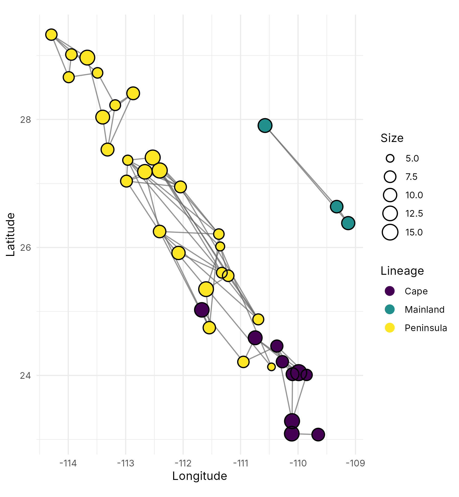
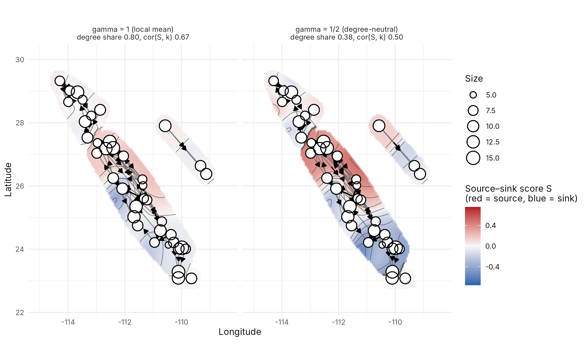

# gstudio 1.15: Population Graphs, genetic gravity and tidy population-genetic analysis in R

Rodney J. Dyer  
rjdyer@vcu.edu  
https://rodneydyer.com

[School of Life Sciences and Sustainability](https://slss.vcu.edu)  
[Virginia Commonwealth University](https://vcu.edu)  
Richmond, Virginia 23284

*Article type:* Computer Note

*Running title:* gstudio 1.15

# Abstract

The R package gstudio provides a data type for multilocus genotypes and a set of tools for the spatial analysis of genetic marker data. Version 1.15 is a substantial update. The separate popgraph package has been folded in, so that Population Graphs, conditional genetic distance and their spatial exports share one data model with the rest of the package. Analyses are reached through four gateway functions for diversity, structure, distance and relatedness, each choosing an estimator by name and returning a plain data frame or matrix ready for ggplot2 and dplyr. Statistical tests return standard `htest` objects. The update also adds genetic gravity, a set of tools for reading the direction of gene flow from an otherwise undirected Population Graph: neighborhood weights at a chosen bandwidth, a source–sink score for each population, directional conditional genetic distance (dcGD), a source–sink gradient test, a comparison of directional and symmetric isolation by graph distance, and gravity-field plots and source–sink surfaces. Two functions support study design: one diagnoses whether a sample can support a Population Graph and the directional tests, and one simulates design-matched data sets under symmetric migration to calibrate those tests. I illustrate the workflow with 363 Sonoran Desert bark beetles (*Araptus attenuatus*) from 39 sites, genotyped at eight nuclear loci. gstudio is open source (GPL ≥ 2), is documented with help pages, vignettes and a website, is covered by about 1,700 unit tests, and is available from GitHub ==[and CRAN]==.

*Keywords:* Population Graphs, conditional genetic distance, asymmetric gene flow, landscape genetics, R package, genetic diversity

# Introduction

Population genetic analysis in R is now spread across many packages, each with its own data class and output format. A typical landscape genetic study may read genotypes with one package, estimate differentiation with a second, build a network with a third and map the result with a fourth, converting between representations at each step. gstudio was written to remove most of those conversions. Its central idea, introduced in the first release (Dyer, 2009), is a `locus` class that stores a genotype as a single column of an ordinary data frame. Genetic data then sit beside coordinates, habitat and any other covariates, and can be filtered, grouped, joined and mapped with the same tools used for the rest of the data.

Population Graphs were developed alongside gstudio, but in a separate package (popgraph; Dyer, 2013). A Population Graph is a network estimated from the conditional genetic covariance among all populations at once; an edge joins two populations only if they remain genetically dependent after their covariance with every other population is accounted for (Dyer & Nason, 2004; Dyer, 2007, 2015). Edge lengths give conditional genetic distance (cGD), which has more power than pairwise distances for landscape models of gene flow (Dyer et al., 2010). Keeping the two packages apart meant two data models and duplicated code for distances, coordinates and export.

Version 1.15 joins them and rebuilds the interface around three conventions: one gateway function per kind of analysis, plain tabular output, and standard test objects. It also adds a new set of tools, *genetic gravity*, that recovers the direction of gene flow from the undirected topology of a Population Graph (Dyer, ==[2026, preprint DOI]==). This note describes the design of the package, its main functions, their inputs and outputs, and a worked example with the *Araptus attenuatus* data distributed with the package.

# Design and implementation

## The locus class

A `locus` stores one genotype per individual as alleles separated by a colon (e.g. `"01:03"`). Missing data are explicit, ploidy is recorded, and a set of operators and generics (`c()`, `[`, `is.na()`, `+` to produce an offspring from two parents, `-` to remove a parent's contribution from an offspring) behave as one expects of a genotype. Loci can be built from codominant strings, two-column formats, SNP counts or probabilities, AFLP presence–absence and allozyme notation, and `read_population()` imports the usual file formats, including GENEPOP and STRUCTURE, which `to_genepop()` and `to_structure()` write back out. Because a locus is a column, `column_class()` finds the genetic columns of any data frame, and every analysis can be restricted to a subset of loci by name.

## Gateway functions and tidy output

Earlier versions exported one function per estimator. Version 1.15 replaces them with four gateway functions—`genetic_diversity()`, `genetic_structure()`, `genetic_distance()` and `genetic_relatedness()`—each of which selects an estimator with a `mode =` argument (Table 1). There is therefore one name to remember per question, and switching estimators means changing a string rather than learning a new function. Every function takes its data first, so analyses read as pipelines, and functions with a stratum argument take it from `dplyr::group_by()` when it is not given.

Results follow one convention. Tables are plain data frames whose population key is `Stratum` and whose edge endpoints are `from` and `to`. Distance and relatedness results stay matrices, with `to_dfdist()` giving the long form. A single hypothesis test returns an `htest`, so it prints, and can be tidied, like any test in base R; a table of many tests uses the column names of `broom::tidy()` (`statistic`, `p.value`, `conf.low`, `conf.high`). The package does not wrap ggplot2: the user plots the data frames directly. The one deliberate exception is graphs. `plot()` on a Population Graph or a gravity field returns a ggplot from a single shared backend, with the same options for layout, node size, labels, fill and edge width, and the result can be extended with `+` like any other ggplot.

## Population Graphs

`population_graph()` estimates a Population Graph from a data frame of genotypes and a stratum column. Multilocus genotypes are coded as allele-frequency vectors, rotated by principal components, and projected onto discriminant axes; the among-population covariance of the population centroids is then inverted, and edges are removed by tests of conditional independence (Dyer & Nason, 2004). The result is an `igraph` object (Csardi & Nepusz, 2006) of class `popgraph`, so every function in igraph applies to it directly. Each node carries the within-population genetic standard deviation as its size, and `decorate_graph()` attaches any population-level data, such as coordinates or habitat, as node attributes. `genetic_distance(mode = "cGD")` returns all-pairs shortest-path conditional genetic distance, and `ibgd()` tests isolation by graph distance against a spatial or ecological separation. Graphs can be exported as simple-features objects for GIS work (`to_sf()`; Pebesma, 2018), as GeoJSON, KML or JSON graph files, and animated across time series with `animate_popgraphs()`.

## Genetic gravity

Each edge of a Population Graph is symmetric, but the two populations it joins sit in different neighborhoods. Genetic gravity reads the direction of gene flow from that difference (Dyer, ==[2026]==). For each population, the conditional distances to its neighbors are converted to neighborhood weights with a node-local Gaussian kernel, as in stochastic neighbor embedding (Hinton & Roweis, 2003), whose bandwidth is a multiple γ of the population's mean edge length. An edge is then read from both ends; the difference between the two weights is the gravity asymmetry, Δ, positive when the first population is the genetic source. The asymmetries are summarized as a source–sink score, S, for each population, estimated by least squares on the graph Laplacian, so that high S marks sources and low S marks sinks.

The bandwidth controls how much of Δ is set by node degree rather than genetic distance. As the kernel flattens, every weight tends to one over the number of neighbors, and the score reduces to a topological floor set by degree alone. The package therefore offers a *degree-neutral* bandwidth (γ = ½, the default for inferring direction) and the *local mean* (γ = 1, for describing a population's overall weight in the network), and reports the *degree share*—the proportion of variance in Δ explained by degree alone—with every result.

The functions are `source_sink_scores()` (gravity and S for each population), `gravity_field()` (nodes, edges and diagnostics for one or more bandwidths, with a `plot()` method that draws a source–sink surface with source → sink arrows on the edges, in graph or geographic space), `dcgd()` and `genetic_distance(mode = "dcGD")` (directional conditional genetic distance, which splits each cGD into its two directional components and returns a directed graph or an asymmetric matrix), `source_sink_test()` (a gradient test of S along a population-level covariate, with a null from Moran spectral randomization on the graph; Wagner & Dray, 2015) and `ibgd(mode = "dcGD")` (a comparison of directional and symmetric isolation by graph distance). The derivation, the choice of bandwidth and the performance of both tests in individual-based simulations are given by Dyer (==[2026]==).

## Study design: diagnostics and design-matched nulls

Two functions address whether a sample can support these analyses. `popgraph_diagnostics()` summarizes the design (strata, individuals per stratum, loci and alleles), the information available to estimate within-population variance (the expected number of heterozygotes per locus in each stratum, *n*·*H*~S~), the shape of the resulting graph (components, mean degree, leaves) and the degree share, and it flags thin sampling, fragmentation, a large degree share and few polymorphic loci. For comparison it also reports the allocation of individuals among strata that is optimal for estimating differentiation, from `optimal_sampling()`. `popgraph_null()` simulates data sets with the study's own strata, sample sizes, loci and alleles under Wright–Fisher drift with symmetric migration, tuned to the observed *G*~ST~, rebuilds a Population Graph from each, and returns null distributions, cutoffs and one-sided *p*-values for both directional tests. A cutoff calibrated in this way is specific to the design, which matters because the rate at which the directional isolation comparison favors the directional model by chance depends on the number of strata, individuals and loci.

## Other functions

The package also includes parentage and paternity analysis (`paternity()`, `parent_finder()`), pedigree inbreeding and kinship through kinship2 (`genetic_pedigree()`), two-generation analysis of pollen pools (`genetic_structure(mode = "PhiFT")`; Smouse et al., 2001), spatial genetic autocorrelation, Hardy–Weinberg and rarefaction tests, and a forward-time, individual-based simulator (`make_populations()`, `migration_matrix()`, `simulate_pop()`) that supports directional stepping-stone migration. Allele frequencies can be mapped interactively with leaflet (`addAlleleFrequencies()`).

## Inputs and outputs

The input to every analysis is a data frame with one row per individual, one or more `locus` columns and, as needed, a stratum column and coordinates (`Longitude`, `Latitude`). Outputs are data frames (diversity, structure, frequencies, diagnostics, gravity nodes and edges), matrices (distances, relatedness), `htest` objects (single tests), `popgraph`/`igraph` objects (graphs), ggplot objects (`plot()` on graphs and gravity fields) and exports to sf, GeoJSON, KML, GENEPOP and STRUCTURE.

# Worked example: *Araptus attenuatus*

The `arapat` data set holds the nuclear genotypes of 363 Sonoran Desert bark beetles from 39 sites in Baja California and Sonora, scored at eight codominant loci (seven intron-spanning gene regions and one microsatellite; Garrick et al., 2013). Each beetle is assigned to one of three lineages identified by Garrick et al. (2013)—Cape (75 beetles, 14 sites), Mainland (36 beetles, 3 sites) and Peninsula (252 beetles, 34 sites)—and twelve sites hold beetles of more than one lineage. The full analysis is in the script `note_arapat.R` (Data availability); its main calls are:

```r
library(gstudio); library(dplyr)
data(arapat)

arapat |> group_by(Species) |>
  genetic_diversity(mode = c("A", "Ae", "He", "Ho", "Fis"))      # Table 2
arapat |> genetic_structure(stratum = "Species", mode = "Dest")  # Table 3

graph <- population_graph(arapat, stratum = "Population", decorate = TRUE)
plot(graph, layout = strata_coordinates(arapat))                 # Figure 1
popgraph_diagnostics(arapat, graph = graph)

field <- gravity_field(graph, gamma = c(1, 0.5))
plot(field, layout = strata_coordinates(arapat))                 # Figure 2
```

**Diversity and differentiation.** The Peninsula lineage was the most diverse (mean 4.9 alleles per locus, *H*~E~ = 0.49) and the Cape lineage the least (2.6 alleles, *H*~E~ = 0.24, with one locus monomorphic; Table 2). Observed heterozygosity was well below expectation in every lineage (*F*~IS~ = 0.30–0.52), as expected when several sites, each with its own allele frequencies, are pooled into one lineage. The three lineages were strongly differentiated (multilocus *G*~ST~ = 0.38, permutation *p* = 0.001 with 999 permutations; *G*′~ST~ = 0.65; *D*~est~ = 0.43; Table 3), most between Cape and Peninsula (pairwise *G*~ST~ = 0.36) and least between Mainland and Peninsula (0.20). Within the Peninsula lineage, sites were differentiated as strongly as the lineages were from one another (*G*~ST~ among sites = 0.42). Because each estimator is a value of `mode`, Table 3 comes from three calls that differ by a single string.

**Population Graph.** The graph of all 39 sites had 71 edges in four components and took a fraction of a second to estimate (Figure 1). The three Mainland sites formed their own component, as did nine northern peninsular sites; the largest component joined 17 peninsular and 8 Cape sites, and the remaining two Cape sites formed a dyad. Only 4 of the 71 edges joined sites assigned to different lineages, all of them between Cape and Peninsula sites in the south, where the two lineages co-occur. Conditional genetic distance was finite for the 340 of 741 site pairs that share a component and increased with great-circle distance among them (Spearman ρ = 0.51).

**Diagnostics.** `popgraph_diagnostics()` identified the main limitation of these data for directional inference. With 4–19 beetles per site (median 10) and a mean within-site heterozygosity of 0.33, the median site had 3.3 expected heterozygotes per locus, and 38 of the 39 sites fell below five, the level below which within-population variance is poorly estimated and simulated graphs begin to fragment (Dyer, ==[2026]==). The function also flagged the four components, which means that the directional tests must be run within a component, and a degree share of 0.38 at the degree-neutral bandwidth.

**Genetic gravity.** The gravity field shows why the bandwidth and the degree share are reported together (Figure 2). At the local mean (γ = 1), degree explained 80% of the variance in the edge asymmetries and the source–sink score was strongly correlated with degree (*r* = 0.67), so the field largely restates the graph's topology. At the degree-neutral bandwidth (γ = ½), the degree share fell to 0.38 and the correlation to 0.50. The population-level ordering was stable between bandwidths (Spearman ρ between the two sets of scores = 0.91), whereas 11 of the 71 edges reversed direction—the pattern expected if direction is read at the level of populations rather than individual edges. At γ = ½ the strongest sources were central peninsular sites (93, 169 and 58; 26.0–26.9°N) and the strongest sinks lay to the south (163, 75 and 156; 24.0–24.6°N). Those sources are also among the best-connected sites in the graph (five to seven neighbors), so the residual degree share argues against reading this pattern as a result without a formal test. Testing it requires an *a priori* hypothesis of direction, a component-by-component analysis and, given the thin sampling within sites, a design-matched null from `popgraph_null()`. That analysis, for the expansions of the Peninsula lineage out of a mid-peninsular refugium hypothesized by Garrick et al. (2013), is reported in Dyer (==[2026]==) and reproduced by its own script with the same functions.

# Comparison with existing software

Several R packages cover parts of this workflow. adegenet (Jombart, 2008) and poppr (Kamvar et al., 2014) provide genotype classes and multivariate and clonal analyses, hierfstat (Goudet, 2005) provides *F*-statistics, mmod (Winter, 2012) provides *G*′~ST~ and *D*~est~, and diveRsity (Keenan et al., 2013) includes `divMigrate`, which estimates directional relative migration from pairwise differentiation (Sundqvist et al., 2016). graph4lg (Savary et al., 2021) builds and analyzes several kinds of genetic graphs for landscape genetics. gstudio differs from these in three respects: genotypes are columns of an ordinary data frame rather than a dedicated container object; Population Graphs, cGD and their spatial exports are integrated with the diversity and structure estimators; and it is, to my knowledge, the only package that infers the direction of gene flow from the conditional covariance structure of a Population Graph, with design diagnostics and calibrated tests for doing so. In simulations, the neighborhood weights matched the true migration matrix more closely than `divMigrate`'s *Nm* did, whereas *Nm* oriented individual adjacent links slightly better (Dyer, ==[2026]==). ==[Check each package description above against its current documentation.]==

# Availability

gstudio is written in R (≥ 4.1) and depends on ggplot2, dplyr, igraph, sf, jsonlite and MASS; kinship2, leaflet and ggraph are optional. Source code, issue tracking and the development history since 2013 are at https://github.com/dyerlab/gstudio, and installation is with `remotes::install_github("dyerlab/gstudio")` ==[or `install.packages("gstudio")` once on CRAN]==. Each release is archived on Zenodo (==[DOI]==). The package is written entirely in R, without compiled code, and so runs wherever R does. Every exported function has a help page with examples; two vignettes (an introduction and a genetic gravity walkthrough) and a documentation website (https://dyerlab.github.io/gstudio/) provide tutorials; and a test suite of about 1,700 unit tests is distributed with the package. Test data sets distributed with the package include `arapat`, the simulated `gravity` data, the Population Graphs `lopho` and `upiga`, and the two-generation data set `cornus_florida`. gstudio is released under the GNU General Public License (version 2 or later).

# Acknowledgements

==[To be added.]==

# Data availability

The *Araptus attenuatus* genotypes are distributed with gstudio as `arapat` (Garrick et al., 2013). The script that produces every number, table and figure in the worked example (`R/note_arapat.R`), with its output, is available at ==[repository / DOI]==.

# Conflict of interest

The author declares no conflict of interest.

# References

Csardi, G., & Nepusz, T. (2006). The igraph software package for complex network research. *InterJournal, Complex Systems*, 1695.

Dyer, R. J. (2007). The evolution of genetic topologies. *Theoretical Population Biology*, *71*, 71–79.

Dyer, R. J. (2009). GeneticStudio: a suite of programs for spatial analysis of genetic-marker data. *Molecular Ecology Resources*, *9*, 110–113. ==[Check title against the published version.]==

Dyer, R. J. (2013). *popgraph: An R package for estimating conditional genetic covariance.* https://github.com/dyerlab/popgraph/

Dyer, R. J. (2015). Population graphs and landscape genetics. *Annual Review of Ecology, Evolution, and Systematics*, *46*, 327–342. https://doi.org/10.1146/annurev-ecolsys-112414-054150

Dyer, R. J. (==[2026]==). Genetic gravity: extracting directional gene flow from Population Graphs. *bioRxiv*. ==[DOI]==

Dyer, R. J., & Nason, J. D. (2004). Population graphs: the graph theoretic shape of genetic structure. *Molecular Ecology*, *13*, 1713–1727.

Dyer, R. J., Nason, J. D., & Garrick, R. C. (2010). Landscape modelling of gene flow: improved power using conditional genetic distance derived from the topology of population networks. *Molecular Ecology*, *19*, 3746–3759. https://doi.org/10.1111/j.1365-294X.2010.04748.x

Garrick, R. C., Nason, J. D., Fernández-Manjarrés, J. F., & Dyer, R. J. (2013). Ecological coassociations influence species' responses to past climatic change: an example from a Sonoran Desert bark beetle. *Molecular Ecology*, *22*, 3345–3361.

Goudet, J. (2005). hierfstat, a package for R to compute and test hierarchical *F*-statistics. *Molecular Ecology Notes*, *5*, 184–186.

Hedrick, P. W. (2005). A standardized genetic differentiation measure. *Evolution*, *59*, 1633–1638.

Hinton, G. E., & Roweis, S. T. (2003). Stochastic neighbor embedding. In S. Becker, S. Thrun, & K. Obermayer (Eds.), *Advances in Neural Information Processing Systems 15* (pp. 857–864). MIT Press.

Jombart, T. (2008). adegenet: a R package for the multivariate analysis of genetic markers. *Bioinformatics*, *24*, 1403–1405.

Jost, L. (2008). *G*~ST~ and its relatives do not measure differentiation. *Molecular Ecology*, *17*, 4015–4026.

Kamvar, Z. N., Tabima, J. F., & Grünwald, N. J. (2014). Poppr: an R package for genetic analysis of populations with clonal, partially clonal, and/or sexual reproduction. *PeerJ*, *2*, e281.

Keenan, K., McGinnity, P., Cross, T. F., Crozier, W. W., & Prodöhl, P. A. (2013). diveRsity: an R package for the estimation and exploration of population genetics parameters and their associated errors. *Methods in Ecology and Evolution*, *4*, 782–788.

Nei, M. (1973). Analysis of gene diversity in subdivided populations. *Proceedings of the National Academy of Sciences*, *70*, 3321–3323.

Pebesma, E. (2018). Simple features for R: standardized support for spatial vector data. *The R Journal*, *10*, 439–446.

Savary, P., Foltête, J.-C., Moal, H., Vuidel, G., & Garnier, S. (2021). graph4lg: a package for constructing and analysing graphs for landscape genetics in R. *Methods in Ecology and Evolution*, *12*, 539–547. ==[Check volume and pages.]==

Smouse, P. E., Dyer, R. J., Westfall, R. D., & Sork, V. L. (2001). Two-generation analysis of pollen flow across a landscape I: male gamete heterogeneity among females. *Evolution*, *55*, 260–271.

Sundqvist, L., Keenan, K., Zackrisson, M., Prodöhl, P., & Kleinhans, D. (2016). Directional genetic differentiation and relative migration. *Ecology and Evolution*, *6*, 3461–3475.

Wagner, H. H., & Dray, S. (2015). Generating spatially constrained null models for irregularly spaced data using Moran spectral randomization methods. *Methods in Ecology and Evolution*, *6*, 1169–1178.

Winter, D. J. (2012). MMOD: an R library for the calculation of population differentiation statistics. *Molecular Ecology Resources*, *12*, 1158–1160.

# Tables

**Table 1.** Main functions of gstudio 1.15, by task. Estimators are chosen with `mode =`.

| Task | Functions | Estimators or output |
|---|---|---|
| Data | `locus()`, `read_population()`, `column_class()`, `frequencies()` | codominant, two-column, SNP, AFLP and allozyme input; GENEPOP and STRUCTURE import |
| Diversity | `genetic_diversity()` | A, Ae, A95, He, Ho, Hi, Hes, Hos, Ht, Fis, Pe, Sh |
| Structure | `genetic_structure()` | Gst (Nei, 1973), Gst′ (Hedrick, 2005), Dest (Jost, 2008), Fst, PhiST, PhiFT (Smouse et al., 2001); pairwise and permutation tests |
| Distance | `genetic_distance()` | AMOVA, Bray, Bruvo, Nei, Dps, Euclidean, Jaccard, cGD, dcGD |
| Relatedness and parentage | `genetic_relatedness()`, `paternity()`, `parent_finder()`, `genetic_pedigree()` | pairwise relatedness; paternity; pedigree inbreeding and kinship |
| Population Graphs | `population_graph()`, `decorate_graph()`, `ibgd()`, `plot()`, `animate_popgraphs()` | `popgraph`/`igraph` object; isolation by graph distance (`htest`) |
| Genetic gravity | `source_sink_scores()`, `gravity_field()`, `dcgd()`, `source_sink_test()`, `ibgd(mode = "dcGD")` | gravity and source–sink score; directed dcGD graph; gradient test and directional isolation comparison (`htest`); source–sink surfaces |
| Study design | `popgraph_diagnostics()`, `popgraph_null()`, `optimal_sampling()` | sampling flags; design-matched null distributions, cutoffs and *p*-values |
| Spatial and export | `strata_coordinates()`, `to_sf()`, `to_geojson()`, `to_kml()`, `to_genepop()`, `to_structure()`, `addAlleleFrequencies()` | sf objects; GIS and program formats; leaflet maps |
| Simulation | `make_populations()`, `migration_matrix()`, `simulate_pop()` | forward-time, individual-based data sets |

**Table 2.** Genetic diversity of the three *Araptus attenuatus* lineages: sites, beetles (*N*), polymorphic loci of eight, and means over loci of the number of alleles (*A*), effective number of alleles (*A*~e~), expected (*H*~E~) and observed (*H*~O~) heterozygosity; *F*~IS~ = 1 − *H*~O~/*H*~E~ from the means. From `genetic_diversity()` on the data grouped by lineage.

| Lineage | Sites | *N* | Polymorphic | *A* | *A*~e~ | *H*~E~ | *H*~O~ | *F*~IS~ |
|---|---|---|---|---|---|---|---|---|
| Cape | 14 | 75 | 7 | 2.63 | 1.39 | 0.235 | 0.112 | 0.522 |
| Mainland | 3 | 36 | 8 | 3.63 | 1.98 | 0.361 | 0.254 | 0.295 |
| Peninsula | 34 | 252 | 8 | 4.88 | 2.21 | 0.494 | 0.273 | 0.447 |

**Table 3.** Differentiation among the three lineages by locus: *G*~ST~ (Nei, 1973), *G*′~ST~ (Hedrick, 2005) and *D*~est~ (Jost, 2008), each from `genetic_structure()` with a different `mode`.

| Locus | *G*~ST~ | *G*′~ST~ | *D*~est~ |
|---|---|---|---|
| LTRS | 0.354 | 0.607 | 0.392 |
| WNT | 0.603 | 0.920 | 0.798 |
| EN | 0.182 | 0.342 | 0.195 |
| EF | 0.365 | 0.576 | 0.331 |
| ZMP | 0.496 | 0.650 | 0.305 |
| AML | 0.272 | 0.897 | 0.858 |
| ATPS | 0.586 | 0.959 | 0.902 |
| MP20 | 0.236 | 0.830 | 0.777 |
| Multilocus | 0.384 | 0.650 | 0.426 |

# Figures



**Figure 1.** Population Graph of 39 *Araptus attenuatus* sites drawn at their geographic coordinates with `plot()`. Node color is the lineage of the majority of beetles at the site; node size is the within-site genetic standard deviation (Dyer & Nason, 2004), not the number of beetles sampled. Edges join sites that remain genetically dependent conditional on all other sites. The graph has four components: the Mainland sites, nine northern peninsular sites, a southern component of peninsular and Cape sites, and a Cape dyad.



**Figure 2.** Gravity field of the Population Graph in Figure 1 at the local mean (γ = 1, left) and the degree-neutral bandwidth (γ = ½, right), from `plot(gravity_field(graph, gamma = c(1, 0.5)))`. The surface interpolates the source–sink score, S, within each component (red, sources; blue, sinks), and arrows on the edges point from source to sink. The degree share and the correlation of S with node degree, *k*, are printed above each panel: at γ = 1 the field largely restates the graph's topology, and at γ = ½ about two-fifths of the variance in the edge asymmetries is still set by degree. The field is descriptive; tests of direction are run within components against an *a priori* axis (see text).
