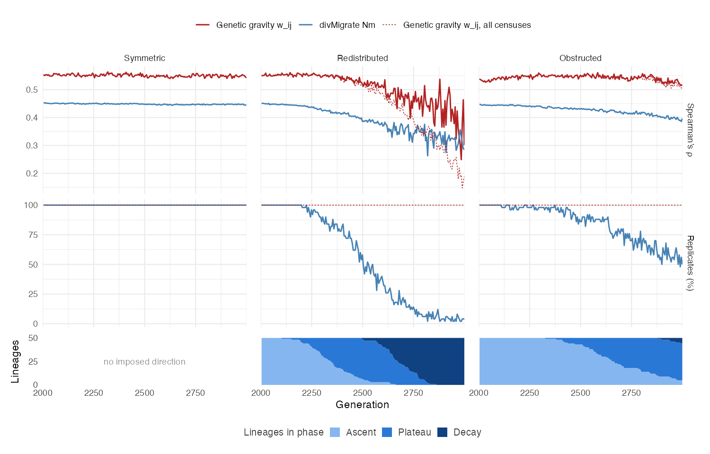

# Genetic Gravity: Extracting Directional Gene Flow from Population Graphs

Rodney J. Dyer  
rjdyer@vcu.edu  
https://rodneydyer.com

[School of Life Sciences and Sustainability](https://slss.vcu.edu)  
[Virginia Commonwealth University](https://vcu.edu)  
Richmond, Virginia 23284

# Abstract

Winds, currents, river networks, source–sink gradients and range expansions all bias the direction of gene flow, yet most summaries of genetic connectivity are symmetric. I introduce genetic gravity, an extension of Population Graphs that reads direction from conditional genetic covariance without a demographic model or an assumption of equilibrium. Each edge is evaluated from the neighborhoods of both populations it joins, and the resulting asymmetries are summarized as a source–sink score that orders populations from genetic sources to sinks. Two single-graph tests ask whether that ordering has a direction: a gradient test along a population-level covariate, and a comparison of directional and symmetric isolation by graph distance. In individual-based simulations of stepping-stone migration, the gradient test held its nominal false-positive rate (2.9–4.2% at α = 0.05) across a ten-fold range of migration, and direction was recovered reliably for populations but not for individual edges. Against the true migration matrix, the neighborhood weights separated migration corridors more cleanly than `divMigrate`, which oriented adjacent links slightly better but became undefined as loci fixed. In the Sonoran Desert bark beetle *Araptus attenuatus*, the approach recovered a southward post-Pleistocene expansion that symmetric isolation by distance missed. Genetic gravity offers a lightweight, testable summary of directional connectivity.

*Keywords:* asymmetric gene flow, conditional genetic distance, landscape genetics, Population Graphs, source-sink dynamics, range expansion.

# Introduction

Inferring the pattern and direction of genetic connectivity from molecular data is a central problem in population and landscape genetics (Slatkin, 1985; Dyer, 2015). Many of the processes that structure natural populations are directional: prevailing winds and ocean currents, the downstream bias of dendritic river networks, gradients in habitat quality that create source–sink dynamics, and range expansions out of refugia all bias the direction of dispersal (Pringle et al., 2011; Paz-Vinas & Blanchet, 2015; Paz-Vinas et al., 2015; Baker & Dyer, 2011; Wogan et al., 2024). Yet the summaries most often used to describe connectivity treat it as symmetric. Pairwise $F_{ST}$ and the constellation of derived analogs return a single value for each pair of populations, $F_{ST(i,j)}=F_{ST(j,i)}$, and under Wright's island model ($F_{ST}\approx1/(4N_em+1)$; Wright, 1931) that value reflects the product of effective size and migration rather than the direction of exchange (Whitlock & McCauley, 1999). The same differentiation can arise from very different histories, and treating connectivity as a scalar, undirected quantity averages over exactly the heterogeneity that questions about colonization, source–sink dynamics, and wind- or water-mediated dispersal are trying to resolve.

The field is not without tools for these questions. Assignment-based methods such as `BayesAss` infer recent, directional migration rates from multilocus genotypes (Wilson & Rannala, 2003), and coalescent and isolation-with-migration frameworks recover asymmetric long-term migration matrices, either by likelihood over genealogies (Beerli & Felsenstein, 2001) or by fitting the joint site-frequency spectrum of a few populations (Gutenkunst et al., 2009). If directionality arises from range expansion, we may infer its direction from spatial gradients in genetic diversity (e.g., Garrick et al., 2013), derive a directionality index from pairwise allele-frequency asymmetries (Peter & Slatkin, 2013), and at a landscape scale estimate effective-migration-surface maps (Petkova et al., 2016; Marcus et al., 2021). Each is powerful within its domain, but each also carries a characteristic cost: a prespecified demographic or spatial model, an assumption of migration–drift equilibrium, genome-scale data, few populations, explicit spatial coordinates, or substantial computation. Differentiation-based estimators such as `divMigrate` (Sundqvist et al., 2016) are lighter, but read direction one pair of populations at a time.  However, symmetric summaries can mislead in a specific way: directional gene flow can weaken or obscure isolation by distance, a pattern ordinarily read as weak spatial structure or high connectivity, even when migration is strongly biased in one direction.

Population Graphs offer a different perspective on the spatial distribution of genetic structure (Dyer & Nason, 2004; Dyer, 2007, 2015). A Population Graph translates among-population genetic variance into a graph-theoretic network using conditional genetic covariance: each edge is estimated from the multilocus covariance of all populations *jointly* and moves the focus from a single index to analyses on the topological shape of the resulting network. Neutral demographic processes such as range expansion, vicariance and isolation by distance each leave characteristic signatures in node degree, edge length and network diameter (Dyer, 2007, 2015). Population Graphs have been used in landscape genetics (Dyer, 2015; Daniel et al., 2024), conservation planning (Vilaça et al., 2024), biogeography (Wogan et al., 2024), life-history comparisons (Reed et al., 2023), invasion biology (Baker & Dyer, 2011) and pollen-mediated gene flow (DiLeo et al., 2014). Their edges, however, are undirected as they are defined by conditional genetic covariance. Source and sink populations may share a strong conditional dependency, but the direction of that dependency—which population's allele frequencies are pulling the other's—cannot be read from the edge weight, and the same weight can be produced by stable, symmetric exchange or by a one-way colonization pulse with opposite implications. 

Here, I introduce the concept of *genetic gravity*, an extension to Population Graphs that extracts directional information from its otherwise undirected topology, without a demographic model and without information beyond the genotypes and the graph built from them. I first derive a pair of neighborhood weights for each edge, read from a node-local Gaussian kernel at each end, whose difference defines an edge-level asymmetry index, and aggregate these into a population-level gravity and a source–sink score that orders populations from genetic sources to sinks. The kernel's bandwidth is read from the graph itself and scaled by a single multiplier that the researcher chooses by the question: a degree-neutral value for inferring direction and the local mean for describing connectivity. I then characterize the behavior of these quantities with individual-based simulations of paired symmetric and asymmetric migration scenarios, following each simulated lineage through the phases its directional signal accumulates, passes through, and dissipates. Next, I introduce two single-graph tests for directional gene flow: a source–sink gradient test along a hypothesized covariate, and a comparison of directional against symmetric isolation-by-graph-distance models built on a directional conditional genetic distance (dcGD) derived from the Population Graph's conditional genetic distance (cGD). For comparison to existing methods, I test the same scenarios using `divMigrate` and evaluate both against the true simulated migration matrix. Genetic gravity is then applied to a test case using the Sonoran Desert bark beetle whose phylogeography predicts a non-trivial post-Pleistocene expansion from a single refugium (Garrick et al., 2013). Although the simulations and the case study use position along a single axis, neither test is tied to Euclidean geography alone, and substituting resistance-based or other ecological distances is a direct extension to the landscape-genetic questions for which Population Graphs are already used (Dyer, 2015). All methods are implemented in the R package `gstudio`.

# Methods

The framework assumes that a Population Graph has already been constructed from multilocus genotypes; its inputs are the symmetric edge weights $e_{ij}$ and the adjacency structure of the graph $G=\{V,E\}$, with notation following Dyer & Nason (2004) and Dyer (2007; Supplementary Materials, Section S1, Table S1). A Population Graph is a Markov independence graph, and two of its properties matter here. First, populations joined by an edge are *conditionally dependent*, through ongoing gene flow, recent shared ancestry, or some combination thereof. Populations joined only through others ($A\leftrightarrow B\leftrightarrow C$) are *conditionally independent* given the intermediates. Unlike pair-wise estimates of structure, distance, and diversity, the construction of the topology, the magnitude of each edge, and the pattern of connectivity is based on all data simultaneously. Adding or removing a population requires the whole topology to be re-estimated. An edge therefore represents a direct relationship between two populations given their covariance with the entire data set. 

## The Model of Genetic Gravity

Each symmetric edge in a Population Graph is the pooled product of two conditional relationships: the contribution of population $j$ to the genetic structure of $i$, and the opposite contribution of $i$ to $j$. The edge weight $e_{ij}$ is the conditional genetic distance (cGD; Dyer et al. 2010) used to infer isolation by graph distance (Dyer, 2015; Miles et al., 2018). Focusing on each population and its retained neighbors, $N(i)$, I define a *neighborhood weight*, $w_{j\mid i}$, as $j$'s weight in $i$'s neighborhood, following Gaussian stochastic neighbor embedding (Hinton & Roweis, 2003):

$$
w_{j\mid i}= \frac{\exp\left(- e_{ij}^{2}/2b_i^{2}\right)}{\sum\limits_{k\in N(i)}\exp\left(- e_{ik}^{2}/2b_i^{2}\right)}
$$

The kernel is strictly local: only retained neighbors contribute, so populations that are conditionally independent of $i$ contribute nothing. The node-specific *local bandwidth* $b_i$ sets how quickly the kernel decays with distance, and is a multiple of the mean edge weight in $i$'s neighborhood,

$$
b_{i} = \gamma\,\frac{s_{i}}{k_{i}} = \frac{\gamma}{k_{i}}\sum\limits_{j\in N(i)}e_{ij},
$$

where $s_i$ is the strength (weighted degree) of population $i$, $k_i$ its degree, and $\gamma$ a fixed multiplier: $\gamma=\tfrac{1}{2}$ for inferring the direction of gene flow, used for every directional analysis here, and $\gamma=1$, the local mean, for describing connectivity (below). Conceptually, a population whose neighbors are genetically divergent receives a broad kernel whereas one embedded in a tight cluster of similar populations receives a narrow one.

**Genetic gravity.** Each edge is read from both of its ends, $w_{j\mid i}$ from $i$'s neighborhood and $w_{i\mid j}$ from $j$'s, and because the two neighborhoods are taken from the perspective of each connected node, the two weights differ. Their difference defines the *gravity asymmetry* along that edge,
$$
\Delta_{i\rightarrow j} = w_{i\mid j}-w_{j\mid i},
$$

$i$'s pull on $j$ minus $j$'s pull on $i$. The asymmetry comes not from the edge itself but from the two neighborhoods it is compared against: the same $e_{ij}$ can be typical of $i$'s neighborhood and atypically long for $j$'s. A value near zero indicates balanced exchange (symmetry); a positive value marks $i$ as the genetic source and $j$ as the sink. Throughout, higher values mean more of a source, for $\Delta_{i\rightarrow j}$ and for every population-level quantity built from it. Because $b_i$ scales with the edge weights, rescaling every cGD by a constant leaves every weight unchanged, so graphs built from marker panels with very different overall divergence can be compared directly.

Edges that share a population are not independent, so direction is summarized at the population level. The *gravity* of population $i$,

$$
g_{i} = \sum\limits_{j\in N(i)} w_{i\mid j},
$$

is the total weight $i$ holds in its neighbors' neighborhoods. Because each population's own weights sum to one, gravity is conserved, $\sum_i g_i=K$, and the source–sink balance $g_i-1$ sums to zero over the graph whatever the underlying migration matrix: every population that reads as a source is balanced by populations that read as sinks. 

**Source–sink scores.** While gravity summarizes each population separately, the *source–sink score*, $S$, places all populations on a single directional scale. $S$ assigns each population the value whose pairwise differences best reproduce the gravity asymmetries along every retained edge at once,
$$
\hat{S}=\arg\min_{S}\sum_{(i,j)\in E}\left[\Delta_{i\rightarrow j}-(S_i-S_j)\right]^2, \qquad \sum_{i}S_i=0 \text{ within each connected component},
$$
so that $S_i-S_j\approx\Delta_{i\rightarrow j}$. A node with a high $S$ marks a source whereas one with a low $S$ represents a sink. Gravity and the source–sink score are two views of the same quantity. Because $\Delta_{j\rightarrow i}=-\Delta_{i\rightarrow j}$ and each population's own neighborhood weights sum to one, the gravity balance is the *net asymmetry* over a population's edges, $g_i-1=\sum_{j\in N(i)}\Delta_{i\rightarrow j}$.  

In practice the scores are found by least squares, solving $L\hat{S}=g-1$, where $L$ is the Laplacian of the graph (Supplementary Materials, Section S2.4). Each population's *gravity balance* is local information based on whether its immediate neighbors' allele frequencies have been drawn toward its own or its own toward theirs. The source–sink score assembles these local imbalances into a single surface across the whole metapopulation, much as elevations can be recovered from the differences in height measured between neighboring points. Populations high on that surface are those whose genetic structure has spread to their neighbors, as expected of an upstream deme or the core of a range expansion. Populations low on it are those that have received it, as expected of downstream or recently colonized demes. The scores can be displayed as a *source–sink surface*, $S$ interpolated across the populations, in either of two spaces: in graph space, with populations placed by a layout of the graph's own covariance structure (Dyer & Nason, 2004; Figure 1), or in geographic space, with populations at their sampling coordinates and the surface interpolated over the landscape (as in the case study below). Overlaid with arrows on the edges giving the sign and size of $\Delta_{i\rightarrow j}$, this display is referred to here as a *gravity-field plot*; both are available in the latest version of the gstudio R package (Dyer, 2013). In either space the surface is a Gaussian kernel-weighted average of the populations' scores (a Nadaraya–Watson smoother) evaluated on a regular 140 × 140 grid spanning the populations, with a smoothing bandwidth of 1.2 times the median nearest-neighbor distance between populations in that space. Because $S$ is centered within each connected component, each grid cell is interpolated only from the populations of the component nearest to it, and cells farther than one bandwidth outside a component's convex hull are left empty. The smoother averages neighboring scores, so the surface at a population's location approximates, rather than reproduces, its $S_i$. The result is a continuous surface whose coordinates are either graph-layout or geographic, and in either case it can be treated as a raster for further analysis.  

### Directional Conditional Genetic Distance, dcGD

The same two weights also split each conditional genetic distance (cGD; Dyer et al. 2010) into directional components. The *directional conditional genetic distance* (dcGD) is $p_{ij} = e_{ij}\,w_{j\mid i}/(w_{j\mid i}+w_{i\mid j})$, with $p_{ji}$ defined as $p_{ij}+p_{ji}=e_{ij}$ and $p_{ij}=p_{ji}=e_{ij}/2$ when the two weights are equal. Because dcGD is a distance, it reads opposite to the source–sink convention: conditional distance is shorter in the direction of gene flow. Using dcGD turns the undirected Population Graph into a directed, asymmetrically weighted graph over the same topology, which can replace cGD in the analyses a Population Graph usually feeds, such as isolation by graph distance (IBGD; Dyer & Nason, 2004), ecological resistance modeling (Dyer, 2015) and studies of range expansion (Baker & Dyer, 2011).

## Individual-based simulations

The behavior of genetic gravity was evaluated with individual-based stochastic simulations following Dyer (2007). Each replicate tracks a metapopulation of $K=25$ demes of $N=100$ diploid individuals scored at $L=20$ independently segregating, codominant, biallelic loci. Replicates start from random allele frequencies; generations are non-overlapping, mating is random within demes, and mutation is excluded so that only migration and drift act. Every replicate first runs a 2,000-generation *burn-in* of symmetric migration along a one-dimensional stepping stone with a fixed per-direction migration rate ($m_{i\rightarrow i+1}=m_{i\leftarrow i+1}=0.025$). Fifty replicates were run, each producing an independent *burn-in* history (hereafter a *lineage*). Multilocus genotypes were saved every five generations, and each saved snapshot (hereafter a *census*) was converted into a Population Graph (Dyer & Nason, 2004), from which the neighborhood weights, gravity asymmetries and source–sink scores were computed. Mean degree centrality ($\bar{C}_D$) and graph diameter ($D_G$) were also recorded for comparison to Dyer (2007) where they were shown to be surrogates for $F_{ST}$ and Slatkin’s $\hat{M}$.

At generation 2000, each lineage was continued for 1,000 generations (generations 2000–2999, hereafter referred to as the *forward phase*) under each of three different migration scenarios (Table 1) so that all three scenarios continue the same lineage and differ only in the migration matrix applied from generation 2000. *Symmetric* migration continued the *burn-in* matrix and serves as the null trajectory. *Redistributed* migration kept the total rate fixed but split it 4:1 in one direction along the stepping stone model, which maintained the overall migration rate identical to the symmetric case. An *Obstructed* migration scenario kept the *Symmetric* forward rate but suppressed the reverse rate. Three further symmetric scenarios at progressively lower migration rates—sym-mid, sym-low and sym-verylow (0.010, 0.005 and 0.0025 in each direction, 0.4, 0.2 and 0.1 times the *Symmetric* rate; Table 1)—raise neutral differentiation without imposing a direction; together with the *Symmetric* scenario they form a *drift gradient* used only to calibrate false-positive rates (Supplementary Materials, Section S7.1). Together the scenarios test a simple expectation: the difference between forward and reverse rates sets the direction and strength of the net force homogenizing the metapopulation, while total migration sets how quickly a lineage moves toward that state. *Obstructed* migration, with half the net bias of *Redistributed* migration and lower total migration, should therefore pass through the same sequence of states more slowly.

**Table 1.** Forward-phase migration rates. All scenarios continue the same 2,000-generation symmetric *burn-in*; the three low-migration scenarios form the drift gradient, used only to calibrate false-positive rates.

| Scenario      | $m_{i \rightarrow i+1}$ | $m_{i \leftarrow i+1}$ | $m_{Total}$ | Ratio | Constant               |
| ------------- | :---------------------: | :--------------------: | :---------: | :---: | ---------------------- |
| *Symmetric* |          0.025          |         0.025          |    0.050    |  1:1  | Symmetric connectivity |
| *Redistributed* |          0.040          |         0.010          |    0.050    |  4:1  | Total emigration rate  |
| *Obstructed*    |          0.025          |         0.010          |    0.035    | 2.5:1 | Forward rate           |
| sym-mid         |          0.010          |         0.010          |    0.020    |  1:1  | Symmetric, 0.4× rate   |
| sym-low         |          0.005          |         0.005          |    0.010    |  1:1  | Symmetric, 0.2× rate   |
| sym-verylow     |          0.0025         |         0.0025         |    0.005    |  1:1  | Symmetric, 0.1× rate   |

### Phases of the forward simulations

Under each scenario, a lineage passes through three predictable phases at a pace determined by its lineage history, genetic diversity, and the scenario being applied; *ascent*, *plateau*, and *decay*. An ascent phase is the period by which genetic covariance reconfigures itself as it comes to some kind of stable equilibrium. This is why a long burn-in period is used at the beginning of simulations but is equally relevant to a period of generations following reorganization of the underlying migration matrix (at generation 2,000 in these simulations). The next phase, *plateau*, is the period of stability as the series of populations tends towards its stable state. This may be followed by a *decay* phase where homogenization of allele spectra (e.g., as $\delta p \to 0$) reduces our ability to identify underlying migration.  

For these simulations, I used population genetic parameters to mark the boundaries of each phase in each lineage under each scenario. In *ascent*, the new migration matrix restructures among-population covariance; upstream demes receive fewer immigrants and lose heterozygosity faster, and I defined the end of *ascent* when the resulting gradient in within-deme $H_e$ along primary migration axis has completed 90% of its rise (used only to date the boundary, not as evidence of direction). On the *plateau*, the covariance structure has adjusted and changes only slowly while allele frequencies continue to converge. Some lineages never left this stage within the forward phase, whereas others entered *decay* because, in a closed system without mutation, allele frequencies converge under any migration matrix, and the among-population variance through which migration is observed is lost, the net result of which is that we cannot estimate among-population covariance. I set the boundary for a lineage to enter *decay* when its *demes* carry, on average, fewer than 4.5 polymorphic loci. Here most loci are fixed within demes, and this corresponds to roughly where the loss of loci alone begins to inflate the asymmetry index (a suitable *informative horizon*). 

These boundaries are heuristics for separating regimes within each lineage under each scenario, not constants of the system. In the phase summaries that follow, measurements are taken from each lineage's *phase core*, the middle half of the interval between the boundaries of that phase, and their sensitivity to the boundaries is reported in Supplementary Materials, Section S3.3. A panel of loci chosen for polymorphism, as SNP panels routinely are, would rarely sit in the *decay* regime, as these are non-informative sites, though I found it informative to report these values to show where inference from analyses of standing variation ends.

## Significance Testing for Asymmetry

Nulls that permute or resample parts of a single Population Graph were consistently anti-conservative under symmetric migration with false positive inflation ranged from 1.1x to 20x depending on the null hypothesis. This is because $\Delta_{i\rightarrow j}$ and $S$ inherit smooth, node-level structure from the graph's topology (see Supplementary Materials, Section S5.4 for a longer discussion). Asymmetry was instead tested with two procedures: a gradient test on the source–sink score, and a comparison of directional (dcGD) and symmetric (cGD) isolation-by-graph-distance models. Censuses from the same lineage share its history, so false-positive rates are given with 95% intervals from a bootstrap that resamples the 50 lineages.

### Source–sink gradient test

This test asks whether the source–sink scores change monotonically along a hypothesized covariate $x$, such as position along a suspected axis of flow. The statistic is Spearman's $r(S,x)$; because high $S$ marks a source, $r(S,x)<0$ places the sources at low values of $x$. The null preserves the spatial structure of $S$ on the census's own Population Graph, using Moran spectral randomization (Wagner & Dray, 2015) on the kernel-weighted adjacency with $B=999$ randomizations, tested two-sided at $\alpha=0.05$ (Supplementary Materials, Section S5.1). Because it reproduces the smoothness that $S$ inherits from drift on the graph, a rejection reflects a gradient along the covariate beyond what drift alone produces.

### Directional isolation by graph distance

This test asks whether modeling direction explicitly improves how well the graph explains isolation by distance (Wright, 1943). Standard IBGD regresses all-pairs cGD (shortest paths over $e_{ij}$) on pairwise spatial separation $|dx_{ij}|$, giving $R^2_{cGD}$. The directional model uses all-pairs directed shortest paths over dcGD, so that the distance from $i$ to $j$ may differ from that from $j$ to $i$, and a hypothesized axis of flow—downstream, a prevailing wind, the front of a range expansion, or here the stepping stone—classifies each ordered pair as forward or reverse; $\text{dcGD}_{ij} \sim |dx_{ij}| + |dx_{ij}| \cdot r_{ij}$, with $r_{ij}=1$ for reverse pairs, then gives separate forward and reverse isolation slopes and a fit $R^2_{dcGD}$ adjusted for the additional slope. If $\Delta R^2 = R^2_{dcGD} - R^2_{cGD} > 0$, the directional description explains isolation better than the symmetric one; if not, this is an *absence of evidence* for asymmetry, not evidence of symmetry. Where the directional fit is supported, the ratio of forward to reverse slopes, $b_{fwd}/b_{rev}$, describes the direction of isolation: a ratio below one means genetic distance accumulates more slowly downstream. Because the two fits use different response matrices, the comparison is not a nested-model test, and its error rates were characterized empirically.

## Choosing the bandwidth

The bandwidth sets the scale at which a population's neighbors are compared, and with it how much of $\Delta_{i\rightarrow j}$ reflects genetic distance and how much the number of neighbors. As the kernel flattens, every weight tends to $1/k_i$, so the index reduces to a *topological floor*, $\Delta^{0}_{i\rightarrow j}=1/k_j-1/k_i$, and the source–sink score to $S^{0}_i=-1/k_i$, both set by degree alone. When the question is the direction of gene flow, degree is a nuisance; when it is a population's overall weight in the network, degree is part of the answer. Two bandwidths are therefore offered, and, as with the choice between a rank and a parametric correlation, the question determines which is appropriate. The *degree-neutral* bandwidth, $\gamma=\tfrac{1}{2}$, is the multiplier at which $S$ carries no degree signature under symmetric migration (median 0.49 across *Symmetric* censuses, and 0.51 in a second, independently simulated set of 50 lineages). It is fixed once from the symmetric null rather than tuned on each graph, because tuning lets the signal under test move the bandwidth (Supplementary Materials, Section S8.2), and it is used for both tests and for the source–sink surface. The *local mean*, $\gamma=1$, keeps the contribution of degree, so that hubs read as sources and leaves as sinks; it describes a population's weight in the network but is not suited to testing direction. With either bandwidth, the *degree share*—the $R^2$ of $\Delta_{i\rightarrow j}$ on $\Delta^{0}_{i\rightarrow j}$—reports how much of the index degree sets (Figure 1). Sensitivity to alternative bandwidths is assessed in Supplementary Materials, Section S8.1.

**Figure 1.** One Population Graph at three bandwidths: a *Redistributed* census on the *plateau* (lineage 4, generation 2504; the gstudio example data set `gravity`), with gene flow toward higher-numbered demes. Nodes are numbered by deme and placed by a Kamada–Kawai layout (Kamada & Kawai, 1989), the same in every panel, with upstream demes at the top. Shading is the source–sink surface (red, source; blue, sink); arrows point from source to sink, with length proportional to $|\Delta_{i\rightarrow j}|$ (the weaker half omitted). Panel headings give the degree share, $\text{cor}(S,k)$ and $r(S,x)$ (negative: sources upstream). At $\gamma=\infty$, $S$ is set by degree alone and reverses the imposed flow ($r(S,x)=0.68$); at the local mean ($\gamma=1$) the imposed gradient appears ($r(S,x)=-0.95$) but degree still explains 11% of the variance in $\Delta_{i\rightarrow j}$; at the degree-neutral bandwidth ($\gamma=\tfrac{1}{2}$) it explains 2% ($r(S,x)=-0.96$).

## Comparison with a differentiation-based method

To place genetic gravity alongside an existing method, the simulated data were also analyzed with `divMigrate` (Sundqvist et al., 2016), a widely used estimator of directional relative migration from codominant genotypes. The two do not estimate the same quantity—`divMigrate` reads relative migration from pairwise differentiation, using the $Nm$ statistic of Alcalá et al. (2014), whereas gravity is read from conditional genetic structure—so the comparison asks only which approach better recapitulates the true migration matrix, known here because it was simulated. Agreement was summarized for each approach across all census data sets by estimating Spearman's $\rho$. 

## Sampling intensity and design-specific calibration

==To evaluate how sampling affects both tests, I rebuilt Population Graphs from subsets of the simulated data: 25, 21, 18, 15, 12, 10, 8 or 5 demes spread along the stepping stone, with 100, 50, 30, 20 or 10 individuals per deme and, for a subset of designs, 10 or 8 rather than 20 polymorphic loci or a contiguous block of demes rather than a spread draw (Supplementary Materials, Section S10). Each test was applied as above to *plateau* phase-core censuses, for power, and to *Symmetric* and sym-low censuses, for false positives, with lineage-bootstrap intervals. Because the rule $\Delta R^2>0$ is not calibrated in small graphs, I also calibrated a cutoff for each design as the 95th percentile of $\Delta R^2$ under *Symmetric* migration, estimated on half of the lineages and evaluated on the other half. In an empirical study the same calibration requires simulating symmetric migration for the study's own design; the latest version of gstudio provides a generator that draws data sets with the observed sites, sample sizes and loci under symmetric migration tuned to the observed differentiation, together with diagnostics of sampling intensity.==

## Case Study: Sonoran Desert Bark Beetle

To show how the framework handles specific *a priori* hypotheses of direction, I applied it to the Sonoran Desert bark beetle *Araptus attenuatus* (Curculionidae) of the Baja California peninsula, which is known only from the senescing stems of its host plant, *Euphorbia lomelii* (Euphorbiaceae). Garrick et al. (2013) found a widespread peninsular clade whose latitudinal gradients in nuclear allelic richness indicated a rapid expansion out of a Pleistocene refugium near 27.5°N, with expansion in both north and south directions as was indicated by rapid loss of diversity. I reanalyzed the nuclear genotypes of that clade (mtCOI Clade B; the `Peninsula` group of the gstudio data set `arapat`), retaining sites with at least four individuals: 240 individuals from 27 sites between 23.3°N and 29.3°N, each genotyped at eight codominant nuclear loci (seven intron-spanning gene regions and one anonymous microsatellite; Garrick et al., 2013). While considerably less rich in marker density when comapred to contemporary studies, I chose this example specifically due to the inferences in the original paper and because of the limited spatial genetic information content.  Each expansion was tested on the Population Graph under the hypothesis that populations near the refugium should read as sources and those farther from it as sinks, and genetic distance should accumulate more slowly moving away from the refugium than toward it. Distance from the refugium, $d_i$, was measured along the long axis of the peninsula (the first principal axis of the site coordinates), and each expansion was tested within the connected component of the graph on its side of the refugium. For the directional isolation comparison, separation was $|d_i-d_j|$, a pair was forward when $j$ lies farther from the refugium than $i$, and the hypothesis predicts $\Delta R^2>0$ with $b_{fwd}/b_{rev}<1$; standard isolation by graph distance was assessed with a Mantel test (999 permutations). All quantities were computed at the degree-neutral bandwidth, with the degree share reported alongside; the source–sink gradient test was repeated at the local mean, and the source–sink surface was drawn in geographic space. ==The directional isolation comparison was judged against a cutoff calibrated for this design: the 95th percentile of $\Delta R^2$ in 999 data sets simulated under symmetric migration with the observed sites, sample sizes and loci, and with the migration rate tuned to the observed differentiation ($G_{ST}=0.14$; Supplementary Materials, Section S10.6). The source–sink gradient test was also repeated against this design-matched null.==

# Results

## *Symmetric* baseline

Under *Symmetric* migration the Population Graphs reached a stable topology within the 2,000-generation *burn-in*: mean degree centrality fell and graph diameter rose toward a plateau and stayed flat through the forward phase (Supplementary Materials, Section S3.5, Figure S2). The mean asymmetry stayed close to zero ($\bar{\Delta}=-0.0015$) over the forward phase. Averaged within lineages, the source–sink score showed no consistent directional bias beyond ordinary between-lineage variation (Supplementary Materials, Section S7.1).

The bandwidth determined how much of the index that node degree determined. At the local mean ($\gamma=1$), $S$ tracked the degree-only score $S^{0}$ closely under symmetric migration (median correlation 0.78–0.83), so hubs read as sources and leaves as sinks without any directional gene flow. At the degree-neutral bandwidth the floor was gone (0.01–0.06). Degree-one leaves read as sinks by construction at any bandwidth, but were rare—in under 1% of symmetric and 5–8% of asymmetric censuses—and excluding them barely changed the source–sink gradient (Supplementary Materials, Section S3.5).

## Consequences of *Redistributed* and *Obstructed* connectivity

Every *Redistributed* lineage passed through all three phases (*ascent*, *plateau*, and *decay*) within the forward phase (Figure 2, left) though the residence time in each phase differed among lineages. *Ascent* ended at a median of generation 2332, the *plateau* lasted a median of 325 generations, and *decay* began at a median of generation 2674. Across these phases mean degree centrality fell ($\bar{C}_D =$ 0.309, 0.274 and 0.236) compared to the *Symmetric* scenario ($\bar{C}_D =$ 0.315) and diameter, after rising slightly near the end of *ascent*, collapsed ($D_G =$ 15.8 on the *plateau* and 10.2 after the horizon) compared to the *Symmetric* scenario ($D_G =$ 16.3), while mean $|\Delta_{i\rightarrow j}|$ rose (0.049, 0.080 and 0.147). Rising asymmetry alongside a collapsing diameter is the expected consequence of sustained directional bias in a closed migration–drift system: *Redistributed* migration does not only make gene flow asymmetric, it progressively homogenizes the metapopulation. Part of the rise after the horizon is information loss rather than signal (Supplementary Materials, Section S3.4, Figure S1). The signed mean $\bar{\Delta}$ was positive in 98% of lineages during *ascent* and on the *plateau*, but negative in 70% after the informative horizon (i.e., the boundary marking entry into the *decay* phase). This sign change is not a reversal of gene flow: it is carried by rewiring of the graph's interior, and the source–sink score kept the imposed ordering through it (see below and Supplementary Materials, Section S4.3).

*Obstructed* migration, with half the net directional bias, passed through the same phases, though more slowly (Figure 2, right). *Obstructed* lineages reached each stage 1.8 to 2.8 times later than *Redistributed* ones (1.9 times later for the end of *ascent*), close to the two-fold difference in net bias. Diameter rose further and held longer before declining, consistent with the lower total migration letting drift differentiate the metapopulation to a greater extent before directional homogenization took over. Once on the *plateau*, however, *Obstructed* lineages resembled *Redistributed* ones (mean degree centrality 0.270 against 0.274, mean $|\Delta_{i\rightarrow j}|$ 0.074 against 0.080, $\bar{\Delta}$ 0.030 against 0.034): the net bias set how quickly a lineage reached its *plateau*, not how strong the directional signal was once there. Only 6 of the 50 *Obstructed* lineages crossed the informative horizon into the *decay* phase, so *Obstructed* results are reported for *ascent* and the *plateau* only.

**Figure 2.** Forward-phase trends in mean degree centrality ($\bar{C}_D$), graph diameter ($D_G$) and mean absolute asymmetry ($\overline{|\Delta_{i\rightarrow j}|}$) under *Redistributed* (left) and *Obstructed* (right) migration, on shared axes. Solid red lines are penalized regression splines (Supplementary Materials, Section S3.2), with ±1 SD across replicates shaded; dashed lines extend the *burn-in* equilibrium fit as the *Symmetric* reference (Supplementary Materials, Section S3.5, Figure S2). The strip beneath each column gives the number of the 50 lineages in *ascent*, on the *plateau* or in *decay* at each census; because lineages change phase at different times, each point on the curves averages lineages in different phases.

## Significance Testing for Asymmetry

### Source–sink gradient test

Under symmetric migration the source–sink gradient test held its nominal rate (Table 2). At $\alpha=0.05$ it rejected in 3.0% of *burn-in* censuses and 2.9% of *Symmetric* forward-phase censuses, and in 2.9–4.2% across the three low-migration scenarios of the drift gradient (sym-mid 4.2%, sym-low 2.9%, sym-verylow 3.2%), down to 0.25 migrants per deme per generation in each direction, against 2.5 under *Symmetric* migration, with no increase as neutral differentiation rose; lineage-clustered upper limits were 5.8% or less.

**Table 2.** False-positive rate of the source–sink gradient test under symmetric migration (degree-neutral bandwidth; spectral null on each census's own Population Graph). 1,000 censuses per sample from 50 lineages (*burn-in*: generations 1904–1999, every 5 generations; forward phase: generations 2004–2954, every 50). Alternative nulls: Supplementary Materials, Section S5.2, Table S5.

| Sample | $\alpha$ = 0.01 | $\alpha$ = 0.05 | $\alpha$ = 0.10 |
| :---- | :---: | :---: | :---: |
| *Burn-in* | 0.004 | 0.030 | 0.056 |
| *Symmetric* | 0.005 | 0.029 | 0.059 |
| sym-mid | 0.010 | 0.042 | 0.076 |
| sym-low | 0.003 | 0.029 | 0.066 |
| sym-verylow | 0.008 | 0.032 | 0.061 |

Under asymmetric migration, single-census power tracked the phases (Figure 3, bottom; Supplementary Materials, Section S5.3, Table S6). In each phase core the rejection rate under *Redistributed* migration was 15% during *ascent*, 65% on the *plateau* and 26% after the informative horizon, and under *Obstructed* migration 10% during *ascent* and 45% on the *plateau*. The direction was far more consistent than any single census could certify: on the *plateau*, $r(S,x)$ was negative—sources upstream—in 98% and 99% of censuses (median $-0.81$ and $-0.73$), and every lineage placed the sources upstream when its *plateau* censuses were averaged (46 of 46 and 42 of 42), against 38% of *Symmetric* lineages. After the horizon, *Redistributed* lineages still placed the sources upstream in 86% of censuses.

**Figure 3.** The source–sink score $S$ (degree-neutral bandwidth) through time, by scenario (columns). Top: median $S$ across the 50 lineages for each deme (rows; gene flow in the asymmetric scenarios runs toward higher deme numbers), over the last 100 generations of the *burn-in* (left of the dashed line) and the forward phase; red, source; blue, sink; the color scale saturates at the 98th percentile of $|S|$. Bottom: fraction of censuses in which the source–sink gradient test rejects at $\alpha=0.05$ (aqua) and in which sources are upstream, $r(S,x)<0$ (orange), with 95% intervals; dotted lines mark 5% and 50% (Supplementary Materials, Section S5.3, Table S6). The strip gives the number of lineages in each phase.

The deme-by-generation display of $S$ shows where the gradient comes from (Figure 3, top). Under symmetric migration the interior is close to neutral, with a mild sink at each terminal deme. Once asymmetry is imposed, the downstream end deepens into a sink within 200–400 generations and a band of sources forms upstream, centered on deme 3 in both scenarios. Under *Obstructed* migration the band holds its place; under *Redistributed* migration it moves downstream after about generation 2600, to deme 11 by the end of the window, while the demes it leaves behind fade to neutral, so the collapse of a lineage advances downstream from its upstream end. Single-census gravity-field plots of each state are shown in Supplementary Materials, Section S4.4, Figure S4.

### Directional isolation by graph distance

Standard isolation by graph distance weakened once migration became asymmetric (Figure 4, top; Table 3). The $R^2$ of cGD on spatial separation stayed near 0.80 under *Symmetric* migration but fell under *Redistributed* migration from 0.78 during *ascent* to 0.63 on the *plateau* and 0.38 after the horizon, and under *Obstructed* migration to 0.68 on the *plateau*. Part of what is lost is directional structure that the direction-aware dcGD model recovers: on the *plateau* its fit exceeded the standard symmetric fit (0.74 against 0.63 under *Redistributed* and 0.75 against 0.68 under *Obstructed* migration), whereas under *Symmetric* migration it fell well short (0.53 against 0.80). A researcher fitting only the symmetric model would read the decline under asymmetric migration as weaker spatial structure, however the directional model clearly shows that much of the loss is actually directional structure the symmetric description simply does not capture. The directional model therefore improves on estimates of Isolation By Graph Distance when, and largely only when, gene flow is asymmetric; for ordinary isolation by distance, cGD remains the appropriate distance (Supplementary Materials, Section S6.2).

**Figure 4.** Isolation by graph distance under symmetric and directional readings of the same edges, by scenario. Top: $R^2$ of standard IBGD (cGD against spatial separation $|dx|$). Bottom: the $R^2$ gained by giving dcGD separate forward and reverse slopes against $|dx|$, relative to a single direction-blind slope. The vertical line marks the end of the *burn-in*; curves are medians by generation, and the strip gives the number of lineages in each phase. Because lineages change phase at different times, the phase-core values in the text and in Table 3 are the more precise summary.

**Table 3.** Median $R^2$ of standard IBGD (cGD) and of dcGD fitted without and with direction (degree-neutral bandwidth), by scenario and phase (*Symmetric*: whole forward phase; asymmetric scenarios: phase cores). The last column is the fraction of censuses in which the direction-aware dcGD fit exceeds standard IBGD. Censuses every 5 generations, 50 lineages.

| Scenario | Phase | Standard cGD $R^2$ | dcGD, direction-blind | dcGD, direction-aware | Direction-aware beats cGD |
| :---- | :---- | :---: | :---: | :---: | :---: |
| *Symmetric* | forward phase | 0.80 | 0.35 | 0.53 | 4% |
| *Redistributed* | *ascent* | 0.78 | 0.30 | 0.66 | 26% |
| *Redistributed* | *plateau* | 0.63 | 0.21 | 0.74 | 89% |
| *Redistributed* | *decay* | 0.38 | 0.13 | 0.48 | 82% |
| *Obstructed* | *ascent* | 0.78 | 0.30 | 0.64 | 23% |
| *Obstructed* | *plateau* | 0.68 | 0.24 | 0.75 | 78% |

Under asymmetric migration the directional model's advantage tracked the phases (Table 3, last column): it was preferred in 26% and 23% of *ascent* censuses under *Redistributed* and *Obstructed* migration, 89% and 78% on the *plateau*, and 82% of *Redistributed* censuses after the horizon. Every detection in the phase cores recovered the imposed direction ($b_{fwd}/b_{rev}<1$; *plateau* medians 0.06 and 0.08), against a median ratio of 1.26 over all *Symmetric* censuses. The test is one-sided: a preferred symmetric fit is not evidence against asymmetry, since even on the *plateau* 11% of *Redistributed* and 22% of *Obstructed* censuses favored cGD.

Under symmetric migration the decision rule $\Delta R^2>0$ rarely fired: in 2.6% of *burn-in* censuses (lineage-clustered 95% CI 1.0–4.6%) and 4.4% across the *Symmetric* forward phase (2.8–6.1%). It was not calibrated once drift dominated (i.e., at very low migration rates): across the drift gradient the rate rose from 6.9% (sym-mid; 1.0 migrant per deme per generation in each direction) to 12.2% (sym-low; 0.5) and 14.6% (sym-verylow; 0.25), with no consistent direction along the axis (Supplementary Materials, Section S6.4, Table S7; Section S7.1).

### Bandwidth sensitivity

Scaling the bandwidth parameter, $\gamma$, from $\gamma=0.25$ to 2 showed how much of the asymmetry index reflects the number of neighbors each population has (its degree) rather than genetic distance: under symmetric migration it explained 2–4% of the variance in $\Delta_{i\rightarrow j}$ at $\gamma\le\tfrac{1}{2}$, 50% at the local mean and 94% at $\gamma=2$ (Supplementary Materials, Section S8.1, Figure S5). Because $\gamma=\tfrac{1}{2}$ was chosen from the original simulations, both bandwidths were evaluated again on a second, independently simulated set of 50 lineages, as a check on the method rather than on any one data set; there the degree-neutral bandwidth again held its false-positive rate and outperformed the local mean on both tests (Supplementary Materials, Section S8.1, Table S12). Choosing the multiplier separately for each graph, at the value where its own source–sink scores are uncorrelated with degree, held the false-positive rate but lost power, because under directional flow that value rises with the signal being tested (median 0.49 under *Symmetric* migration, 0.73–0.75 on the asymmetric *plateau*; Supplementary Materials, Section S8.2). Kernels that do not scale with each population's own neighborhood, a fixed global bandwidth and a perplexity search, lost most of their *plateau* power (Supplementary Materials, Section S8.1). Edge-level orientation was the least stable quantity: between $\gamma=1$ and $\tfrac{1}{2}$, 22–28% of edges changed sign, yet every lineage placed the sources upstream on the *plateau* at both bandwidths, and 95–100% did so at every multiplier from 0.25 to 1.41.

### Sampling intensity

==Sampling intensity determined which test could establish direction (Supplementary Materials, Section S10, Figure S6, Table S13). The number of populations set the power of the source–sink test, which remained calibrated throughout: with 30 individuals per population, *plateau* power under *Redistributed* migration fell from 0.70 with 25 populations to 0.37 with 15 and 0.04 with 8. The rule $\Delta R^2>0$ became anti-conservative as populations were removed, firing in 9% of *Symmetric* graphs with 15 populations, 14% with 10 and 41% with 5, but a cutoff calibrated for each combination of populations and individuals restored a 5% false-positive rate on held-out lineages and kept more power than the source–sink test (0.68 with 15 populations and 0.53 with 10). That cutoff did not protect against strong drift, under which it fired in 7–13% of graphs. The number of individuals per population governed whether the graph held together: with 10 per population about half of the graphs were fragmented and the degree-neutral bandwidth retained a degree signature, whereas with 30 at most 11% were fragmented. Reducing the loci from 20 to 8 cut source–sink power at 25 populations from 0.70 to 0.49, and sampling a contiguous block rather than the whole axis cut it further. Under asymmetric migration the sign of $r(S,x)$ still placed the sources upstream in 89–99% of graphs with as few as five populations, against about 40% under *Symmetric* migration.==

## Comparison with a differentiation-based method

Against the true migration matrix, the neighborhood weight $w_{j\mid i}$ agreed more closely than `divMigrate`'s $Nm$ (Figure 5): median Spearman's $\rho$ was 0.55 for genetic gravity against `divMigrate`'s 0.45 under *Symmetric* migration. Under *Redistributed* migration, genetic gravity had a higher correlation than `divMigrate` on the *plateau* ($\rho =$ 0.52 against 0.39). Similar results were found under *Obstructed* migration ($\rho =$ 0.53 against 0.41).  

Scored on direction alone, $Nm$ did better: on the *plateau* it was larger in the imposed direction on 67% and 62% of the stepping-stone links, against 62% and 59% for $w_{j\mid i}$, and both sat at 50% under *Symmetric* migration. $Nm$ became *unavailable* as a parameter (due to fixation at some loci) before the Population Graph lost information: under *Redistributed* migration it was defined in 98% of censuses in the *ascent* phase core, 59% in the *plateau* phase core and 5% after the horizon, first becoming undefined a median of 175 generations before each lineage's horizon. The agreement of $w_{j\mid i}$ with the truth also fell after the horizon (median 0.31), so neither estimator should be relied on there (Supplementary Materials, Section S9.2).

**Figure 5.** Agreement with the true migration matrix, by scenario (columns). Top: median Spearman's $\rho$ between each estimate and the truth over all 600 ordered population pairs (true rates on the 48 stepping-stone links, zero elsewhere), for genetic gravity's $w_{j\mid i}$ (degree-neutral bandwidth) against $m_{j\rightarrow i}$ and `divMigrate`'s relative $Nm$ against $m_{i\rightarrow j}$. Solid lines use censuses at which $Nm$ is defined on every pair; the dotted line is $w_{j\mid i}$ over all censuses. Middle: percentage of replicates retained under that restriction. Bottom: number of lineages in each phase. Late in the *Redistributed* window the solid gravity line rests on a shrinking subset of replicates (Supplementary Materials, Section S9.2).

## Case Study: Sonoran Desert Bark Beetle

The Population Graph had 34 edges among the 27 sites and fell into four connected components that recapitulate the regional populations of Garrick et al. (2013; Figure 6). The fourteen central sites (24.7–27.4°N) formed one component and the nine northern sites (27.5–29.3°N) another; the two components meet at the hypothesized refuge. The remaining four sites formed two dyads toward the south of the range (58 with 153, 24.1–26.0°N; 163 with Aqu, 23.3–24.2°N). In a two-site component both members carry the same single edge, so $S=0$ and $\Delta=0$ by symmetry, and the dyads carry no directional information.

*Southward expansion (central component).* Isolation by graph distance was absent under the symmetric model: over all 91 pairs, cGD did not increase with separation along the axis ($R^2_{cGD}=0.007$, Mantel $p=0.23$). The directional model recovered it ($R^2_{dcGD}=0.20$ over 182 ordered pairs; $\Delta R^2=0.20$). ==Under the symmetric model alone, the central component would have been read as showing no isolation by distance along the peninsula. Without calibration, $\Delta R^2>0$ arose in 38% of the design-matched null data sets, so the observed value alone would have meant little; against the calibrated cutoff of 0.100 it was significant (one-sided $p=0.008$), and it remained so across alternative effective sizes, durations and a two-dimensional migration kernel (cutoffs 0.087–0.117, $p=0.004$–0.008; Supplementary Materials, Section S10.6, Table S14).== Conditional genetic distance accumulated moving north, toward the refuge (reverse slope $7.4\times10^{-3}$ per km), but not moving south, away from it (forward slope $-4.6\times10^{-3}$ per km). This is the pattern expected under a southward expansion, in which isolation is set up in one direction and hidden when the two directions are averaged. The source–sink scores pointed the same way: the strongest sources were near the refuge (populations `161`, `SFr` and `93`; 27.0–27.4°N) and the strongest sinks were farther south (166, 51 and 77; 24.9–25.9°N). However, the gradient test did not reject ($r(S,d)=-0.55$, $p=0.44$ at $\gamma=\tfrac{1}{2}$; $r(S,d)=-0.51$, $p=0.30$ at $\gamma=1$)==, nor did it against the design-matched null ($p=0.14$)==. In this sparse component (mean degree 2.7), most of the index was set by degree even at the degree-neutral bandwidth (degree share 0.85, $\text{cor}(S,k)=0.83$)==, as expected of about nine beetles per site: every site fell below roughly five expected heterozygotes per locus, the level at which the simulated graphs began to fragment (Supplementary Materials, Section S10.4)==.

*Northward expansion (northern component).* Isolation by graph distance was strong under the symmetric model ($r=0.61$, $R^2_{cGD}=0.37$, Mantel $p=0.002$, over 36 pairs), and the directional model did not improve on it ($R^2_{dcGD}=0.26$, $\Delta R^2=-0.11$). Isolation accumulated at nearly the same rate away from the refuge as toward it (forward slope $1.9\times10^{-2}$, reverse $2.1\times10^{-2}$ per km; ratio 0.89). Sources and sinks showed no gradient along the axis ($r(S,d)=0.10$, $p=0.80$ at $\gamma=\tfrac{1}{2}$, degree share 0.36; $r(S,d)=0.28$, $p=0.35$ at $\gamma=1$). The northern component therefore shows isolation by distance but no evidence of a direction to it.

The two expansions inferred by Garrick et al. (2013) from diversity gradients are thus not equally visible in the Population Graph. The southward expansion through central Baja is carried by the directional isolation model, with a direction that agrees with the source–sink scores. The northward expansion is not: its isolation is described as well by the symmetric model as by the directional one.

**Figure 6.** Source–sink surfaces for the peninsular clade of *Araptus attenuatus* at the degree-neutral bandwidth, (A) in graph space (Kamada–Kawai layout) and (B) in geographic space. Nodes are colored by connected component: 1, central (14 sites; tested for southward expansion); 3, northern (9 sites; northward); 2 and 4, two-site components whose scores are zero by symmetry (shown in A only). The dashed line marks the hypothesized refugium (27.5°N; Garrick et al., 2013), and node size is within-population genetic variability. Red, source; blue, sink; because $S$ sums to zero within each component, colors are comparable only within a component. Arrows point from source to sink, with length proportional to $|\Delta_{i\rightarrow j}|$.

# Discussion

Genetic gravity converts the conditional topology of a Population Graph into a signed field of directional influence, using only the edge weights the graph already contains and without a demographic model or an assumption of equilibrium. Each undirected edge pools two neighborhood relationships—how typical the edge is from the perspective of each of the two populations it joins—and the difference between them, the gravity asymmetry $\Delta_{i\rightarrow j}$, summarized at the population level by the source–sink score $S$, orders populations from genetic sources to genetic sinks from a single sample of genotypes. That ordering can be displayed as a source–sink surface in graph space or over the landscape from which the samples came (Figure 6), and two tests ask whether it has a direction: the source–sink gradient test, along a population-level covariate, and the directional isolation comparison, which carries the same information into isolation-by-distance and resistance analyses through dcGD. What the framework measures is the relative influence of populations on standing conditional genetic structure. It is not a migration rate, and a genetic sink is not a demographic sink in the sense of Pulliam (1988); it is best seen as a structural summary that narrows the hypotheses to be examined with model-based estimators, not as a replacement for them.

Among the directional methods reviewed above, genetic gravity sits at the low end of assumption load: it needs no demographic model or equilibrium, requires spatial information only when a hypothesis about the axis of flow is tested, works from a single snapshot, and scales readily with the number of populations. ==It also works with small marker panels: the case study used eight nuclear loci and the simulations twenty, far too few for site-frequency-spectrum methods (e.g., Gutenkunst et al., 2009), so a directional signal can be read from legacy panels already in hand, albeit with less power than from larger panels (Supplementary Materials, Section S10.5). More loci should estimate the graph more precisely and so improve power, and because the bandwidth scales with the edge weights, graphs built from panels with very different overall divergence remain directly comparable.== The price is that it describes structure rather than estimating rates. ==What it adds is the ability to separate processes that symmetric summaries conflate. Similar pairwise differentiation, or weak isolation by distance, can arise from stable symmetric exchange or from directional gene flow, and in both the simulations and the case study the symmetric description understated structure that the directional description recovered.== The comparison with `divMigrate` shows what that trade means in practice. $Nm$ oriented individual adjacent links in the imposed direction somewhat more often than $w_{j\mid i}$, whereas $w_{j\mid i}$ more cleanly separated the true corridors from pairs with no direct migration, and $Nm$ could no longer be estimated well before the Population Graph lost its structure. The underlying difference is network conditioning. A pairwise estimator evaluates each pair of populations in isolation, so gene flow from $A$ to $C$ routed through $B$ registers as direct exchange between $A$ and $C$; a Population Graph prunes such conditionally independent pairs before any direction is assigned (Dyer & Nason, 2004), so the kernel cannot direct an $A$–$C$ edge that does not exist. Whether this filtering accounts for the cleaner separation of corridors was not tested here. The two approaches are complementary: genetic gravity indicates where sources and sinks lie and whether the population-level pattern has a direction, and pairwise or model-based estimators can then quantify direction and rate on particular links.

The clearest result is a separation by scale of inference: the framework is robust at the level of the population and fragile at the level of the individual edge. Between the local mean and the degree-neutral bandwidth roughly a quarter of the edges changed sign, yet every lineage placed the sources upstream on the *plateau* at both bandwidths. Those are averages over many censuses of each lineage; for a researcher with a single graph the relevant figures are per census, and on the *plateau* $S$ placed the sources upstream in 98–99% of censuses while the source–sink test formally rejected in 45–65% of them. $S$ is also a steadier summary than the graph-mean asymmetry $\bar{\Delta}$, which changed sign after the informative horizon in most *Redistributed* lineages while $S$ kept the imposed ordering in 86% of censuses.

The source–sink scores show the state of a system as well as its direction. Under directional flow a single run extends from sources upstream to sinks downstream, and as a *Redistributed* lineage loses information the band of sources moves downstream, from deme 3 to deme 11 over the last 400 generations, a change that no single statistic captures (Figure 3). The steepness of the source–sink gradient is not, however, the strength of the asymmetry. *Obstructed* and *Redistributed* lineages produced nearly the same *plateau* gradient despite a two-fold difference in net directional bias, which set how soon a lineage reached its *plateau* rather than how strong the signal was once there. A steep gradient is evidence of direction, not of a large difference between forward and reverse migration.

The source–sink test depends on a null that preserves the spatial smoothness $S$ inherits from the graph: spectral randomization on each census's own Population Graph held its nominal rate from 2.5 down to 0.25 migrants per deme per generation in each direction, whereas nulls that ignored that structure, including one built on the landscape adjacency that generated the data, did not (Supplementary Materials, Section S5.2). The Population Graph may therefore be a better basis for spatial nulls than the landscape itself, in landscape-genetic tests more generally. The directional isolation comparison was the more powerful of the two and speaks directly to the isolation and resistance analyses that Population Graphs usually feed. The two tests detected partly different censuses, but whenever both rejected they agreed on the direction of flow. The southern expansion of *Araptus attenuatus* shows the same strengths on real data: isolation by graph distance that was invisible under the symmetric model was recovered by the directional one, in the direction predicted by the refugium, with the strongest sources beside it.

The bandwidth is a choice set by the question, much as a researcher chooses between a rank and a parametric correlation. The degree-neutral value removes the contribution of node degree under symmetric migration, whereas the local mean keeps it and suits a description of a population's overall weight in the network. Because $\gamma=\tfrac{1}{2}$ is fixed in advance rather than estimated, a researcher with one graph needs no second data set to choose it; tuning it on the graph at hand is precisely what lost power here, because under directional flow the sparsely connected upstream populations are the true sources and degree becomes part of the signal. What can be done with one graph is to report the degree share and check whether the conclusions hold across a range of $\gamma$. This matters most in sparse graphs: in the central *Araptus* component, with a mean degree of 2.7, degree accounted for most of the index even at the degree-neutral bandwidth, and the source–sink test agreed in sign but did not reject. ==The sampling analysis explains why. With 14 sites, about nine beetles per site and eight loci, the component sits where the simulations give the source–sink test roughly 0.15–0.25 power, and where thin samples within populations push the degree share up. A large degree share is therefore a warning that too few individuals were sampled per population, and in such a graph the directional isolation comparison, judged against a cutoff calibrated for the design, is the better test; here it supported the southward expansion.==

The directional isolation comparison is not calibrated under strong drift. Its false-positive rate rose to 12–15% once migration fell to 0.5 or fewer migrants per deme per generation in each direction, so a directional fit in such a system is weak evidence on its own and is best corroborated by the source–sink test. ==In small graphs the uncalibrated rule is also anti-conservative, and a cutoff calibrated for the design is needed.== Nor does dcGD replace cGD, which remains the appropriate distance for ordinary isolation by distance. Individual edges have no calibrated test (Supplementary Materials, Section S5.4), so their arrows are leads rather than findings. And a low score is not by itself evidence of immigration: an isolated, strongly drifted population can also read as a sink, so $S$ is best interpreted alongside within-population diversity and node degree. Additional recommendations for applying the framework are given in Supplementary Materials, Section S11.

==These results bear on study design. For a fixed number of individuals, the allocation that minimizes the variance of an estimate of differentiation is many populations of few individuals each—about $1/\Phi$ individuals per population (Falconer, 1981), or four or five for the simulated *plateau* ($\Phi\approx0.4$). That allocation is far too thin for a Population Graph, whose edges depend on estimating variation within populations: with ten individuals per population half of the simulated graphs fragmented, whereas about thirty, or roughly five expected heterozygotes per locus per population, kept them intact and the degree-neutral bandwidth neutral. Beyond that, populations buy power for the source–sink test, loci buy power for both tests, and sampling should span the whole hypothesized axis. In these simulations, both tests were usable with about 18 or more populations of about 30 individuals and 20 or more loci; with 10–15 populations the directional isolation comparison, judged against a cutoff calibrated for the design, was the better test; and with fewer than about 10 populations neither test could establish direction from one graph, so the sign of $r(S,x)$ and the slope ratio are best reported as descriptions, alongside what symmetric migration gives for the same design, and corroborated by replication. These thresholds come from a one-dimensional stepping stone with biallelic loci and will shift with other systems and marker types; what transfers is the procedure of calibrating against symmetric migration simulated for the study's own design.==

One challenge with most real data sets is that they are a single snapshot. The *Araptus attenuatus* samples sit at an unknown point in a sequence of states that began with expansion from the refugium after the Last Glacial Maximum and continues to the present. In the simulations, asymmetry was hardest to detect early, before the covariance structure had reorganized: the source–sink test flagged only 10–15% of *ascent* censuses and the directional comparison about a quarter. It was easiest to detect on the *plateau*, and became harder again after the informative horizon, as the among-population variance needed to infer connectivity was lost. At any point in that sequence, a non-significant result is therefore not evidence of symmetric migration. The northern *Araptus* component makes the point. Garrick et al. (2013) inferred a northward expansion there from diversity gradients, but the graph showed isolation by distance with no direction; either that expansion left no directional signal in the standing covariance, ==or nine populations genotyped at eight loci were too few to detect it; with nine sites, the simulations give the source–sink test almost no power,== and a single snapshot cannot tell the two apart.

Some limits are shared by every method that reads gene flow from standing variation. *Decay* is largely a property of these simulations, which exclude mutation and never filter loci; panels chosen for polymorphism, as SNP panels routinely are, would rarely sit in that regime. Where diversity really is that low, differentiation reflects the product $N_em$ ($F_{ST}\approx1/(4N_em+1)$) rather than the direction of exchange, and once among-population variance is exhausted neither the presence nor the direction of migration can be recovered. Pairwise statistics reach that limit one pair at a time; a Population Graph, estimated jointly, reaches it later but still reaches it. Other limits are specific to this study: a one-dimensional stepping stone with a known axis of flow, every deme sampled, no mutation, and a single empirical application. Because each edge is conditional on all sampled populations, an unsampled population changes the whole topology, and robustness to incomplete sampling and behavior on two-dimensional landscapes remain to be tested.

The framework also points beyond the systems tested here. Repeated sampling of the same populations would turn a single set of source–sink scores into a time series and locate a system within the sequence of states described here. Ecological or directional resistance, such as river networks or prevailing winds, can replace spatial separation in both tests, and each population's local scale could be conditioned on at-site covariates while the multiplier stays fixed (see DiLeo et al., 2014, for this approach applied to pollen-mediated gene flow).

Most inferences about directional gene flow come from systems in which direction is expected along a single axis—expansion from a refugium, downstream drift along a river, dispersal on a prevailing wind—and the simulations and case study here are of that kind; a one-dimensional expansion along the Baja California peninsula after the Pleistocene is not, in itself, surprising. Many landscapes are less simple. Dispersal may run through a two-dimensional network in which a subset of connections carries more movement, and more asymmetric movement, than the rest, along routes set by ecological features or human activity that the researcher may not know in advance. In the western black widow, for example, gene flow among cities forms a network of urban hubs whose connections span far greater distances than those between each city and its surrounding habitat (Miles et al., 2018): part of the dispersal network is highway and part of it back road. A test along a single hypothesized axis is poorly matched to such systems. The source–sink scores, by contrast, are computed from the Population Graph alone, without an axis or covariate, so the source–sink surface can suggest where such channels of directional gene flow lie—canalized paths, in something like Waddington's (1957) sense of a chreod—rather than requiring a hypothesis about them at the outset.

## Software and data availability

All methods described here are implemented in the open-source R package gstudio (Dyer, 2013; version ==[X.Y.Z, CRAN, to be added on submission]==), which also incorporates the conditional genetic-covariance routines of the former popgraph package: construction of Population Graphs, the neighborhood weights and gravity asymmetry at a chosen bandwidth multiplier, gravity and the source–sink score, directional conditional genetic distance, the source–sink gradient test, the directional isolation-by-graph-distance comparison, and the gravity-field plots and source–sink surfaces used here. The *Redistributed* census shown in Figure 1 is distributed with the package as the example data set `gravity`. The simulation code, analysis scripts and derived data that reproduce every figure and table are available at ==[repository / DOI to be added on submission]==.

# References

Alcalá, N., Goudet, J., & Vuilleumier, S. (2014). On the transition of genetic differentiation from isolation to panmixia: What we can learn from $G_{ST}$ and $D$. *Theoretical Population Biology*, *93*, 75–84.

Baker, S. A., & Dyer, R. J. (2011). Invasion genetics of *Microstegium vimineum* (Poaceae) within the James River basin of Virginia, USA. *Conservation Genetics*, *12*, 793–803. [https://doi.org/10.1007/s10592-011-0186-0](https://doi.org/10.1007/s10592-011-0186-0)

Beerli, P., & Felsenstein, J. (2001). Maximum likelihood estimation of a migration matrix and effective population sizes in n subpopulations by using a coalescent approach. *Proceedings of the National Academy of Sciences*, *98*(8), 4563–4568.

Daniel, A., Savary, P., Foltête, J. C., Vuidel, G., Faivre, B., Garnier, S., & Khimoun, A. (2024). What can optimized cost distances based on genetic distances offer? A simulation study on the use and misuse of ResistanceGA. *Molecular Ecology Resources*. [https://doi.org/10.1111/1755-0998.14024](https://doi.org/10.1111/1755-0998.14024)

DiLeo, M. F., Siu, J. C., Rhodes, M. K., López-Villalobos, A., Redwine, A., Ksiazek, K., & Dyer, R. J. (2014). The gravity of pollination: Integrating at-site features into spatial analysis of contemporary pollen movement. *Molecular Ecology*, *23*. [https://doi.org/10.1111/mec.12839](https://doi.org/10.1111/mec.12839)

Dyer, R. J. (2007). The evolution of genetic topologies. *Theoretical Population Biology*, *71*, 71–79.

Dyer, R. J. (2013). *popgraph: An R package for estimating conditional genetic covariance.* [https://github.com/dyerlab/popgraph/](https://github.com/dyerlab/popgraph/)

Dyer, R. J. (2015). Population graphs and landscape genetics. *Annual Review of Ecology, Evolution, and Systematics*, *46*, 327–342. [https://doi.org/10.1146/annurev-ecolsys-112414-054150](https://doi.org/10.1146/annurev-ecolsys-112414-054150)

Dyer, R. J., & Nason, J. D. (2004). Population graphs: The graph theoretic shape of genetic structure. *Molecular Ecology*, *13*, 1713–1727. [http://www.ncbi.nlm.nih.gov/pubmed/15189198](http://www.ncbi.nlm.nih.gov/pubmed/15189198)

Dyer, R. J., Nason J. D., and Garrick R. C. (2010) Landscape modeling of gene flow: improved power using conditional genetic distance derived from the topology of population networks. *Molecular Ecology*, 19, 3746-3759. https://doi.org/10.1111/j.1365-294x.2010.04748.x

Dyer, R. J., Westfall, R. D., Sork, V. L., & Smouse, P. E. (2004). Two-generation analysis of pollen flow across a landscape V: A stepwise approach for extracting factors contributing to pollen structure. *Heredity*, *92*, 204–211.

Falconer, D. S. (1981). *Introduction to quantitative genetics* (2nd ed.). Longman.

Garrick, R. C., Nason, J. D., Fernández-Manjarrés, J. F., & Dyer, R. J. (2013). Ecological coassociations influence species' responses to past climatic change: An example from a Sonoran Desert bark beetle. *Molecular Ecology*, *22*, 3345–3361.

Gutenkunst, R. N., Hernandez, R. D., Williamson, S. H., & Bustamante, C. D. (2009). Inferring the joint demographic history of multiple populations from multidimensional SNP frequency data. *PLoS Genetics*, *5*(10), e1000695.

Hinton, G. E., & Roweis, S. T. (2003). Stochastic neighbor embedding. In S. Becker, S. Thrun, & K. Obermayer (Eds.), *Advances in Neural Information Processing Systems 15* (pp. 857–864). MIT Press.

Jiang, X., Lim, L.-H., Yao, Y., & Ye, Y. (2011). Statistical ranking and combinatorial Hodge theory. *Mathematical Programming*, *127*(1), 203–244. [https://doi.org/10.1007/s10107-010-0419-x](https://doi.org/10.1007/s10107-010-0419-x)

Joshi, A. (1999). The Shifting Balance Theory of Evolution. *Resonance*, *4*(12), 66–75. https://doi.org/10.1007/bf02838675

Kamada, T., & Kawai, S. (1989). An algorithm for drawing general undirected graphs. *Information Processing Letters*, *31*, 7–15.

Marcus, J., Ha, W., Barber, R. F., & Novembre, J. (2021). Fast and flexible estimation of effective migration surfaces. *eLife*, *10*, e61927.

Miles, L. S., Dyer, R. J., & Verrelli, B. C. (2018). Urban hubs of connectivity: Contrasting patterns of gene flow within and among cities in the western black widow spider. *Proceedings of the Royal Society B: Biological Sciences*, *285*. [https://doi.org/10.1098/rspb.2018.1224](https://doi.org/10.1098/rspb.2018.1224)

Paz-Vinas, I., & Blanchet, S. (2015). Dendritic connectivity shapes spatial patterns of genetic diversity: a simulation-based study. *Journal of Evolutionary Biology*, 28(4), 986–994. [https://doi.org/10.1111/jeb.12626](https://www.google.com/search?q=https://doi.org/10.1111/jeb.12626

Paz-Vinas, I., Loot, G., Stevens, V. M., & Blanchet, S. (2015). Evolutionary processes driving spatial patterns of intraspecific genetic diversity in river ecosystems. *Molecular Ecology*, 24(18), 4586–4604. [https://doi.org/10.1111/mec.13345](https://doi.org/10.1111/mec.13345)

Peter, B. M., & Slatkin, M. (2013). Detecting range expansions from genetic data. *Evolution*, *67*(11), 3274–3289.

Petkova, D., Novembre, J., & Stephens, M. (2016). Visualizing spatial population structure with estimated effective migration surfaces. *Nature Genetics*, *48*(1), 94–100.

Pringle, J. M., Blakeslee, A. M. H., Byers, J. E., & Roman, J. (2011). Asymmetric dispersal allows an upstream region to control population structure throughout a species' range. *Proceedings of the National Academy of Sciences*, 108(37), 15288–15293. [https://doi.org/10.1073/pnas.1100473108](https://doi.org/10.1073/pnas.1100473108)

Pulliam, H. R. (1988). Sources, sinks, and population regulation. *The American Naturalist*, *132*(5), 652–661.

Reed, E. M. X., Reiskind, M. H., & Reiskind, M. O. B. (2023). Life-history stage and the population genetics of the tiger mosquito, *Aedes albopictus*, at a fine spatial scale. *Medical and Veterinary Entomology*, *37*, 132–142. [https://doi.org/10.1111/mve.12618](https://doi.org/10.1111/mve.12618)

Slatkin, M. (1981). Estimating levels of gene flow in natural populations. *Genetics*, *99*, 323–335.

Slatkin, M. (1985). Gene flow in natural populations. *Annual Review of Ecology and Systematics*, *16*, 393–430.

Slatkin, M. (1993). Isolation by distance in equilibrium and non-equilibrium populations. *Evolution*, *47*, 264–279.

Smouse, P. E., Dyer, R. J., Westfall, R. D., & Sork, V. L. (2001). Two-generation analysis of pollen flow across a landscape I: Male gamete heterogeneity among females. *Evolution*, *55*, 260–271.

Sundqvist, L., Zackrisson, M., & Kleinhans, D. (2016). Directional genetic differentiation and relative migration. *Ecology and Evolution*, *6*(11), 3461–3475.

van der Maaten, L., & Hinton, G. (2008). Visualizing data using t-SNE. *Journal of Machine Learning Research*, *9*, 2579–2605.

Vilaça, S. T., Dalapicolla, J., Soares, R., Guedes, N. M. R., Miyaki, C. Y., & Aleixo, A. (2024). Prioritizing conservation areas for the hyacinth macaw (*Anodorhynchus hyacinthinus*) in Brazil from low-coverage genomic data. *Evolutionary Applications*, *17*. [https://doi.org/10.1111/eva.70039](https://doi.org/10.1111/eva.70039)

Waddington, C. H. (1957). *The strategy of the genes: A discussion of some aspects of theoretical biology*. George Allen & Unwin.

Wagner, H. H., & Dray, S. (2015). Generating spatially constrained null models for irregularly spaced data using Moran spectral randomization methods. *Methods in Ecology and Evolution*, *6*(10), 1169–1178.

Weir, B. S., & Cockerham, C. C. (1984). Estimating *F*-statistics for the analysis of population structure. *Evolution*, *38*(6), 1358–1370.

Wilson, G. A., & Rannala, B. (2003). Bayesian inference of recent migration rates using multilocus genotypes. *Genetics*, *163*(3), 1177–1191.

Whitlock, M. C., & McCauley, D. E. (1999). *Indirect measures of gene flow and migration:* $F_{ST} \neq 1/(4Nm + 1)$. *Heredity, 82(2)*, 117–125.

Wogan, G. O. U., Voelker, G., Jain, T., Kaliba, P., & Bowie, R. C. K. (2024). Niche dynamics modulate population connectivity between disjunct ranges of the Cape Robin-Chat (*Cossypha caffra*), supporting an aridlands species pump. *Frontiers of Biogeography*, *17*. [https://doi.org/10.21425/fob.17.132679](https://doi.org/10.21425/fob.17.132679)

Wright, S. (1931). Evolution in Mendelian populations. *Genetics*, *16*(2), 97–159.

Wright, S. (1943). Isolation by distance. *Genetics*, *28*, 114–156.

Wright, S. (1965). The interpretation of population structure by F-statistics with special regard to systems of mating. *Evolution*, *19*(3), 395–420.
