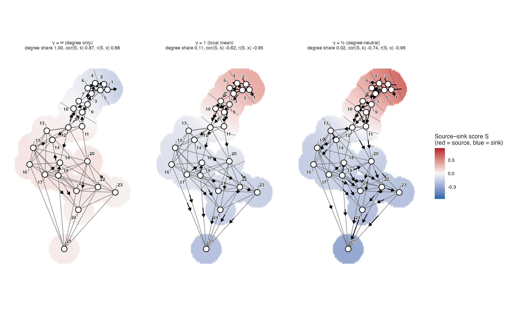
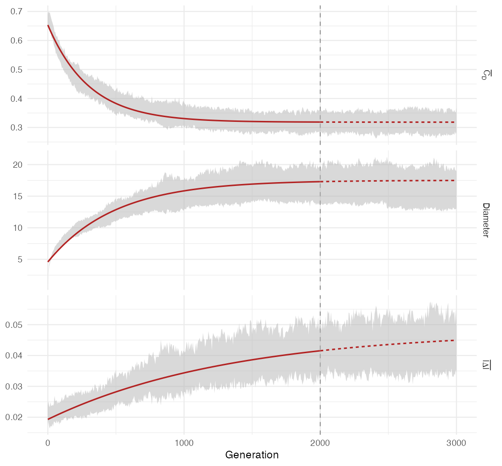
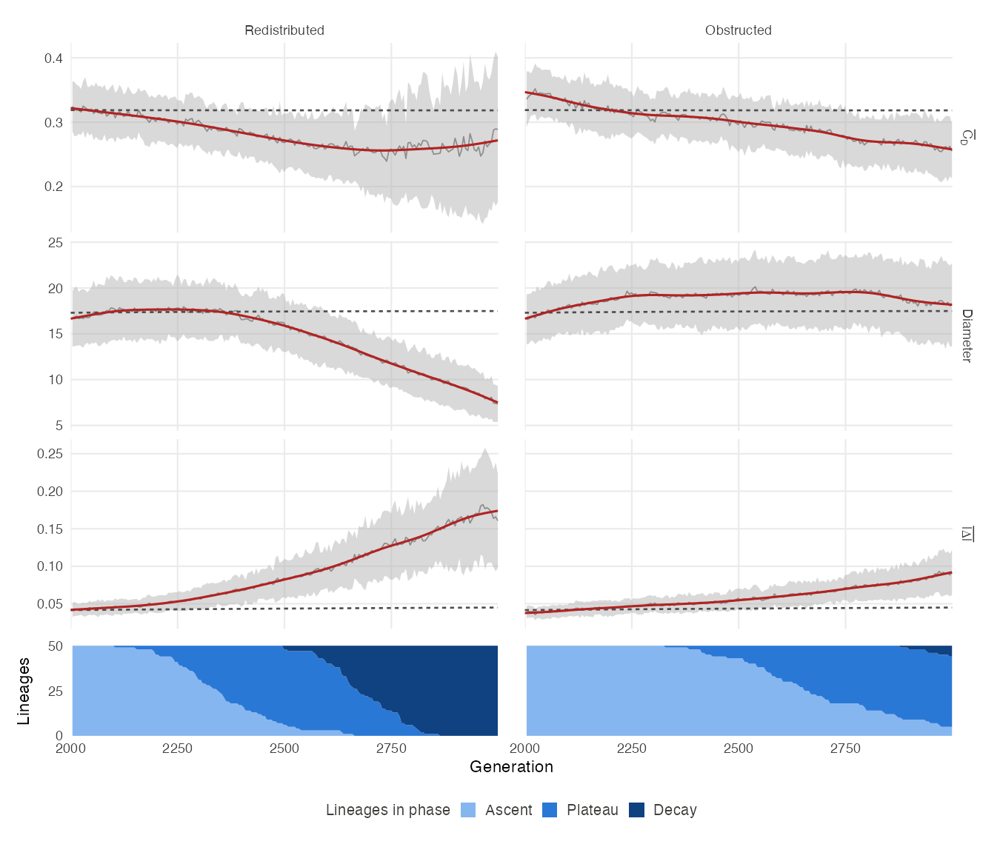
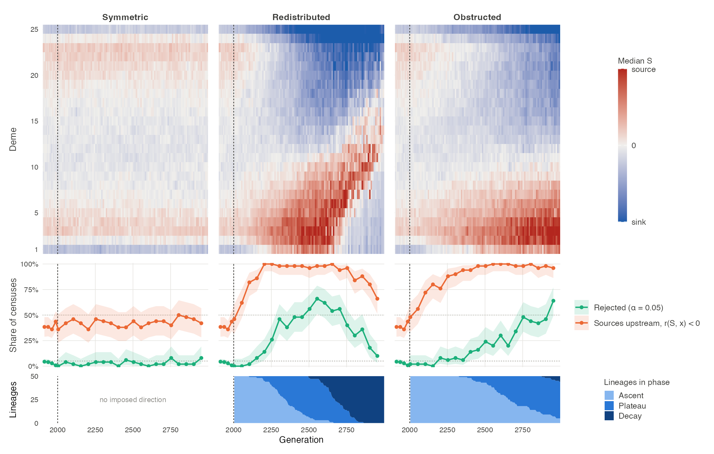
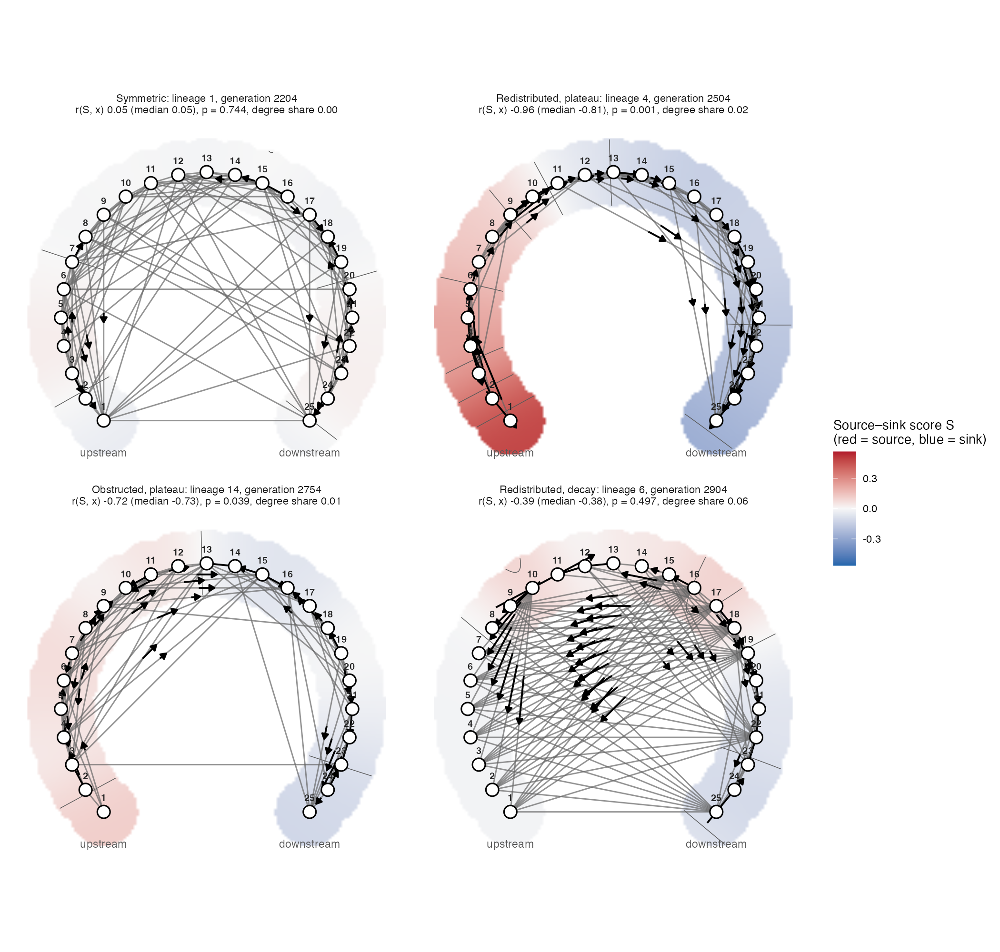
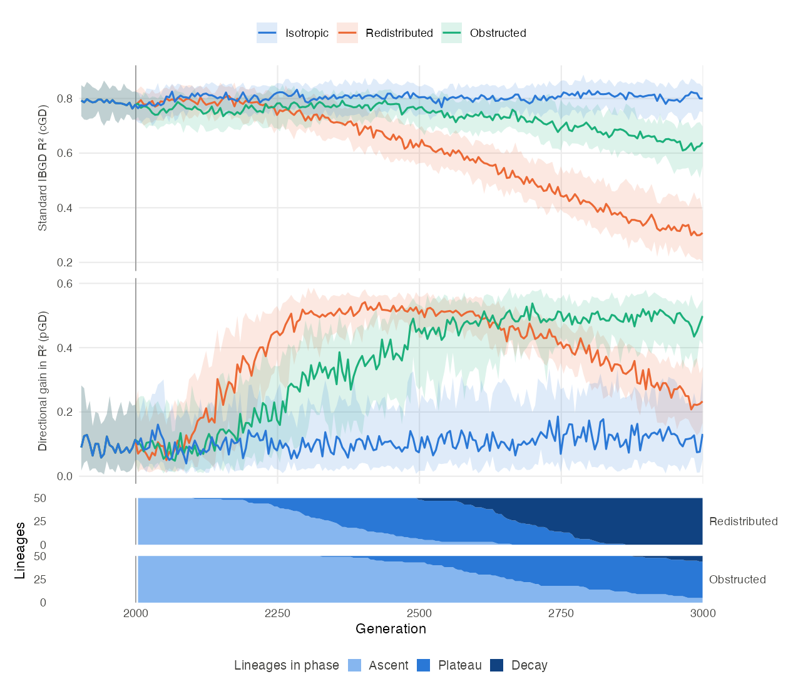
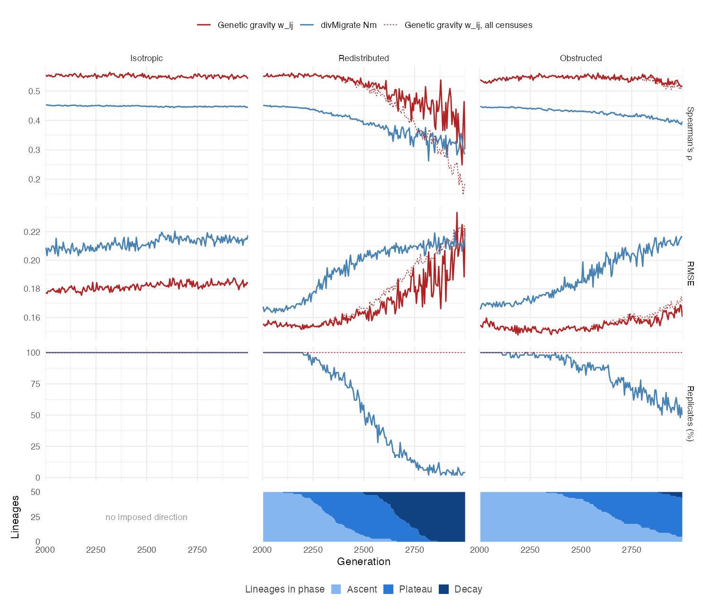
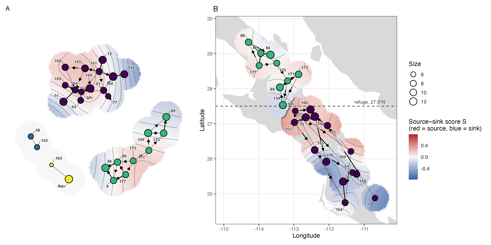

# Genetic Gravity: Extracting Directional Gene Flow from Population Graphs

Rodney J. Dyer  
rjdyer@vcu.edu  
https://rodneydyer.com

[School of Life Sciences and Sustainability](https://slss.vcu.edu)  
[Virginia Commonwealth University](https://vcu.edu)  
Richmond, Virginia 23284

# Abstract

> ==To be added after discussion is finished==

# Introduction

==[Evolution Version]==There is a fundamental tension between mathematical tractability and biological reality when estimating asymmetric connectivity in population genetics. While foundational theory—most notably Sewall Wright’s (1931) island model, parameterized as $F_{ST} \approx \frac{1}{4N_em + 1}$, requires strict symmetry in effective population sizes and bidirectional migration rates, it is widely recognized that directional, asymmetric gene flow is a primary driving force of evolutionary change across a species’ range (Slatkin, 1987). In fact, Wright’s (1932) own Shifting Balance Theory relies explicity on asymmetric gene flow during its third phase *(interdemic selectio*n), wherein demes occupying higher adaptive peaks export surplus migrants to pull neighboring populations toward new adaptive optima (Joshi, 1999).  

==[Evolution Version]==However, empirically resolving asymmetric connectivity in natural systems has remained notoriously difficult. In nature, symmetrical exchange is the exception rather than the rule: physical transport vectors (e.g., prevailing wind patterns, ocean currents, and dendritic river networks), habitat quality gradients (source–sink dynamics), and historical range expansions inherently bias the direction of dispersal (Pringle et al., 2011; Paz-Vinas & Blanchet 2015; Paz-Vinas et al., 2015). Yet, when translating empirical genetic data into connectivity estimates, population geneticists have historically defaulted to pairwise summary statistics like $F_{ST}$ or its analogs. Because pairwise $F_{ST}$ is an inherently symmetric matrix ($F_{ST(i,j)} = F_{ST(j,i)}$) that conflates effective population size ($N_e$) with migration rate ($m$), it collapses directional movement into a single, non-directional average (Whitlock & McCauley, 1999). Consequently, relying on symmetric metrics in asymmetric biological systems masks critical evolutionary and demographic processes—confounding a thriving source population with a dependent sink, or misinterpreting directional gene swamping as high bidirectional connectivity (Beerli & Felsenstein, 2001; Marko & Hart, 2011).

==[Old Version]== Inferring the pattern and direction of genetic connectivity from molecular data is a central problem in evolutionary, population, and landscape genetics (Slatkin, 1985; Dyer, 2015).  The distribution of population genetic covariance we see today is the result of overlapping evolutionary processes—stochastic, neutral, and adaptive.  A common approach to elucidating the relative importance of these processes is to partition genetic variance into within- and among-stratum components using Wright’s $F_{ST}$ (or one of its many derivatives).  Applying an underlying evolutionary model then allows us to compute the expected values of evolutionarily relevant parameters, such as migration rate (*m*; Slatkin, 1981, 1993), genetic effective population size ($N_e$; Wright, 1931), inbreeding ($F_{IS}$; Wright, 1965; Weir & Cockerham, 1984), and others.  This process raises several specific challenges to using the current distribution of genetic variation to infer historical processes.  First, the relationship between an estimated standardized parameter and the stratigraphy of evolutionary and demographic histories that produced the set of sampled alleles and genotypes is non-reversible—the same ratio of within- and among-stratum variances can arise from completely non-overlapping demographic and evolutionary histories.   Second, treating connectivity as a scalar, undirected quantity is analytically convenient, but it homogenizes the varied histories of interactions that created these systems by taking an ‘average across generations under equilibrium conditions’ rather than directly embracing the potential for spatial and temporal heterogeneity within populations.  Estimating the effective number of migrants per generation, $N_em$, is critical for comparative inferences, but may be too coarse when the analytical questions focus on more intricate demographic processes or when attempting to include more granular landscape, demographic, or ecological features that may affect standing genetic structure.  Questions focusing on understanding how genetic structure is affected by colonization, range expansion, source–sink dynamics, wind- or water-mediated dispersal, and environmentally filtered gene flow benefit from approaches that are more fine-grained than a single summarizing parameter, as these inter-strata interactions are heterogeneous and fundamentally *directional* in nature (Baker & Dyer, 2011; Wogan et al., 2024).

==[Old Version]==The field is not, of course, without tools for addressing questions such as these, and an increasingly sophisticated set of approaches is available for estimating heterogeneity in connectivity and asymmetric gene flow from genetic data. Assignment-based tools such as `BayesAss` infer recent, directional migration rates from multilocus genotypes under linkage and Hardy–Weinberg assumptions (Wilson & Rannala, 2003), while coalescent and isolation-with-migration frameworks recover asymmetric long-term migration matrices, either by direct likelihood over genealogies (Beerli & Felsenstein, 2001) or by fitting the joint site-frequency spectrum of a few populations (e.g., Gutenkunst et al., 2009). Where the question is specifically the direction of a range expansion, the directionality index $\psi$ reads the origin and axis of spread from pairwise allele-frequency asymmetries (Peter & Slatkin, 2013). At the landscape scale, effective-migration-surface methods map spatial heterogeneity in gene flow (Marcus et al., 2021; Petkova et al., 2016), and recent extensions of that family relax their symmetry assumption to render the surface directional. Each of these is powerful within its domain, but each also exacts a characteristic cost: a prespecified demographic or spatial model, an assumption of migration–drift equilibrium, genome-scale marker panels, a small number of demes, explicit spatial coordinates, or substantial computational resources. This manuscript provides a lightweight summary of *directional structure* that requires no demographic model, can be read directly from the multivariate covariance dependency topology, and scales to many populations from a single snapshot; it does leave the researcher choices—of bandwidth and of test—that depend on what she is trying to test and examine. The framework extended herein is intended to fill this niche by using conditional genetic covariance structures, as represented within Population Graphs (Dyer & Nason, 2004; Dyer, 2007, 2015), to identify and quantify asymmetry in population migration.

The Population Graph framework translates the total among-stratum variance into a weighted connectivity network using conditional genetic covariance.  This approach is distinct from pairwise structure or genetic distance analyses in one important way.  Pairwise approaches focus on estimates from each pair of strata whereas estimates of stratum-to-stratum covariance in a Population Graph are based on the multilocus covariance between all populations in the analysis.  This resulting covariance topology is able to capture dependencies that pairwise measures obscure and the resulting network’s topological shape is diagnostic of the evolutionary processes that produced it—range expansions, vicariance, and equilibrium isolation-by-distance each leave characteristic signatures in node degree, edge length, and network diameter (Dyer, 2007, 2015). Population Graphs have been used to address questions of connectivity and structure in a broad range of scenarios including landscape genetics (Daniel et al., 2024; Dyer, 2015), conservation planning (Vilaça et al., 2024), biogeography (Wogan et al., 2024), life-history effects (Reed et al., 2023), invasive species management (Baker & Dyer, 2011), and pollen-mediated gene flow (DiLeo et al., 2014; Dyer et al., 2004; Smouse et al., 2001).

The edges in a Population Graph are weighted estimates of conditional inter-population covariance: the conditional covariance $e_{ij}$ is a scalar, and the overall genetic covariance topology produced by the approach is, by definition, undirected.  Both source and sink populations may share a strong conditional dependency, but the *direction* of that dependency—who is overwriting whose allele frequencies—is a biologically distinct question that cannot be read directly from the undirected edge any more easily than it can be addressed with pairwise structure statistics. The same edge weight can be produced by a stable, symmetric exchange and by a unidirectional colonization pulse, yet the evolutionary implications are opposite, and in most cases, the actual inference of highest practical interest to the researcher.

Here, I introduce the concept of *genetic gravity*, an extension of the topology of the classic Population Graph that creates a node-centric framework for extracting directional information from an otherwise undirected Population Graph.  The goal here is to determine whether the conditional genetic structure encoded in the Population Graph topology itself can be used to partition symmetric covariance into asymmetric components, without invoking any new population-genetic model or incorporating additional outside information.  To this end, I begin by formalizing the notion of genetic gravity, deriving a pair of directional weights ($w_{j\mid i}$ and $w_{i\mid j}$) for each edge ($e_{ij}$) to define an asymmetry index, $\Delta_{i\rightarrow j}$, associated with each edge, and aggregate those edges into a population-level gravity and a source–sink score that orders populations from genetic sources to sinks.  For this, I introduce a node-local Gaussian kernel approach whose bandwidth is read directly from the Population Graph and scaled by a single multiplier chosen by the question being asked: a degree-neutral bandwidth for inferring the direction of gene flow, and the local mean for describing connectivity.  Second, I characterize their behavior under stochastic models of symmetric and asymmetric connectivity. I validate the framework with stochastic individual-based simulations under three migration scenarios—*Symmetric*, *Redistributed* and *Obstructed*—tracking both the canonical undirected Population Graph metrics and their directed counterparts derived from genetic gravity, as well as a mean asymmetry index $\bar{\Delta}$. Next, I characterize the temporal dynamics and detectability of the directional signal against a within-replicate empirical null, following each replicate lineage through its own phases rather than pooling lineages by generation, and introduce two single-graph tests for directional gene flow: a source–sink gradient test on population-level gravity, and a comparison of directional against symmetric isolation-by-graph-distance models.  Finally, I benchmark the asymmetry index against an existing approach suitable for the kinds of data found in the simulations using `divMigrate`, a widely used differentiation-based estimator of directional relative migration (Sundqvist et al., 2016).  The two methods estimate different quantities, so the comparison asks only which better approximates the true migration matrix used in the simulations, and in which phase of a lineage's history each can still be relied on.  All simulation routines and analysis functions have been implemented in the `gstudio` R package maintained by the author and are freely available. Although the simulations and worked examples here use simple spatial position along a one-dimensional stepping stone, neither test is tied to Euclidean geography: substituting a resistance-based or other ecological distance for the spatial separation used throughout is a direct extension of the framework to the kinds of landscape-genetic questions Population Graphs are already well suited to (Dyer, 2015).
# Methods

The framework assumes that a Population Graph has already been constructed from multilocus genotypes; its inputs are the symmetric edge weights $e_{ij}$ and the adjacency structure of the graph $G=\{V,E\}$, with notation following Dyer & Nason (2004) and Dyer (2007) (Supplementary Materials, Tab_Notation). A Population Graph is a Markov independence graph, and two of its properties matter here. Populations joined by an edge are conditionally dependent, through ongoing gene flow or recent shared ancestry, whereas populations joined only through others ($A\leftrightarrow B\leftrightarrow C$) are conditionally independent given the intermediates. And because the presence of each edge depends on all sampled populations at once, adding or removing a population requires the whole topology to be re-estimated. An edge therefore represents a direct relationship between two populations given those sampled, not one routed through another sampled population, which is what allows a direction to be attributed to it (Supplementary Materials).

## The Model of Genetic Gravity

Each symmetric edge in a Population Graph is the pooled product of two conditional relationships: the contribution of population $j$ to the genetic structure of $i$, and the opposite contribution of $i$ to $j$. The edge weight $e_{ij}$ is the conditional genetic distance (cGD) used to infer isolation by graph distance (Dyer, 2015; Miles et al., 2018). Focusing on each population and its retained neighbors, $N(i)$, I define a *neighborhood weight*, $w_{j\mid i}$, as $j$'s weight in $i$'s neighborhood, following Gaussian stochastic neighbor embedding (Hinton & Roweis, 2003):

$$
w_{j\mid i}= \frac{\exp\left(- e_{ij}^{2}/2b_i^{2}\right)}{\sum\limits_{k\in N(i)}\exp\left(- e_{ik}^{2}/2b_i^{2}\right)}
$$

The kernel is strictly local: only retained neighbors contribute, so populations that are conditionally independent of $i$ contribute nothing. The node-specific *local bandwidth* $b_i$ sets how quickly the kernel decays with distance, and is a multiple of the mean edge weight in $i$'s neighborhood,

$$
b_{i} = \gamma\,\frac{s_{i}}{k_{i}} = \frac{\gamma}{k_{i}}\sum\limits_{j\in N(i)}e_{ij},
$$

where $s_i$ is the strength (weighted degree) of population $i$, $k_i$ its degree, and $\gamma$ a fixed multiplier: $\gamma=\tfrac{1}{2}$ for inferring the direction of gene flow, used for every directional analysis here, and $\gamma=1$, the local mean, for describing connectivity (below). A population whose neighbors are genetically divergent receives a broad kernel; one embedded in a tight cluster of similar populations receives a narrow one.

Every edge is read from both of its ends, $w_{j\mid i}$ from $i$'s neighborhood and $w_{i\mid j}$ from $j$'s, and because the two neighborhoods differ, so do the two weights. Their difference defines the *gravity asymmetry* along the edge,

$$
\Delta_{i\rightarrow j} = w_{i\mid j}-w_{j\mid i},
$$

$i$'s pull on $j$ minus $j$'s pull on $i$. The asymmetry comes not from the edge itself but from the two neighborhoods it is compared against: the same $e_{ij}$ can be typical of $i$'s neighborhood and atypically long for $j$'s. A value near zero indicates balanced exchange; a positive value marks $i$ as the genetic source and $j$ as the sink. Throughout, higher values mean more of a source, for $\Delta_{i\rightarrow j}$ and for every population-level quantity built from it. Because $b_i$ scales with the edge weights, rescaling every cGD by a constant leaves every weight unchanged, so graphs built from marker panels with very different overall divergence can be compared directly.

Edges that share a population are not independent, so direction is summarized at the population level. The *gravity* of population $i$,

$$
g_{i} = \sum\limits_{j\in N(i)} w_{i\mid j},
$$

is the total weight $i$ holds in its neighbors' neighborhoods. Because each population's own weights sum to one, gravity is conserved, $\sum_i g_i=K$, and the source–sink balance $g_i-1$ sums to zero over the graph whatever the migration matrix: every population that reads as a source is balanced by populations that read as sinks. The *source–sink score*, $S$, places all populations on a single scale, assigning each the value whose differences best reproduce the asymmetries along every retained edge at once,

$$
\hat{S}=\arg\min_{S}\sum_{(i,j)\in E}\left[\Delta_{i\rightarrow j}-(S_i-S_j)\right]^2, \qquad \sum_{i}S_i=0 \text{ within each connected component}.
$$

$S$ is the potential on the graph whose local imbalance is the gravity balance, the construction of HodgeRank (Jiang et al., 2011; Supplementary Materials). It is the quantity mapped onto geography and tested against a hypothesized covariate. "Source" and "sink" here are genetic, not demographic: a genetic source is a population toward whose allele frequencies its neighbors have been pulled, distinct from the demographic sense of Pulliam (1988). Low gravity is not by itself proof of immigration, because an isolated, strongly drifted population can read as a sink for the same reason a true recipient does, and a low score is best interpreted alongside within-population diversity.

### Partitioned Conditional Genetic Distance, pGD

The same two weights also split each edge's distance into directional components. The *partitioned conditional genetic distance* (pGD) is $p_{ij} = e_{ij}\,w_{j\mid i}/(w_{j\mid i}+w_{i\mid j})$, with $p_{ji}$ defined correspondingly, so that $p_{ij}+p_{ji}=e_{ij}$ and $p_{ij}=p_{ji}=e_{ij}/2$ when the two weights are equal. Because pGD is a distance, it reads opposite to the source–sink convention: conditional distance is shorter in the direction of gene flow. pGD turns the undirected Population Graph into a directed, asymmetrically weighted graph over the same topology, which can replace cGD in the analyses a Population Graph usually feeds, such as isolation by graph distance (IBGD; Dyer & Nason, 2004), ecological resistance modeling (Dyer, 2015) and studies of range expansion (Baker & Dyer, 2011).

## Individual-based simulations

The behavior of genetic gravity was evaluated with individual-based stochastic simulations following Dyer (2007). Each replicate tracks a metapopulation of $K=25$ demes of $N=100$ diploid individuals scored at $L=20$ independently segregating, codominant, biallelic loci. Replicates start from random allele frequencies; generations are non-overlapping, mating is random within demes, and mutation is excluded so that only migration and drift act. Every replicate first runs a 2,000-generation *burn-in* of symmetric migration along a one-dimensional stepping stone ($m_{i\rightarrow i+1}=m_{i\leftarrow i+1}=0.025$). Fifty replicates were run, multilocus genotypes were saved every five generations, and each snapshot was converted into a Population Graph (Dyer & Nason, 2004), from which the neighborhood weights, gravity asymmetries, source–sink scores, mean degree centrality ($\bar{C}_D$) and graph diameter were recorded.

At generation 2000 each replicate was continued for 1,000 generations under each of three scenarios (Tab_ScenarioParameters), so that all three share an identical history to that point. *Symmetric* migration continued the *burn-in* matrix and serves as the null trajectory. *Redistributed* migration kept the total rate fixed but split it 4:1 in one direction, and *Obstructed* migration kept the *Symmetric* forward rate but suppressed the reverse rate; in both, the bias ran toward higher deme numbers at every link. Three further symmetric scenarios at progressively lower migration rates, which raise neutral differentiation without imposing a direction, were used only to calibrate false-positive rates (Supplementary Materials). Together the scenarios test a simple expectation: the difference between forward and reverse rates sets the direction and strength of the net force homogenizing the metapopulation, while total migration sets how quickly a replicate moves toward that state. *Obstructed* migration, with half the net bias of *Redistributed* migration and lower total migration, should therefore pass through the same sequence of states more slowly.

*Tab_ScenarioParameters:* Post-*burn-in* migration parameters for the three simulation scenarios. All scenarios share an identical 2,000-generation symmetric *burn-in* before the scenario's migration matrix is applied.

| Scenario      | $m_{i \rightarrow i+1}$ | $m_{i \leftarrow i+1}$ | $m_{Total}$ | Ratio | Constant               |
| ------------- | :---------------------: | :--------------------: | :---------: | :---: | ---------------------- |
| *Symmetric* |          0.025          |         0.025          |    0.050    |  1:1  | Symmetric connectivity |
| *Redistributed* |          0.040          |         0.010          |    0.050    |  4:1  | Total emigration rate  |
| *Obstructed*    |          0.025          |         0.010          |    0.035    | 2.5:1 | Forward rate           |

### Phases of the forward simulations

After the change in migration, each lineage passes through three phases at its own pace, so results for the asymmetric scenarios are reported by phase, with each lineage's censuses assigned by boundaries read from its own genotypes. In *ascent*, the new migration matrix restructures among-population covariance; upstream demes receive fewer immigrants and lose heterozygosity faster, and *ascent* ends when the resulting gradient in within-deme $H_e$ along the axis of flow has completed 90% of its rise (used only to date the boundary, not as evidence of direction). On the *plateau*, the covariance structure has adjusted and changes only slowly while allele frequencies continue to converge. *Decay* follows because, in a closed system without mutation, allele frequencies converge under any migration matrix, and the among-population variance through which migration is observed is lost; it begins at the first census at which a lineage's demes carry, on average, fewer than 4.5 of the 20 loci polymorphic, roughly where the loss of loci alone begins to inflate the asymmetry index (the *informative horizon*). These boundaries are heuristics for separating regimes, not constants of the system. Phase summaries are therefore taken from the core of each lineage's phase, the middle half of the interval between its boundaries, and their sensitivity to the boundaries is reported in the Supplementary Materials. A panel of loci chosen for polymorphism, as SNP panels routinely are, would rarely sit in the *decay* regime, which is reported mainly to show where inference from standing variation ends.

## Significance Testing for Asymmetry

Nulls that permute or resample parts of a single Population Graph were consistently anti-conservative under symmetric migration, because $\Delta_{i\rightarrow j}$ and $S$ inherit smooth, node-level structure from the graph's topology (Supplementary Materials). Asymmetry was instead tested with two procedures: a gradient test on the source–sink score, and a comparison of directional (pGD) and symmetric (cGD) isolation-by-graph-distance models. Censuses from the same lineage share its history, so false-positive rates are given with 95% intervals from a bootstrap that resamples the 50 lineages.

### Source–sink gradient test

This test asks whether the source–sink scores change monotonically along a hypothesized covariate $x$, such as position along a suspected axis of flow. The statistic is Spearman's $r(S,x)$; because high $S$ marks a source, $r(S,x)<0$ places the sources at low values of $x$. The null preserves the spatial structure of $S$ on the census's own Population Graph, using Moran spectral randomization (Wagner & Dray, 2015) on the kernel-weighted adjacency with $B=999$ randomizations, tested two-sided at $\alpha=0.05$ (Supplementary Materials). Because it reproduces the smoothness that $S$ inherits from drift on the graph, a rejection reflects a gradient along the covariate beyond what drift alone produces.

### Directional isolation by graph distance

This test asks whether modeling direction explicitly improves how well the graph explains isolation by distance (Wright, 1943). Standard IBGD regresses all-pairs cGD (shortest paths over $e_{ij}$) on pairwise spatial separation $|dx_{ij}|$, giving $R^2_{cGD}$. The directional model uses all-pairs directed shortest paths over pGD, so that the distance from $i$ to $j$ may differ from that from $j$ to $i$, and a hypothesized axis of flow—downstream, a prevailing wind, the front of a range expansion, or here the stepping stone—classifies each ordered pair as forward or reverse; $\text{pGD}_{ij} \sim |dx_{ij}| + |dx_{ij}| \cdot r_{ij}$, with $r_{ij}=1$ for reverse pairs, then gives separate forward and reverse isolation slopes and a fit $R^2_{pGD}$ adjusted for the additional slope. If $\Delta R^2 = R^2_{pGD} - R^2_{cGD} > 0$, the directional description explains isolation better than the symmetric one; if not, this is an absence of evidence for asymmetry, not evidence of symmetry. Where the directional fit is supported, the ratio of forward to reverse slopes, $b_{fwd}/b_{rev}$, describes the direction of isolation: a ratio below one means genetic distance accumulates more slowly downstream. Because the two fits use different response matrices, the comparison is not a nested-model test, and its error rates were characterized empirically.

## Choosing the bandwidth

The bandwidth sets the scale at which a population's neighbors are compared, and with it how much of $\Delta_{i\rightarrow j}$ reflects genetic distance and how much the number of neighbors. As the kernel flattens, every weight tends to $1/k_i$, so the index reduces to a *topological floor*, $\Delta^{0}_{i\rightarrow j}=1/k_j-1/k_i$, and the source–sink score to $S^{0}_i=-1/k_i$, both set by degree alone. When the question is the direction of gene flow, degree is a nuisance; when it is a population's overall weight in the network, degree is part of the answer. Two bandwidths are therefore offered, and, as with the choice between a rank and a parametric correlation, the question determines which is appropriate. The *degree-neutral* bandwidth, $\gamma=\tfrac{1}{2}$, is the multiplier at which $S$ carries no degree signature under symmetric migration (median 0.49 across *Symmetric* censuses, and 0.51 in 50 further lineages simulated with new seeds). It is fixed once from the symmetric null rather than tuned on each graph, because tuning lets the signal under test move the bandwidth (Supplementary Materials), and it is used for both tests and for mapping sources and sinks. The *local mean*, $\gamma=1$, keeps the contribution of degree, so that hubs read as sources and leaves as sinks; it describes a population's weight in the network but is not suited to testing direction. With either bandwidth, the *degree share*—the $R^2$ of $\Delta_{i\rightarrow j}$ on $\Delta^{0}_{i\rightarrow j}$—reports how much of the index degree sets (Fig_GravityFieldBandwidth). Sensitivity to alternative bandwidths is assessed in the Supplementary Materials.

*Fig_GravityFieldBandwidth:* One Population Graph drawn at three bandwidths: a *Redistributed* census on the *plateau* (lineage 4, generation 2504; gene flow biased toward higher-numbered demes, so the sources are expected at the top), distributed with gstudio as the example data set `gravity`. Nodes are numbered by deme and placed in the same positions in every panel (a Kamada–Kawai layout of the graph; Kamada & Kawai, 1989), so the upstream demes sit at the top and the downstream demes at the bottom. The shaded surface interpolates the source–sink score $S$ (red, source; blue, sink), and arrows on the edges point from source to sink with length proportional to $|\Delta_{i\rightarrow j}|$ (the weaker half are omitted). Each panel heading gives the degree share (the $R^2$ of $\Delta_{i\rightarrow j}$ on $\Delta^{0}_{i\rightarrow j}$), $\text{cor}(S,k)$, and $r(S,x)$, the Spearman correlation of $S$ with deme number used by the source–sink gradient test (negative: sources upstream). At $\gamma=\infty$ the weights are $1/k_i$, the degree share is one, and $S$ follows degree alone: the sparsely connected upstream demes read as sinks and the densely connected downstream demes as sources, so topology alone draws the reverse of the imposed flow ($r(S,x)=0.68$). At the local mean ($\gamma=1$) the gradient from upstream sources to downstream sinks appears ($r(S,x)=-0.95$), but 11% of the variance in $\Delta_{i\rightarrow j}$ is still degree. At the degree-neutral bandwidth ($\gamma=\tfrac{1}{2}$) degree accounts for 2% and the map shows the flow ($r(S,x)=-0.96$). Under directional flow the sparsely connected upstream demes are the true sources, so $S$ correlates negatively with degree even at the degree-neutral bandwidth ($\text{cor}(S,k)=-0.74$); it is the degree share, not $\text{cor}(S,k)$, that measures how much of the index the topological floor sets. Sharper kernels are compared in Supplementary Materials, Fig_BandwidthSweep.

## Comparison with a differentiation-based method

To place genetic gravity alongside an existing method, the simulated data were also analyzed with `divMigrate` (Sundqvist et al., 2016), a widely used estimator of directional relative migration from codominant genotypes. The two do not estimate the same quantity—`divMigrate` reads relative migration from pairwise differentiation, using the $N_m$ statistic of Alcalá et al. (2014), whereas gravity is read from conditional genetic structure—so the comparison asks only which better reproduces the true migration matrix, known here because it was simulated. Gene flow from $j$ to $i$ raises $j$'s weight in $i$'s neighborhood, so $w_{j\mid i}$ was compared with the transposed truth, $m_{j\rightarrow i}$, and $N_m[i,j]$ with $m_{i\rightarrow j}$. Agreement was summarized at each census as Spearman's $\rho$ over all ordered pairs, which mainly measures whether an estimator separates the stepping-stone corridors from pairs with no direct migration, and direction separately as the fraction of the 24 stepping-stone links on which an estimate is larger in the imposed direction. Censuses at which $N_m$ was undefined on any pair were excluded from the paired comparison (Supplementary Materials).

## Case Study: Sonoran Desert Bark Beetle

To show how the framework handles specific *a priori* hypotheses of direction, I applied it to the Sonoran Desert bark beetle *Araptus attenuatus* (Curculionidae) of the Baja California peninsula, which is known only from the senescing stems of its host plant, *Euphorbia lomelii* (Euphorbiaceae). Garrick et al. (2013) found a widespread peninsular clade whose patterns of allelic diversity indicated a rapid expansion out of a Pleistocene refugium near 27.5°N, both northward and southward. ==[Sampling and markers: number of sites, individuals and loci; how the Population Graph was built.]== If so, populations near the refugium should read as sources and those farther from it as sinks, and genetic distance should accumulate more slowly moving away from the refugium than toward it ($\Delta R^2>0$ with $b_{fwd}/b_{rev}<1$). For the directional isolation comparison, separation was the difference in distance from the refugium, $|d_i-d_j|$, and a pair was forward when $j$ lies farther from the refugium than $i$. All quantities were computed at the degree-neutral bandwidth, with the degree share reported alongside; the source–sink gradient test was repeated at the local mean, and the results were mapped onto the landscape.

# Results

## *Symmetric* baseline

Individual-based simulations were run to establish that the *burn-in* period produces stable, comparable starting topologies before any directional migration is imposed. Dyer (2007) showed that mean degree centrality ($\bar{C}_D$) and graph diameter track standard population-genetic measures of structure and gene flow ($F_{ST}$ and $\hat{M}$); here, where the focus is the graph's topology itself rather than that correspondence, the same two metrics serve as a check that replicate runs have converged to equilibrium. Across the *Symmetric* replicates, $\bar{C}_D$ falls and graph diameter rises from their initial values, each relaxing toward a stable plateau within the 2,000-generation *burn-in* and remaining flat through the subsequent *Symmetric* forward phase (Fig_SymmetricBaseline). The magnitude of the asymmetry index, $\overline{|\Delta_{i\rightarrow j}|}$, rises from near zero more slowly than the topological metrics (median relaxation time 1,346 generations) and is still rising gently at the end of the *burn-in*; it reflects the structure the graph accumulates under drift and migration rather than any directional gene flow, since none is present in this scenario. The signed mean stays close to zero throughout (not shown; forward-phase $\bar{\Delta}=-0.0015$, 95% CI $-0.0029$ to $0.0000$), an order of magnitude below the values reached under asymmetric migration. Averaged within lineages, the source–sink score shows a weak lean—sources slightly downstream in 33 of the 50 *burn-in* lineages (sign test $p=0.033$)—that runs against the direction imposed in the asymmetric scenarios, so it can only work against detection there. It is a property of these particular lineages rather than of the method: it is stronger at the local mean bandwidth, reverses exactly when the deme labels are mirrored, is not produced by the simulation's migration and mating steps, and did not recur in 50 further lineages simulated with new seeds (Supplementary Materials). Every replicate therefore enters the *Redistributed* and *Obstructed* scenarios from a topologically equilibrated and directly comparable starting configuration, establishing the *Symmetric* scenario as the empirical null against which asymmetry in the other two scenarios is judged.

*Fig_SymmetricBaseline*: Structural stability of Population Graphs under *Symmetric* migration as depicted by degree centrality, $\bar{C}_D$, and graph diameter (following Dyer, 2007), and by the mean absolute asymmetry index, $\overline{|\Delta_{i\rightarrow j}|}$, for the *Symmetric* replicates. The background shading represents the empirical $\pm$ 1 standard deviation from the simulated data. The red line is an exponential approach to equilibrium, $y = y_\infty + (y_0 - y_\infty)e^{-t/\tau}$, fit to the *burn-in* period; it is extended as a dashed line to show its projection across the *Symmetric* phase (n.b., the vertical dashed line represents the end of the *burn-in* period). The asymmetry index is computed at the degree-neutral bandwidth; its fit has not reached its asymptote by the end of the *burn-in*, so the dashed projection runs slightly above the observed forward level.

Gravity has a topological floor, and the bandwidth determines how much of it the index carries. At the local mean bandwidth ($\gamma=1$), $S$ tracks node degree closely under symmetric migration (median correlation with the degree-only score $S^{0}$ of 0.78–0.83 across the symmetric samples): hubs score as sources and leaves as sinks, independent of any directional gene flow, and asymmetric migration only partly decouples the two (0.49 under *Redistributed* and 0.61 under *Obstructed* migration). At the degree-neutral bandwidth the floor is gone: the median correlation is 0.01–0.06 under symmetric migration and −0.11 under both asymmetric scenarios (correlations pooled over all censuses of each scenario, since the floor follows from topology alone). The edge-level topological term $\Delta^{0}_{i\rightarrow j}$ separates from the directional remainder in the same way (Supplementary Materials). Degree-one leaves are the extreme case: a leaf's single neighborhood weight is 1 at any bandwidth, so it reads as a sink by construction ($\Delta_{\text{leaf}\rightarrow j}\le 0$). Leaves were rare—present in under 1% of symmetric censuses and 5–8% of asymmetric ones—were never the strongest source and were the strongest sink in at most 1.2% of censuses, and $r(S,x)$ computed on interior populations alone tracked the full value closely (correlation 0.84–0.92).

## Consequences of *Redistributed* and *Obstructed* connectivity

Forward-phase trends are fitted with generalized additive models rather than the exponential-equilibrium curve used for the *burn-in*, because the forward trajectories rise, hold and decline rather than relaxing to a single equilibrium (Supplementary Materials). The *Symmetric* reference shown with each scenario is the *burn-in* fit, extrapolated across the forward phase.

*Fig_ScenarioComparison*: Forward-phase (generations 2000–2999) trends in graph structure and asymmetry magnitude under the *Redistributed* (left) and *Obstructed* (right) scenarios, on shared axes for direct comparison—mean degree centrality ($\bar{C}_D$), graph diameter, and mean absolute asymmetry ($\overline{|\Delta_{i\rightarrow j}|}$)—mirroring Fig_SymmetricBaseline. The dashed line is the *burn-in*'s fitted exponential-equilibrium curve, extrapolated across the forward phase, as the null reference; the shaded band is the empirical $\pm$1 SD across replicates and the solid red line is a fitted trend (a penalized regression spline; Supplementary Materials). Diameter follows the same rise–hold–decline sequence under both scenarios on different timescales: *Redistributed* rises slightly above the *Symmetric* level, peaks near generation 2230 and collapses after about generation 2350, whereas *Obstructed* rises further, holds from about generation 2300 to 2800, and has only begun to decline by the end of the window. The strip beneath each column shows, at each census, how many of the 50 lineages are in *ascent*, on the *plateau*, or in *decay*, with each lineage assigned to a phase by its own boundaries. Because lineages change phase at different generations, every point on the curves above averages lineages in different phases; under *Obstructed* migration almost no lineage reaches the *decay* phase within the window.

The *Redistributed* scenario serves as the worked example of the three phases, because every *Redistributed* lineage passes through all of them within the forward window. In the 46 lineages whose rise exceeded drift, *ascent* ended at a median of generation 2332 (IQR 2267–2408) and the *plateau* lasted a median of 325 generations (means: *ascent* 335 ± 100 generations after onset; *plateau* 355 ± 107 generations); *decay* began at a median of generation 2674 (IQR 2634–2765) across all 50. $\bar{C}_D$ fell from 0.309 during *ascent* to 0.274 on the *plateau* and 0.236 once lineages entered *decay* (*Symmetric* 0.315; medians of lineage means within the core of each phase). Diameter first rose slightly—from 16.7 to a trend maximum of 17.7 near generation 2230, as each lineage neared the end of its *ascent*—then declined, to a median of 15.8 on the *plateau* and 10.2 after the horizon (*Symmetric* 16.3), and to 7.9 over the final 50 censuses (Fig_ScenarioComparison, left). Mean $|\Delta_{i\rightarrow j}|$ tracked the same staging in the opposite direction: 0.049 during *ascent*, slightly above the *Symmetric* 0.043, then 0.080 on the *plateau* and 0.147 after the horizon. Rising asymmetry alongside a collapsing diameter and falling $\bar{C}_D$ is the expected consequence of a sustained directional bias in a closed migration–drift system: *Redistributed* migration is not only making gene flow asymmetric, it is progressively homogenizing the metapopulation. Part of the rise after the horizon is information loss rather than signal, since the horizon marks roughly where the loss of polymorphic loci alone begins to inflate $|\Delta_{i\rightarrow j}|$ (Supplementary Materials, Fig_InformationNull); the *plateau* values carry no such inflation.

The signed graph mean $\bar{\Delta}$ carries the imposed direction through the first two phases and loses it in the third (Supplementary Materials, Fig_SignedAsymmetry). It was positive—upstream populations reading as sources—in 98% of *Redistributed* lineages during *ascent* (median 0.013) and in 98% of the 46 with a *plateau* (median 0.034), with the across-lineage trend peaking near generation 2493; after the horizon it was negative in 70% of lineages (median $-0.020$), with a median crossing at generation 2729 in the 37 lineages whose smoothed series changed sign. That sign change is not a reversal of the direction of gene flow. The population-level source–sink score keeps the imposed ordering through it: $r(S,x)<0$ in 98% of *plateau* censuses and still in 86% of *decay* censuses (below). The sign change is carried by the interior of the graph rather than its ends: in 97% of the crossing lineages it coincides with the sign change of the sum over interior edges, and in none with that of the terminal-deme terms. Because $\bar{\Delta}$ weights each population's score by the balance of its edges pointing upstream versus downstream along the stepping stone, rewiring of the interior graph as lineages enter *decay* can change the sign of $\bar{\Delta}$ while the ordering of sources and sinks along the stepping stone largely holds (Supplementary Materials). $\bar{\Delta}$ is therefore a reliable summary of direction on the *plateau*, not after the horizon.

The *Obstructed* scenario was designed to test a prediction: with the same forward rate but half the net directional bias ($m_{i\rightarrow i+1}-m_{i\leftarrow i+1}=0.015$ against 0.03) and lower total flux (0.035 against 0.05), it should pass through the same phases more slowly. It did (Fig_ScenarioComparison, right). In the 44 lineages whose rise exceeded drift, *ascent* ended at a median of generation 2642 (IQR 2544–2787), 642 generations after onset (mean 650 ± 162) against 332 under *Redistributed* migration; $\bar{\Delta}$'s trend peaked near generation 2884 against 2493; and each lineage's smoothed diameter peaked at a median of generation 2632 (IQR 2354–2838) against 2224 (IQR 2114–2337). Depending on the measure, *Obstructed* lineages reached each stage 1.8 to 2.8 times later—1.9 times later for the end of *ascent*—close to the two-fold difference in net bias; total flux also differs between the scenarios and is not excluded as a contributor. Diameter traced the same rise–hold–decline sequence, stretched over the whole window: it rose from 16.7 to about 19.2 by generation 2300, held between 19.2 and 19.6 until about generation 2800, and then began to decline, to 18.2 by generation 2999. The *Obstructed* rise was larger (a median of 5.5 against 2.7 units per lineage) and its *plateau* far longer, consistent with the lower total migration letting drift differentiate the metapopulation further before directional homogenization took over. Once on the *plateau*, however, *Obstructed* lineages looked like *Redistributed* ones: $\bar{C}_D$ 0.270 against 0.274, mean $|\Delta_{i\rightarrow j}|$ 0.074 against 0.080, and $\bar{\Delta}$ 0.030 against 0.034, positive in 98% of lineages. The difference in net bias therefore set how quickly a lineage reached its *plateau* rather than how strong the directional signal was once there. The two routes to a net directional bias that the scenarios were built to contrast—redistributing a fixed migration budget and suppressing back-flow at a fixed forward rate—thus produced the same directional signal on the *plateau*; the contrast appears in timing, not in the kind of signal. Only 6 of the 50 *Obstructed* lineages crossed the informative horizon, all after generation 2900, so the last 200 generations of the *Obstructed* scenario show what the first 400 of the *Redistributed* scenario show—a diameter peak followed by the start of a decline—and the *Obstructed* scenario's own *decay* phase lies beyond the 1,000-generation window. Observing it would require longer simulations that would add little beyond what the *Redistributed* scenario already shows, so *Obstructed* results are reported below for *ascent* and the *plateau* only.

## Significance Testing for Asymmetry

### Source–sink gradient test

False-positive rates were measured on censuses simulated under symmetric migration: the final 100 generations of *burn-in* (every 5 generations, 1,000 censuses), the *Symmetric* forward phase, and the three low-migration symmetric scenarios (every 50 generations, 1,000 censuses per scenario). Under symmetric migration the source–sink gradient test held its nominal rate (Tab_SourceSinkCalibration). At $\alpha=0.05$ it rejected in 3.0% of *burn-in* censuses (lineage-clustered 95% CI 2.0–4.1%) and 2.9% of *Symmetric* forward-phase censuses (2.0–3.9%), and across the symmetric differentiation gradient in 2.9–4.2%, with no increase as neutral differentiation rose (sym-mid 4.2%, sym-low 2.9%, sym-verylow 3.2%; every upper limit 5.8% or less; Supplementary Materials). At $\alpha=0.01$ it was conservative (0.3–1.0%). Clustering by lineage barely widens these intervals (design effects 0.9–1.7): the false positives are spread across lineages rather than concentrated in a few, the worst single lineage reaching 10–25%. The p-values were close to uniform, with slightly fewer small values than expected (*burn-in*: 6–14% of censuses in each tenth of the unit interval). The choice of null matters. Permuting $S$ across populations while ignoring the graph rejected in 10.4–18.2% of censuses, and Moran spectral randomization on the true landscape adjacency—the 24-link stepping-stone adjacency that generated the data—in 5.4–7.3%. The contrast is far sharper at the local mean bandwidth, where $S$ carries the degree floor (24–33% and 11–17%): $S$ inherits its smoothness from the graph's topology, including its non-adjacent edges, not from the stepping-stone adjacency, so the Population Graph is the safer basis for a spatial null than the landscape itself. Seven of the 7,000 census graphs had more than one connected component and were randomized as whole graphs; excluding them changes no reported rate by more than 0.2 percentage points (within-component randomization, the appropriate treatment for disconnected graphs, was not evaluated).

*Tab_SourceSinkCalibration:* False-positive rate of the source–sink gradient test (Spearman $r(S,x)$, degree-neutral bandwidth) under symmetric migration, at $\alpha$ = 0.01 / 0.05 / 0.10, for the spectral null on the census's own Population Graph with two alternative nulls at $\alpha=0.05$ for comparison: plain permutation of $S$ across populations, and spectral randomization on the true stepping-stone adjacency. The last column gives the graph spectral null at the local mean bandwidth ($\gamma=1$), $\alpha=0.05$. 1,000 censuses per sample (*burn-in*: generations 1904–1999, every 5 generations; forward phase: generations 2004–2954, every 50 generations; 50 replicates).

| Sample | Graph spectral null, $\alpha$ = 0.01 / 0.05 / 0.10 | Plain permutation, 0.05 | Stepping-stone spectral null, 0.05 | Local mean, graph spectral null, 0.05 |
| :---- | :---: | :---: | :---: | :---: |
| *Burn-in* | 0.004 / 0.030 / 0.056 | 0.104 | 0.054 | 0.046 |
| *Symmetric* | 0.005 / 0.029 / 0.059 | 0.138 | 0.058 | 0.062 |
| sym-mid | 0.010 / 0.042 / 0.076 | 0.177 | 0.065 | 0.051 |
| sym-low | 0.003 / 0.029 / 0.066 | 0.179 | 0.061 | 0.064 |
| sym-verylow | 0.008 / 0.032 / 0.061 | 0.182 | 0.073 | 0.038 |

Under asymmetric migration the test's single-census power tracked the same phases as the other measures (Fig_SourceSinkScore, bottom; Supplementary Materials, Tab_SourceSinkPower). In the core of each phase, the rejection rate under *Redistributed* migration was 15% during *ascent*, 65% on the *plateau*, and 26% after the informative horizon; under *Obstructed* migration it was 10% during *ascent* and 45% on the *plateau*. The direction was far more consistent than any single census could certify. On the *plateau* the median $r(S,x)$ was $-0.81$ under *Redistributed* migration and $-0.73$ under *Obstructed* migration—sources upstream, the imposed direction—and $r(S,x)$ was negative in 98% and 99% of *plateau* censuses. When each lineage's *plateau* censuses were averaged, every lineage placed the sources upstream in both scenarios (46 of 46 and 42 of 42), against 38% of *Symmetric* lineages over the forward phase. After the horizon, *Redistributed* lineages still placed the sources upstream in 86% of censuses (98% of lineages on average), with a weaker median $r(S,x)$ of $-0.38$.

*Fig_SourceSinkScore:* The population-level source–sink score $S$ (degree-neutral bandwidth) through time. Top: median $S$ across the 50 replicates for each deme (rows; migration in the asymmetric scenarios runs toward higher deme numbers) at each census (every 5 generations in the final 100 generations of the shared *burn-in*, left of the dashed onset line, and every 10 generations in the forward phase), by scenario (columns). Red marks genetic sources (high $S$), blue marks sinks (low $S$), and gray is zero; the color scale is symmetric and saturates at the 98th percentile of $|S|$. Bottom: the source–sink gradient test at each census (50 replicates; *burn-in* censuses pooled into 25-generation bins): the fraction of censuses in which the test rejects at $\alpha=0.05$ (aqua) and the fraction with sources upstream, $r(S,x)<0$ (orange), with 95% intervals. Each forward-phase point takes one census from each lineage, so its interval is binomial; each *burn-in* bin holds five censuses per lineage, so its interval is a bootstrap over lineages. Dotted lines mark the nominal 5% rate and 50%. $S$ was computed from every saved graph on this grid; the test was run every 50 generations in the forward phase (Supplementary Materials, Tab_SourceSinkPower). The strip at the bottom shows, at each census, how many of the 50 lineages in each asymmetric scenario are in *ascent*, on the *plateau*, or in *decay*, each lineage assigned by its own boundaries.

The map shows where the gradient comes from (Fig_SourceSinkScore, top). Under symmetric migration the terminal deme at each end reads as a mild sink and the next few demes inward as weak sources—the terminal demes have fewer retained neighbors (median degree 6 against 8 in the interior), which leaves a trace even at the degree-neutral bandwidth—while the interior is close to neutral (median $r(S,x)$ 0.05 in the *Symmetric* forward phase). Once asymmetry is imposed, the downstream end deepens into a sink within 200–400 generations and a band of sources forms upstream, centered on deme 3 in both scenarios. Under *Obstructed* migration that band holds its place to the end of the window. Under *Redistributed* migration it moves: the population with the highest $S$ stays near deme 3 until about generation 2600, then shifts downstream—to deme 6 in generations 2600–2700, deme 7 in 2700–2800, deme 10 in 2800–2900 and deme 11 in 2900–3000—while the demes it leaves behind fade to neutral. The collapse of a *Redistributed* lineage therefore advances downstream along the stepping stone from its upstream end, and the source–sink gradient weakens as the band of sources contracts toward the sink, which is why the fraction of censuses with sources upstream falls from about 95% to 66% over the final 300 generations, as *Redistributed* lineages cross the informative horizon.

Fig_SourceSinkExamples illustrates these patterns on single censuses, drawn as a researcher would draw their own graph with `plot(gravity_field(graph))`: what no direction, a clear direction, and a direction falling apart look like on a map. Under *Symmetric* migration the map has no direction: weak sources and sinks alternate around the stepping stone, and the arrows on neighbouring edges point both ways. On the *plateau* both asymmetric scenarios show a single run from red upstream to blue downstream, with the arrows on the short edges pointing downstream; the *Redistributed* example is the census distributed with gstudio as the data set `gravity` (also shown in Fig_GravityFieldBandwidth), so the map can be reproduced from genotypes. After the informative horizon the *Redistributed* map falls apart from its upstream end: the upstream demes 1–9, which no longer differ genetically, share one value of $S$, the band of sources has moved to the middle of the stepping stone, and arrows on the long edges point back toward the upstream end.

*Fig_SourceSinkExamples:* Four single censuses drawn as gravity fields at the degree-neutral bandwidth ($\gamma=\tfrac{1}{2}$): *Symmetric* migration (lineage 1, generation 2204), *Redistributed* on the *plateau* (lineage 4, generation 2504; the gstudio example data set `gravity`, the same graph as Fig_GravityFieldBandwidth, placed here in deme order rather than by graph layout), *Obstructed* on the *plateau* (lineage 14, generation 2754), and *Redistributed* in *decay* (lineage 6, generation 2904). The examples are illustrative. The *Symmetric*, *Obstructed* and *decay* censuses are each the one whose $r(S,x)$ is closest to its sample's median (ties broken by the lowest lineage number), among all 1,000 *Symmetric* forward-phase test censuses or the censuses in the core of the named phase (middle half of each lineage's phase); the *Redistributed* *plateau* census, from the core of its lineage's *plateau*, has the strongest gradient of the 160 *plateau*-core censuses ($r(S,x)=-0.96$, against a median of $-0.81$), so it is the clearest case rather than a typical one. Nodes are numbered by deme and placed in order around a horseshoe, the same in every panel, from upstream (deme 1, lower left) to downstream (deme 25, lower right), so that long edges separate. Surface, arrows and colour scale as in Fig_GravityFieldBandwidth, with a common scale across panels. Each heading gives $r(S,x)$, the sample median, the source–sink test $p$-value and the degree share.

### Directional isolation by graph distance

The three phases are also visible in the graph's principal downstream use: relating conditional genetic distance to geographic distance as a measure of isolation by graph distance (IBGD). Standard IBGD—the fit ($R^2$) of symmetric cGD regressed against pairwise spatial separation, $|dx|$—stays flat under *Symmetric* migration (median 0.80 across the forward phase) but weakens once migration becomes asymmetric: under *Redistributed* migration from a median of 0.78 during *ascent* to 0.63 on the *plateau* and 0.38 after the informative horizon, and under *Obstructed* migration from 0.78 to 0.68 on the *plateau* (Fig_DirectionalIBGD, top). Part of what standard IBGD loses under asymmetry is directional structure that a model allowing pGD separate forward and reverse slopes against the same spatial distance can recover: the $R^2$ gained by modeling direction explicitly—a direction-aware pGD fit minus a direction-blind pGD fit against the same $|dx|$—sits at a floor of about 0.10 under *Symmetric* migration (not zero; see below). Under *Redistributed* migration it rises from a median of 0.31 during *ascent* to 0.52 on the *plateau* and falls back to 0.34 after the horizon; under *Obstructed* migration it reaches 0.51 on the *plateau*, which most *Obstructed* lineages occupy through the end of the window.

*Fig_DirectionalIBGD:* Isolation by graph distance under symmetric and directional readings of the same edges, by scenario. Top: $R^2$ for standard IBGD, cGD regressed against spatial distance $|dx|$. Bottom: the additional $R^2$ gained by letting pGD's forward and reverse edge distances take separate slopes against the same $|dx|$, relative to a single shared (direction-blind) pGD slope. The vertical line marks the end of *burn-in*. *Symmetric* remains flat on both measures throughout the forward phase; *Redistributed* and *Obstructed* both trace the phases established above, *Redistributed* reaching its *plateau* gain earlier and falling back as its lineages cross the informative horizon, *Obstructed* reaching a similar *plateau* later and holding it through the end of the window. The curves are medians by generation; because lineages change phase at different times, the phase-matched values in the text and in Tab_IBGDFitComparison are the more precise summary. The strip beneath shows, at each census, how many of the 50 lineages in each asymmetric scenario are in *ascent*, on the *plateau*, or in *decay*, each lineage assigned by its own boundaries.

*Tab_IBGDFitComparison:* Median $R^2$ for standard (symmetric) IBGD compared against pGD (degree-neutral bandwidth) fit without and with direction modeled explicitly, by scenario and phase (*Symmetric*: whole forward phase; *Redistributed* and *Obstructed*: the core of each lineage's own phases; above). The rightmost column is the fraction of censuses in that phase at which the direction-aware pGD model's $R^2$ exceeds standard cGD IBGD's. Censuses every 5 generations, 50 replicates.

| Scenario | Phase | Standard cGD $R^2$ | pGD, direction-blind | pGD, direction-aware | Direction-aware beats cGD |
| :---- | :---- | :---: | :---: | :---: | :---: |
| *Symmetric* | whole forward phase | 0.80 | 0.35 | 0.53 | 4% of censuses |
| *Redistributed* | *ascent* | 0.78 | 0.30 | 0.66 | 26% |
| *Redistributed* | *plateau* | 0.63 | 0.21 | 0.74 | 89% |
| *Redistributed* | *decay* | 0.38 | 0.13 | 0.48 | 82% |
| *Obstructed* | *ascent* | 0.78 | 0.30 | 0.64 | 23% |
| *Obstructed* | *plateau* | 0.68 | 0.24 | 0.75 | 78% |

The gain shown in Fig_DirectionalIBGD is measured against pGD's own direction-blind fit, not against standard cGD IBGD directly, and the distinction matters: splitting each edge into two directional pGD observations against the same undirected spatial distance adds scatter that a shared, direction-blind slope cannot absorb, so a direction-blind pGD model fits much worse than standard cGD IBGD even under *Symmetric* migration (0.35 against 0.80; Tab_IBGDFitComparison). Modeling direction recovers part of that loss under symmetric migration and, under asymmetry, more than all of it (0.74 against 0.63 on the *Redistributed* *plateau*, 0.75 against 0.68 under *Obstructed* migration). The claim these data support is accordingly narrower than "pGD gives a better IBGD fit than cGD": standard IBGD weakens under asymmetric gene flow, part of what it loses is directional structure, and a direction-aware model recovers that loss—exceeding the standard symmetric fit when, and largely only when, gene flow is asymmetric. That asymmetry-specific reversal is what makes the comparison usable as a test, and splitting each edge into two directional observations is also why the gain sits above zero under *Symmetric* migration (about 0.10), where the extra slope absorbs noise along with each lineage's small *burn-in* lean.

False-positive rates were measured as the fraction of censuses with $\Delta R^2>0$ on the same symmetric samples as the source–sink test, but at every census (every 5 generations: 1,000 *burn-in* censuses, and 10,000 in the *Symmetric* forward phase and in each low-migration scenario). Under symmetric migration the directional isolation model rarely displaces standard IBGD. In the final 100 generations of *burn-in*, $R^2_{pGD}$ exceeded $R^2_{cGD}$ in 2.6% of censuses (26 of 1,000; lineage-clustered 95% CI 1.0–4.6%), and across the entire *Symmetric* forward phase in 4.4% (2.8–6.1%; 10,000 censuses), with median $\Delta R^2$ of $-0.29$ and $-0.27$. Censuses five generations apart within a lineage are close to duplicates for this test, so its clustered intervals are several times wider than census-level binomial ones (design effects 3–60). The strongly negative median is the cost of the directional description when there is no direction to describe (above). At these migration rates the decision rule $\Delta R^2>0$ therefore holds a false-positive rate near 5% without any calibration. That does not hold once drift dominates. Across the symmetric differentiation gradient the rate rose from 6.9% (sym-mid; 4.2–10.1%) to 12.2% (sym-low; 7.9–17.1%) and 14.6% (sym-verylow; 9.6–20.3%; Tab_IBGDDetection), even though the median $\Delta R^2$ stayed negative in every arm. The false detections were concentrated in a few lineages (per-lineage rates up to 54–81%) and, unlike detections under asymmetric migration, did not consistently point one way along the axis (slope ratio above one in 45–54% of them). On the same scenarios the source–sink gradient test stayed at 2.9–4.2%. The model comparison has no null that absorbs drift-generated structure along the graph, so where the drift–migration balance tips toward drift a preferred directional fit should be read alongside the source–sink test rather than on its own. Post hoc, requiring the slope ratio to agree with a hypothesized direction of flow ($b_{fwd}/b_{rev}<1$) would have lowered the rate to 1.9% (0.8–3.2%) under *Symmetric* migration with almost no loss of power, since more than 99% of detections under asymmetric migration already met it, but only to 6.7% and 6.8% under strong drift (upper limits 10.8–11.4%), so it narrows the drift problem rather than removing it. Because the rule was identified from these data and makes the test one-sided, it is reported here as an observation rather than adopted.

Under asymmetric migration the comparison reverses, tracking each lineage's phase (Tab_IBGDDetection, Supplementary Materials). In the *ascent* core the directional model was preferred in 26% of *Redistributed* and 23% of *Obstructed* censuses—the imposed asymmetry has not yet restructured the graph in most of them. On the *plateau* detection rose to 89% of *Redistributed* and 78% of *Obstructed* censuses, and after the informative horizon it was 82% of *Redistributed* censuses. Where the directional model was preferred, it also recovered the imposed direction: the forward-to-reverse slope ratio was below one in every detection in the phase cores under both asymmetric scenarios (*plateau* median 0.06 *Redistributed*, 0.08 *Obstructed*), against a median of 1.26 (IQR 0.69–2.24) over all *Symmetric* censuses.

The test is one-sided in what it can establish. At migration rates like those of the *burn-in*—though not under strong drift (above)—a preferred directional fit is good evidence of asymmetric gene flow along the hypothesized axis, but a preferred symmetric fit is not evidence against it: even on the *plateau*, 11% of *Redistributed* and 22% of *Obstructed* censuses still favored cGD, and during *ascent* 74–77% did. Two alternatives were considered and rejected as the decision statistic. The gain from adding the direction term within pGD alone (direction-aware against direction-blind pGD) is positive in 95% of *Symmetric* censuses, because the added slope always absorbs some noise, so it can serve as a test only with a threshold calibrated by simulation. The slope ratio separates the scenarios more sharply (AUC 0.97–0.99 against *Symmetric* censuses in the *plateau* cores and the *Redistributed* *decay* core, and 0.87 during *ascent*), but its detection threshold is likewise simulation-specific; it is reported here as the description of a detected asymmetry rather than as the test for one.

The comparison also bears on what each representation of the graph is for. For isolation by distance in the ordinary sense—genetic distance against the separation of sampling locations, with no hypothesis about direction—cGD is the appropriate distance, and splitting it directionally only adds noise. When the migration process is itself directional, however, the directional partition of the same edges describes isolation better than the symmetric one, and it does so specifically when, and because, gene flow is asymmetric. This is the downstream counterpart of the ground-truth result (below): the neighborhood weights recover which populations exchange migrants, and the directional isolation model reads direction from that structure along a hypothesized axis.

The two tests answer different questions and suit different conditions. The source–sink gradient test is the more conservative: it held its false-positive rate across the whole drift gradient (2.9–4.2%), needs only a population-level covariate rather than pairwise distances, and resolves which populations act as sources. It is therefore the appropriate test when differentiation is high or migration low, when the aim is to locate sources and sinks, or when the hypothesis is framed as a population attribute such as elevation, position along a river, or distance from a presumed refugium. The directional isolation model is the more powerful (78–89% of *plateau* censuses, against 45–65% for the source–sink test) and speaks directly to how Population Graphs are used downstream, so it is the natural choice when the question is whether an isolation-by-distance or landscape-resistance model should be directional and drift is moderate. Under strong drift its false-positive rate rose to 12–15% (lineage-clustered upper limits near 20%), so a directional fit there should be corroborated by the source–sink test. The two tests detected partly different censuses. The overlap was greatest on the *plateau*, where 61% (*Redistributed*) and 44% (*Obstructed*) of censuses flagged by either test were flagged by both, against 18–31% during *ascent* and 26% in *Redistributed* *decay*. Yet in every phase of both asymmetric scenarios every census flagged by both tests agreed on the direction of flow (226 of 226 over the *ascent*, *plateau* and *Redistributed* *decay* cores); under symmetric migration joint detections were rare (2 in the *Symmetric* forward phase; Supplementary Materials, Tab_TestOverlap). Used together, the two tests therefore detect more often than either alone and, where both reject, give an independent check on direction.

### Bandwidth sensitivity

The degree-neutral bandwidth was compared with the local mean, a sharper kernel ($\gamma=\tfrac{1}{4}$), a fixed global bandwidth, a perplexity-based search, and a continuous rescaling of the local mean from $\gamma=0.25$ to 2 (Supplementary Materials, Bandwidth sensitivity). Performance lay on a curve with an interior maximum near $\gamma=\tfrac{1}{2}$. Under symmetric migration degree explained 2–4% of the variance in $\Delta_{i\rightarrow j}$ at $\gamma\le\tfrac{1}{2}$, 50% at the local mean and 94% at $\gamma=2$, and the source–sink gradient test held its false-positive rate at every finite multiplier. In the phase cores, the degree-neutral bandwidth raised *plateau* power from 48% (*Redistributed*) and 37% (*Obstructed*) at the local mean to 65% and 45% for the source–sink test, and from 75% and 56% to 89% and 78% for the directional isolation comparison. Because $\gamma=\tfrac{1}{2}$ was identified on these lineages, both bandwidths were evaluated again on 50 lineages simulated with new seeds, where the degree-neutral bandwidth again held its false-positive rate and outperformed the local mean (46% and 47% against 33% and 33% for the source–sink test; 80% and 73% against 60% and 57% for the directional comparison). The one cost was that the directional comparison's false-positive rate under strong drift was highest near the same multipliers (12–15%). Edge-level orientation was the least stable quantity: between $\gamma=1$ and $\tfrac{1}{2}$, 22–28% of edges changed the sign of $\Delta_{i\rightarrow j}$, yet the population-level ordering held—every lineage placed the sources upstream on the *plateau* at both bandwidths, and 95–100% did so at every multiplier from 0.25 to 1.41. Kernels that do not scale with each population's own neighborhood failed: the fixed global and perplexity bandwidths cut *plateau* power to 3–18% and, after the informative horizon, placed the sources upstream in only 16–20% of *Redistributed* lineages, against 78–98% for the local kernels.

## Comparison with a differentiation-based method

Against the true migration matrix, gravity's neighborhood weight $w_{j\mid i}$ (compared with $m_{j\rightarrow i}$) agreed more closely than `divMigrate`'s $N_m$ (compared with $m_{i\rightarrow j}$; Fig_DivMigrateTruth). Median Spearman's $\rho$ was 0.55 against 0.45 under *Symmetric* migration, and on the *plateau* 0.52 against 0.39 under *Redistributed* and 0.53 against 0.41 under *Obstructed* migration; $w_{j\mid i}$ was the higher in more than 99% of *plateau* censuses at which both were defined. This agreement measures which pairs exchange migrants rather than the direction of exchange: over all ordered pairs, $\rho$ is dominated by the separation of the 48 true corridors from the 552 pairs with no direct migration, and transposing the truth matrix changes either estimator's median $\rho$ by no more than 0.002.

Scored on direction alone—the fraction of the 24 stepping-stone links on which an estimate is larger in the imposed direction—$N_m$ did better. On the *plateau* it was larger in the imposed direction on 67% of links under *Redistributed* and 62% under *Obstructed* migration, against 62% and 59% for $w_{j\mid i}$ on the same censuses, and did better in 92% of *Redistributed* and 80% of *Obstructed* lineages. The difference was already present during *ascent* (62% and 60% against 56% and 55%); both estimators sat at 50% under *Symmetric* migration. The degree-neutral bandwidth narrows the gap (at the local mean, $w_{j\mid i}$ oriented 56% and 54% of *plateau* links), but $N_m$ remains the better reader of direction on individual adjacent links. The weaker orientation of individual links by $w_{j\mid i}$ is consistent with the graph's directional signal being carried partly by longer, non-adjacent edges and read most reliably at the population level (above).

$N_m$ became unavailable before the Population Graph lost information. Under *Redistributed* migration it was defined in 98% of censuses in the *ascent* core, 59% in the *plateau* core and 5% after the informative horizon. A lineage's $N_m$ first became undefined for three consecutive censuses at a median of generation 2504, after its *ascent* ended and a median of 175 generations before its horizon. Over all censuses, the agreement of $w_{j\mid i}$ with the truth also fell once lineages crossed the horizon, to a median of 0.31 (0.44 on the censuses at which $N_m$ was defined, against 0.33 for $N_m$), coinciding with the loss of structure seen in graph diameter. Neither estimator should be relied on after the horizon.

*Fig_DivMigrateTruth:* Agreement of each directional estimator with the true simulated migration matrix, by scenario (columns) and metric (rows: Spearman's $\rho$, RMSE, and percent of replicates retained). At every census, $\rho$ and RMSE are computed between an estimate and the true matrix across all 600 ordered population pairs (diagonals excluded); the true matrix carries the scenario's forward and reverse rates on the 48 stepping-stone links and zero elsewhere. The gravity estimate is the raw neighborhood weight $w_{j\mid i}$ at the degree-neutral bandwidth, used directly rather than through the pGD transform and compared with the transposed truth $m_{j\rightarrow i}$; divMigrate's estimate is its relative $N_m$, compared with $m_{i\rightarrow j}$. Each matrix, including the truth, is rescaled by its own maximum. Solid lines are the across-replicate median restricted to censuses at which $N_m$ is defined on every pair, the same censuses underlying $N_m$'s own curve; the dashed line ($w_{j\mid i}$, all censuses) instead includes every census regardless of $N_m$'s availability, and the bottom row shows the percentage of replicates retained by the paired restriction at each census. Censuses at which $N_m$ was non-finite or negative on any pair are excluded from the paired series: 4,692 of 10,000 *Redistributed* censuses (46.9%), 1,544 of 10,000 *Obstructed* (15.4%), and none *Symmetric*. Under *Symmetric* and *Obstructed* migration, $w_{j\mid i}$ tracks the truth more closely than $N_m$ throughout, and the paired and all-censuses series stay close together, consistent with the low, gradual $N_m$ dropout in those two scenarios (bottom row). Under *Redistributed* migration, dropout reaches 96% by generation 2999; the paired series, resting on that shrinking and increasingly unrepresentative subset of replicates, stays elevated and noisy late in the window, while the all-censuses series — the fairer measure of $w_{j\mid i}$'s own performance — declines to roughly 0.15–0.32 over the final 25 generations, comparable to $N_m$'s own late-window level (0.29–0.36); over each *Redistributed* lineage's whole *decay* phase its median is 0.32. This late *Redistributed* decline falls after the informative horizon for nearly every lineage (median generation 2674) and should be read as both estimators degrading together once lineages enter *decay*, not as $w_{j\mid i}$ retaining an advantage throughout. RMSE is reported for completeness despite its limited utility here: it is dominated by the large majority of true-zero pairs, is weakened as a magnitude measure by the per-matrix rescaling both series require, and crosses between the two estimators at different points in each scenario without a clear mechanistic explanation. The strip at the bottom shows, at each census, how many of the 50 lineages in each asymmetric scenario are in *ascent*, on the *plateau*, or in *decay*, each lineage assigned by its own boundaries. Under *Redistributed* migration, $N_m$'s retention falls as lineages move from the *plateau* into the *decay* phase.

## Case Study: Sonoran Desert Bark Beetle

The Population Graph had 34 edges among the 27 sites and fell into four connected components that recapitulate the regional populations of Garrick et al. (2013; Fig_CaseStudyArapat). The fourteen central sites (24.7–27.4°N) formed one component and the nine northern sites (27.5–29.3°N) another; the two components meet at the hypothesized refuge. The remaining four sites formed two dyads toward the south of the range (58 with 153, 24.1–26.0°N; 163 with Aqu, 23.3–24.2°N). In a two-site component both members carry the same single edge, so $S=0$ and $\Delta=0$ by symmetry, and the dyads carry no directional information.

*Southward expansion (central component).* Isolation by graph distance was absent under the symmetric model: over all 91 pairs, cGD did not increase with separation along the axis ($R^2_{cGD}=0.007$, Mantel $p=0.23$). The directional model recovered it ($R^2_{pGD}=0.20$ over 182 ordered pairs; $\Delta R^2=0.20$). Conditional genetic distance accumulated moving north, toward the refuge (reverse slope $7.4\times10^{-3}$ per km), but not moving south, away from it (forward slope $-4.6\times10^{-3}$ per km). This is the pattern expected under a southward expansion, in which isolation is set up in one direction and hidden when the two directions are averaged. The source–sink scores pointed the same way: the strongest sources were near the refuge (161, SFr and 93; 27.0–27.4°N) and the strongest sinks were farther south (166, 51 and 77; 24.9–25.9°N). However, the gradient test did not reject ($r(S,d)=-0.55$, $p=0.44$ at $\gamma=\tfrac{1}{2}$; $r(S,d)=-0.51$, $p=0.30$ at $\gamma=1$). In this sparse component (mean degree 2.7), most of the index was set by degree even at the degree-neutral bandwidth (degree share 0.85, $\text{cor}(S,k)=0.83$).

*Northward expansion (northern component).* Isolation by graph distance was strong under the symmetric model ($r=0.61$, $R^2_{cGD}=0.37$, Mantel $p=0.002$, over 36 pairs), and the directional model did not improve on it ($R^2_{pGD}=0.26$, $\Delta R^2=-0.11$). Isolation accumulated at nearly the same rate away from the refuge as toward it (forward slope $1.9\times10^{-2}$, reverse $2.1\times10^{-2}$ per km; ratio 0.89). Sources and sinks showed no gradient along the axis ($r(S,d)=0.10$, $p=0.80$ at $\gamma=\tfrac{1}{2}$, degree share 0.36; $r(S,d)=0.28$, $p=0.35$ at $\gamma=1$). The northern component therefore shows isolation by distance but no evidence of a direction to it.

The two expansions inferred by Garrick et al. (2013) from diversity gradients are thus not equally visible in the Population Graph. The southward expansion through central Baja is carried by the directional isolation model, with a direction that agrees with the source–sink scores. The northward expansion is not: its isolation is described as well by the symmetric model as by the directional one.

*Fig_CaseStudyArapat:* Genetic gravity in the Population Graph of the peninsular lineage of *Araptus attenuatus* at the degree-neutral bandwidth ($\gamma=\tfrac{1}{2}$), (A) in graph space, with a Kamada–Kawai layout (Kamada & Kawai, 1989), and (B) over the Baja California peninsula, with each site at its sampled coordinates. Nodes are colored by connected component: 1, central (14 sites), tested for southward expansion; 3, northern (9 sites), tested for northward expansion; 2 and 4, two-site southern components, whose scores are zero by symmetry and which are shown in (A) only. The dashed line marks the hypothesized refuge (27.5°N; Garrick et al., 2013). Node size is within-population genetic variability. The shaded surface interpolates the source–sink score $S$ (red, source; blue, sink). Because $S$ sums to zero within each component, colors are comparable only within a component. Arrows on the edges point from source to sink, with length proportional to $|\Delta_{i\rightarrow j}|$.

# Discussion

Genetic gravity converts the conditional topology of a Population Graph into a signed field of directional influence, using only the covariance topology and independnet of an underlying demographic model or assumptions of equilibrium. Each undirected edge pools two neighborhood relationships—how important the edge is from the perspective of each of the two populations and its neighbors.  The difference in relative importance, $\Delta_{i\rightarrow j}$, is labeled as *genetic gravity*, and when summarized at the population level defines a node-level source–sink score $S$. We can interpret the distribution of $S$ values either in graph space (e.g., as a graph-theoretic layout based on covariance strengths; Figure Fig_CaseStudyArapat A), or stretched onto a physical map over the landscape from which the samples were taken (Figure Fig_CaseStudyArapat B).   If ==[FIX FROM HERE]==

Two tests then ask whether that map has a direction: the source–sink gradient test, which relates $S$ to a population-level covariate, and the directional isolation comparison, which asks whether partitioned conditional genetic distance (pGD) explains isolation better than cGD and carries the answer into downstream isolation and resistance analyses. Because every retained edge has already been conditioned on all sampled populations (Dyer & Nason, 2004), direction is read from the joint covariance structure rather than from pairs of populations in isolation. And because the bandwidth scales with the edges themselves, rescaling every cGD by a constant leaves the weights unchanged, so the index can be compared across marker panels. What genetic gravity measures is the relative influence of populations on standing conditional genetic structure. It is not a migration rate, and a genetic sink is not a demographic sink in the sense of Pulliam (1988); the framework is best seen as a structural summary that narrows the hypothesis space for model-based estimators, not as a replacement for them.

Many hypotheses of directional gene flow are one-dimensional—expansion from a refugium, downstream drift along a river, dispersal on a prevailing wind—and both the simulations and the case study presented here are of that kind (Garrick et al., 2013). Connectivity in real landscapes is often less regular. In the western black widow, for example, gene flow among cities forms a network of urban hubs whose connections span far greater distances than those between each city and its surrounding habitat (Miles et al., 2018). ==[Check this description against Miles et al. (2018).]== Because genetic gravity reads direction from the topology rather than from a predefined axis, the map applies equally to networks of that kind; only the tests require the researcher to specify an axis or covariate.

*The Source–Sink Map:* The kernel is an idealization—it imposes a Gaussian decay and a local bandwidth that the biology never guarantees—and I designed the simulations less to vindicate it than to establish where it is useful and where it is not ==[cite Box (1976) here if the "all models are wrong" framing is kept]==. The clearest result is a separation by scale of inference: the framework is robust at the level of the population and fragile at the level of the individual edge. Between the local mean and the degree-neutral bandwidth, roughly a quarter of the edges changed the sign of $\Delta_{i\rightarrow j}$, yet every lineage placed the sources upstream on the *plateau* at both bandwidths, and nearly all did so at every multiplier from 0.25 to 1.41. Individual edge orientations also carry a deterministic degree component, are not independent of one another, and have no calibrated significance test, since every null built from a single graph's own edges was anti-conservative (Supplementary Materials). Edge arrows are therefore best treated as leads for further work rather than as findings.

For the same reason, $S$ is a better population-level summary than the graph mean $\bar{\Delta}$. $S$ is fitted to every edge at once, whereas $\bar{\Delta}$ weights each population by the balance of its upstream and downstream edges and so depends on how the interior of the graph is wired. After the informative horizon, $\bar{\Delta}$ changed sign in most *Redistributed* lineages while $S$ continued to place the sources upstream in 86% of censuses. Gravity and the source–sink score are complementary views of the same quantity: gravity is conserved across the graph ($\sum_i g_i=K$), so every source is balanced by sinks, and $S$ resolves that budget into the single ordering most consistent with every edge.

The map is also where the state of a system is easiest to see (Fig_GravityFieldBandwidth, Fig_SourceSinkExamples). In the absence of directional gene flow, weak sources and sinks alternate along the stepping stone and the arrows point both ways. Under directional flow, a single run extends from sources upstream to sinks downstream. And as a lineage loses information, the upstream demes converge on a single value while the band of sources moves downstream—under *Redistributed* migration, from deme 3 to deme 11 over the last 400 generations—a change that no scalar statistic captures. Because the example graph is distributed with gstudio as the data set `gravity`, the map can be reproduced directly from genotypes.

The strength of the map should not be read as the strength of the asymmetry. On the *plateau*, *Obstructed* and *Redistributed* lineages produced nearly the same asymmetry and source–sink gradient despite a two-fold difference in net directional bias; the bias determined how soon a lineage reached its *plateau*, not how strong the signal was once it got there. A steep gradient is thus evidence of direction, not of a large difference between forward and reverse migration. Nor is every low score a product of immigration. An isolated, strongly drifted population can also read as a sink, so low values of $S$ are best interpreted alongside within-population diversity and node degree.

*Choosing the Bandwidth:* The bandwidth multiplier spans two limits. As $\gamma\rightarrow\infty$, every weight approaches $1/k_i$ and $\Delta_{i\rightarrow j}$ collapses to the topological floor, $\Delta^{0}_{i\rightarrow j}=1/k_j-1/k_i$, so that degree alone sets the score ($S^{0}_i=-1/k_i$) and well-connected populations read as sources. On the stepping stone, topology alone draws the reverse of the imposed flow (Fig_GravityFieldBandwidth). Because the floor is fitted exactly by $S^{0}$, any criterion that rewards a close fit of $\Delta$ to a potential, such as a small least-squares residual, will be drawn toward this limit. As $\gamma\rightarrow0$, each population's weight concentrates on its nearest retained neighbor, and gravity becomes the in-degree of a nearest-neighbor graph. Between the two, degree accounted for half the variance in $\Delta_{i\rightarrow j}$ under symmetric migration at the local mean ($\gamma=1$), but only a few percent at the degree-neutral bandwidth ($\gamma=\tfrac{1}{2}$).

The practical consequence is that the bandwidth is chosen by the question, much as a researcher chooses between a rank and a parametric correlation. For inferring direction—the source–sink test, the directional isolation comparison, pGD and the map—the degree-neutral bandwidth removes the topological floor under symmetric migration. Its value was fixed once, from the symmetric null, and held its false-positive rate and outperformed the local mean in 50 independent lineages (Tab_BandwidthFresh). For describing a population's overall weight in the network, where hubs ought to count, the local mean remains the natural choice. The choice is a real one, and it is worth reporting.

Degree is not only a nuisance, however. Under directional flow the sparsely connected upstream demes are the true sources, so $S$ correlates negatively with degree even at the degree-neutral bandwidth. This is why tuning the bandwidth on each graph lost power—doing so lets the signal under test move the bandwidth—and why the degree share (the $R^2$ of $\Delta_{i\rightarrow j}$ on $\Delta^{0}_{i\rightarrow j}$), rather than $\text{cor}(S,k)$, is the more useful diagnostic. Kernels that do not scale with each population's own neighborhood fail for a related reason: the fixed global and perplexity bandwidths lost most of their power on the *plateau* and, after the horizon, reversed the direction of flow in most *Redistributed* lineages. Topology and biology also coincide at the ends of a graph. A degree-one population places all of its weight on its single neighbor and reads as a sink by construction, but such leaves were more common under asymmetric than symmetric migration, and a terminal deme, receiving about half the immigrant input of an interior one, does drift faster. Conditioning the null on degree would be a natural refinement.

*Testing for Direction:* A real study observes a single lineage, and that lineage carries its own drift-generated, spatially smooth tilt. The weak lean in the simulated lineages, which did not recur in 50 fresh lineages, illustrates the kind of structure any single history can contain. A null for a source–sink gradient must therefore preserve the spatial smoothness that $S$ inherits from the graph. Plain permutation of $S$ rejected in 10–18% of symmetric censuses, and spectral randomization on the stepping-stone adjacency that generated the data in 5–7%, whereas spectral randomization on each census's own Population Graph held its nominal rate (Tab_SourceSinkCalibration). The graph, in other words, provided a better basis for a spatial null than the landscape that produced it, a result that may hold for landscape-genetic tests more generally.

The two tests answer different questions and suit different data. The source–sink gradient test requires a value for each population—position along an axis, elevation, distance from a presumed refugium—held its nominal rate across the whole drift gradient, and identifies which populations are sources. The directional isolation comparison requires a pairwise separation or resistance matrix, is the more powerful of the two, and speaks directly to downstream isolation and resistance models, but its false-positive rate rose to 12–15% under strong drift. Where both rejected, they agreed on the direction of flow in every case. Calibration by simulation carries its own uncertainty: censuses within a lineage are correlated, and lineage-clustered intervals were close to binomial for the source–sink test but several times wider for the directional comparison. A directional isolation result under strong drift is therefore weak evidence on its own, and is best corroborated by the source–sink test.

No equivalent test is available for individual edges. None of the nulls built from a single graph's own edges was exchangeable (Supplementary Materials), so individual arrows remain exploratory. Nor does pGD replace cGD. cGD remains the appropriate distance for ordinary isolation by distance, and the directional fit improved on it largely only under asymmetric migration; pGD is intended for questions in which the process itself is thought to be directional.

*The Sonoran Desert Bark Beetle:* The case study tests these points on a graph that is sparse, irregular and divided into components. In the central component, isolation by graph distance was absent under the symmetric model but recovered by the directional one: genetic distance accumulated toward the refuge but not away from it, as expected under a southward expansion, and the strongest sources lay near the refuge. The source–sink gradient test agreed in sign but did not reject, and with a mean degree of 2.7, degree accounted for most of the index even at the degree-neutral bandwidth (degree share 0.85). Sparse empirical graphs may therefore be where the topological floor matters most, and where the directional isolation comparison is the more informative of the two tests—one reason to report the degree share alongside every map. In the northern component, isolation was strong but symmetric, and the sources showed no gradient. This should not be read as evidence of specificity, since Garrick et al. (2013) inferred a northward expansion there from diversity gradients. Either that expansion has left no directional signal in the standing covariance, or nine populations are too few to detect it; a single snapshot cannot distinguish between the two.

*What a Single Snapshot Can Show:* A sampled graph sits somewhere in a sequence of states that the researcher does not observe; the *ascent*, *plateau* and *decay* phases are an analytical device for the simulations, not something a study can see. Detection was weakest early in that sequence, when the source–sink test flagged 10–15% of *ascent* censuses and the directional comparison about a quarter, and again after the informative horizon. A non-significant result is therefore not evidence of symmetric migration.

*Decay* is in large part a property of the simulations, which exclude mutation and never filter loci. Real marker panels are chosen for polymorphism, as SNP panels routinely are, and would rarely sit in that regime. Where diversity really is that low, the limit is shared by every method that relies on among-population variance. Under migration–drift balance, differentiation reflects the product $N_e m$ ($F_{ST}\approx1/(4N_e m+1)$) rather than the direction of exchange, and once that variance is exhausted neither the presence nor the direction of migration can be recovered from standing variation. The two kinds of estimator approach this limit differently. A pairwise statistic fails one pair at a time: `divMigrate`'s $N_m$ was undefined in two of every five censuses in the *Redistributed* *plateau* core and in nearly all censuses after the horizon. A Population Graph estimates every edge jointly, so a converged pair weakens or loses its edge while the rest of the graph is still estimated. This postpones the failure rather than avoiding it—the agreement of $w_{j\mid i}$ with the true migration matrix also declined after the horizon—and neither estimator should be relied on there.

The topology itself sets a ceiling on what can be inferred. The kernel reads direction only from edges the Population Graph retains, so directional inference inherits the edge-retention properties of the graph estimator. Several features of the simulation design also bound these results: a one-dimensional stepping stone with a known axis of flow; every deme sampled, with 100 individuals and 20 loci each; and no mutation. Because each edge is conditional on all sampled populations, an unsampled population changes the whole topology, and I did not test robustness to incomplete sampling. Two-dimensional landscapes remain to be examined, and the case study is a single application.

*Extending Existing Approaches with Genetic Gravity:* The directional methods reviewed at the outset each occupy a different point on the trade-off between demographic interpretability and assumption load. Assignment-based estimators of recent migration (Wilson & Rannala, 2003) and coalescent or site-frequency-spectrum approaches (Beerli & Felsenstein, 2001; Gutenkunst et al., 2009) return demographically interpretable, asymmetric migration rates, at the cost of equilibrium or explicit-model assumptions, genome-scale data or few populations, and substantial computation. Resistance-surface and effective-migration-surface methods (Daniel et al., 2024; Marcus et al., 2021; Petkova et al., 2016) recover landscape-level effective gene flow but require spatial coordinates and, in their classical form, treat migration as symmetric. The expansion directionality index $\psi$ (Peter & Slatkin, 2013) is closest in spirit, reading direction from allele-frequency asymmetry, but is tailored to a single expansion origin rather than an arbitrary topology. Genetic gravity is intended to complement these approaches: it requires no demographic model or equilibrium assumption, needs spatial information only when a hypothesis about the axis of flow is tested, works from a single snapshot, and scales readily with the number of populations.

The comparison with `divMigrate` illustrates what each kind of estimator does well. $N_m$ oriented individual adjacent links in the imposed direction somewhat more often than $w_{j\mid i}$, whereas $w_{j\mid i}$ more cleanly separated true corridors from pairs with no direct migration, in part because a Population Graph is sparse. The underlying difference is network conditioning. A pairwise estimator evaluates each pair of populations in isolation, so gene flow from $A$ to $C$ routed through $B$ registers as direct exchange between $A$ and $C$. A Population Graph, as a Markov random field, prunes conditionally independent pairs—precisely those indirect channels—before any direction is assigned (Dyer & Nason, 2004), so the kernel cannot direct an $A$–$C$ edge that does not exist. Whether this filtering accounts for the cleaner separation of corridors by $w_{j\mid i}$ was not tested here. The two approaches are complementary: genetic gravity indicates where the sources and sinks lie and whether the population-level pattern has a direction, while pairwise and model-based estimators quantify direction and rate on individual links. ==Practical recommendations for applying the framework to a single data set are given in the Supplementary Materials.==

*Extensions:* Several extensions follow from this work. Temporal sampling—resampling the same populations, or using time-structured genotypes—would turn the static map into a series and let a researcher place a system within the sequence of states described here rather than infer its position from one snapshot. Replacing spatial separation with ecological or directional resistance, such as river networks or prevailing winds, would allow both tests to address asymmetric landscape hypotheses directly, and each population's local scale could be modulated by at-site covariates, following the gravity-model treatment of pollen flow in DiLeo et al. (2014), while the multiplier itself remains fixed. The directional isolation comparison also generalizes to node-restricted comparisons, for example the edges incident to a single population, which would support tests of whether particular populations act as sources or sinks. Finally, the framework makes a testable prediction about pairwise estimators: if they increasingly absorb indirect, multi-hop relatedness as a system homogenizes, their divergence from the graph should track the growth of similarity among non-adjacent populations rather than homogenization in general. Two-dimensional landscapes, incomplete sampling and additional empirical systems are the obvious next tests. ==[Companion paper still planned? If so, say what it covers here.]==

## Software and data availability

All methods described here are implemented in the open-source R package gstudio (Dyer, 2013; version ==[X.Y.Z, CRAN, to be added on submission]==), which also incorporates the conditional genetic-covariance routines of the former popgraph package: construction of Population Graphs, the neighborhood weights and gravity asymmetry at a chosen bandwidth multiplier, gravity and the source–sink score, partitioned conditional genetic distance, the source–sink gradient test, the directional isolation-by-graph-distance comparison, and the gravity-field plots used here (`plot(gravity_field(graph))`). The *Redistributed* census shown in Fig_GravityFieldBandwidth is distributed with the package as the example data set `gravity`. The simulation code, analysis scripts and derived data that reproduce every figure and table are available at ==[repository / DOI to be added on submission]==.

# References

Alcalá, N., Goudet, J., & Vuilleumier, S. (2014). On the transition of genetic differentiation from isolation to panmixia: What we can learn from $G_{ST}$ and $D$. *Theoretical Population Biology*, *93*, 75–84.

Baker, S. A., & Dyer, R. J. (2011). Invasion genetics of *Microstegium vimineum* (Poaceae) within the James River basin of Virginia, USA. *Conservation Genetics*, *12*, 793–803. [https://doi.org/10.1007/s10592-011-0186-0](https://doi.org/10.1007/s10592-011-0186-0)

Beerli, P., & Felsenstein, J. (2001). Maximum likelihood estimation of a migration matrix and effective population sizes in n subpopulations by using a coalescent approach. *Proceedings of the National Academy of Sciences*, *98*(8), 4563–4568.

Daniel, A., Savary, P., Foltête, J. C., Vuidel, G., Faivre, B., Garnier, S., & Khimoun, A. (2024). What can optimized cost distances based on genetic distances offer? A simulation study on the use and misuse of ResistanceGA. *Molecular Ecology Resources*. [https://doi.org/10.1111/1755-0998.14024](https://doi.org/10.1111/1755-0998.14024)

DiLeo, M. F., Siu, J. C., Rhodes, M. K., López-Villalobos, A., Redwine, A., Ksiazek, K., & Dyer, R. J. (2014). The gravity of pollination: Integrating at-site features into spatial analysis of contemporary pollen movement. *Molecular Ecology*, *23*. [https://doi.org/10.1111/mec.12839](https://doi.org/10.1111/mec.12839)

Dyer, R. J. (2007). The evolution of genetic topologies. *Theoretical Population Biology*, *71*, 71–79.

Dyer, R. J. (2013). *popgraph: An R package for estimating conditional genetic covariance.* [https://github.com/dyerlab/popgraph/](https://github.com/dyerlab/popgraph/)

Dyer, R. J. (2015). Population graphs and landscape genetics. *Annual Review of Ecology, Evolution, and Systematics*, *46*, 327–342. [https://doi.org/10.1146/annurev-ecolsys-112414-054150](https://doi.org/10.1146/annurev-ecolsys-112414-054150)

Dyer, R. J., & Nason, J. D. (2004). Population graphs: The graph theoretic shape of genetic structure. *Molecular Ecology*, *13*, 1713–1727. [http://www.ncbi.nlm.nih.gov/pubmed/15189198](http://www.ncbi.nlm.nih.gov/pubmed/15189198)

Dyer, R. J., Westfall, R. D., Sork, V. L., & Smouse, P. E. (2004). Two-generation analysis of pollen flow across a landscape V: A stepwise approach for extracting factors contributing to pollen structure. *Heredity*, *92*, 204–211.

Garrick, R. C., Nason, J. D., Fernández-Manjarrés, J. F., & Dyer, R. J. (2013). Ecological coassociations influence species' responses to past climatic change: An example from a Sonoran Desert bark beetle. *Molecular Ecology*, *22*, 3345–3361.

Gutenkunst, R. N., Hernandez, R. D., Williamson, S. H., & Bustamante, C. D. (2009). Inferring the joint demographic history of multiple populations from multidimensional SNP frequency data. *PLoS Genetics*, *5*(10), e1000695.

Hinton, G. E., & Roweis, S. T. (2003). Stochastic neighbor embedding. In S. Becker, S. Thrun, & K. Obermayer (Eds.), *Advances in Neural Information Processing Systems 15* (pp. 857–864). MIT Press.

Jiang, X., Lim, L.-H., Yao, Y., & Ye, Y. (2011). Statistical ranking and combinatorial Hodge theory. *Mathematical Programming*, *127*(1), 203–244. [https://doi.org/10.1007/s10107-010-0419-x](https://doi.org/10.1007/s10107-010-0419-x)

Joshi, A. (1999). The Shifting Balance Theory of Evolution. *Resonance*, *4*(12), 66–75. https://doi.org/10.1007/bf02838675

Kamada, T., & Kawai, S. (1989). An algorithm for drawing general undirected graphs. *Information Processing Letters*, *31*, 7–15.

Marcus, J., Ha, W., Barber, R. F., & Novembre, J. (2021). Fast and flexible estimation of effective migration surfaces. *eLife*, *10*, e61927.

Miles, L. S., Dyer, R. J., & Verrelli, B. C. (2018). Urban hubs of connectivity: Contrasting patterns of gene flow within and among cities in the western black widow spider. *Proceedings of the Royal Society B: Biological Sciences*, *285*. [https://doi.org/10.1098/rspb.2018.1224](https://doi.org/10.1098/rspb.2018.1224)

Paz-Vinas, I., & Blanchet, S. (2015). Dendritic connectivity shapes spatial patterns of genetic diversity: a simulation-based study. *Journal of Evolutionary Biology*, 28(4), 986–994. [https://doi.org/10.1111/jeb.12626](https://www.google.com/search?q=https://doi.org/10.1111/jeb.12626

Paz-Vinas, I., Loot, G., Stevens, V. M., & Blanchet, S. (2015). Evolutionary processes driving spatial patterns of intraspecific genetic diversity in river ecosystems. *Molecular Ecology*, 24(18), 4586–4604. [https://doi.org/10.1111/mec.13345](https://doi.org/10.1111/mec.13345)

Peter, B. M., & Slatkin, M. (2013). Detecting range expansions from genetic data. *Evolution*, *67*(11), 3274–3289.

Petkova, D., Novembre, J., & Stephens, M. (2016). Visualizing spatial population structure with estimated effective migration surfaces. *Nature Genetics*, *48*(1), 94–100.

Pringle, J. M., Blakeslee, A. M. H., Byers, J. E., & Roman, J. (2011). Asymmetric dispersal allows an upstream region to control population structure throughout a species' range. *Proceedings of the National Academy of Sciences*, 108(37), 15288–15293. [https://doi.org/10.1073/pnas.1100473108](https://doi.org/10.1073/pnas.1100473108)

Pulliam, H. R. (1988). Sources, sinks, and population regulation. *The American Naturalist*, *132*(5), 652–661.

Reed, E. M. X., Reiskind, M. H., & Reiskind, M. O. B. (2023). Life-history stage and the population genetics of the tiger mosquito, *Aedes albopictus*, at a fine spatial scale. *Medical and Veterinary Entomology*, *37*, 132–142. [https://doi.org/10.1111/mve.12618](https://doi.org/10.1111/mve.12618)

Slatkin, M. (1981). Estimating levels of gene flow in natural populations. *Genetics*, *99*, 323–335.

Slatkin, M. (1985). Gene flow in natural populations. *Annual Review of Ecology and Systematics*, *16*, 393–430.

Slatkin, M. (1993). Isolation by distance in equilibrium and non-equilibrium populations. *Evolution*, *47*, 264–279.

Smouse, P. E., Dyer, R. J., Westfall, R. D., & Sork, V. L. (2001). Two-generation analysis of pollen flow across a landscape I: Male gamete heterogeneity among females. *Evolution*, *55*, 260–271.

Sundqvist, L., Zackrisson, M., & Kleinhans, D. (2016). Directional genetic differentiation and relative migration. *Ecology and Evolution*, *6*(11), 3461–3475.

van der Maaten, L., & Hinton, G. (2008). Visualizing data using t-SNE. *Journal of Machine Learning Research*, *9*, 2579–2605.

Vilaça, S. T., Dalapicolla, J., Soares, R., Guedes, N. M. R., Miyaki, C. Y., & Aleixo, A. (2024). Prioritizing conservation areas for the hyacinth macaw (*Anodorhynchus hyacinthinus*) in Brazil from low-coverage genomic data. *Evolutionary Applications*, *17*. [https://doi.org/10.1111/eva.70039](https://doi.org/10.1111/eva.70039)

Wagner, H. H., & Dray, S. (2015). Generating spatially constrained null models for irregularly spaced data using Moran spectral randomization methods. *Methods in Ecology and Evolution*, *6*(10), 1169–1178.

Weir, B. S., & Cockerham, C. C. (1984). Estimating *F*-statistics for the analysis of population structure. *Evolution*, *38*(6), 1358–1370.

Wilson, G. A., & Rannala, B. (2003). Bayesian inference of recent migration rates using multilocus genotypes. *Genetics*, *163*(3), 1177–1191.

Whitlock, M. C., & McCauley, D. E. (1999). *Indirect measures of gene flow and migration:* $F_{ST} \neq 1/(4Nm + 1)$. *Heredity, 82(2)*, 117–125.

Wogan, G. O. U., Voelker, G., Jain, T., Kaliba, P., & Bowie, R. C. K. (2024). Niche dynamics modulate population connectivity between disjunct ranges of the Cape Robin-Chat (*Cossypha caffra*), supporting an aridlands species pump. *Frontiers of Biogeography*, *17*. [https://doi.org/10.21425/fob.17.132679](https://doi.org/10.21425/fob.17.132679)

Wright, S. (1931). Evolution in Mendelian populations. *Genetics*, *16*(2), 97–159.

Wright, S. (1943). Isolation by distance. *Genetics*, *28*, 114–156.

Wright, S. (1965). The interpretation of population structure by F-statistics with special regard to systems of mating. *Evolution*, *19*(3), 395–420.
