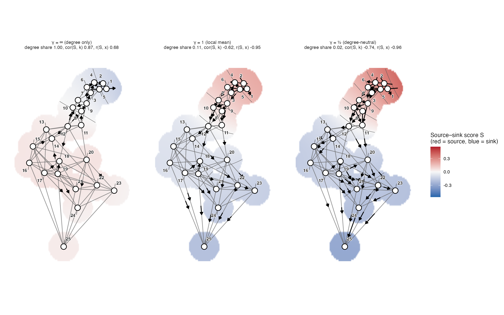
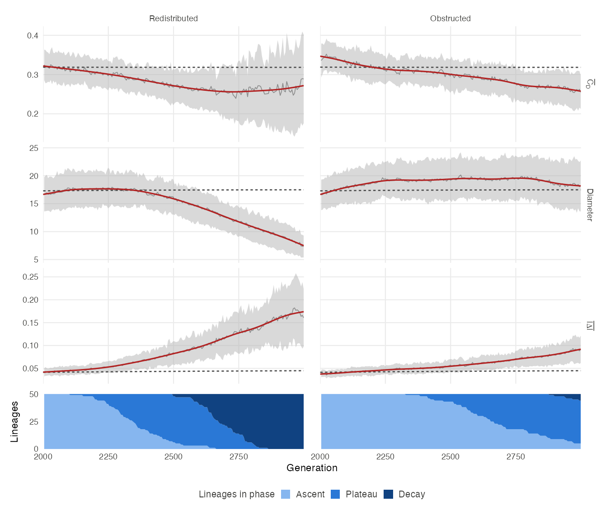
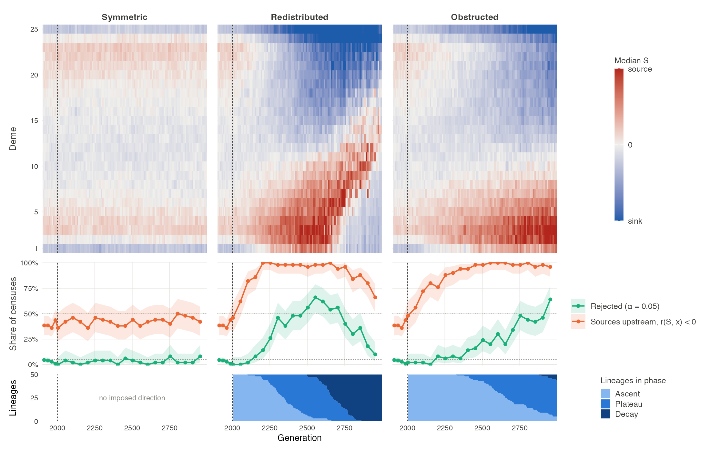
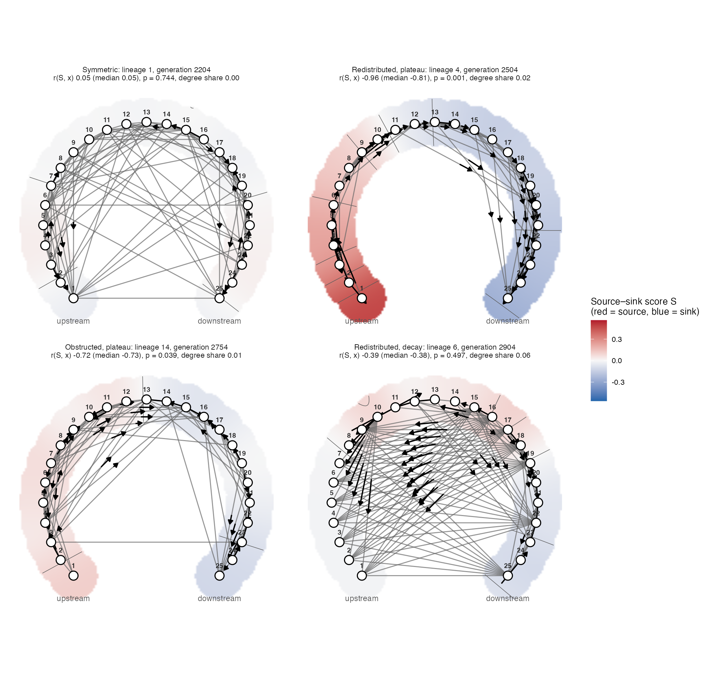
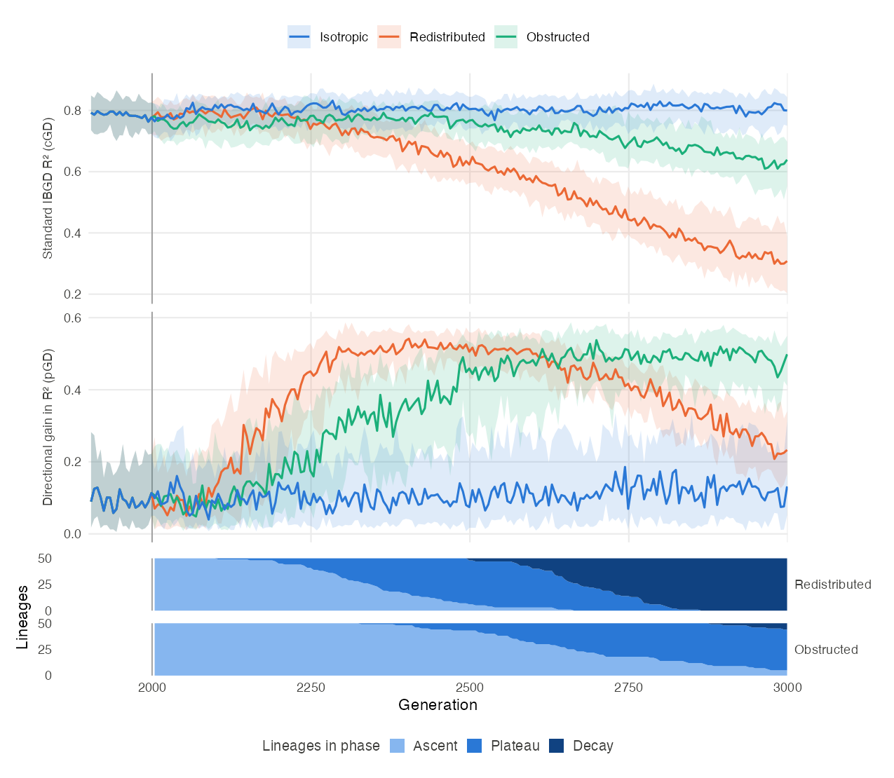
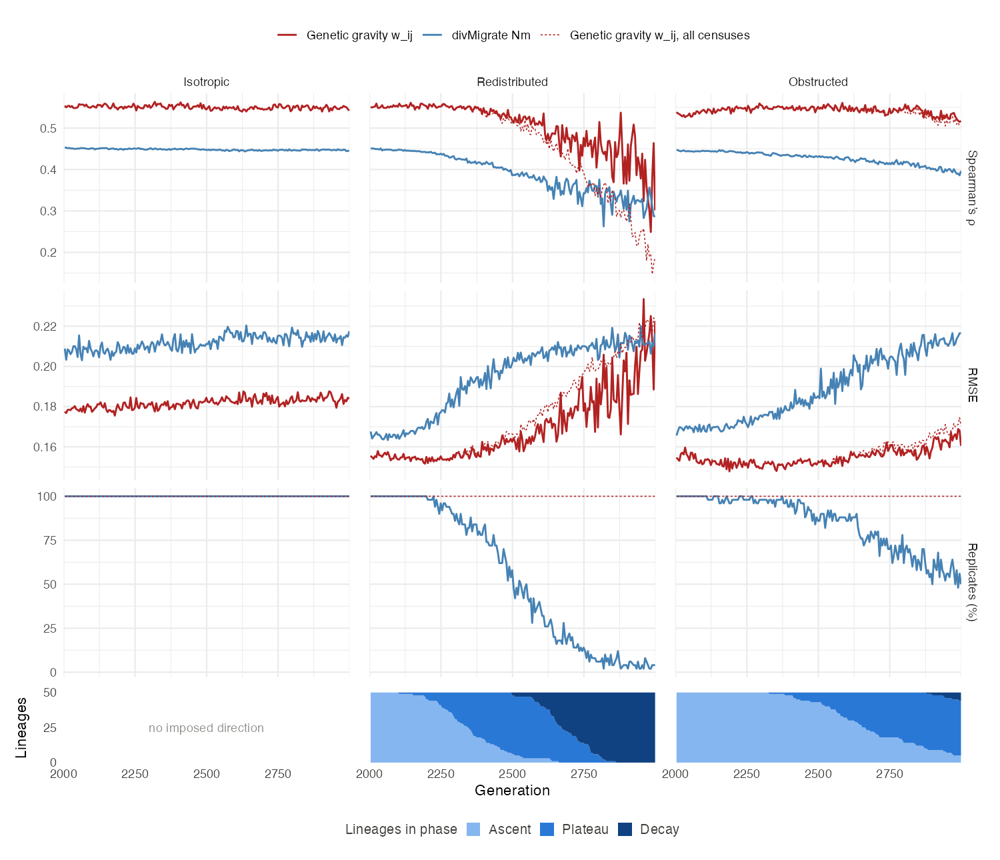
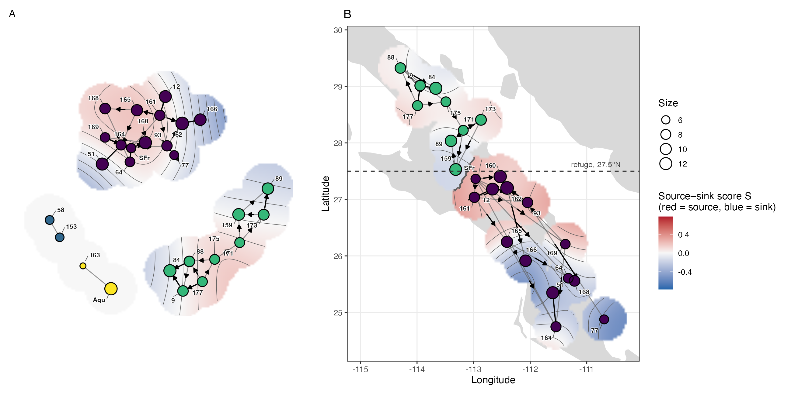

# Genetic Gravity: Extracting Directional Gene Flow from Population Graphs

Rodney J. Dyer  
rjdyer@vcu.edu  
https://rodneydyer.com

[School of Life Sciences and Sustainability](https://slss.vcu.edu)  
[Virginia Commonwealth University](https://vcu.edu)  
Richmond, Virginia 23284

# Abstract

> ==To be added after discussion is finished==

# Introduction

Inferring the pattern and direction of genetic connectivity from molecular data is a central problem in population and landscape genetics (Slatkin, 1985; Dyer, 2015). Many of the processes that structure natural populations are directional: prevailing winds and ocean currents, the downstream bias of dendritic river networks, gradients in habitat quality that create source–sink dynamics, and range expansions out of refugia all bias the direction of dispersal (Pringle et al., 2011; Paz-Vinas & Blanchet, 2015; Paz-Vinas et al., 2015; Baker & Dyer, 2011; Wogan et al., 2024). Yet the summaries most often used to describe connectivity as if they were symmetric. Pairwise $F_{ST}$ and its analogs return a single value for each pair of populations, $F_{ST(i,j)}=F_{ST(j,i)}$, and under Wright's island model ($F_{ST}\approx1/(4N_em+1)$; Wright, 1931), a value that reflects the product of effective size and migration rather than the direction of exchange (Whitlock & McCauley, 1999). The same differentiation can arise from very different histories, and treating connectivity as a scalar, undirected quantity averages over exactly the heterogeneity that questions about colonization, source–sink dynamics, and wind- or water-mediated dispersal are trying to resolve.

The field is not without tools for these questions. Assignment-based methods such as `BayesAss` infer recent, directional migration rates from multilocus genotypes (Wilson & Rannala, 2003), and coalescent and isolation-with-migration frameworks recover asymmetric long-term migration matrices, either by likelihood over genealogies (Beerli & Felsenstein, 2001) or by fitting the joint site-frequency spectrum of a few populations (Gutenkunst et al., 2009). Where the question is the direction of a range expansion, the directionality index $\psi$ reads the origin and axis of spread from pairwise allele-frequency asymmetries (Peter & Slatkin, 2013), and at the landscape scale, effective-migration-surface methods map spatial heterogeneity in gene flow (Petkova et al., 2016; Marcus et al., 2021). Each is powerful within its domain, but each also carries a characteristic cost: a prespecified demographic or spatial model, an assumption of migration–drift equilibrium, genome-scale data, few populations, explicit spatial coordinates, or substantial computation. Differentiation-based estimators such as `divMigrate` (Sundqvist et al., 2016) are lighter, but read direction one pair of populations at a time.

Population Graphs offer a different starting point (Dyer & Nason, 2004; Dyer, 2007, 2015). A Population Graph translates among-population genetic variance into a network using conditional genetic covariance: each edge is estimated from the multilocus covariance of all populations jointly, so that pairs connected only through other sampled populations are pruned, and the shape of the resulting network is diagnostic of the processes that produced it—range expansion, vicariance and isolation by distance each leave characteristic signatures in node degree, edge length and network diameter (Dyer, 2007, 2015). Population Graphs have been used in landscape genetics (Dyer, 2015; Daniel et al., 2024), conservation planning (Vilaça et al., 2024), biogeography (Wogan et al., 2024), life-history comparisons (Reed et al., 2023), invasion biology (Baker & Dyer, 2011) and pollen-mediated gene flow (Smouse et al., 2001; Dyer et al., 2004; DiLeo et al., 2014). Their edges, however, are undirected. Source and sink populations may share a strong conditional dependency, but the direction of that dependency—which population's allele frequencies are pulling the other's—cannot be read from the edge weight, and the same weight can be produced by stable, symmetric exchange or by a one-way colonization pulse with opposite implications.

Here, I introduce *genetic gravity*, an extension of the Population Graph that extracts directional information from its otherwise undirected topology, without a demographic model and without information beyond the genotypes and the graph built from them. I first derive a pair of neighborhood weights for each edge, read from a node-local Gaussian kernel at each end, whose difference defines an edge-level asymmetry index, and aggregate these into a population-level gravity and a source–sink score that orders populations from genetic sources to sinks. The kernel's bandwidth is read from the graph itself and scaled by a single multiplier that the researcher chooses by the question: a degree-neutral value for inferring direction and the local mean for describing connectivity. I then characterize the behavior of these quantities with individual-based simulations of *Symmetric*, *Redistributed* and *Obstructed* migration along a stepping stone, following each replicate through the phases its directional signal passes through, and introduce two single-graph tests for directional gene flow: a source–sink gradient test along a hypothesized covariate, and a comparison of directional against symmetric isolation-by-graph-distance models built on a directional partition of conditional genetic distance. I compare the neighborhood weights with `divMigrate` against the true simulated migration matrix, and apply the framework to a Sonoran Desert bark beetle whose phylogeography predicts expansion in two directions from a single refugium (Garrick et al., 2013). Although the simulations and the case study use position along a single axis, neither test is tied to Euclidean geography, and substituting resistance-based or other ecological distances is a direct extension to the landscape-genetic questions for which Population Graphs are already used (Dyer, 2015). All methods are implemented in the R package gstudio.

# Methods

The framework assumes that a Population Graph has already been constructed from multilocus genotypes; its inputs are the symmetric edge weights $e_{ij}$ and the adjacency structure of the graph $G=\{V,E\}$, with notation following Dyer & Nason (2004) and Dyer (2007) (Supplementary Materials, Tab_Notation). A Population Graph is a Markov independence graph, and two of its properties matter here. Populations joined by an edge are conditionally dependent, through ongoing gene flow or recent shared ancestry, whereas populations joined only through others ($A\leftrightarrow B\leftrightarrow C$) are conditionally independent given the intermediates. And because the presence of each edge depends on all sampled populations at once, adding or removing a population requires the whole topology to be re-estimated. An edge therefore represents a direct relationship between two populations given those sampled, not one routed through another sampled population, which is what allows a direction to be attributed to it (Supplementary Materials).

## The Model of Genetic Gravity

Each symmetric edge in a Population Graph is the pooled product of two conditional relationships: the contribution of population $j$ to the genetic structure of $i$, and the opposite contribution of $i$ to $j$. The edge weight $e_{ij}$ is the conditional genetic distance (cGD) used to infer isolation by graph distance (Dyer, 2015; Miles et al., 2018). Focusing on each population and its retained neighbors, $N(i)$, I define a *neighborhood weight*, $w_{j\mid i}$, as $j$'s weight in $i$'s neighborhood, following Gaussian stochastic neighbor embedding (Hinton & Roweis, 2003):

$$
w_{j\mid i}= \frac{\exp\left(- e_{ij}^{2}/2b_i^{2}\right)}{\sum\limits_{k\in N(i)}\exp\left(- e_{ik}^{2}/2b_i^{2}\right)}
$$

The kernel is strictly local: only retained neighbors contribute, so populations that are conditionally independent of $i$ contribute nothing. The node-specific *local bandwidth* $b_i$ sets how quickly the kernel decays with distance, and is a multiple of the mean edge weight in $i$'s neighborhood,

$$
b_{i} = \gamma\,\frac{s_{i}}{k_{i}} = \frac{\gamma}{k_{i}}\sum\limits_{j\in N(i)}e_{ij},
$$

where $s_i$ is the strength (weighted degree) of population $i$, $k_i$ its degree, and $\gamma$ a fixed multiplier: $\gamma=\tfrac{1}{2}$ for inferring the direction of gene flow, used for every directional analysis here, and $\gamma=1$, the local mean, for describing connectivity (below). A population whose neighbors are genetically divergent receives a broad kernel; one embedded in a tight cluster of similar populations receives a narrow one.

Every edge is read from both of its ends, $w_{j\mid i}$ from $i$'s neighborhood and $w_{i\mid j}$ from $j$'s, and because the two neighborhoods differ, so do the two weights. Their difference defines the *gravity asymmetry* along the edge,

$$
\Delta_{i\rightarrow j} = w_{i\mid j}-w_{j\mid i},
$$

$i$'s pull on $j$ minus $j$'s pull on $i$. The asymmetry comes not from the edge itself but from the two neighborhoods it is compared against: the same $e_{ij}$ can be typical of $i$'s neighborhood and atypically long for $j$'s. A value near zero indicates balanced exchange; a positive value marks $i$ as the genetic source and $j$ as the sink. Throughout, higher values mean more of a source, for $\Delta_{i\rightarrow j}$ and for every population-level quantity built from it. Because $b_i$ scales with the edge weights, rescaling every cGD by a constant leaves every weight unchanged, so graphs built from marker panels with very different overall divergence can be compared directly.

Edges that share a population are not independent, so direction is summarized at the population level. The *gravity* of population $i$,

$$
g_{i} = \sum\limits_{j\in N(i)} w_{i\mid j},
$$

is the total weight $i$ holds in its neighbors' neighborhoods. Because each population's own weights sum to one, gravity is conserved, $\sum_i g_i=K$, and the source–sink balance $g_i-1$ sums to zero over the graph whatever the migration matrix: every population that reads as a source is balanced by populations that read as sinks. The *source–sink score*, $S$, places all populations on a single scale, assigning each the value whose differences best reproduce the asymmetries along every retained edge at once,

$$
\hat{S}=\arg\min_{S}\sum_{(i,j)\in E}\left[\Delta_{i\rightarrow j}-(S_i-S_j)\right]^2, \qquad \sum_{i}S_i=0 \text{ within each connected component}.
$$

$S$ is the potential on the graph whose local imbalance is the gravity balance, the construction of HodgeRank (Jiang et al., 2011; Supplementary Materials). It is the quantity mapped onto geography and tested against a hypothesized covariate. "Source" and "sink" here are genetic, not demographic: a genetic source is a population toward whose allele frequencies its neighbors have been pulled, distinct from the demographic sense of Pulliam (1988). Low gravity is not by itself proof of immigration, because an isolated, strongly drifted population can read as a sink for the same reason a true recipient does, and a low score is best interpreted alongside within-population diversity.

### Partitioned Conditional Genetic Distance, pGD

The same two weights also split each edge's distance into directional components. The *partitioned conditional genetic distance* (pGD) is $p_{ij} = e_{ij}\,w_{j\mid i}/(w_{j\mid i}+w_{i\mid j})$, with $p_{ji}$ defined correspondingly, so that $p_{ij}+p_{ji}=e_{ij}$ and $p_{ij}=p_{ji}=e_{ij}/2$ when the two weights are equal. Because pGD is a distance, it reads opposite to the source–sink convention: conditional distance is shorter in the direction of gene flow. pGD turns the undirected Population Graph into a directed, asymmetrically weighted graph over the same topology, which can replace cGD in the analyses a Population Graph usually feeds, such as isolation by graph distance (IBGD; Dyer & Nason, 2004), ecological resistance modeling (Dyer, 2015) and studies of range expansion (Baker & Dyer, 2011).

## Individual-based simulations

The behavior of genetic gravity was evaluated with individual-based stochastic simulations following Dyer (2007). Each replicate tracks a metapopulation of $K=25$ demes of $N=100$ diploid individuals scored at $L=20$ independently segregating, codominant, biallelic loci. Replicates start from random allele frequencies; generations are non-overlapping, mating is random within demes, and mutation is excluded so that only migration and drift act. Every replicate first runs a 2,000-generation *burn-in* of symmetric migration along a one-dimensional stepping stone ($m_{i\rightarrow i+1}=m_{i\leftarrow i+1}=0.025$). Fifty replicates were run, multilocus genotypes were saved every five generations, and each snapshot was converted into a Population Graph (Dyer & Nason, 2004), from which the neighborhood weights, gravity asymmetries, source–sink scores, mean degree centrality ($\bar{C}_D$) and graph diameter were recorded.

At generation 2000 each replicate was continued for 1,000 generations under each of three scenarios (Tab_ScenarioParameters), so that all three share an identical history to that point. *Symmetric* migration continued the *burn-in* matrix and serves as the null trajectory. *Redistributed* migration kept the total rate fixed but split it 4:1 in one direction, and *Obstructed* migration kept the *Symmetric* forward rate but suppressed the reverse rate; in both, the bias ran toward higher deme numbers at every link. Three further symmetric scenarios at progressively lower migration rates, which raise neutral differentiation without imposing a direction, were used only to calibrate false-positive rates (Supplementary Materials). Together the scenarios test a simple expectation: the difference between forward and reverse rates sets the direction and strength of the net force homogenizing the metapopulation, while total migration sets how quickly a replicate moves toward that state. *Obstructed* migration, with half the net bias of *Redistributed* migration and lower total migration, should therefore pass through the same sequence of states more slowly.

*Tab_ScenarioParameters:* Post-*burn-in* migration parameters for the three simulation scenarios. All scenarios share an identical 2,000-generation symmetric *burn-in* before the scenario's migration matrix is applied.

| Scenario      | $m_{i \rightarrow i+1}$ | $m_{i \leftarrow i+1}$ | $m_{Total}$ | Ratio | Constant               |
| ------------- | :---------------------: | :--------------------: | :---------: | :---: | ---------------------- |
| *Symmetric* |          0.025          |         0.025          |    0.050    |  1:1  | Symmetric connectivity |
| *Redistributed* |          0.040          |         0.010          |    0.050    |  4:1  | Total emigration rate  |
| *Obstructed*    |          0.025          |         0.010          |    0.035    | 2.5:1 | Forward rate           |

### Phases of the forward simulations

After the change in migration, each lineage passes through three phases at its own pace, so results for the asymmetric scenarios are reported by phase, with each lineage's censuses assigned by boundaries read from its own genotypes. In *ascent*, the new migration matrix restructures among-population covariance; upstream demes receive fewer immigrants and lose heterozygosity faster, and *ascent* ends when the resulting gradient in within-deme $H_e$ along the axis of flow has completed 90% of its rise (used only to date the boundary, not as evidence of direction). On the *plateau*, the covariance structure has adjusted and changes only slowly while allele frequencies continue to converge. *Decay* follows because, in a closed system without mutation, allele frequencies converge under any migration matrix, and the among-population variance through which migration is observed is lost; it begins at the first census at which a lineage's demes carry, on average, fewer than 4.5 of the 20 loci polymorphic, roughly where the loss of loci alone begins to inflate the asymmetry index (the *informative horizon*). These boundaries are heuristics for separating regimes, not constants of the system. Phase summaries are therefore taken from the core of each lineage's phase, the middle half of the interval between its boundaries, and their sensitivity to the boundaries is reported in the Supplementary Materials. A panel of loci chosen for polymorphism, as SNP panels routinely are, would rarely sit in the *decay* regime, which is reported mainly to show where inference from standing variation ends.

## Significance Testing for Asymmetry

Nulls that permute or resample parts of a single Population Graph were consistently anti-conservative under symmetric migration, because $\Delta_{i\rightarrow j}$ and $S$ inherit smooth, node-level structure from the graph's topology (Supplementary Materials). Asymmetry was instead tested with two procedures: a gradient test on the source–sink score, and a comparison of directional (pGD) and symmetric (cGD) isolation-by-graph-distance models. Censuses from the same lineage share its history, so false-positive rates are given with 95% intervals from a bootstrap that resamples the 50 lineages.

### Source–sink gradient test

This test asks whether the source–sink scores change monotonically along a hypothesized covariate $x$, such as position along a suspected axis of flow. The statistic is Spearman's $r(S,x)$; because high $S$ marks a source, $r(S,x)<0$ places the sources at low values of $x$. The null preserves the spatial structure of $S$ on the census's own Population Graph, using Moran spectral randomization (Wagner & Dray, 2015) on the kernel-weighted adjacency with $B=999$ randomizations, tested two-sided at $\alpha=0.05$ (Supplementary Materials). Because it reproduces the smoothness that $S$ inherits from drift on the graph, a rejection reflects a gradient along the covariate beyond what drift alone produces.

### Directional isolation by graph distance

This test asks whether modeling direction explicitly improves how well the graph explains isolation by distance (Wright, 1943). Standard IBGD regresses all-pairs cGD (shortest paths over $e_{ij}$) on pairwise spatial separation $|dx_{ij}|$, giving $R^2_{cGD}$. The directional model uses all-pairs directed shortest paths over pGD, so that the distance from $i$ to $j$ may differ from that from $j$ to $i$, and a hypothesized axis of flow—downstream, a prevailing wind, the front of a range expansion, or here the stepping stone—classifies each ordered pair as forward or reverse; $\text{pGD}_{ij} \sim |dx_{ij}| + |dx_{ij}| \cdot r_{ij}$, with $r_{ij}=1$ for reverse pairs, then gives separate forward and reverse isolation slopes and a fit $R^2_{pGD}$ adjusted for the additional slope. If $\Delta R^2 = R^2_{pGD} - R^2_{cGD} > 0$, the directional description explains isolation better than the symmetric one; if not, this is an absence of evidence for asymmetry, not evidence of symmetry. Where the directional fit is supported, the ratio of forward to reverse slopes, $b_{fwd}/b_{rev}$, describes the direction of isolation: a ratio below one means genetic distance accumulates more slowly downstream. Because the two fits use different response matrices, the comparison is not a nested-model test, and its error rates were characterized empirically.

## Choosing the bandwidth

The bandwidth sets the scale at which a population's neighbors are compared, and with it how much of $\Delta_{i\rightarrow j}$ reflects genetic distance and how much the number of neighbors. As the kernel flattens, every weight tends to $1/k_i$, so the index reduces to a *topological floor*, $\Delta^{0}_{i\rightarrow j}=1/k_j-1/k_i$, and the source–sink score to $S^{0}_i=-1/k_i$, both set by degree alone. When the question is the direction of gene flow, degree is a nuisance; when it is a population's overall weight in the network, degree is part of the answer. Two bandwidths are therefore offered, and, as with the choice between a rank and a parametric correlation, the question determines which is appropriate. The *degree-neutral* bandwidth, $\gamma=\tfrac{1}{2}$, is the multiplier at which $S$ carries no degree signature under symmetric migration (median 0.49 across *Symmetric* censuses, and 0.51 in 50 further lineages simulated with new seeds). It is fixed once from the symmetric null rather than tuned on each graph, because tuning lets the signal under test move the bandwidth (Supplementary Materials), and it is used for both tests and for mapping sources and sinks. The *local mean*, $\gamma=1$, keeps the contribution of degree, so that hubs read as sources and leaves as sinks; it describes a population's weight in the network but is not suited to testing direction. With either bandwidth, the *degree share*—the $R^2$ of $\Delta_{i\rightarrow j}$ on $\Delta^{0}_{i\rightarrow j}$—reports how much of the index degree sets (Fig_GravityFieldBandwidth). Sensitivity to alternative bandwidths is assessed in the Supplementary Materials.

*Fig_GravityFieldBandwidth:* One Population Graph drawn at three bandwidths: a *Redistributed* census on the *plateau* (lineage 4, generation 2504; gene flow biased toward higher-numbered demes, so the sources are expected at the top), distributed with gstudio as the example data set `gravity`. Nodes are numbered by deme and placed in the same positions in every panel (a Kamada–Kawai layout of the graph; Kamada & Kawai, 1989), so the upstream demes sit at the top and the downstream demes at the bottom. The shaded surface interpolates the source–sink score $S$ (red, source; blue, sink), and arrows on the edges point from source to sink with length proportional to $|\Delta_{i\rightarrow j}|$ (the weaker half are omitted). Each panel heading gives the degree share (the $R^2$ of $\Delta_{i\rightarrow j}$ on $\Delta^{0}_{i\rightarrow j}$), $\text{cor}(S,k)$, and $r(S,x)$, the Spearman correlation of $S$ with deme number used by the source–sink gradient test (negative: sources upstream). At $\gamma=\infty$ the weights are $1/k_i$, the degree share is one, and $S$ follows degree alone: the sparsely connected upstream demes read as sinks and the densely connected downstream demes as sources, so topology alone draws the reverse of the imposed flow ($r(S,x)=0.68$). At the local mean ($\gamma=1$) the gradient from upstream sources to downstream sinks appears ($r(S,x)=-0.95$), but 11% of the variance in $\Delta_{i\rightarrow j}$ is still degree. At the degree-neutral bandwidth ($\gamma=\tfrac{1}{2}$) degree accounts for 2% and the map shows the flow ($r(S,x)=-0.96$). Under directional flow the sparsely connected upstream demes are the true sources, so $S$ correlates negatively with degree even at the degree-neutral bandwidth ($\text{cor}(S,k)=-0.74$); it is the degree share, not $\text{cor}(S,k)$, that measures how much of the index the topological floor sets. Sharper kernels are compared in Supplementary Materials, Fig_BandwidthSweep.

## Comparison with a differentiation-based method

To place genetic gravity alongside an existing method, the simulated data were also analyzed with `divMigrate` (Sundqvist et al., 2016), a widely used estimator of directional relative migration from codominant genotypes. The two do not estimate the same quantity—`divMigrate` reads relative migration from pairwise differentiation, using the $N_m$ statistic of Alcalá et al. (2014), whereas gravity is read from conditional genetic structure—so the comparison asks only which better reproduces the true migration matrix, known here because it was simulated. Gene flow from $j$ to $i$ raises $j$'s weight in $i$'s neighborhood, so $w_{j\mid i}$ was compared with the transposed truth, $m_{j\rightarrow i}$, and $N_m[i,j]$ with $m_{i\rightarrow j}$. Agreement was summarized at each census as Spearman's $\rho$ over all ordered pairs, which mainly measures whether an estimator separates the stepping-stone corridors from pairs with no direct migration, and direction separately as the fraction of the 24 stepping-stone links on which an estimate is larger in the imposed direction. Censuses at which $N_m$ was undefined on any pair were excluded from the paired comparison (Supplementary Materials).

## Case Study: Sonoran Desert Bark Beetle

To show how the framework handles specific *a priori* hypotheses of direction, I applied it to the Sonoran Desert bark beetle *Araptus attenuatus* (Curculionidae) of the Baja California peninsula, which is known only from the senescing stems of its host plant, *Euphorbia lomelii* (Euphorbiaceae). Garrick et al. (2013) found a widespread peninsular clade whose patterns of allelic diversity indicated a rapid expansion out of a Pleistocene refugium near 27.5°N, both northward and southward. ==[Sampling and markers: number of sites, individuals and loci; how the Population Graph was built.]== If so, populations near the refugium should read as sources and those farther from it as sinks, and genetic distance should accumulate more slowly moving away from the refugium than toward it ($\Delta R^2>0$ with $b_{fwd}/b_{rev}<1$). For the directional isolation comparison, separation was the difference in distance from the refugium, $|d_i-d_j|$, and a pair was forward when $j$ lies farther from the refugium than $i$. All quantities were computed at the degree-neutral bandwidth, with the degree share reported alongside; the source–sink gradient test was repeated at the local mean, and the results were mapped onto the landscape.

# Results

## *Symmetric* baseline

Under *Symmetric* migration the Population Graphs reached a stable topology within the 2,000-generation *burn-in*: mean degree centrality fell and graph diameter rose toward a plateau and stayed flat through the forward phase (Supplementary Materials, Fig_SymmetricBaseline). The signed mean asymmetry stayed close to zero ($\bar{\Delta}=-0.0015$ over the forward phase), an order of magnitude below the values reached under asymmetric migration. Averaged within replicates, the source–sink score showed a weak lean, with sources slightly downstream in 33 of the 50 *burn-in* lineages ($p=0.033$); the lean runs against the direction later imposed, so it can only work against detection, and it did not recur in 50 lineages simulated with new seeds (Supplementary Materials).

The bandwidth determined how much of the index degree set. At the local mean ($\gamma=1$), $S$ tracked the degree-only score $S^{0}$ closely under symmetric migration (median correlation 0.78–0.83), so hubs read as sources and leaves as sinks without any directional gene flow. At the degree-neutral bandwidth the floor was gone (0.01–0.06). Degree-one leaves read as sinks by construction at any bandwidth, but were rare—in under 1% of symmetric and 5–8% of asymmetric censuses—and excluding them barely changed the source–sink gradient (Supplementary Materials).

## Consequences of *Redistributed* and *Obstructed* connectivity

Every *Redistributed* lineage passed through all three phases within the forward window (Fig_ScenarioComparison, left). *Ascent* ended at a median of generation 2332, the *plateau* lasted a median of 325 generations, and *decay* began at a median of generation 2674. Across these phases mean degree centrality fell (0.309, 0.274 and 0.236; *Symmetric* 0.315) and diameter, after rising slightly near the end of *ascent*, collapsed (15.8 on the *plateau* and 10.2 after the horizon; *Symmetric* 16.3), while mean $|\Delta_{i\rightarrow j}|$ rose (0.049, 0.080 and 0.147). Rising asymmetry alongside a collapsing diameter is the expected consequence of sustained directional bias in a closed migration–drift system: *Redistributed* migration does not only make gene flow asymmetric, it progressively homogenizes the metapopulation. Part of the rise after the horizon is information loss rather than signal (Supplementary Materials, Fig_InformationNull). The signed mean $\bar{\Delta}$ was positive in 98% of lineages during *ascent* and on the *plateau*, but negative in 70% after the horizon. This sign change is not a reversal of gene flow: it is carried by rewiring of the graph's interior, and the source–sink score kept the imposed ordering through it (below; Supplementary Materials).

*Obstructed* migration, with half the net directional bias, passed through the same phases more slowly, as predicted (Fig_ScenarioComparison, right). *Obstructed* lineages reached each stage 1.8 to 2.8 times later than *Redistributed* ones (1.9 times later for the end of *ascent*), close to the two-fold difference in net bias, although the difference in total migration is not excluded as a contributor. Diameter rose further and held longer before declining, consistent with the lower total migration letting drift differentiate the metapopulation further before directional homogenization took over. Once on the *plateau*, however, *Obstructed* lineages resembled *Redistributed* ones (mean degree centrality 0.270 against 0.274, mean $|\Delta_{i\rightarrow j}|$ 0.074 against 0.080, $\bar{\Delta}$ 0.030 against 0.034): the net bias set how quickly a lineage reached its *plateau*, not how strong the directional signal was once there. Only 6 of the 50 *Obstructed* lineages crossed the informative horizon, so *Obstructed* results are reported for *ascent* and the *plateau* only.

*Fig_ScenarioComparison*: Forward-phase (generations 2000–2999) trends in graph structure and asymmetry magnitude under the *Redistributed* (left) and *Obstructed* (right) scenarios, on shared axes for direct comparison—mean degree centrality ($\bar{C}_D$), graph diameter, and mean absolute asymmetry ($\overline{|\Delta_{i\rightarrow j}|}$)—mirroring Fig_SymmetricBaseline (Supplementary Materials). The dashed line is the *burn-in*'s fitted exponential-equilibrium curve, extrapolated across the forward phase, as the null reference; the shaded band is the empirical $\pm$1 SD across replicates and the solid red line is a fitted trend (a penalized regression spline; Supplementary Materials). Diameter follows the same rise–hold–decline sequence under both scenarios on different timescales: *Redistributed* rises slightly above the *Symmetric* level, peaks near generation 2230 and collapses after about generation 2350, whereas *Obstructed* rises further, holds from about generation 2300 to 2800, and has only begun to decline by the end of the window. The strip beneath each column shows, at each census, how many of the 50 lineages are in *ascent*, on the *plateau*, or in *decay*, with each lineage assigned to a phase by its own boundaries. Because lineages change phase at different generations, every point on the curves above averages lineages in different phases; under *Obstructed* migration almost no lineage reaches the *decay* phase within the window.

## Significance Testing for Asymmetry

### Source–sink gradient test

Under symmetric migration the source–sink gradient test held its nominal rate (Tab_SourceSinkCalibration). At $\alpha=0.05$ it rejected in 3.0% of *burn-in* censuses and 2.9% of *Symmetric* forward-phase censuses, and in 2.9–4.2% across the symmetric differentiation gradient, with no increase as neutral differentiation rose; lineage-clustered upper limits were 5.8% or less. The choice of null mattered. Permuting $S$ across populations rejected in 10–18% of censuses, and spectral randomization on the stepping-stone adjacency that generated the data in 5–7%: $S$ inherits its smoothness from the Population Graph, including its non-adjacent edges, so the graph is a safer basis for a spatial null than the landscape itself (Supplementary Materials).

*Tab_SourceSinkCalibration:* False-positive rate of the source–sink gradient test (Spearman $r(S,x)$, degree-neutral bandwidth) under symmetric migration, at $\alpha$ = 0.01 / 0.05 / 0.10, for the spectral null on the census's own Population Graph with two alternative nulls at $\alpha=0.05$ for comparison: plain permutation of $S$ across populations, and spectral randomization on the true stepping-stone adjacency. The last column gives the graph spectral null at the local mean bandwidth ($\gamma=1$), $\alpha=0.05$. 1,000 censuses per sample (*burn-in*: generations 1904–1999, every 5 generations; forward phase: generations 2004–2954, every 50 generations; 50 replicates).

| Sample | Graph spectral null, $\alpha$ = 0.01 / 0.05 / 0.10 | Plain permutation, 0.05 | Stepping-stone spectral null, 0.05 | Local mean, graph spectral null, 0.05 |
| :---- | :---: | :---: | :---: | :---: |
| *Burn-in* | 0.004 / 0.030 / 0.056 | 0.104 | 0.054 | 0.046 |
| *Symmetric* | 0.005 / 0.029 / 0.059 | 0.138 | 0.058 | 0.062 |
| sym-mid | 0.010 / 0.042 / 0.076 | 0.177 | 0.065 | 0.051 |
| sym-low | 0.003 / 0.029 / 0.066 | 0.179 | 0.061 | 0.064 |
| sym-verylow | 0.008 / 0.032 / 0.061 | 0.182 | 0.073 | 0.038 |

Under asymmetric migration, single-census power tracked the phases (Fig_SourceSinkScore, bottom; Supplementary Materials, Tab_SourceSinkPower). In the core of each phase the rejection rate under *Redistributed* migration was 15% during *ascent*, 65% on the *plateau* and 26% after the informative horizon, and under *Obstructed* migration 10% during *ascent* and 45% on the *plateau*. The direction was far more consistent than any single census could certify: on the *plateau*, $r(S,x)$ was negative—sources upstream—in 98% and 99% of censuses (median $-0.81$ and $-0.73$), and every lineage placed the sources upstream when its *plateau* censuses were averaged (46 of 46 and 42 of 42), against 38% of *Symmetric* lineages. After the horizon, *Redistributed* lineages still placed the sources upstream in 86% of censuses.

*Fig_SourceSinkScore:* The population-level source–sink score $S$ (degree-neutral bandwidth) through time. Top: median $S$ across the 50 replicates for each deme (rows; migration in the asymmetric scenarios runs toward higher deme numbers) at each census (every 5 generations in the final 100 generations of the shared *burn-in*, left of the dashed onset line, and every 10 generations in the forward phase), by scenario (columns). Red marks genetic sources (high $S$), blue marks sinks (low $S$), and gray is zero; the color scale is symmetric and saturates at the 98th percentile of $|S|$. Bottom: the source–sink gradient test at each census (50 replicates; *burn-in* censuses pooled into 25-generation bins): the fraction of censuses in which the test rejects at $\alpha=0.05$ (aqua) and the fraction with sources upstream, $r(S,x)<0$ (orange), with 95% intervals. Each forward-phase point takes one census from each lineage, so its interval is binomial; each *burn-in* bin holds five censuses per lineage, so its interval is a bootstrap over lineages. Dotted lines mark the nominal 5% rate and 50%. $S$ was computed from every saved graph on this grid; the test was run every 50 generations in the forward phase (Supplementary Materials, Tab_SourceSinkPower). The strip at the bottom shows, at each census, how many of the 50 lineages in each asymmetric scenario are in *ascent*, on the *plateau*, or in *decay*, each lineage assigned by its own boundaries.

The map shows where the gradient comes from (Fig_SourceSinkScore, top). Under symmetric migration the interior is close to neutral, with a mild sink at each terminal deme. Once asymmetry is imposed, the downstream end deepens into a sink within 200–400 generations and a band of sources forms upstream, centered on deme 3 in both scenarios. Under *Obstructed* migration the band holds its place; under *Redistributed* migration it moves downstream after about generation 2600, to deme 11 by the end of the window, while the demes it leaves behind fade to neutral, so the collapse of a lineage advances downstream from its upstream end. Fig_SourceSinkExamples shows these states on single censuses, drawn with `plot(gravity_field(graph))`: without direction, weak sources and sinks alternate and arrows point both ways; on the *plateau*, a single run extends from sources upstream to sinks downstream; after the horizon, the upstream demes, which no longer differ genetically, share one value of $S$ and the band of sources has moved to the middle of the stepping stone.

*Fig_SourceSinkExamples:* Four single censuses drawn as gravity fields at the degree-neutral bandwidth ($\gamma=\tfrac{1}{2}$): *Symmetric* migration (lineage 1, generation 2204), *Redistributed* on the *plateau* (lineage 4, generation 2504; the gstudio example data set `gravity`, the same graph as Fig_GravityFieldBandwidth, placed here in deme order rather than by graph layout), *Obstructed* on the *plateau* (lineage 14, generation 2754), and *Redistributed* in *decay* (lineage 6, generation 2904). The examples are illustrative. The *Symmetric*, *Obstructed* and *decay* censuses are each the one whose $r(S,x)$ is closest to its sample's median (ties broken by the lowest lineage number), among all 1,000 *Symmetric* forward-phase test censuses or the censuses in the core of the named phase (middle half of each lineage's phase); the *Redistributed* *plateau* census, from the core of its lineage's *plateau*, has the strongest gradient of the 160 *plateau*-core censuses ($r(S,x)=-0.96$, against a median of $-0.81$), so it is the clearest case rather than a typical one. Nodes are numbered by deme and placed in order around a horseshoe, the same in every panel, from upstream (deme 1, lower left) to downstream (deme 25, lower right), so that long edges separate. Surface, arrows and colour scale as in Fig_GravityFieldBandwidth, with a common scale across panels. Each heading gives $r(S,x)$, the sample median, the source–sink test $p$-value and the degree share.

### Directional isolation by graph distance

Standard isolation by graph distance weakened once migration became asymmetric (Fig_DirectionalIBGD, top; Tab_IBGDFitComparison). The $R^2$ of cGD on spatial separation stayed near 0.80 under *Symmetric* migration but fell under *Redistributed* migration from 0.78 during *ascent* to 0.63 on the *plateau* and 0.38 after the horizon, and under *Obstructed* migration to 0.68 on the *plateau*. Part of what is lost is directional structure that the direction-aware pGD model recovers: on the *plateau* its fit exceeded the standard symmetric fit (0.74 against 0.63 under *Redistributed* and 0.75 against 0.68 under *Obstructed* migration), whereas under *Symmetric* migration it fell well short (0.53 against 0.80). The directional model therefore improves on cGD when, and largely only when, gene flow is asymmetric; for ordinary isolation by distance, cGD remains the appropriate distance (Supplementary Materials).

*Fig_DirectionalIBGD:* Isolation by graph distance under symmetric and directional readings of the same edges, by scenario. Top: $R^2$ for standard IBGD, cGD regressed against spatial distance $|dx|$. Bottom: the additional $R^2$ gained by letting pGD's forward and reverse edge distances take separate slopes against the same $|dx|$, relative to a single shared (direction-blind) pGD slope. The vertical line marks the end of *burn-in*. *Symmetric* remains flat on both measures throughout the forward phase; *Redistributed* and *Obstructed* both trace the phases established above, *Redistributed* reaching its *plateau* gain earlier and falling back as its lineages cross the informative horizon, *Obstructed* reaching a similar *plateau* later and holding it through the end of the window. The curves are medians by generation; because lineages change phase at different times, the phase-matched values in the text and in Tab_IBGDFitComparison are the more precise summary. The strip beneath shows, at each census, how many of the 50 lineages in each asymmetric scenario are in *ascent*, on the *plateau*, or in *decay*, each lineage assigned by its own boundaries.

*Tab_IBGDFitComparison:* Median $R^2$ for standard (symmetric) IBGD compared against pGD (degree-neutral bandwidth) fit without and with direction modeled explicitly, by scenario and phase (*Symmetric*: whole forward phase; *Redistributed* and *Obstructed*: the core of each lineage's own phases; above). The rightmost column is the fraction of censuses in that phase at which the direction-aware pGD model's $R^2$ exceeds standard cGD IBGD's. Censuses every 5 generations, 50 replicates.

| Scenario | Phase | Standard cGD $R^2$ | pGD, direction-blind | pGD, direction-aware | Direction-aware beats cGD |
| :---- | :---- | :---: | :---: | :---: | :---: |
| *Symmetric* | whole forward phase | 0.80 | 0.35 | 0.53 | 4% of censuses |
| *Redistributed* | *ascent* | 0.78 | 0.30 | 0.66 | 26% |
| *Redistributed* | *plateau* | 0.63 | 0.21 | 0.74 | 89% |
| *Redistributed* | *decay* | 0.38 | 0.13 | 0.48 | 82% |
| *Obstructed* | *ascent* | 0.78 | 0.30 | 0.64 | 23% |
| *Obstructed* | *plateau* | 0.68 | 0.24 | 0.75 | 78% |

Under symmetric migration the decision rule $\Delta R^2>0$ rarely fired: in 2.6% of *burn-in* censuses (lineage-clustered 95% CI 1.0–4.6%) and 4.4% across the *Symmetric* forward phase (2.8–6.1%). This did not hold once drift dominated. Across the symmetric differentiation gradient the rate rose from 6.9% to 12.2% and 14.6% (Supplementary Materials, Tab_IBGDDetection), the false detections were concentrated in a few lineages, and they did not consistently point one way along the axis. Under asymmetric migration detection tracked the phases: 26% and 23% of *ascent* censuses under *Redistributed* and *Obstructed* migration, 89% and 78% on the *plateau*, and 82% of *Redistributed* censuses after the horizon. Every detection in the phase cores recovered the imposed direction ($b_{fwd}/b_{rev}<1$; *plateau* medians 0.06 and 0.08), against a median ratio of 1.26 over all *Symmetric* censuses. The test is one-sided: a preferred symmetric fit is not evidence against asymmetry, since even on the *plateau* 11% of *Redistributed* and 22% of *Obstructed* censuses favored cGD.

### Comparing the two tests

The source–sink gradient test held its false-positive rate across the whole drift gradient, needs only a population-level covariate, and identifies which populations act as sources; the directional isolation comparison was the more powerful (78–89% of *plateau* censuses, against 45–65%) and speaks directly to downstream isolation and resistance models, but its false-positive rate rose to 12–15% under strong drift. The two detected partly different censuses—on the *plateau*, 61% (*Redistributed*) and 44% (*Obstructed*) of censuses flagged by either test were flagged by both—yet every census flagged by both agreed on the direction of flow (226 of 226 across the phase cores; Supplementary Materials, Tab_TestOverlap).

### Bandwidth sensitivity

Across a continuous rescaling of the local mean ($\gamma=0.25$ to 2) and four alternative kernels, performance lay on a curve with an interior maximum near $\gamma=\tfrac{1}{2}$ (Supplementary Materials, Bandwidth sensitivity). Under symmetric migration degree explained 2–4% of the variance in $\Delta_{i\rightarrow j}$ at $\gamma\le\tfrac{1}{2}$, 50% at the local mean and 94% at $\gamma=2$. In the phase cores, the degree-neutral bandwidth raised *plateau* power from 48% and 37% at the local mean to 65% and 45% for the source–sink test, and from 75% and 56% to 89% and 78% for the directional isolation comparison. Because $\gamma=\tfrac{1}{2}$ was identified on these lineages, both bandwidths were evaluated again on 50 lineages simulated with new seeds, where the degree-neutral bandwidth again held its false-positive rate and outperformed the local mean (Tab_BandwidthFresh). Edge-level orientation was the least stable quantity: between $\gamma=1$ and $\tfrac{1}{2}$, 22–28% of edges changed sign, yet every lineage placed the sources upstream on the *plateau* at both bandwidths, and 95–100% did so at every multiplier from 0.25 to 1.41. Kernels that do not scale with each population's own neighborhood—a fixed global bandwidth and a perplexity search—cut *plateau* power to 3–18%.

## Comparison with a differentiation-based method

Against the true migration matrix, the neighborhood weight $w_{j\mid i}$ agreed more closely than `divMigrate`'s $N_m$ (Fig_DivMigrateTruth): median Spearman's $\rho$ was 0.55 against 0.45 under *Symmetric* migration, and on the *plateau* 0.52 against 0.39 under *Redistributed* and 0.53 against 0.41 under *Obstructed* migration. This agreement mainly measures which pairs exchange migrants—the separation of the 48 true corridors from the 552 pairs with no direct migration—rather than the direction of exchange. Scored on direction alone, $N_m$ did better: on the *plateau* it was larger in the imposed direction on 67% and 62% of the stepping-stone links, against 62% and 59% for $w_{j\mid i}$, and both sat at 50% under *Symmetric* migration. $N_m$ became unavailable before the Population Graph lost information: under *Redistributed* migration it was defined in 98% of censuses in the *ascent* core, 59% in the *plateau* core and 5% after the horizon, first becoming undefined a median of 175 generations before each lineage's horizon. The agreement of $w_{j\mid i}$ with the truth also fell after the horizon (median 0.31), so neither estimator should be relied on there (Supplementary Materials).

*Fig_DivMigrateTruth:* Agreement of each directional estimator with the true simulated migration matrix, by scenario (columns) and metric (rows: Spearman's $\rho$, RMSE, and percent of replicates retained). At every census, $\rho$ and RMSE are computed between an estimate and the true matrix across all 600 ordered population pairs (diagonals excluded); the true matrix carries the scenario's forward and reverse rates on the 48 stepping-stone links and zero elsewhere. The gravity estimate is the raw neighborhood weight $w_{j\mid i}$ at the degree-neutral bandwidth, used directly rather than through the pGD transform and compared with the transposed truth $m_{j\rightarrow i}$; divMigrate's estimate is its relative $N_m$, compared with $m_{i\rightarrow j}$. Each matrix, including the truth, is rescaled by its own maximum. Solid lines are the across-replicate median restricted to censuses at which $N_m$ is defined on every pair, the same censuses underlying $N_m$'s own curve; the dashed line ($w_{j\mid i}$, all censuses) instead includes every census regardless of $N_m$'s availability, and the bottom row shows the percentage of replicates retained by the paired restriction at each census. Censuses at which $N_m$ was non-finite or negative on any pair are excluded from the paired series: 4,692 of 10,000 *Redistributed* censuses (46.9%), 1,544 of 10,000 *Obstructed* (15.4%), and none *Symmetric*. Under *Symmetric* and *Obstructed* migration, $w_{j\mid i}$ tracks the truth more closely than $N_m$ throughout, and the paired and all-censuses series stay close together, consistent with the low, gradual $N_m$ dropout in those two scenarios (bottom row). Under *Redistributed* migration, dropout reaches 96% by generation 2999; the paired series, resting on that shrinking and increasingly unrepresentative subset of replicates, stays elevated and noisy late in the window, while the all-censuses series — the fairer measure of $w_{j\mid i}$'s own performance — declines to roughly 0.15–0.32 over the final 25 generations, comparable to $N_m$'s own late-window level (0.29–0.36); over each *Redistributed* lineage's whole *decay* phase its median is 0.32. This late *Redistributed* decline falls after the informative horizon for nearly every lineage (median generation 2674) and should be read as both estimators degrading together once lineages enter *decay*, not as $w_{j\mid i}$ retaining an advantage throughout. RMSE is reported for completeness despite its limited utility here: it is dominated by the large majority of true-zero pairs, is weakened as a magnitude measure by the per-matrix rescaling both series require, and crosses between the two estimators at different points in each scenario without a clear mechanistic explanation. The strip at the bottom shows, at each census, how many of the 50 lineages in each asymmetric scenario are in *ascent*, on the *plateau*, or in *decay*, each lineage assigned by its own boundaries. Under *Redistributed* migration, $N_m$'s retention falls as lineages move from the *plateau* into the *decay* phase.

## Case Study: Sonoran Desert Bark Beetle

The Population Graph had 34 edges among the 27 sites and fell into four connected components that recapitulate the regional populations of Garrick et al. (2013; Fig_CaseStudyArapat). The fourteen central sites (24.7–27.4°N) formed one component and the nine northern sites (27.5–29.3°N) another; the two components meet at the hypothesized refuge. The remaining four sites formed two dyads toward the south of the range (58 with 153, 24.1–26.0°N; 163 with Aqu, 23.3–24.2°N). In a two-site component both members carry the same single edge, so $S=0$ and $\Delta=0$ by symmetry, and the dyads carry no directional information.

*Southward expansion (central component).* Isolation by graph distance was absent under the symmetric model: over all 91 pairs, cGD did not increase with separation along the axis ($R^2_{cGD}=0.007$, Mantel $p=0.23$). The directional model recovered it ($R^2_{pGD}=0.20$ over 182 ordered pairs; $\Delta R^2=0.20$). Conditional genetic distance accumulated moving north, toward the refuge (reverse slope $7.4\times10^{-3}$ per km), but not moving south, away from it (forward slope $-4.6\times10^{-3}$ per km). This is the pattern expected under a southward expansion, in which isolation is set up in one direction and hidden when the two directions are averaged. The source–sink scores pointed the same way: the strongest sources were near the refuge (161, SFr and 93; 27.0–27.4°N) and the strongest sinks were farther south (166, 51 and 77; 24.9–25.9°N). However, the gradient test did not reject ($r(S,d)=-0.55$, $p=0.44$ at $\gamma=\tfrac{1}{2}$; $r(S,d)=-0.51$, $p=0.30$ at $\gamma=1$). In this sparse component (mean degree 2.7), most of the index was set by degree even at the degree-neutral bandwidth (degree share 0.85, $\text{cor}(S,k)=0.83$).

*Northward expansion (northern component).* Isolation by graph distance was strong under the symmetric model ($r=0.61$, $R^2_{cGD}=0.37$, Mantel $p=0.002$, over 36 pairs), and the directional model did not improve on it ($R^2_{pGD}=0.26$, $\Delta R^2=-0.11$). Isolation accumulated at nearly the same rate away from the refuge as toward it (forward slope $1.9\times10^{-2}$, reverse $2.1\times10^{-2}$ per km; ratio 0.89). Sources and sinks showed no gradient along the axis ($r(S,d)=0.10$, $p=0.80$ at $\gamma=\tfrac{1}{2}$, degree share 0.36; $r(S,d)=0.28$, $p=0.35$ at $\gamma=1$). The northern component therefore shows isolation by distance but no evidence of a direction to it.

The two expansions inferred by Garrick et al. (2013) from diversity gradients are thus not equally visible in the Population Graph. The southward expansion through central Baja is carried by the directional isolation model, with a direction that agrees with the source–sink scores. The northward expansion is not: its isolation is described as well by the symmetric model as by the directional one.

*Fig_CaseStudyArapat:* Genetic gravity in the Population Graph of the peninsular lineage of *Araptus attenuatus* at the degree-neutral bandwidth ($\gamma=\tfrac{1}{2}$), (A) in graph space, with a Kamada–Kawai layout (Kamada & Kawai, 1989), and (B) over the Baja California peninsula, with each site at its sampled coordinates. Nodes are colored by connected component: 1, central (14 sites), tested for southward expansion; 3, northern (9 sites), tested for northward expansion; 2 and 4, two-site southern components, whose scores are zero by symmetry and which are shown in (A) only. The dashed line marks the hypothesized refuge (27.5°N; Garrick et al., 2013). Node size is within-population genetic variability. The shaded surface interpolates the source–sink score $S$ (red, source; blue, sink). Because $S$ sums to zero within each component, colors are comparable only within a component. Arrows on the edges point from source to sink, with length proportional to $|\Delta_{i\rightarrow j}|$.

# Discussion

Genetic gravity converts the conditional topology of a Population Graph into a signed field of directional influence, using only the covariance topology and independnet of an underlying demographic model or assumptions of equilibrium. Each undirected edge pools two neighborhood relationships—how important the edge is from the perspective of each of the two populations and its neighbors.  The difference in relative importance, $\Delta_{i\rightarrow j}$, is labeled as *genetic gravity*, and when summarized at the population level defines a node-level source–sink score $S$. We can interpret the distribution of $S$ values either in graph space (e.g., as a graph-theoretic layout based on covariance strengths; Figure Fig_CaseStudyArapat A), or stretched onto a physical map over the landscape from which the samples were taken (Figure Fig_CaseStudyArapat B).   If ==[FIX FROM HERE]==

Two tests then ask whether that map has a direction: the source–sink gradient test, which relates $S$ to a population-level covariate, and the directional isolation comparison, which asks whether partitioned conditional genetic distance (pGD) explains isolation better than cGD and carries the answer into downstream isolation and resistance analyses. Because every retained edge has already been conditioned on all sampled populations (Dyer & Nason, 2004), direction is read from the joint covariance structure rather than from pairs of populations in isolation. And because the bandwidth scales with the edges themselves, rescaling every cGD by a constant leaves the weights unchanged, so the index can be compared across marker panels. What genetic gravity measures is the relative influence of populations on standing conditional genetic structure. It is not a migration rate, and a genetic sink is not a demographic sink in the sense of Pulliam (1988); the framework is best seen as a structural summary that narrows the hypothesis space for model-based estimators, not as a replacement for them.

Many hypotheses of directional gene flow are one-dimensional—expansion from a refugium, downstream drift along a river, dispersal on a prevailing wind—and both the simulations and the case study presented here are of that kind (Garrick et al., 2013). Connectivity in real landscapes is often less regular. In the western black widow, for example, gene flow among cities forms a network of urban hubs whose connections span far greater distances than those between each city and its surrounding habitat (Miles et al., 2018). ==[Check this description against Miles et al. (2018).]== Because genetic gravity reads direction from the topology rather than from a predefined axis, the map applies equally to networks of that kind; only the tests require the researcher to specify an axis or covariate.

*The Source–Sink Map:* The kernel is an idealization—it imposes a Gaussian decay and a local bandwidth that the biology never guarantees—and I designed the simulations less to vindicate it than to establish where it is useful and where it is not ==[cite Box (1976) here if the "all models are wrong" framing is kept]==. The clearest result is a separation by scale of inference: the framework is robust at the level of the population and fragile at the level of the individual edge. Between the local mean and the degree-neutral bandwidth, roughly a quarter of the edges changed the sign of $\Delta_{i\rightarrow j}$, yet every lineage placed the sources upstream on the *plateau* at both bandwidths, and nearly all did so at every multiplier from 0.25 to 1.41. Individual edge orientations also carry a deterministic degree component, are not independent of one another, and have no calibrated significance test, since every null built from a single graph's own edges was anti-conservative (Supplementary Materials). Edge arrows are therefore best treated as leads for further work rather than as findings.

For the same reason, $S$ is a better population-level summary than the graph mean $\bar{\Delta}$. $S$ is fitted to every edge at once, whereas $\bar{\Delta}$ weights each population by the balance of its upstream and downstream edges and so depends on how the interior of the graph is wired. After the informative horizon, $\bar{\Delta}$ changed sign in most *Redistributed* lineages while $S$ continued to place the sources upstream in 86% of censuses. Gravity and the source–sink score are complementary views of the same quantity: gravity is conserved across the graph ($\sum_i g_i=K$), so every source is balanced by sinks, and $S$ resolves that budget into the single ordering most consistent with every edge.

The map is also where the state of a system is easiest to see (Fig_GravityFieldBandwidth, Fig_SourceSinkExamples). In the absence of directional gene flow, weak sources and sinks alternate along the stepping stone and the arrows point both ways. Under directional flow, a single run extends from sources upstream to sinks downstream. And as a lineage loses information, the upstream demes converge on a single value while the band of sources moves downstream—under *Redistributed* migration, from deme 3 to deme 11 over the last 400 generations—a change that no scalar statistic captures. Because the example graph is distributed with gstudio as the data set `gravity`, the map can be reproduced directly from genotypes.

The strength of the map should not be read as the strength of the asymmetry. On the *plateau*, *Obstructed* and *Redistributed* lineages produced nearly the same asymmetry and source–sink gradient despite a two-fold difference in net directional bias; the bias determined how soon a lineage reached its *plateau*, not how strong the signal was once it got there. A steep gradient is thus evidence of direction, not of a large difference between forward and reverse migration. Nor is every low score a product of immigration. An isolated, strongly drifted population can also read as a sink, so low values of $S$ are best interpreted alongside within-population diversity and node degree.

*Choosing the Bandwidth:* The bandwidth multiplier spans two limits. As $\gamma\rightarrow\infty$, every weight approaches $1/k_i$ and $\Delta_{i\rightarrow j}$ collapses to the topological floor, $\Delta^{0}_{i\rightarrow j}=1/k_j-1/k_i$, so that degree alone sets the score ($S^{0}_i=-1/k_i$) and well-connected populations read as sources. On the stepping stone, topology alone draws the reverse of the imposed flow (Fig_GravityFieldBandwidth). Because the floor is fitted exactly by $S^{0}$, any criterion that rewards a close fit of $\Delta$ to a potential, such as a small least-squares residual, will be drawn toward this limit. As $\gamma\rightarrow0$, each population's weight concentrates on its nearest retained neighbor, and gravity becomes the in-degree of a nearest-neighbor graph. Between the two, degree accounted for half the variance in $\Delta_{i\rightarrow j}$ under symmetric migration at the local mean ($\gamma=1$), but only a few percent at the degree-neutral bandwidth ($\gamma=\tfrac{1}{2}$).

The practical consequence is that the bandwidth is chosen by the question, much as a researcher chooses between a rank and a parametric correlation. For inferring direction—the source–sink test, the directional isolation comparison, pGD and the map—the degree-neutral bandwidth removes the topological floor under symmetric migration. Its value was fixed once, from the symmetric null, and held its false-positive rate and outperformed the local mean in 50 independent lineages (Tab_BandwidthFresh). For describing a population's overall weight in the network, where hubs ought to count, the local mean remains the natural choice. The choice is a real one, and it is worth reporting.

Degree is not only a nuisance, however. Under directional flow the sparsely connected upstream demes are the true sources, so $S$ correlates negatively with degree even at the degree-neutral bandwidth. This is why tuning the bandwidth on each graph lost power—doing so lets the signal under test move the bandwidth—and why the degree share (the $R^2$ of $\Delta_{i\rightarrow j}$ on $\Delta^{0}_{i\rightarrow j}$), rather than $\text{cor}(S,k)$, is the more useful diagnostic. Kernels that do not scale with each population's own neighborhood fail for a related reason: the fixed global and perplexity bandwidths lost most of their power on the *plateau* and, after the horizon, reversed the direction of flow in most *Redistributed* lineages. Topology and biology also coincide at the ends of a graph. A degree-one population places all of its weight on its single neighbor and reads as a sink by construction, but such leaves were more common under asymmetric than symmetric migration, and a terminal deme, receiving about half the immigrant input of an interior one, does drift faster. Conditioning the null on degree would be a natural refinement.

*Testing for Direction:* A real study observes a single lineage, and that lineage carries its own drift-generated, spatially smooth tilt. The weak lean in the simulated lineages, which did not recur in 50 fresh lineages, illustrates the kind of structure any single history can contain. A null for a source–sink gradient must therefore preserve the spatial smoothness that $S$ inherits from the graph. Plain permutation of $S$ rejected in 10–18% of symmetric censuses, and spectral randomization on the stepping-stone adjacency that generated the data in 5–7%, whereas spectral randomization on each census's own Population Graph held its nominal rate (Tab_SourceSinkCalibration). The graph, in other words, provided a better basis for a spatial null than the landscape that produced it, a result that may hold for landscape-genetic tests more generally.

The two tests answer different questions and suit different data. The source–sink gradient test requires a value for each population—position along an axis, elevation, distance from a presumed refugium—held its nominal rate across the whole drift gradient, and identifies which populations are sources. The directional isolation comparison requires a pairwise separation or resistance matrix, is the more powerful of the two, and speaks directly to downstream isolation and resistance models, but its false-positive rate rose to 12–15% under strong drift. Where both rejected, they agreed on the direction of flow in every case. Calibration by simulation carries its own uncertainty: censuses within a lineage are correlated, and lineage-clustered intervals were close to binomial for the source–sink test but several times wider for the directional comparison. A directional isolation result under strong drift is therefore weak evidence on its own, and is best corroborated by the source–sink test.

No equivalent test is available for individual edges. None of the nulls built from a single graph's own edges was exchangeable (Supplementary Materials), so individual arrows remain exploratory. Nor does pGD replace cGD. cGD remains the appropriate distance for ordinary isolation by distance, and the directional fit improved on it largely only under asymmetric migration; pGD is intended for questions in which the process itself is thought to be directional.

*The Sonoran Desert Bark Beetle:* The case study tests these points on a graph that is sparse, irregular and divided into components. In the central component, isolation by graph distance was absent under the symmetric model but recovered by the directional one: genetic distance accumulated toward the refuge but not away from it, as expected under a southward expansion, and the strongest sources lay near the refuge. The source–sink gradient test agreed in sign but did not reject, and with a mean degree of 2.7, degree accounted for most of the index even at the degree-neutral bandwidth (degree share 0.85). Sparse empirical graphs may therefore be where the topological floor matters most, and where the directional isolation comparison is the more informative of the two tests—one reason to report the degree share alongside every map. In the northern component, isolation was strong but symmetric, and the sources showed no gradient. This should not be read as evidence of specificity, since Garrick et al. (2013) inferred a northward expansion there from diversity gradients. Either that expansion has left no directional signal in the standing covariance, or nine populations are too few to detect it; a single snapshot cannot distinguish between the two.

*What a Single Snapshot Can Show:* A sampled graph sits somewhere in a sequence of states that the researcher does not observe; the *ascent*, *plateau* and *decay* phases are an analytical device for the simulations, not something a study can see. Detection was weakest early in that sequence, when the source–sink test flagged 10–15% of *ascent* censuses and the directional comparison about a quarter, and again after the informative horizon. A non-significant result is therefore not evidence of symmetric migration.

*Decay* is in large part a property of the simulations, which exclude mutation and never filter loci. Real marker panels are chosen for polymorphism, as SNP panels routinely are, and would rarely sit in that regime. Where diversity really is that low, the limit is shared by every method that relies on among-population variance. Under migration–drift balance, differentiation reflects the product $N_e m$ ($F_{ST}\approx1/(4N_e m+1)$) rather than the direction of exchange, and once that variance is exhausted neither the presence nor the direction of migration can be recovered from standing variation. The two kinds of estimator approach this limit differently. A pairwise statistic fails one pair at a time: `divMigrate`'s $N_m$ was undefined in two of every five censuses in the *Redistributed* *plateau* core and in nearly all censuses after the horizon. A Population Graph estimates every edge jointly, so a converged pair weakens or loses its edge while the rest of the graph is still estimated. This postpones the failure rather than avoiding it—the agreement of $w_{j\mid i}$ with the true migration matrix also declined after the horizon—and neither estimator should be relied on there.

The topology itself sets a ceiling on what can be inferred. The kernel reads direction only from edges the Population Graph retains, so directional inference inherits the edge-retention properties of the graph estimator. Several features of the simulation design also bound these results: a one-dimensional stepping stone with a known axis of flow; every deme sampled, with 100 individuals and 20 loci each; and no mutation. Because each edge is conditional on all sampled populations, an unsampled population changes the whole topology, and I did not test robustness to incomplete sampling. Two-dimensional landscapes remain to be examined, and the case study is a single application.

*Extending Existing Approaches with Genetic Gravity:* The directional methods reviewed at the outset each occupy a different point on the trade-off between demographic interpretability and assumption load. Assignment-based estimators of recent migration (Wilson & Rannala, 2003) and coalescent or site-frequency-spectrum approaches (Beerli & Felsenstein, 2001; Gutenkunst et al., 2009) return demographically interpretable, asymmetric migration rates, at the cost of equilibrium or explicit-model assumptions, genome-scale data or few populations, and substantial computation. Resistance-surface and effective-migration-surface methods (Daniel et al., 2024; Marcus et al., 2021; Petkova et al., 2016) recover landscape-level effective gene flow but require spatial coordinates and, in their classical form, treat migration as symmetric. The expansion directionality index $\psi$ (Peter & Slatkin, 2013) is closest in spirit, reading direction from allele-frequency asymmetry, but is tailored to a single expansion origin rather than an arbitrary topology. Genetic gravity is intended to complement these approaches: it requires no demographic model or equilibrium assumption, needs spatial information only when a hypothesis about the axis of flow is tested, works from a single snapshot, and scales readily with the number of populations.

The comparison with `divMigrate` illustrates what each kind of estimator does well. $N_m$ oriented individual adjacent links in the imposed direction somewhat more often than $w_{j\mid i}$, whereas $w_{j\mid i}$ more cleanly separated true corridors from pairs with no direct migration, in part because a Population Graph is sparse. The underlying difference is network conditioning. A pairwise estimator evaluates each pair of populations in isolation, so gene flow from $A$ to $C$ routed through $B$ registers as direct exchange between $A$ and $C$. A Population Graph, as a Markov random field, prunes conditionally independent pairs—precisely those indirect channels—before any direction is assigned (Dyer & Nason, 2004), so the kernel cannot direct an $A$–$C$ edge that does not exist. Whether this filtering accounts for the cleaner separation of corridors by $w_{j\mid i}$ was not tested here. The two approaches are complementary: genetic gravity indicates where the sources and sinks lie and whether the population-level pattern has a direction, while pairwise and model-based estimators quantify direction and rate on individual links. ==Practical recommendations for applying the framework to a single data set are given in the Supplementary Materials.==

*Extensions:* Several extensions follow from this work. Temporal sampling—resampling the same populations, or using time-structured genotypes—would turn the static map into a series and let a researcher place a system within the sequence of states described here rather than infer its position from one snapshot. Replacing spatial separation with ecological or directional resistance, such as river networks or prevailing winds, would allow both tests to address asymmetric landscape hypotheses directly, and each population's local scale could be modulated by at-site covariates, following the gravity-model treatment of pollen flow in DiLeo et al. (2014), while the multiplier itself remains fixed. The directional isolation comparison also generalizes to node-restricted comparisons, for example the edges incident to a single population, which would support tests of whether particular populations act as sources or sinks. Finally, the framework makes a testable prediction about pairwise estimators: if they increasingly absorb indirect, multi-hop relatedness as a system homogenizes, their divergence from the graph should track the growth of similarity among non-adjacent populations rather than homogenization in general. Two-dimensional landscapes, incomplete sampling and additional empirical systems are the obvious next tests. ==[Companion paper still planned? If so, say what it covers here.]==

## Software and data availability

All methods described here are implemented in the open-source R package gstudio (Dyer, 2013; version ==[X.Y.Z, CRAN, to be added on submission]==), which also incorporates the conditional genetic-covariance routines of the former popgraph package: construction of Population Graphs, the neighborhood weights and gravity asymmetry at a chosen bandwidth multiplier, gravity and the source–sink score, partitioned conditional genetic distance, the source–sink gradient test, the directional isolation-by-graph-distance comparison, and the gravity-field plots used here (`plot(gravity_field(graph))`). The *Redistributed* census shown in Fig_GravityFieldBandwidth is distributed with the package as the example data set `gravity`. The simulation code, analysis scripts and derived data that reproduce every figure and table are available at ==[repository / DOI to be added on submission]==.

# References

Alcalá, N., Goudet, J., & Vuilleumier, S. (2014). On the transition of genetic differentiation from isolation to panmixia: What we can learn from $G_{ST}$ and $D$. *Theoretical Population Biology*, *93*, 75–84.

Baker, S. A., & Dyer, R. J. (2011). Invasion genetics of *Microstegium vimineum* (Poaceae) within the James River basin of Virginia, USA. *Conservation Genetics*, *12*, 793–803. [https://doi.org/10.1007/s10592-011-0186-0](https://doi.org/10.1007/s10592-011-0186-0)

Beerli, P., & Felsenstein, J. (2001). Maximum likelihood estimation of a migration matrix and effective population sizes in n subpopulations by using a coalescent approach. *Proceedings of the National Academy of Sciences*, *98*(8), 4563–4568.

Daniel, A., Savary, P., Foltête, J. C., Vuidel, G., Faivre, B., Garnier, S., & Khimoun, A. (2024). What can optimized cost distances based on genetic distances offer? A simulation study on the use and misuse of ResistanceGA. *Molecular Ecology Resources*. [https://doi.org/10.1111/1755-0998.14024](https://doi.org/10.1111/1755-0998.14024)

DiLeo, M. F., Siu, J. C., Rhodes, M. K., López-Villalobos, A., Redwine, A., Ksiazek, K., & Dyer, R. J. (2014). The gravity of pollination: Integrating at-site features into spatial analysis of contemporary pollen movement. *Molecular Ecology*, *23*. [https://doi.org/10.1111/mec.12839](https://doi.org/10.1111/mec.12839)

Dyer, R. J. (2007). The evolution of genetic topologies. *Theoretical Population Biology*, *71*, 71–79.

Dyer, R. J. (2013). *popgraph: An R package for estimating conditional genetic covariance.* [https://github.com/dyerlab/popgraph/](https://github.com/dyerlab/popgraph/)

Dyer, R. J. (2015). Population graphs and landscape genetics. *Annual Review of Ecology, Evolution, and Systematics*, *46*, 327–342. [https://doi.org/10.1146/annurev-ecolsys-112414-054150](https://doi.org/10.1146/annurev-ecolsys-112414-054150)

Dyer, R. J., & Nason, J. D. (2004). Population graphs: The graph theoretic shape of genetic structure. *Molecular Ecology*, *13*, 1713–1727. [http://www.ncbi.nlm.nih.gov/pubmed/15189198](http://www.ncbi.nlm.nih.gov/pubmed/15189198)

Dyer, R. J., Westfall, R. D., Sork, V. L., & Smouse, P. E. (2004). Two-generation analysis of pollen flow across a landscape V: A stepwise approach for extracting factors contributing to pollen structure. *Heredity*, *92*, 204–211.

Garrick, R. C., Nason, J. D., Fernández-Manjarrés, J. F., & Dyer, R. J. (2013). Ecological coassociations influence species' responses to past climatic change: An example from a Sonoran Desert bark beetle. *Molecular Ecology*, *22*, 3345–3361.

Gutenkunst, R. N., Hernandez, R. D., Williamson, S. H., & Bustamante, C. D. (2009). Inferring the joint demographic history of multiple populations from multidimensional SNP frequency data. *PLoS Genetics*, *5*(10), e1000695.

Hinton, G. E., & Roweis, S. T. (2003). Stochastic neighbor embedding. In S. Becker, S. Thrun, & K. Obermayer (Eds.), *Advances in Neural Information Processing Systems 15* (pp. 857–864). MIT Press.

Jiang, X., Lim, L.-H., Yao, Y., & Ye, Y. (2011). Statistical ranking and combinatorial Hodge theory. *Mathematical Programming*, *127*(1), 203–244. [https://doi.org/10.1007/s10107-010-0419-x](https://doi.org/10.1007/s10107-010-0419-x)

Joshi, A. (1999). The Shifting Balance Theory of Evolution. *Resonance*, *4*(12), 66–75. https://doi.org/10.1007/bf02838675

Kamada, T., & Kawai, S. (1989). An algorithm for drawing general undirected graphs. *Information Processing Letters*, *31*, 7–15.

Marcus, J., Ha, W., Barber, R. F., & Novembre, J. (2021). Fast and flexible estimation of effective migration surfaces. *eLife*, *10*, e61927.

Miles, L. S., Dyer, R. J., & Verrelli, B. C. (2018). Urban hubs of connectivity: Contrasting patterns of gene flow within and among cities in the western black widow spider. *Proceedings of the Royal Society B: Biological Sciences*, *285*. [https://doi.org/10.1098/rspb.2018.1224](https://doi.org/10.1098/rspb.2018.1224)

Paz-Vinas, I., & Blanchet, S. (2015). Dendritic connectivity shapes spatial patterns of genetic diversity: a simulation-based study. *Journal of Evolutionary Biology*, 28(4), 986–994. [https://doi.org/10.1111/jeb.12626](https://www.google.com/search?q=https://doi.org/10.1111/jeb.12626

Paz-Vinas, I., Loot, G., Stevens, V. M., & Blanchet, S. (2015). Evolutionary processes driving spatial patterns of intraspecific genetic diversity in river ecosystems. *Molecular Ecology*, 24(18), 4586–4604. [https://doi.org/10.1111/mec.13345](https://doi.org/10.1111/mec.13345)

Peter, B. M., & Slatkin, M. (2013). Detecting range expansions from genetic data. *Evolution*, *67*(11), 3274–3289.

Petkova, D., Novembre, J., & Stephens, M. (2016). Visualizing spatial population structure with estimated effective migration surfaces. *Nature Genetics*, *48*(1), 94–100.

Pringle, J. M., Blakeslee, A. M. H., Byers, J. E., & Roman, J. (2011). Asymmetric dispersal allows an upstream region to control population structure throughout a species' range. *Proceedings of the National Academy of Sciences*, 108(37), 15288–15293. [https://doi.org/10.1073/pnas.1100473108](https://doi.org/10.1073/pnas.1100473108)

Pulliam, H. R. (1988). Sources, sinks, and population regulation. *The American Naturalist*, *132*(5), 652–661.

Reed, E. M. X., Reiskind, M. H., & Reiskind, M. O. B. (2023). Life-history stage and the population genetics of the tiger mosquito, *Aedes albopictus*, at a fine spatial scale. *Medical and Veterinary Entomology*, *37*, 132–142. [https://doi.org/10.1111/mve.12618](https://doi.org/10.1111/mve.12618)

Slatkin, M. (1981). Estimating levels of gene flow in natural populations. *Genetics*, *99*, 323–335.

Slatkin, M. (1985). Gene flow in natural populations. *Annual Review of Ecology and Systematics*, *16*, 393–430.

Slatkin, M. (1993). Isolation by distance in equilibrium and non-equilibrium populations. *Evolution*, *47*, 264–279.

Smouse, P. E., Dyer, R. J., Westfall, R. D., & Sork, V. L. (2001). Two-generation analysis of pollen flow across a landscape I: Male gamete heterogeneity among females. *Evolution*, *55*, 260–271.

Sundqvist, L., Zackrisson, M., & Kleinhans, D. (2016). Directional genetic differentiation and relative migration. *Ecology and Evolution*, *6*(11), 3461–3475.

van der Maaten, L., & Hinton, G. (2008). Visualizing data using t-SNE. *Journal of Machine Learning Research*, *9*, 2579–2605.

Vilaça, S. T., Dalapicolla, J., Soares, R., Guedes, N. M. R., Miyaki, C. Y., & Aleixo, A. (2024). Prioritizing conservation areas for the hyacinth macaw (*Anodorhynchus hyacinthinus*) in Brazil from low-coverage genomic data. *Evolutionary Applications*, *17*. [https://doi.org/10.1111/eva.70039](https://doi.org/10.1111/eva.70039)

Wagner, H. H., & Dray, S. (2015). Generating spatially constrained null models for irregularly spaced data using Moran spectral randomization methods. *Methods in Ecology and Evolution*, *6*(10), 1169–1178.

Weir, B. S., & Cockerham, C. C. (1984). Estimating *F*-statistics for the analysis of population structure. *Evolution*, *38*(6), 1358–1370.

Wilson, G. A., & Rannala, B. (2003). Bayesian inference of recent migration rates using multilocus genotypes. *Genetics*, *163*(3), 1177–1191.

Whitlock, M. C., & McCauley, D. E. (1999). *Indirect measures of gene flow and migration:* $F_{ST} \neq 1/(4Nm + 1)$. *Heredity, 82(2)*, 117–125.

Wogan, G. O. U., Voelker, G., Jain, T., Kaliba, P., & Bowie, R. C. K. (2024). Niche dynamics modulate population connectivity between disjunct ranges of the Cape Robin-Chat (*Cossypha caffra*), supporting an aridlands species pump. *Frontiers of Biogeography*, *17*. [https://doi.org/10.21425/fob.17.132679](https://doi.org/10.21425/fob.17.132679)

Wright, S. (1931). Evolution in Mendelian populations. *Genetics*, *16*(2), 97–159.

Wright, S. (1943). Isolation by distance. *Genetics*, *28*, 114–156.

Wright, S. (1965). The interpretation of population structure by F-statistics with special regard to systems of mating. *Evolution*, *19*(3), 395–420.
