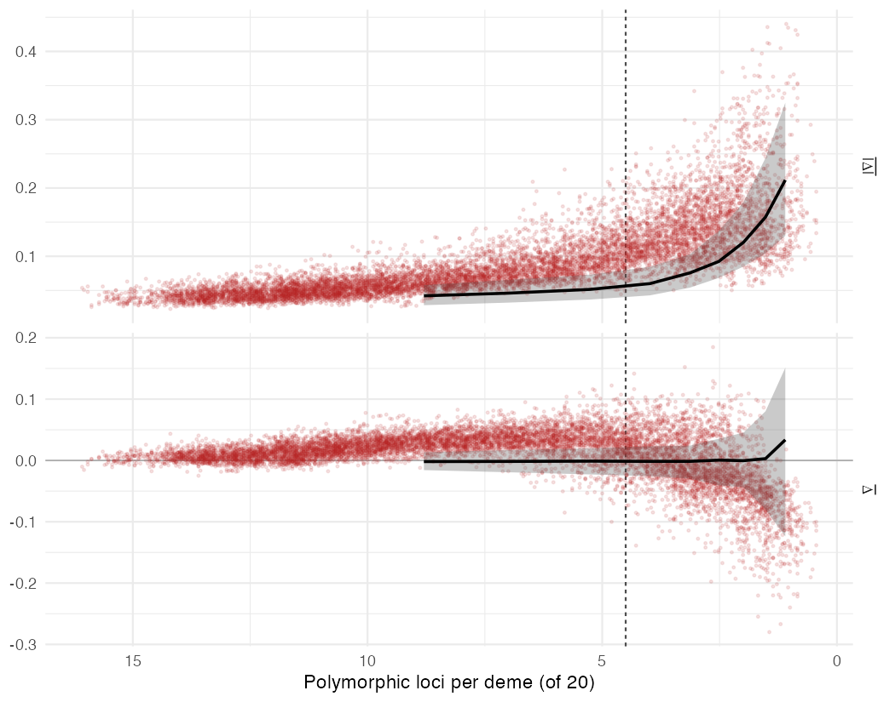
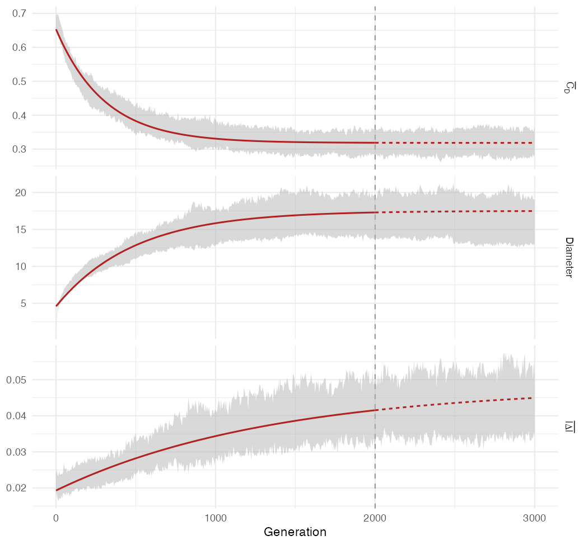
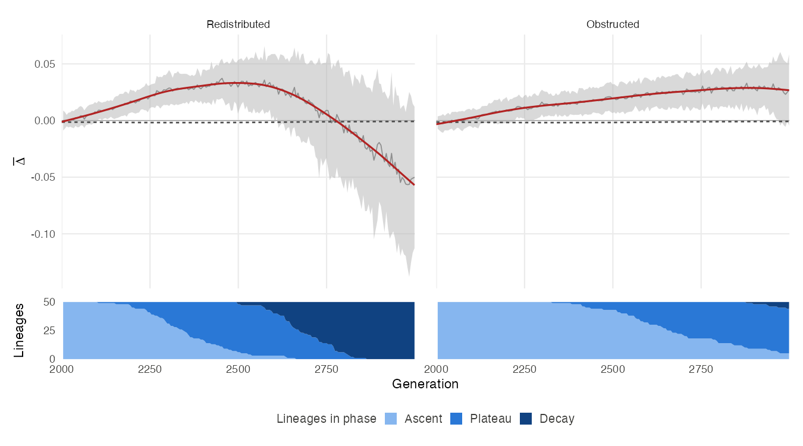
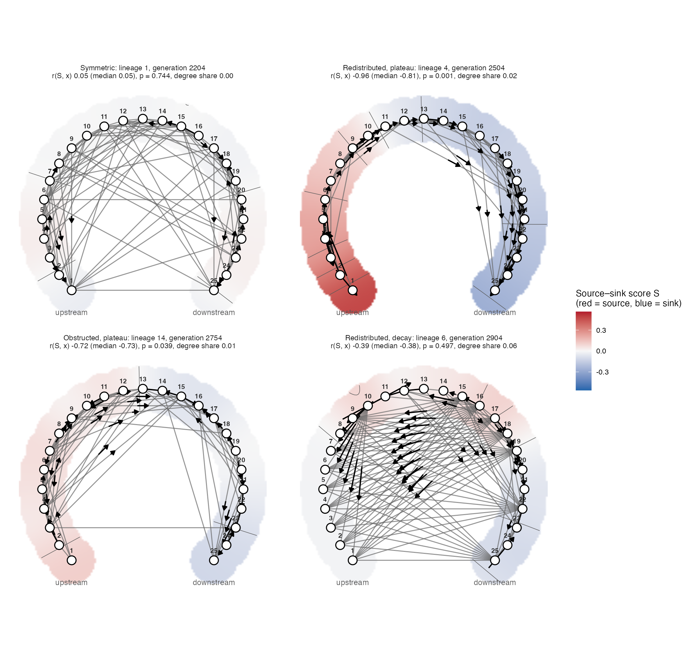
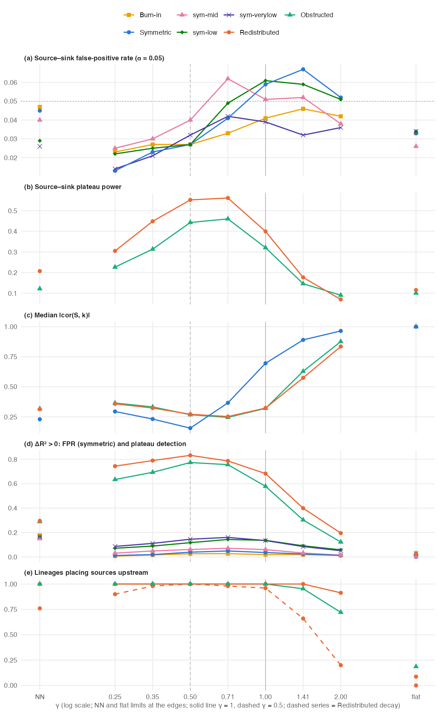
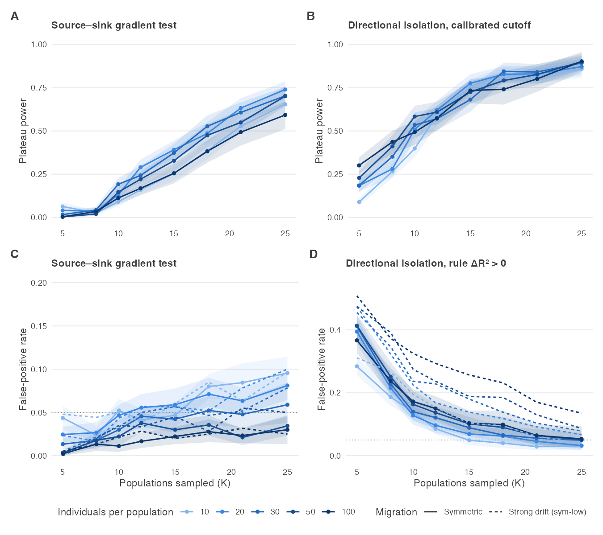

# Supplementary Materials

**Genetic Gravity: Extracting Directional Gene Flow from Population Graphs**

Rodney J. Dyer

These Supplementary Materials give the derivations, simulation details and full results summarized in the main text. Sections, figures and tables cited without "(main text)" are in this document; main-text items are cited as "(main text)". Terms follow the main text: a *lineage* is one of the 50 independent *burn-in* histories, each continued under every forward scenario; a *census* is the Population Graph built from one saved generation of a lineage; a *phase core* is the middle half of a lineage's *ascent*, *plateau* or *decay* phase; and the *informative horizon* marks the onset of *decay*. Unless stated otherwise, analyses use the degree-neutral bandwidth ($\gamma=\tfrac{1}{2}$).

- S1. Notation
- S2. The model: Markov properties, the asymmetry, the topological floor, the source–sink score, identities
- S3. Simulations and phases: design, trend fitting, phase boundaries, information loss, the *Symmetric* baseline
- S4. Directional signal under asymmetric migration
- S5. Source–sink gradient test: details, calibration, detection, rejected nulls
- S6. Directional isolation by graph distance: procedure, fits, error rates
- S7. Specificity and agreement of the two tests
- S8. Bandwidth: sensitivity and per-graph tuning
- S9. Comparison with `divMigrate`
- S10. Sampling intensity: power, false positives and design-specific calibration
- S11. Recommendations for practice

## S1. Notation

Briefly, $K$ populations are represented as centroids in a multivariate genetic space, with the $K\times K$ Euclidean distance matrix $D$ double-centered via the idempotent operator $H=I-\frac{1}{K}\mathbf{1}\mathbf{1}^{T}$ to yield the covariance matrix $C=-\frac{1}{2}HD^{2}H$ (Dyer et al., 2004; Gower, 1966). Population Graph edges are retained where the corresponding partial correlation (from $C^{-1}$) is significant, so that an edge $e_{ij}\in E$ indicates a conditional genetic dependency between $i$ and $j$ that cannot be explained through intermediate populations (Dyer & Nason, 2004). I write $N(i)$ for the neighbors of node $i$ in $G$ and $k_{i}=|N(i)|$ for its degree. Symbols are listed in Table S1.

**Table S1.** Mathematical notation used throughout.

| Symbol                   | Description                                                  |
|:------------------------:|--------------------------------------------------------------|
|  $K$                     | Number of populations (strata)                               |
|  $N$                     | Number of individuals per population                         |
|  $L$                     | Number of loci                                               |
|  $D$                     | $K\times K$ matrix of inter-centroid Euclidean distances in genetic space  |
|  $C$                     | Double-centered covariance matrix derived from $D$           |
|  $H$                     | Idempotent centering operator  $I-\frac{1}{K}\mathbf{1}\mathbf{1}^{T}$ |
|  $G=\{V,E\}$             | Population Graph with vertex set $V$ and edge set $E$        |
| $N(i)$                   | Neighbor set of node $i$ in $G$                              |
| $k_{i}$                  | Topological degree of node $i$                               |
| $e_{ij}$                 | Symmetric edge weight between populations $i$ and $j$        |
| $b_{i}$                  | Local genetic-gravity bandwidth of the node $i$              |
| $w_{j\mid i}$            | Neighborhood weight: $j$'s weight in $i$'s neighborhood (a Gaussian stochastic-neighbor-embedding conditional probability) |
| $\Delta_{i\rightarrow j}$ | Gravity asymmetry along an edge, $w_{i\mid j}-w_{j\mid i}$; positive when $i$ is the source and $j$ the sink |
| $\Delta^{0}_{i\rightarrow j}$ | Topological (no-direction-limit) component of $\Delta_{i\rightarrow j}$, $1/k_{j}-1/k_{i}$ |
| $g_{i}$                  | Gravity of population $i$, $\sum_{j\in N(i)} w_{i\mid j}$ (total weight $i$ holds in its neighbors' neighborhoods) |
| $g_{i}-1$                | Source–sink balance of population $i$ ($>0$ source, $<0$ sink); sums to zero over the graph because $\sum_i g_i=K$ |
| $S_{i}$                  | Source-sink score: population scores whose pairwise differences best reproduce the gravity asymmetries, $S_{i}-S_{j}\approx\Delta_{i\rightarrow j}$; high $S$ = source |
| $n_{i}$                  | Orientation imbalance of population $i$: the number of its edges on which it is the upstream endpoint minus the number on which it is the downstream endpoint; the part of $\|E\|\bar{\Delta}$ reproduced by $S$ equals $\sum_i S_i n_i$ |
| $\bar{\Delta}$           | Mean gravity asymmetry over all retained edges, each written with $i$ upstream of $j$ along the hypothesized axis of flow, $\|E\|^{-1}\sum\limits_{(i,j)\in E}^{}\Delta_{i\rightarrow j}$; requires an axis, so it is used descriptively in the simulations only  |
| $p_{ij}$                 | Directional conditional genetic distance (dcGD), $e_{ij}\,w_{j\mid i}/(w_{j\mid i}+w_{i\mid j})$; shorter in the direction of gene flow |
| $\bar{C}_D$             | Mean degree centrality of the Population Graph, averaged over nodes |
| $s_{i}$                  | Strength (weighted degree) of node $i$, $\sum_{j\in N(i)}e_{ij}$ |
| $\gamma$                 | Bandwidth multiplier, $b_i=\gamma s_i/k_i$; $\tfrac{1}{2}$ degree-neutral, $1$ local mean |
| Degree share             | $R^2$ of $\Delta_{i\rightarrow j}$ on $\Delta^{0}_{i\rightarrow j}$: the share of the index set by node degree |
| $Nm$                     | `divMigrate`'s relative migration statistic (Alcalá et al., 2014; Sundqvist et al., 2016) |
| $D_G$                    | Graph diameter: longest shortest-path distance between any two nodes in the Population Graph |

## S2. The model

### S2.1 Markov properties of Population Graphs

A Population Graph is a Markov independence graph, and three of its Markov properties bear on the development of asymmetry models. The first, the *global* Markov property, concerns graph separation. Any pair of populations *directly* connected in the topology (e.g., $A\leftrightarrow B$, denoted by the edge $e_{AB}$) are, by definition, not genetically independent. Evolutionary processes that lead to conditional dependence include ongoing genetic connectivity or recent divergence from a common ancestral population; cessation of connectivity via gene flow allows genetic drift and other processes to lead populations towards genetic independence. If populations are connected only *through* one or more other populations, in a stepwise fashion (e.g., $A\leftrightarrow B\leftrightarrow C$), populations not directly connected (such as $A$ and $C$) are conditionally independent, such that $P(A,C\mid B)=P(A\mid B)P(C\mid B)$. Second, under the *pairwise* Markov property any two non-adjacent populations are genetically independent conditional on *all other populations* in the topology. If a sampling population is added or removed from the data set, the entire topology must be re-estimated. The presence or absence of each edge depends on *all the data simultaneously*, not just the populations attached to that edge. This distinguishes Population Graphs from the pairwise structure estimators commonly used in evolutionary, landscape, and population genetic analyses. Third, under the *local* Markov property each population is independent of all others in the topology *given its* direct neighbors. Biologically, an edge therefore reflects a direct relationship between two populations *given the populations sampled*, not one routed through any other sampled population—the property that matters when a directional signal is attributed to an edge intended to represent patterns of genetic connectivity.

### S2.2 Reading the asymmetry

Every edge is read from both of its ends: $w_{j\mid i}$ from $i$'s neighborhood with bandwidth $b_i$, and, symmetrically, $w_{i\mid j}$ from $j$'s neighborhood with bandwidth $b_j$. Because the two neighborhoods differ, the two weights generally differ, and their signed difference defines a local, edge-specific direction,
$$
\Delta_{i\rightarrow j} = w_{i\mid j}-w_{j\mid i},
$$
the *gravity asymmetry* along the edge—$i$'s pull on $j$ minus $j$'s pull on $i$. Positive $\Delta_{i\rightarrow j}$ means $i$ holds more weight in $j$'s neighborhood than $j$ holds in $i$'s: $j$'s kernel points more strongly back at $i$ than the reverse, marking $i$ as the genetic source and $j$ as the sink. The asymmetry does not come from the edge itself but from the two *neighborhoods the edge is compared against*. The local bandwidth $b_{i}$ is node $i$'s native genetic-distance scale, and $w_{j\mid i}$ measures how near edge $(i,j)$ is *relative to that scale*. The same edge weight $e_{ij}$ therefore reads as relatively near from $i$'s side when $b_i$ is large (when $i$'s other neighbors are, on average, farther away) and relatively far from $j$'s side when $b_j$ is small, and $\Delta_{i\rightarrow j}$ records whether the edge is more typical of $i$'s local scale or of $j$'s. Bandwidth contrast alone is not a reliable guide to which population is the source; direction should be read from $\Delta_{i\rightarrow j}$ itself.

### S2.3 Bandwidth is not degree

A natural objection is that $\Delta_{i\rightarrow j}$ is merely a function of node degree and neighborhood composition. That is correct in form but not in consequence. The parameter $\Delta_{i\rightarrow j}$ is indeed a deterministic function of the graph; it has no other inputs. The question is whether the neighborhood scales $b_{i}$, $b_{j}$ carry *biological* directionality or only *topological* position, and whether the two contributions are separable. Topology contributes a component that is present even under symmetric migration and is largest at low-degree boundary nodes (the leaf-node effect); this component is independent of the direction of gene flow. Directional gene flow contributes a second component through its effect on neighborhood scale, but not in the direction a naive reading of "exporting migrants compresses the recipient's bandwidth" would suggest. Empirically, under imposed gene flow the source—not the sink—more often carries the *smaller* own bandwidth (57–59% of edges at peak asymmetry): a source's own neighbors increasingly resemble it as it exports its structure outward, compressing its own neighborhood scale rather than the recipient's. Independently, and even under symmetric migration, a larger own bandwidth leans toward a more source-like (positive) own $\Delta$, because a flatter kernel spreads a node's weight away from its nearest neighbor, lowering the weight it places on that neighbor relative to the weight the neighbor places back on it; this is a property of the kernel, not evidence of direction. The two effects pull against each other: sources tend to carry the smaller bandwidth, yet a smaller bandwidth on its own leans sink-like. Neither fact licenses a simple story of "small bandwidth marks the source" read off in isolation—$\Delta_{i\rightarrow j}$ combines both nodes' bandwidths with the raw edge distances, and it is the combination, not either bandwidth alone, that carries directional information. Crucially, the topological and directional components are distinguished empirically rather than by assertion: because every scenario branches from a shared *burn-in* state with the same stepping-stone connectivity, the purely topological contribution is shared with the *Symmetric* null and cannot separate the scenarios. The validation bears this out—$\bar{\Delta}\approx 0$ and single-census discrimination is at chance under symmetric migration, and both rise only once migration becomes asymmetric (main text). A degree artifact cannot discriminate between scenarios that share a topology; the observed separation is therefore migration-driven, not the sole property of the graph's pattern of connectivity. The bandwidth statistics in this paragraph refer to the local mean ($\gamma=1$); at the degree-neutral bandwidth used for directional inference the topological term explains only 2–4% of the variance in $\Delta_{i\rightarrow j}$ under symmetric migration (main text).

This separation can be made explicit. In the *no-direction limit*, where node $i$'s retained neighbor distances are equal, the neighborhood weight reduces to the uniform value $w_{j\mid i}=1/k_{i}$ and the gravity asymmetry collapses to a purely topological term that depends only on the endpoint degrees,
$$
\Delta_{i\rightarrow j}^{0} = \frac{1}{k_{j}}-\frac{1}{k_{i}} = \frac{k_{i}-k_{j}}{k_{i} k_{j}}
$$
which vanishes exactly when the endpoints share a degree, grows with the degree imbalance, and is largest at low-degree nodes—recovering a leaf-node effect (where $k_{i}=1$ forces $w_{j\mid i}=1$) as the extreme case. Writing $\Delta_{i\rightarrow j}=\Delta_{i\rightarrow j}^{0}+\delta_{i\rightarrow j}$, the directional signal is carried entirely by the second term $\delta_{i\rightarrow j}$, which arises whenever a node's retained neighbor distances are unequal—through which neighbors are near and which are far and, secondarily, through the bandwidth contrast $b_{i}\ne b_{j}$ (with a single bandwidth shared by every node, $\delta_{i\rightarrow j}$ is still non-zero); $\Delta_{i\rightarrow j}^{0}$ is invariant to migration. This topological term is itself an exact difference of population values, $\Delta^{0}_{i\rightarrow j}=S^{0}_{i}-S^{0}_{j}$ with a topological source–sink score $S^{0}_{i}=-1/k_{i}$, under which hubs read as sources and leaves as sinks—the same pattern the full $S$ shows under symmetric migration (main text), and the reason the population-level score absorbs the topological floor as cleanly as the edge-level term does. Because every forward scenario branches from a shared *burn-in* topology, the topological term $\Delta_{i\rightarrow j}^{0}$ is held in common with the *Symmetric* null and cancels in any scenario contrast, which is why the simulations compare scenarios with the *Symmetric* null rather than with an algebraic zero; the expression above makes explicit the term that comparison absorbs.

### S2.4 Least-squares source–sink score

The source–sink score $S$ (main text) is the set of population values whose pairwise differences best reproduce the gravity asymmetries along every retained edge. It minimizes

$$
\sum_{(i,j)\in E}\left(\Delta_{i\rightarrow j}-(S_{i}-S_{j})\right)^{2}.
$$

Write $B$ for the $|E|\times K$ edge–population incidence matrix, with $+1$ in the column of each edge's first population and $-1$ in the column of its second (the choice of which endpoint is first does not matter, because reversing an edge negates both its row of $B$ and its $\Delta$). The objective is $\lVert \boldsymbol{\Delta}-BS\rVert^{2}$, and its normal equations are $B^{T}B\,S=B^{T}\boldsymbol{\Delta}$. Here $B^{T}B$ is the unweighted graph Laplacian $L$—each population's degree $k_i$ on the diagonal and $-1$ for every retained edge—and the $i$th entry of $B^{T}\boldsymbol{\Delta}$ is $\sum_{j\in N(i)}\Delta_{i\rightarrow j}=g_i-1$, the source–sink balance. The score is therefore

$$
S = L^{+}(\mathbf{g}-\mathbf{1}),
$$

where $L^{+}$ is the Moore–Penrose pseudoinverse. $L$ is singular: adding a constant to every score in a connected component leaves every difference unchanged. The pseudoinverse selects the solution centered within each connected component, so scores are comparable only within a component and each component's scores average to zero. In the simulations this rarely mattered: 7 of 7,000 analyzed census graphs had more than one component. When populations fall into genetically independent groups, scores should therefore be computed and interpreted within each component, as in the case study (main text).

Gravity and the source–sink score are therefore two views of the same quantity: the balance $g_i-1$ is the local source–sink signal, and $S$ is its integral over the topology—the potential on the graph whose local imbalance is the gravity balance. This is the construction of HodgeRank, which recovers a global ranking from pairwise comparisons on a graph by projecting them onto the space of gradient flows (Jiang et al., 2011); the non-directional residual (below) is the divergence-free, circulating component of the flow.

The fit leaves a *non-directional residual*, $\Delta_{i\rightarrow j}-(S_i-S_j)$: the part of the edge asymmetries that no ordering of the populations can reproduce, which arises only where the graph contains cycles. The residual is orthogonal to the fitted part, so the two shares of $\sum\Delta_{i\rightarrow j}^{2}$ add to one. At the degree-neutral bandwidth used for directional inference the residual carries a median 38% of $\sum\Delta_{i\rightarrow j}^{2}$ under *Symmetric* migration, 36–38% during *ascent*, 30–31% on the asymmetric *plateau* and 13% in *Redistributed* *decay* (censuses every 50 generations), so the population-level ordering reproduces about 60–70% of the edge-level variation, and more as directional structure builds. At the local mean bandwidth the residual is smaller, a median 15–19% (*burn-in* 18.8%, *Symmetric* 19.1%, *Obstructed* 17.8%, *Redistributed* 14.7%; interquartile ranges within 8–23%), because the degree floor it carries is itself an exact difference of population values (above). On any tree the residual is exactly zero, because a tree has no cycles and every set of edge values is a difference of population values.

### S2.5 Identities

The quantities above satisfy the following identities, each checked numerically in the sign convention used throughout (higher = more of a source) on 20 census graphs (10 *burn-in* graphs at generation 1999 and 10 *Redistributed* graphs at generation 2454). They are listed in Table S2.

**Table S2.** Identities of the neighborhood weights, gravity and source–sink score, with the largest absolute numerical error over the 20 graphs.

| Identity | Max. abs. error |
| :---- | :---: |
| Each population's neighborhood weights sum to one, $\sum_{j\in N(i)}w_{j\mid i}=1$ | $4\times10^{-16}$ |
| The source–sink balance is the sum of a population's edge asymmetries, $g_i-1=\sum_{j\in N(i)}\Delta_{i\rightarrow j}$ | $4\times10^{-16}$ |
| The balance sums to zero over the graph, $\sum_i(g_i-1)=0$ | $1\times10^{-15}$ |
| With one bandwidth $b$ shared by all populations, $\Delta_{i\rightarrow j}=K_{ij}\left(1/d_{j}-1/d_{i}\right)$, where $K_{ij}=\exp(-e_{ij}^{2}/2b^{2})$ and $d_{i}=\sum_{k\in N(i)}K_{ik}$ | $1\times10^{-16}$ |
| On a spanning tree the source–sink score reproduces every asymmetry (non-directional residual = 0) | $3\times10^{-15}$ |
| The part of $\|E\|\bar{\Delta}$ reproduced by $S$ equals $\sum_i S_i n_i$ | $7\times10^{-16}$ |

The shared-bandwidth identity shows how the direction of an edge arises when every population uses the same kernel scale: $w_{i\mid j}=K_{ij}/d_j$ and $w_{j\mid i}=K_{ij}/d_i$, so $i$ reads as the source for $j$ exactly when $d_i>d_j$, that is, when the kernel weights of $i$'s retained neighbors sum to more than $j$'s—because $i$'s neighbors are closer, more numerous, or both. Each edge's asymmetry is then $K_{ij}$ times the difference of the population values $-1/d_i$ and $-1/d_j$, so an ordering of the populations reproduces the asymmetries exactly once each edge is weighted by $K_{ij}$; the unweighted fit that defines $S$ reproduces most, but not all, of them. The telescoping identity follows from writing every edge with its upstream population first: summing $S_i-S_j$ over edges counts each $S_i$ once for every edge on which population $i$ is upstream and subtracts it once for every edge on which it is downstream.

## S3. Simulations and phases

### S3.1 Simulation design

The behavior of genetic gravity was evaluated with individual-based stochastic simulations following Dyer (2007). Each replicate tracks a metapopulation of $K=25$ discrete demes, each of $N=100$ diploid individuals scored at $L=20$ independently segregating, codominant, biallelic loci. Replicates start from random allele frequencies; generations are non-overlapping, mating is random within demes, and mutation is excluded so that only migration and drift act. Migrants are drawn at random each generation according to the migration matrix. Every replicate first runs a 2,000-generation *burn-in* of symmetric migration in a one-dimensional stepping-stone model ($m_{i\rightarrow i+1}=m_{i\leftarrow i+1}=0.025$, where the pair is always ordered $(i,i{+}1)$ and the arrow gives forward or reverse flow). Dyer (2007) showed that graph-theoretic summaries such as mean degree centrality ($\bar{C}_D$) and graph diameter ($D_G$) stabilize much sooner than population-genetic statistics such as multilocus structure ($\Phi_{ST}$) or isolation by distance ($\hat{M}$); both kinds of metric were checked for stability at the end of the *burn-in*, and $\bar{C}_D$ and $D_G$ are reported alongside $\Delta_{i\rightarrow j}$ and $S$ for context. Fifty replicates were run, each producing an independent *burn-in* history (a *lineage*). Multilocus genotypes were saved every five generations, and each saved generation (a *census*) was converted into a Population Graph (Dyer & Nason, 2004), from which the neighborhood weights, gravity asymmetries, source–sink scores, edge density, diameter and mean cGD were recorded.

### S3.2 Trend fitting for forward-phase metrics

The *burn-in* relaxes to a single equilibrium, and a three-parameter exponential-equilibrium curve fits it well (Section S3.5). The same form was tried for the forward-phase trajectories under the *Redistributed* and *Obstructed* scenarios and rejected: for *Redistributed* diameter and signed $\bar\Delta$, and for *Obstructed* diameter, at least one parameter (typically the *plateau*) was driven far outside the range of the observed data by the optimizer rather than converging to a value the fit could support — a sign that the underlying trajectory is not a simple relaxation to one equilibrium over this window, consistent with the rise–hold–decline shapes described in the main text, which pass through the three phases at different times in different lineages.

Trends reported for these metrics are instead generalized additive models, $y \sim s(\text{generation}, k=20) + s(\text{replicate}, \text{bs}=\text{"re"})$, fit by REML (`mgcv`; Wood, 2017) to every census in the forward phase. The smooth term over generation captures the shape of the trend without committing to a functional form; the replicate-level random intercept absorbs stable between-replicate offsets so that a few extreme replicates do not dominate the fitted trend, and is excluded from the plotted prediction, which reports the population-level smooth only. The same fitting procedure was applied identically across the *Symmetric*, *Redistributed*, and *Obstructed* forward phases so that trends remain directly comparable to one another.

### S3.3 Phase delineation

**End of *ascent*.** At each census the $H_e$ gradient was computed as the least-squares slope of within-deme expected heterozygosity on deme index over the interior demes (3–23), and each lineage's trajectory was smoothed with a penalized spline ($k=10$). *Ascent* ends when the smoothed gradient has completed 90% of its rise from the lineage's own *burn-in* level. To separate a directional rise from drift, each lineage's rise was compared with the 95th percentile of rises among *Symmetric* lineages; 46 of 50 *Redistributed* and 44 of 50 *Obstructed* lineages exceeded it, against 4 of 50 *Symmetric* lineages when each was compared with the other 49, close to the 5% expected by construction, and the largest *Symmetric* rise was about half the median asymmetric rise. The 4 *Redistributed* and 6 *Obstructed* lineages below the threshold show no rise distinguishable from drift, so they were held in *ascent* until the onset of *decay* and contribute no *plateau* censuses. Assigning them to phases from their own 90% point instead, as for every other lineage, changes no *plateau* rate reported in the main text by more than 2.4 percentage points and no *ascent* rate by more than 4.3.

**Onset of *decay*.** *Decay* begins at the first census at which the lineage's demes carry, on average, fewer than 4.5 polymorphic loci. The threshold is the informative horizon of Figure S1, calibrated on *Symmetric* graphs only, roughly below which the loss of polymorphic loci alone inflates $\overline{|\Delta_{i\rightarrow j}|}$ by more than 10%. The marker never fired in a *Symmetric* lineage. Every *Redistributed* lineage crossed it; only 6 of 50 *Obstructed* lineages did, all after generation 2900.

**Phase cores and boundary sensitivity.** The boundaries separate regimes; they are not constants of the system. Main-text phase summaries are therefore taken from each lineage's phase core, the middle half of the interval between its boundaries. Phases that end at generation 2999 because the next boundary was never reached are censored, and their phase core is the middle half of the observed interval: this applies to 39 of the 44 *Obstructed* *plateaus* and to every *decay* phase. On the 50-generation grid the phase cores lose no *Redistributed* lineage and two *Obstructed* *plateau* lineages whose phase core holds no census. Taking the phase core rather than the whole phase sharpens the contrast between phases (*plateau* source–sink rejection 65% and 45% against 57% and 43% over the full phase; directional isolation detection 89% and 78% against 85% and 76%) and leaves mean $|\Delta_{i\rightarrow j}|$, agreement with the truth matrix and corridor direction essentially unchanged.

The phase-core summaries were recomputed with the end of *ascent* placed at 80% or 95% of the $H_e$-gradient rise instead of 90%, and with the onset of *decay* at 6 or 8 polymorphic loci instead of 4.5. Moving the end of *ascent* left every *Redistributed* *plateau* value within 3 percentage points; under *Obstructed* migration, the 80% rule lowered *plateau* rejection from 45% to 42% and detection from 78% to 72%. With the horizon at 6, *plateau* rates fell by up to 7 points (source–sink rejection 58% and 40%, detection 85% and 78%). With the horizon at 8 the *plateau* largely disappears: 48 of 50 *Obstructed* lineages reach *decay* (6 at 4.5), the median *Redistributed* *plateau* shortens from 325 to 112 generations, and what remains is the stretch just after *ascent* (rejection 45% and 37%, detection 76% and 75%). Eight polymorphic loci of 20 is not a low-diversity regime, so this variant measures a different window rather than perturbing the same one. Under every variant, 97–100% of *plateau* lineages placed the sources upstream (median $r(S,x)$ −0.69 to −0.81), the slope ratio was below one in every *plateau* detection, and every census flagged by both tests agreed on direction.

### S3.4 Information loss and the asymmetry signal

As lineages approach fixation the number of loci still polymorphic within demes falls, and a Population Graph built from fewer informative loci could show larger asymmetries for that reason alone. To separate the two, *Symmetric* graphs were rebuilt from random subsets of polymorphic loci, giving the asymmetry expected from information content alone at each level of remaining polymorphism, and every *Redistributed* census was placed against that reference (Figure S1). At the degree-neutral bandwidth the null $\overline{|\Delta_{i\rightarrow j}|}$ is 1.07 times the *Symmetric* reference level between 4.5 and 6 polymorphic loci per deme and 1.25 times between 3.5 and 4.5, so information loss inflates the index by more than about 10% only below roughly 4.5 polymorphic loci per deme (as at the local mean). The horizon depends on how the reference level is defined: with the observed forward *Symmetric* level, or the late *burn-in* level, as the reference instead of the fitted *burn-in* asymptote, it would sit at 6–8 polymorphic loci. It is therefore used as a heuristic marker of where information loss begins to matter rather than as a threshold of the system, and the main-text conclusions on *ascent* and the *plateau* are unchanged with the horizon at 6 (Section S3.3). A researcher can run the same check on their own data by rebuilding the graph from random subsets of loci.

**Figure S1.** Directional signal versus information loss. Mean absolute (top) and signed (bottom) asymmetry index (degree-neutral bandwidth) for every *Redistributed* census (points) against the mean number of loci polymorphic within demes. The black line and band are the median and 90% range for *Symmetric* graphs rebuilt from random subsets of polymorphic loci—the values expected from information content alone. The vertical dashed line marks the informative horizon (4.5 polymorphic loci per deme), below which information loss alone inflates $\overline{|\Delta_{i\rightarrow j}|}$ by more than 10%.

### S3.5 *Symmetric* baseline

Individual-based simulations were run to establish that the *burn-in* period produces stable, comparable starting topologies before any directional migration is imposed. Dyer (2007) showed that mean degree centrality ($\bar{C}_D$) and graph diameter track standard population-genetic measures of structure and gene flow ($F_{ST}$ and $\hat{M}$); here, where the focus is the graph's topology itself rather than that correspondence, the same two metrics serve as a check that replicate runs have converged to equilibrium. Across the *Symmetric* replicates, $\bar{C}_D$ falls and graph diameter rises from their initial values, each relaxing toward a stable plateau within the 2,000-generation *burn-in* and remaining flat through the subsequent *Symmetric* forward phase (Figure S2). The magnitude of the asymmetry index, $\overline{|\Delta_{i\rightarrow j}|}$, rises from near zero more slowly than the topological metrics (median relaxation time 1,346 generations) and is still rising gently at the end of the *burn-in*; it reflects the structure the graph accumulates under drift and migration rather than any directional gene flow, since none is present in this scenario. The signed mean stays close to zero throughout (not shown; forward-phase $\bar{\Delta}=-0.0015$, 95% CI $-0.0029$ to $0.0000$), an order of magnitude below the values reached under asymmetric migration. Averaged within lineages, the source–sink score showed no consistent directional bias beyond ordinary between-lineage variation. The original lineages carried a small chance excess with sources slightly downstream (33 of 50 *burn-in* lineages; sign test $p=0.033$), opposite to the direction later imposed; it was not produced by the simulation's migration and mating steps, reversed exactly when the deme labels were mirrored, and did not recur in a second, independently simulated set of 50 lineages (Section S7.1). Every replicate therefore enters the *Redistributed* and *Obstructed* scenarios from a topologically equilibrated and directly comparable starting configuration, establishing the *Symmetric* scenario as the empirical null against which asymmetry in the other two scenarios is judged.

**Figure S2.** Structural stability of Population Graphs under *Symmetric* migration as depicted by degree centrality, $\bar{C}_D$, and graph diameter (following Dyer, 2007), and by the mean absolute asymmetry index, $\overline{|\Delta_{i\rightarrow j}|}$, for the *Symmetric* replicates. The background shading represents the empirical $\pm$ 1 standard deviation from the simulated data. The red line is an exponential approach to equilibrium, $y = y_\infty + (y_0 - y_\infty)e^{-t/\tau}$, fit to the *burn-in* period; it is extended as a dashed line to show its projection across the *Symmetric* phase (the vertical dashed line marks the end of the *burn-in*). The asymmetry index is computed at the degree-neutral bandwidth; its fit has not reached its asymptote by the end of the *burn-in*, so the dashed projection runs slightly above the observed forward level.

Gravity has a topological floor, and the bandwidth determines how much of it the index carries. At the local mean bandwidth ($\gamma=1$), $S$ tracks node degree closely under symmetric migration (median correlation with the degree-only score $S^{0}$ of 0.78–0.83 across the symmetric samples): hubs score as sources and leaves as sinks, independent of any directional gene flow, and asymmetric migration only partly decouples the two (0.49 under *Redistributed* and 0.61 under *Obstructed* migration). At the degree-neutral bandwidth the floor is gone: the median correlation is 0.01–0.06 under symmetric migration and −0.11 under both asymmetric scenarios (correlations pooled over all censuses of each scenario, since the floor follows from topology alone). The edge-level topological term $\Delta^{0}_{i\rightarrow j}$ separates from the directional remainder in the same way (Section S2.3). Degree-one leaves are the extreme case: a leaf's single neighborhood weight is 1 at any bandwidth, so it reads as a sink by construction ($\Delta_{\text{leaf}\rightarrow j}\le 0$). Leaves were rare—present in under 1% of symmetric censuses and 5–8% of asymmetric ones—were never the strongest source and were the strongest sink in at most 1.2% of censuses, and $r(S,x)$ computed on interior populations alone tracked the full value closely (correlation 0.84–0.92).

## S4. Directional signal under asymmetric migration

### S4.1 *Redistributed* phases

The *Redistributed* scenario serves as the worked example of the three phases, because every *Redistributed* lineage passes through all of them within the forward window. In the 46 lineages whose rise exceeded drift, *ascent* ended at a median of generation 2332 (IQR 2267–2408) and the *plateau* lasted a median of 325 generations (means: *ascent* 335 ± 100 generations after onset; *plateau* 355 ± 107 generations); *decay* began at a median of generation 2674 (IQR 2634–2765) across all 50. $\bar{C}_D$ fell from 0.309 during *ascent* to 0.274 on the *plateau* and 0.236 once lineages entered *decay* (*Symmetric* 0.315; medians of lineage means within each phase core). Diameter first rose slightly—from 16.7 to a trend maximum of 17.7 near generation 2230, as each lineage neared the end of its *ascent*—then declined, to a median of 15.8 on the *plateau* and 10.2 after the horizon (*Symmetric* 16.3), and to 7.9 over the final 50 censuses (main text, Figure 2, left). Mean $|\Delta_{i\rightarrow j}|$ tracked the same staging in the opposite direction: 0.049 during *ascent*, slightly above the *Symmetric* 0.043, then 0.080 on the *plateau* and 0.147 after the horizon. Rising asymmetry alongside a collapsing diameter and falling $\bar{C}_D$ is the expected consequence of a sustained directional bias in a closed migration–drift system: *Redistributed* migration is not only making gene flow asymmetric, it is progressively homogenizing the metapopulation. Part of the rise after the horizon is information loss rather than signal, since the horizon marks roughly where the loss of polymorphic loci alone begins to inflate $|\Delta_{i\rightarrow j}|$ (Section S3.4, Figure S1); the *plateau* values carry no such inflation.

### S4.2 Directional balance vs. backflow suppression

The *Obstructed* scenario was designed to test a prediction: with the same forward rate but half the net directional bias ($m_{i\rightarrow i+1}-m_{i\leftarrow i+1}=0.015$ against 0.03) and lower total flux (0.035 against 0.05), it should pass through the same phases more slowly. It did (main text, Figure 2, right). In the 44 lineages whose rise exceeded drift, *ascent* ended at a median of generation 2642 (IQR 2544–2787), 642 generations after onset (mean 650 ± 162) against 332 under *Redistributed* migration; $\bar{\Delta}$'s trend peaked near generation 2884 against 2493; and each lineage's smoothed diameter peaked at a median of generation 2632 (IQR 2354–2838) against 2224 (IQR 2114–2337). Depending on the measure, *Obstructed* lineages reached each stage 1.8 to 2.8 times later—1.9 times later for the end of *ascent*—close to the two-fold difference in net bias; total flux also differs between the scenarios and is not excluded as a contributor. Diameter traced the same rise–hold–decline sequence, stretched over the whole window: it rose from 16.7 to about 19.2 by generation 2300, held between 19.2 and 19.6 until about generation 2800, and then began to decline, to 18.2 by generation 2999. The *Obstructed* rise was larger (a median of 5.5 against 2.7 units per lineage) and its *plateau* far longer, consistent with the lower total migration letting drift differentiate the metapopulation further before directional homogenization took over. Once on the *plateau*, however, *Obstructed* lineages looked like *Redistributed* ones: $\bar{C}_D$ 0.270 against 0.274, mean $|\Delta_{i\rightarrow j}|$ 0.074 against 0.080, and $\bar{\Delta}$ 0.030 against 0.034, positive in 98% of lineages. The difference in net bias therefore set how quickly a lineage reached its *plateau* rather than how strong the directional signal was once there. The two routes to a net directional bias that the scenarios were built to contrast—redistributing a fixed migration budget and suppressing back-flow at a fixed forward rate—thus produced the same directional signal on the *plateau*; the contrast appears in timing, not in the kind of signal. Only 6 of the 50 *Obstructed* lineages crossed the informative horizon, all after generation 2900, so the last 200 generations of the *Obstructed* scenario show what the first 400 of the *Redistributed* scenario show—a diameter peak followed by the start of a decline—and the *Obstructed* scenario's own *decay* phase lies beyond the 1,000-generation window. Observing it would require longer simulations that would add little beyond what the *Redistributed* scenario already shows, so *Obstructed* results are reported for *ascent* and the *plateau* only.

The signed graph-mean asymmetry, $\bar{\Delta}$, follows the same course under both routes to a net bias (Figure S3). Both scenarios carry the imposed direction through *ascent* and the *plateau*, with $\bar{\Delta}>0$: upstream populations read as sources. Over each lineage's own phase core (main text), *Redistributed* $\bar{\Delta}$ is positive in 98% of lineages during *ascent* (median 0.013) and in 98% of the 46 lineages with a *plateau* (median 0.034); *Obstructed* $\bar{\Delta}$ is positive in 96% and 98% of lineages (44 with a *plateau*; medians 0.015 and 0.030). On the *plateau* the two scenarios therefore carry nearly the same directional signal; what differs is when they reach it. The across-lineage trend peaks around generation 2493 under *Redistributed* migration (~500 generations after onset) and around 2884 under *Obstructed* migration (~900 generations).

*Redistributed* $\bar{\Delta}$ then changes sign, and it does so in the *decay* phase: after the informative horizon it is negative in 70% of lineages (median $-0.020$). The fitted trend crosses zero near generation 2776; lineage by lineage, the smoothed series crosses in 37 of the 50 lineages, at a median of generation 2729 (IQR 2674–2824), against a median horizon of 2674, and in only 6 *Obstructed* lineages. This is not a reversal of the direction of gene flow. The population-level source–sink score keeps the imposed ordering through the crossing—$r(S,x)<0$ in 98% of *plateau* censuses and 86% of *decay* censuses—and weakens only as lineages enter *decay*. The crossing itself is carried by the interior of the graph, not by the terminal demes (below).

**Figure S3.** Signed graph-mean asymmetry, $\bar{\Delta}$ (degree-neutral bandwidth; positive when upstream populations are the sources, the imposed direction), for the *Redistributed* and *Obstructed* scenarios (columns) over the forward phase (generations 2000–2999), fit with the same penalized-regression-spline approach used for Figure 2 in the main text. The shaded band is the across-replicate $\pm$ 1 SD, and the dashed line is the fitted *Symmetric* trend, which sits slightly below zero ($-0.0019$ to $-0.0008$, within between-lineage variation), as the null reference. *Redistributed* $\bar{\Delta}$ rises to a maximum near generation 2493 and changes sign near generation 2776, an interior-topology effect rather than a reversal of direction (below); *Obstructed* $\bar{\Delta}$ rises to a maximum near generation 2884 and stays positive throughout the window. The strip beneath shows, at each census, how many of the 50 lineages in each asymmetric scenario are in *ascent*, on the *plateau*, or in *decay*, each lineage assigned by its own boundaries. The late *Redistributed* sign change coincides with lineages entering the *decay* phase.

### S4.3 Decomposition of the late sign change in $\bar{\Delta}$

The axis-oriented sum $|E|\bar{\Delta}=\sum\Delta_{i\rightarrow j}$ (each edge written with $i$ upstream) splits exactly into the part reproduced by the source–sink score, which equals $\sum_i S_i n_i$ (Section S1, Section S2.5), and the non-directional residual. The reproduced part splits further into the terms of the two terminal demes (demes 1 and 25) and those of the interior. A separate check sums $\Delta_{i\rightarrow j}$ over interior edges only, those with both endpoints in demes 3–23. All components were computed for every *Redistributed* and *Obstructed* census from generation 2254 to 2954 (every 5 generations, 50 replicates). Table S3 gives the median components by generation, and Table S4 the timing of their first zero crossings.

**Table S3.** Median components of $|E|\bar{\Delta}$ under *Redistributed* migration (degree-neutral bandwidth), by generation. Components are medians taken separately, so they need not sum exactly.

| Generation | $\|E\|\bar{\Delta}$ | Part reproduced by $S$ | Non-directional residual | Terminal demes | Interior | Interior edges only |
| :---: | :---: | :---: | :---: | :---: | :---: | :---: |
| 2254 | 2.04 | 1.33 | 0.71 | 0.69 | 0.50 | 1.43 |
| 2454 | 3.22 | 1.97 | 1.04 | 1.31 | 0.73 | 2.29 |
| 2604 | 2.61 | 1.84 | 0.87 | 1.39 | 0.46 | 2.37 |
| 2654 | 2.25 | 1.37 | 0.98 | 1.37 | 0.06 | 2.07 |
| 2704 | 1.42 | 0.76 | 0.90 | 1.44 | −1.57 | 1.21 |
| 2754 | 0.08 | −0.13 | 0.75 | 1.37 | −1.23 | 1.07 |
| 2804 | −1.10 | −1.53 | 0.80 | 1.56 | −3.23 | −0.65 |
| 2904 | −2.13 | −2.53 | 0.40 | 1.46 | −4.47 | −1.46 |
| 2954 | −3.58 | −4.69 | 0.48 | 1.30 | −5.79 | −3.12 |

Under *Obstructed* migration $|E|\bar{\Delta}$ stays positive through generation 2954 (median rising from 0.86 to 2.82).

**Table S4.** First zero crossing after generation 2400, from each lineage's smoothed series: the number of lineages (of 50) in which each component crosses, and the median (IQR) generation.

| Component | *Redistributed* | *Obstructed* |
| :---- | :---- | :---- |
| $\|E\|\bar{\Delta}$ | 37 — 2729 (2674–2824) | 6 — 2679 (2514–2870) |
| Part reproduced by $S$ | 40 — 2702 (2658–2809) | 6 |
| Interior | 43 — 2634 (2552–2769) | 17 |
| Interior edges only | 37 — 2759 (2664–2834) | 3 |
| Terminal demes | 1 — 2954 | 8 |
| Non-directional residual | 12 — 2912 (2872–2932) | 5 |

Among the 37 *Redistributed* lineages in which $\bar{\Delta}$ changes sign, the crossing coincides (within 50 generations) with that of the interior-edge sum in 97%, the interior part of the reproduced sum in 11%, and the non-directional residual and the terminal-deme terms in none. The terminal-deme terms stay positive throughout (0.7–1.6) and cross in only one lineage. At the degree-neutral bandwidth the non-directional residual is not negligible: it stays positive (0.4–1.0) throughout and delays the crossing of $|E|\bar{\Delta}$ relative to the part reproduced by $S$, but it does not change sign with $\bar{\Delta}$. (At the local mean bandwidth it was negligible, $-0.06$ to $0.09$, and the crossing otherwise behaved alike: 39 lineages, median generation 2684, 92% coinciding with the interior-edge sum.) The sign change is therefore an interior phenomenon, not an effect of the terminal demes. It is also compatible with the ordering of sources and sinks being preserved: the sum weights each population's score $S_i$ by its orientation imbalance $n_i$, not by its position, and as lineages collapse the interior graph rewires, changing which populations carry long edges upstream or downstream along the stepping stone. The ordering of $S$ along the stepping stone can hold ($r(S,x)$ stays negative) while its $n$-weighted sum changes sign. How much of the interior change comes from $S$ and how much from the rewiring of $n$ has not been separated.

### S4.4 Source–sink scores through time

The deme-by-generation display of $S$ shows where the gradient comes from (main text, Figure 3, top). Under symmetric migration the terminal deme at each end reads as a mild sink and the next few demes inward as weak sources—the terminal demes have fewer retained neighbors (median degree 6 against 8 in the interior), which leaves a trace even at the degree-neutral bandwidth—while the interior is close to neutral (median $r(S,x)$ 0.05 in the *Symmetric* forward phase). Once asymmetry is imposed, the downstream end deepens into a sink within 200–400 generations and a band of sources forms upstream, centered on deme 3 in both scenarios. Under *Obstructed* migration that band holds its place to the end of the window. Under *Redistributed* migration it moves: the population with the highest $S$ stays near deme 3 until about generation 2600, then shifts downstream—to deme 6 in generations 2600–2700, deme 7 in 2700–2800, deme 10 in 2800–2900 and deme 11 in 2900–3000—while the demes it leaves behind fade to neutral. The collapse of a *Redistributed* lineage therefore advances downstream along the stepping stone from its upstream end, and the source–sink gradient weakens as the band of sources contracts toward the sink, which is why the fraction of censuses with sources upstream falls from about 95% to 66% over the final 300 generations, as *Redistributed* lineages cross the informative horizon.

Figure S4 shows these patterns on single censuses, drawn as gravity-field plots as a researcher would draw their own graph: what no direction, a clear direction and a direction falling apart look like. Under *Symmetric* migration the plot has no direction: weak sources and sinks alternate around the stepping stone, and the arrows on neighboring edges point both ways. On the *plateau* both asymmetric scenarios show a single run from red upstream to blue downstream, with the arrows on the short edges pointing downstream; the *Redistributed* example is the census distributed with gstudio as the data set `gravity` (also shown in the main text, Figure 1), so the plot can be reproduced from genotypes. After the informative horizon the *Redistributed* source–sink surface falls apart from its upstream end: the upstream demes 1–9, which no longer differ genetically, share one value of $S$, the band of sources has moved to the middle of the stepping stone, and arrows on the long edges point back toward the upstream end.

**Figure S4.** Four single censuses drawn as gravity-field plots at the degree-neutral bandwidth ($\gamma=\tfrac{1}{2}$): *Symmetric* migration (lineage 1, generation 2204), *Redistributed* on the *plateau* (lineage 4, generation 2504; the gstudio example data set `gravity`, the same graph as main-text Figure 1, placed here in deme order rather than by graph layout), *Obstructed* on the *plateau* (lineage 14, generation 2754), and *Redistributed* in *decay* (lineage 6, generation 2904). The examples are illustrative. The *Symmetric*, *Obstructed* and *decay* censuses are each the one whose $r(S,x)$ is closest to its sample's median (ties broken by the lowest lineage number), among all 1,000 *Symmetric* forward-phase test censuses or the censuses in the phase core of the named phase (middle half of each lineage's phase); the *Redistributed* *plateau* census, from the phase core of its lineage's *plateau*, has the strongest gradient of the 160 *plateau* phase-core censuses ($r(S,x)=-0.96$, against a median of $-0.81$), so it is the clearest case rather than a typical one. Nodes are numbered by deme and placed in order around a horseshoe, the same in every panel, from upstream (deme 1, lower left) to downstream (deme 25, lower right), so that long edges separate. Surface, arrows and color scale as in main-text Figure 1, with a common scale across panels. Each heading gives $r(S,x)$, the sample median, the source–sink test $p$-value and the degree share.

## S5. Source–sink gradient test

### S5.1 Test details

This test asks whether the source–sink scores of the populations change monotonically along a hypothesized covariate $x$, such as position along a suspected axis of flow, as expected if gene flow runs consistently in one direction along it. It is the natural first check: a rejection identifies both that a gradient exists and, from the sign of $S$ against $x$, which way it runs. The test statistic is Spearman's $r(S,x)$, with $S$ computed at the degree-neutral bandwidth (main text); scores within $10^{-10}\max|S|$ of one another are treated as tied before ranking, so that floating-point near-ties do not decide the ranks. Because high $S$ marks a source, $r(S,x)<0$ places the sources at low values of $x$ (upstream, when $x$ increases downstream) and $r(S,x)>0$ places them at high values. The null preserves $S$'s spectral power on the census's own Population Graph: Moran spectral randomization (Wagner & Dray, 2015) on the kernel-weighted adjacency $\exp(-e_{ij}^{2}/2\bar b^{2})$, where $\bar b$ is the mean retained edge weight, with $B=999$ randomizations, tested two-sided at $\alpha=0.05$. Because it reproduces the node-level smoothness that $S$ inherits from drift on the graph, a rejection reflects a gradient along the hypothesized covariate beyond what drift alone produces. Power was measured as the rejection rate on the same census grid under the *Redistributed* and *Obstructed* scenarios, by each lineage's own phase (main text; Section S3.3).

### S5.2 Calibration

False-positive rates were measured on censuses simulated under symmetric migration: the final 100 generations of *burn-in* (every 5 generations, 1,000 censuses), the *Symmetric* forward phase, and the three low-migration symmetric scenarios (every 50 generations, 1,000 censuses per scenario). Under symmetric migration the source–sink gradient test held its nominal rate (main text, Table 2; alternative nulls in Table S5). At $\alpha=0.05$ it rejected in 3.0% of *burn-in* censuses (lineage-clustered 95% CI 2.0–4.1%) and 2.9% of *Symmetric* forward-phase censuses (2.0–3.9%), and across the drift gradient in 2.9–4.2%, with no increase as neutral differentiation rose (sym-mid 4.2%, sym-low 2.9%, sym-verylow 3.2%; every upper limit 5.8% or less; Section S7.2). At $\alpha=0.01$ it was conservative (0.3–1.0%). Clustering by lineage barely widens these intervals (design effects 0.9–1.7): the false positives are spread across lineages rather than concentrated in a few, the worst single lineage reaching 10–25%. The p-values were close to uniform, with slightly fewer small values than expected (*burn-in*: 6–14% of censuses in each tenth of the unit interval). The choice of null matters. Permuting $S$ across populations while ignoring the graph rejected in 10.4–18.2% of censuses, and Moran spectral randomization on the true landscape adjacency—the 24-link stepping-stone adjacency that generated the data—in 5.4–7.3%. The contrast is far sharper at the local mean bandwidth, where $S$ carries the degree floor (24–33% and 11–17%): $S$ inherits its smoothness from the graph's topology, including its non-adjacent edges, not from the stepping-stone adjacency, so the Population Graph is the safer basis for a spatial null than the landscape itself. Seven of the 7,000 census graphs had more than one connected component and were randomized as whole graphs; excluding them changes no reported rate by more than 0.2 percentage points (within-component randomization, the appropriate treatment for disconnected graphs, was not evaluated).

**Table S5.** False-positive rate of the source–sink gradient test (Spearman $r(S,x)$, degree-neutral bandwidth) under symmetric migration, at $\alpha$ = 0.01 / 0.05 / 0.10, for the spectral null on the census's own Population Graph with two alternative nulls at $\alpha=0.05$ for comparison: plain permutation of $S$ across populations, and spectral randomization on the true stepping-stone adjacency. The last column gives the graph spectral null at the local mean bandwidth ($\gamma=1$), $\alpha=0.05$. 1,000 censuses per sample (*burn-in*: generations 1904–1999, every 5 generations; forward phase: generations 2004–2954, every 50 generations; 50 replicates).

| Sample | Graph spectral null   $\alpha$ = 0.01 / 0.05 / 0.10 | Permutation, 0.05 | Stepping-stone spectral null, 0.05 | Local mean, graph spectral null, 0.05 |
| :---- | :---: | :---: | :---: | :---: |
| *Burn-in* | 0.004 / 0.030 / 0.056 | 0.104 | 0.054 | 0.046 |
| *Symmetric* | 0.005 / 0.029 / 0.059 | 0.138 | 0.058 | 0.062 |
| sym-mid | 0.010 / 0.042 / 0.076 | 0.177 | 0.065 | 0.051 |
| sym-low | 0.003 / 0.029 / 0.066 | 0.179 | 0.061 | 0.064 |
| sym-verylow | 0.008 / 0.032 / 0.061 | 0.182 | 0.073 | 0.038 |

### S5.3 Detection rates for the source–sink gradient test

Table S6 gives the rejection rate, median $r(S,x)$ and direction of the source–sink gradient test by scenario and phase, over full phases and phase cores.

**Table S6.** Rejection rate of the source–sink gradient test at $\alpha=0.05$ (degree-neutral bandwidth), median $r(S,x)$, the fraction of censuses with sources upstream ($r(S,x)<0$), and the fraction of lineages whose mean $r(S,x)$ in the phase is negative, by scenario and each lineage's own phase (main text), over the full phase and over its phase core (the middle half; main-text values). Censuses every 50 generations in 2004–2954, 50 replicates. *Obstructed* lineages reach the *decay* phase in only 6 censuses (4 lineages), which are not tabulated.

| Scenario | Phase | Window | Censuses (lineages) | Rejected | Median $r(S,x)$ | Censuses with sources upstream | Lineages with sources upstream |
| :---- | :---- | :---- | :---: | :---: | :---: | :---: | :---: |
| *Symmetric* | whole forward phase | — | 1,000 (50) | 2.9% | 0.05 | 42% | 38% |
| *Redistributed* | *ascent* | full | 375 (50) | 14.9% | −0.34 | 83% | 98% |
| *Redistributed* | *ascent* | core | 179 (50) | 14.5% | −0.38 | 91% | 98% |
| *Redistributed* | *plateau* | full | 328 (46) | 56.7% | −0.78 | 98% | 100% |
| *Redistributed* | *plateau* | core | 160 (46) | 65.0% | −0.81 | 98% | 100% |
| *Redistributed* | *decay* | full | 297 (50) | 29.3% | −0.43 | 85% | 100% |
| *Redistributed* | *decay* | core | 160 (50) | 26.2% | −0.38 | 86% | 98% |
| *Obstructed* | *ascent* | full | 707 (50) | 12.7% | −0.36 | 85% | 98% |
| *Obstructed* | *ascent* | core | 346 (50) | 10.4% | −0.39 | 92% | 96% |
| *Obstructed* | *plateau* | full | 287 (43) | 43.2% | −0.73 | 98% | 100% |
| *Obstructed* | *plateau* | core | 152 (42) | 45.4% | −0.73 | 99% | 100% |

In main-text Figure 3, $S$ was computed from every saved graph (every 5 generations in the last 100 generations of the *burn-in* and every 10 in the forward phase) and the test was run every 50 generations in the forward phase. Each forward-phase point takes one census from each lineage, so its 95% interval is binomial; each *burn-in* point pools five censuses per lineage into a 25-generation bin, so its interval is a bootstrap over lineages.

### S5.4 Permutation nulls for $\Delta_{i\rightarrow j}$

Before adopting the source–sink gradient test and the model comparison (main text), significance tests built directly on the asymmetry index were evaluated against the same symmetric reference (the final 100 generations of *burn-in*; 1,000 censuses, 95,903 edges), with the index at the local mean bandwidth ($\gamma=1$). None was usable as a test.

- **Graph-level rewiring null** (mean $|\Delta_{i\rightarrow j}|$ against degree-preserving random rewiring with shuffled edge weights). The test rejected in none of the symmetric censuses and almost never under asymmetric migration (3.4% of *Redistributed* and 0.3% of *Obstructed* *plateau* censuses; 22% of *Redistributed* censuses after the informative horizon): stepping-stone graphs are degree-assortative and locally smooth, so the observed graph sat a median 2.6–3.3 SD *below* the rewired null.
- **Edge-level label-permutation null** (individuals permuted among populations and the graph refit on the fixed topology). Under symmetric migration, 8.4% of edges were significant at $\alpha=0.05$, with an excess of p-values near both 0 and 1. Centering the p-value on the null mean removed the excess near 1 but raised the false-positive rate to 24.6%. The permuted (panmictic) data flatten each node's kernel, so the null centers on the degree term $\Delta^{0}_{i\rightarrow j}=1/k_j-1/k_i$, whereas the observed $\Delta_{i\rightarrow j}$ averages about 0.65 of it; the null is also too narrow (a 16.0% false-positive rate even on edges whose endpoints have equal degree).
- **Sign-exchangeability null** (edge signs flipped independently, magnitudes fixed). Under symmetric migration, a median 81% of $\sum\Delta_{i\rightarrow j}^2$ is reproduced by a single population-level ordering ($\Delta_{i\rightarrow j}\approx S_i-S_j$), against 25% expected if edge signs were independent. Edges sharing a node are therefore not exchangeable, and every sign- or node-permutation statistic tried, including permuting $S$ directly across nodes, was anti-conservative (14–100% false positives at $\alpha=0.05$; permuting $S$ alone gives 24%).

The common cause is that $\Delta_{i\rightarrow j}$ and $S$ carry node-level structure (degree and bandwidth) and a drift-generated, spatially smooth trend along the graph that no null built by exchanging parts of a single graph reproduces. Two things do reproduce it. Asking whether a directional description of the graph explains isolation better than a symmetric one (main text) sidesteps the problem entirely: both descriptions carry the same node-level structure, and only directional gene flow favors the directional one. Alternatively, a null that preserves the graph's own spectral structure rather than shuffling it away—Moran spectral randomization on the census's own Population Graph—reproduces the node-level smoothness directly: at the local mean it brings the false-positive rate on $S$ from 24–33% under plain permutation down to 3.8–6.4%, more reliably than randomizing against the true landscape adjacency that generated the data (11–17%; Section S5.2, Table S5), making the Population Graph itself the better basis for a spatial null.

## S6. Directional isolation by graph distance

### S6.1 Procedure

1. **Estimate the topology and fit standard IBGD.** The Population Graph is estimated as usual, and all-pairs conditional genetic distance (cGD, the shortest-path distance over edge weights $e_{ij}$) is regressed on pairwise spatial separation, $|dx_{ij}|$, giving $R^2_{cGD}$. If asymmetry is not suspected, the analysis ends here.
2. **Estimate the directional distances.** If asymmetry is suspected, the directed graph with arc costs $p_{ij}$ (dcGD; main text, at the degree-neutral bandwidth) is formed and all-pairs directed shortest-path distances are computed, so that the distance from $i$ to $j$ may differ from the distance from $j$ to $i$.
3. **Fit a directional isolation model.** A directional model requires direction on both sides of the regression: the genetic response (dcGD, over ordered pairs $i\neq j$) and the spatial separation. Spatial direction is supplied by a hypothesized axis of flow—downstream, a prevailing wind or current, or the front of a range expansion; here, the one-dimensional stepping stone—so that each ordered pair is either *forward* ($j$ lies downstream of $i$) or *reverse*. The model $\text{dcGD}_{ij} \sim |dx_{ij}| + |dx_{ij}| \cdot r_{ij}$, where $r_{ij}=1$ for reverse pairs, gives dcGD separate forward and reverse isolation slopes, with fit $R^2_{dcGD}$ (adjusted for the additional slope).
4. **Compare the fits.** If $\Delta R^2 = R^2_{dcGD} - R^2_{cGD} > 0$, the directional description of the graph explains isolation better than the symmetric one, which is consistent with asymmetric gene flow along the hypothesized axis. If $\Delta R^2 \le 0$, the symmetric description is sufficient; this is an absence of evidence for asymmetry, not evidence of symmetry.
5. **Describe the asymmetry.** Where the directional fit is supported, the ratio of the forward to the reverse slope, $b_{fwd}/b_{rev}$, gives the direction and relative strength of isolation along the axis: a ratio below one means genetic distance accumulates more slowly downstream than upstream.

### S6.2 Isolation by graph distance by phase

The three phases are also visible in the graph's principal downstream use: relating conditional genetic distance to geographic distance as a measure of isolation by graph distance (IBGD). Standard IBGD—the fit ($R^2$) of symmetric cGD regressed against pairwise spatial separation, $|dx|$—stays flat under *Symmetric* migration (median 0.80 across the forward phase) but weakens once migration becomes asymmetric: under *Redistributed* migration from a median of 0.78 during *ascent* to 0.63 on the *plateau* and 0.38 after the informative horizon, and under *Obstructed* migration from 0.78 to 0.68 on the *plateau* (main text, Figure 4, top). Part of what standard IBGD loses under asymmetry is directional structure that a model allowing dcGD separate forward and reverse slopes against the same spatial distance can recover: the $R^2$ gained by modeling direction explicitly—a direction-aware dcGD fit minus a direction-blind dcGD fit against the same $|dx|$—sits at a floor of about 0.10 under *Symmetric* migration (not zero; see below). Under *Redistributed* migration it rises from a median of 0.31 during *ascent* to 0.52 on the *plateau* and falls back to 0.34 after the horizon; under *Obstructed* migration it reaches 0.51 on the *plateau*, which most *Obstructed* lineages occupy through the end of the window.

The gain shown in Figure 4 (main text) is measured against dcGD's own direction-blind fit, not against standard cGD IBGD directly, and the distinction matters: splitting each edge into two directional dcGD observations against the same undirected spatial distance adds scatter that a shared, direction-blind slope cannot absorb, so a direction-blind dcGD model fits much worse than standard cGD IBGD even under *Symmetric* migration (0.35 against 0.80; main text, Table 3). Modeling direction recovers part of that loss under symmetric migration and, under asymmetry, more than all of it (0.74 against 0.63 on the *Redistributed* *plateau*, 0.75 against 0.68 under *Obstructed* migration). The claim these data support is accordingly narrower than "dcGD gives a better IBGD fit than cGD": standard IBGD weakens under asymmetric gene flow, part of what it loses is directional structure, and a direction-aware model recovers that loss—exceeding the standard symmetric fit when, and largely only when, gene flow is asymmetric. That asymmetry-specific reversal is what makes the comparison usable as a test, and splitting each edge into two directional observations is also why the gain sits above zero under *Symmetric* migration (about 0.10), where the extra slope absorbs noise, including each lineage's chance *burn-in* structure.

The comparison also bears on what each representation of the graph is for. For isolation by distance in the ordinary sense—genetic distance against the separation of sampling locations, with no hypothesis about direction—cGD is the appropriate distance, and splitting it directionally only adds noise. When the migration process is itself directional, however, the directional partition of the same edges describes isolation better than the symmetric one, and it does so specifically when, and because, gene flow is asymmetric. This is the downstream counterpart of the ground-truth result (Section S9): the neighborhood weights recover which populations exchange migrants, and the directional isolation model reads direction from that structure along a hypothesized axis.

### S6.3 False positives and detection

False-positive rates were measured as the fraction of censuses with $\Delta R^2>0$ on the same symmetric samples as the source–sink test, but at every census (every 5 generations: 1,000 *burn-in* censuses, and 10,000 in the *Symmetric* forward phase and in each low-migration scenario). Under symmetric migration the directional isolation model rarely displaces standard IBGD. In the final 100 generations of *burn-in*, $R^2_{dcGD}$ exceeded $R^2_{cGD}$ in 2.6% of censuses (26 of 1,000; lineage-clustered 95% CI 1.0–4.6%), and across the entire *Symmetric* forward phase in 4.4% (2.8–6.1%; 10,000 censuses), with median $\Delta R^2$ of $-0.29$ and $-0.27$. Censuses five generations apart within a lineage are close to duplicates for this test, so its clustered intervals are several times wider than census-level binomial ones (design effects 3–60). The strongly negative median is the cost of the directional description when there is no direction to describe (above). At these migration rates the decision rule $\Delta R^2>0$ therefore holds a false-positive rate near 5% without any calibration. That does not hold once drift dominates. Across the drift gradient the rate rose from 6.9% (sym-mid; 4.2–10.1%) to 12.2% (sym-low; 7.9–17.1%) and 14.6% (sym-verylow; 9.6–20.3%; Table S7), even though the median $\Delta R^2$ stayed negative in every arm. The false detections were concentrated in a few lineages (per-lineage rates up to 54–81%) and, unlike detections under asymmetric migration, did not consistently point one way along the axis (slope ratio above one in 45–54% of them). On the same scenarios the source–sink gradient test stayed at 2.9–4.2%. The model comparison has no null that absorbs drift-generated structure along the graph, so where the drift–migration balance tips toward drift a preferred directional fit should be read alongside the source–sink test rather than on its own. Post hoc, requiring the slope ratio to agree with a hypothesized direction of flow ($b_{fwd}/b_{rev}<1$) would have lowered the rate to 1.9% (0.8–3.2%) under *Symmetric* migration with almost no loss of power, since more than 99% of detections under asymmetric migration already met it, but only to 6.7% and 6.8% under strong drift (upper limits 10.8–11.4%), so it narrows the drift problem rather than removing it. Because the rule was identified from these data and makes the test one-sided, it is reported here as an observation rather than adopted.

Under asymmetric migration the comparison reverses, tracking each lineage's phase (Table S7, Section S6.4). In the *ascent* phase core the directional model was preferred in 26% of *Redistributed* and 23% of *Obstructed* censuses—the imposed asymmetry has not yet restructured the graph in most of them. On the *plateau* detection rose to 89% of *Redistributed* and 78% of *Obstructed* censuses, and after the informative horizon it was 82% of *Redistributed* censuses. Where the directional model was preferred, it also recovered the imposed direction: the forward-to-reverse slope ratio was below one in every detection in the phase cores under both asymmetric scenarios (*plateau* median 0.06 *Redistributed*, 0.08 *Obstructed*), against a median of 1.26 (IQR 0.69–2.24) over all *Symmetric* censuses.

The test is one-sided in what it can establish. At migration rates like those of the *burn-in*—though not under strong drift (above)—a preferred directional fit is good evidence of asymmetric gene flow along the hypothesized axis, but a preferred symmetric fit is not evidence against it: even on the *plateau*, 11% of *Redistributed* and 22% of *Obstructed* censuses still favored cGD, and during *ascent* 74–77% did. Two alternatives were considered and rejected as the decision statistic. The gain from adding the direction term within dcGD alone (direction-aware against direction-blind dcGD) is positive in 95% of *Symmetric* censuses, because the added slope always absorbs some noise, so it can serve as a test only with a threshold calibrated by simulation. The slope ratio separates the scenarios more sharply (AUC 0.97–0.99 against *Symmetric* censuses in the *plateau* phase cores and the *Redistributed* *decay* phase core, and 0.87 during *ascent*), but its detection threshold is likewise simulation-specific; it is reported here as the description of a detected asymmetry rather than as the test for one.

### S6.4 Detection rates for the directional isolation test

**Table S7.** Fraction of censuses in which the directional isolation model ($\text{dcGD}_{ij} \sim |dx_{ij}| + |dx_{ij}|\cdot r_{ij}$, adjusted $R^2$, degree-neutral bandwidth) fits better than standard IBGD (cGD against $|dx_{ij}|$), by scenario and, for the asymmetric scenarios, each lineage's own phase (full phase and phase core; main text), with the median $\Delta R^2 = R^2_{dcGD}-R^2_{cGD}$ and, among detections, the fraction with a forward-to-reverse slope ratio below one. Under symmetric migration the preferred fraction is the false-positive rate; under the asymmetric scenarios it is the detection rate. 50 replicates; 5-generation censuses (1,000 for the *burn-in* reference, 10,000 for the *Symmetric* forward phase and for each low-migration scenario of the drift gradient; asymmetric phases as listed). The *Obstructed* *decay* row rests on 6 lineages. Under strong drift (sym-low, sym-verylow) the rule is anti-conservative.

| Scenario | Window or phase | Censuses | Directional model preferred | Median $\Delta R^2$ | Slope ratio < 1 among detections |
| :---- | :---- | :---: | :---: | :---: | :---: |
| *Burn-in* (symmetric) | 1904–1999 | 1,000 | 2.6% | −0.287 | 27% |
| *Symmetric* | 2004–2999 | 10,000 | 4.4% | −0.272 | 43% |
| sym-mid (symmetric) | 2004–2999 | 10,000 | 6.9% | −0.259 | 47% |
| sym-low (symmetric) | 2004–2999 | 10,000 | 12.2% | −0.213 | 55% |
| sym-verylow (symmetric) | 2004–2999 | 10,000 | 14.6% | −0.192 | 46% |
| *Redistributed* | *ascent*, full / core | 3,534 / 1,793 | 28.6% / 26.1% | −0.126 / −0.127 | 98.7% / 100% |
| *Redistributed* | *plateau*, full / core | 3,262 / 1,640 | 84.5% / 89.1% | 0.108 / 0.120 | 100% / 100% |
| *Redistributed* | *decay*, full / core | 3,204 / 1,584 | 80.3% / 81.6% | 0.106 / 0.109 | 99.9% / 100% |
| *Obstructed* | *ascent*, full / core | 6,876 / 3,459 | 25.8% / 22.8% | −0.130 / −0.130 | 99.0% / 100% |
| *Obstructed* | *plateau*, full / core | 3,044 / 1,513 | 75.6% / 77.9% | 0.079 / 0.081 | 100% / 100% |
| *Obstructed* | *decay*, full | 80 | 82.5% | 0.117 | 100% |

## S7. Specificity and agreement of the tests

### S7.1 Differentiation without direction

The framework also claims *specificity*: the asymmetry index should respond to the *direction* of gene flow, not to the *amount* of genetic structure. This was tested with a gradient of symmetric (1:1) scenarios at progressively lower migration—conditions that tip the drift–migration balance toward drift and raise neutral differentiation without imposing any direction. As per-direction migration falls across the gradient (0.010, 0.005 and 0.0025 in sym-mid, sym-low and sym-verylow, against 0.025 under *Symmetric* migration; 1.0, 0.5 and 0.25 migrants per deme per generation in each direction, against 2.5; main text, Table 1), neutral differentiation climbs sharply—mean cGD at the lowest-migration arm reaches roughly 2.6$\times$ its *Symmetric* value (mean cGD 3.73 *Symmetric*; 5.53, 7.14 and 9.55 across the gradient at the final forward generation)—giving a direct test of whether that rise in structure alone is read as direction by either measure below.

Both single-graph tests were re-run on this gradient's censuses (50 lineages per arm).

- **Source–sink gradient test** (every 50 generations, 1,000 censuses per arm). Its false-positive rate at $\alpha=0.05$ stays at or below the nominal level however much differentiation rises: 4.2% (sym-mid), 2.9% (sym-low) and 3.2% (sym-verylow), against 2.9% for the *Symmetric* forward phase (main text, Table 2).
- **Directional isolation model comparison** (every 5 generations, 10,000 censuses per arm). The decision rule $\Delta R^2>0$ is *not* specific under strong drift. It fired in 6.9% of sym-mid censuses (lineage-clustered 95% CI 4.2–10.1%), close to the 4.4% *Symmetric* rate, but in 12.2% of sym-low (7.9–17.1%) and 14.6% of sym-verylow (9.6–20.3%) censuses. Median $\Delta R^2$ stayed negative in every arm ($-0.26$, $-0.21$, $-0.19$), but standard IBGD itself weakens as drift rises (median $R^2_{cGD}$ 0.74, 0.64, 0.57), and the directional description is preferred more often.
  - These false detections cluster in particular lineages: the worst reach 54–81%.
  - They do not consistently point one way along the axis: the forward-to-reverse slope ratio exceeds one in 45–54% of them. (At the local mean bandwidth 59–67% pointed against the imposed direction, the same direction as the chance excess in the original lineages described below.)
  - They are therefore drift-generated structure, amplified as drift weakens the symmetric fit, rather than spurious detections of the imposed direction.

Between-lineage variation in the direction of $r(S,x)$ under symmetric migration shows no consistent bias beyond chance at the degree-neutral bandwidth. Averaged over each lineage's censuses, $r(S,x)$ is positive (sources slightly downstream) in 26 of 50 sym-mid lineages, 33 of 50 sym-low ($p=0.033$) and 34 of 50 sym-verylow ($p=0.015$), and in 33 of 50 *burn-in* lineages ($p=0.033$) from which every arm branches; at the local mean bandwidth it is stronger (36 of 50 *burn-in* lineages, $p=0.003$). In the *Symmetric* forward phase it is 31 of 50 ($p=0.12$). Rebuilding the Population Graphs after mirroring the deme labels reverses $r(S,x)$ exactly, and it did not recur in a second, independently simulated set of 50 lineages (23 of 50 *Symmetric* lineages at the degree-neutral bandwidth and 27 of 50 at the local mean, both $p=0.67$). It contributes nothing to the false-positive rates beyond ordinary between-lineage variation, which the lineage-clustered intervals (Section S7.2) already include. The simulation's migration and mating steps do not produce it. From each of the 50 saved *burn-in* states at generation 1999, every individual was tagged with its deme of origin and one generation of the simulation's migrate–mate–resample cycle was run under the symmetric matrix, 20 times per state. Across interior demes, 50.4% of the parents contributing from a neighboring deme came from the upstream neighbor (115,336 of 228,896 parental gametes; 95% CI 50.0–50.8%, treating each simulated generation as the independent unit), immigrant individuals were balanced (50.3% upstream), and upstream and downstream immigrants contributed equally many gametes each (1.99 against 1.98; paired $p=0.39$).

### S7.2 Lineage-clustered intervals for false-positive rates

Censuses from one lineage share its history, so they are not independent replicates. Every false-positive rate was therefore also given a lineage-clustered 95% interval: the 50 lineages were resampled with replacement 10,000 times and the rate recomputed (percentile interval). The design effect is the ratio of the bootstrap variance to the binomial variance that treats censuses as independent. The rates and intervals are given in Table S8.

**Table S8.** False-positive rates (%) with lineage-clustered 95% intervals, degree-neutral bandwidth. Source–sink test at $\alpha=0.05$ (every 50 generations; *burn-in* every 5); directional isolation comparison ($\Delta R^2>0$) and the post hoc rule ($\Delta R^2>0$ with $b_{fwd}/b_{rev}<1$), every 5 generations in the original lineages and every 50 in the fresh lineages. Design effects: 0.9–1.7 for the source–sink test, 3–60 for the directional isolation comparison in the original lineages.

| Lineages | Sample | Source–sink | $\Delta R^2>0$ | Post hoc rule |
| :---- | :---- | :---: | :---: | :---: |
| Original | *Burn-in* | 3.0 (2.0–4.1) | 2.6 (1.0–4.6) | 0.7 (0.0–1.9) |
| Original | *Symmetric* | 2.9 (2.0–3.9) | 4.4 (2.8–6.1) | 1.9 (0.8–3.2) |
| Original | sym-mid | 4.2 (2.8–5.8) | 6.9 (4.2–10.1) | 3.2 (1.3–5.8) |
| Original | sym-low | 2.9 (1.7–4.3) | 12.2 (7.9–17.1) | 6.7 (3.3–10.8) |
| Original | sym-verylow | 3.2 (2.1–4.4) | 14.6 (9.6–20.3) | 6.8 (3.0–11.4) |
| Fresh | *Symmetric* | 4.2 (3.0–5.5) | 4.4 (1.8–7.5) | — |
| Fresh | sym-low | 6.5 (4.5–8.7) | 6.2 (4.3–8.1) | — |

At the local mean bandwidth the source–sink rates were 3.8–6.4% (clustered intervals 2.2–8.2%) and the directional isolation rates 1.9–14.3%, with the *Symmetric* forward phase at 4.1% (2.7–5.7%).

### S7.3 Agreement between the two tests

The two tests answer different questions and suit different conditions. The source–sink gradient test is the more conservative: it held its false-positive rate across the whole drift gradient (2.9–4.2%), needs only a population-level covariate rather than pairwise distances, and resolves which populations act as sources. It is therefore the appropriate test when differentiation is high or migration low, when the aim is to locate sources and sinks, or when the hypothesis is framed as a population attribute such as elevation, position along a river, or distance from a presumed refugium. The directional isolation model is the more powerful (78–89% of *plateau* censuses, against 45–65% for the source–sink test) and speaks directly to how Population Graphs are used downstream, so it is the natural choice when the question is whether an isolation-by-distance or landscape-resistance model should be directional and drift is moderate. Under strong drift its false-positive rate rose to 12–15% (lineage-clustered upper limits near 20%), so a directional fit there should be corroborated by the source–sink test. The two tests detected partly different censuses. The overlap was greatest on the *plateau*, where 61% (*Redistributed*) and 44% (*Obstructed*) of censuses flagged by either test were flagged by both, against 18–31% during *ascent* and 26% in *Redistributed* *decay*. Yet in every phase of both asymmetric scenarios every census flagged by both tests agreed on the direction of flow (226 of 226 over the *ascent*, *plateau* and *Redistributed* *decay* phase cores); under symmetric migration joint detections were rare (2 in the *Symmetric* forward phase; Table S9, below). Used together, the two tests therefore detect more often than either alone and, where both reject, give a check on direction.

**Table S9.** Census-level agreement between the source–sink gradient test (rejection at $\alpha=0.05$) and the directional isolation model comparison ($\Delta R^2>0$), both at the degree-neutral bandwidth, by scenario and each lineage's own phase, summarized over phase cores (the middle 50% of each lineage's phase; main text). "Both / either" is the fraction of censuses flagged by either test that were flagged by both; "Same direction" counts joint detections in which both tests place the sources upstream ($r(S,x)<0$ together with $b_{fwd}/b_{rev}<1$). Censuses every 50 generations, 50 replicates; *burn-in*: generations 1904–1999, every 5 generations. The *Obstructed* *decay* row rests on 3 censuses (3 lineages) and is shown for completeness only.

| Scenario | Phase | Censuses | Both | Source–sink only | $\Delta R^2$ only | Neither | Both / either | Same direction |
| :---- | :---- | :---: | :---: | :---: | :---: | :---: | :---: | :---: |
| *Redistributed* | *ascent* | 179 | 18 | 8 | 33 | 120 | 0.31 | 18/18 |
| *Redistributed* | *plateau* | 160 | 94 | 10 | 50 | 6 | 0.61 | 94/94 |
| *Redistributed* | *decay* | 160 | 36 | 6 | 95 | 23 | 0.26 | 36/36 |
| *Obstructed* | *ascent* | 346 | 19 | 17 | 68 | 242 | 0.18 | 19/19 |
| *Obstructed* | *plateau* | 152 | 59 | 10 | 64 | 19 | 0.44 | 59/59 |
| *Obstructed* | *decay* | 3 | 1 | 1 | 1 | 0 | (0.33) | 1/1 |
| *Symmetric* | whole forward phase | 1,000 | 2 | 27 | 37 | 934 | 0.03 | 1/2 |
| *Burn-in* | generations 1904–1999 | 1,000 | 1 | 29 | 25 | 945 | 0.02 | 0/1 |

## S8. Bandwidth

### S8.1 Bandwidth sensitivity

This section gives the full bandwidth analysis summarized in the main text. The first two paragraphs describe the design; the remainder reports the results. Values are on the census grid stated with each table and paragraph, and summarize either phase cores or full phases as noted.

Because the bandwidth is a modeling choice, its sensitivity was assessed directly: $\Delta$ was recomputed on the forward-phase censuses under four alternatives to the degree-neutral reference—the local mean ($\gamma=1$), a sharper kernel ($\gamma=\tfrac{1}{4}$), a fixed *global* bandwidth (a single scale, the mean retained edge weight, applied to every node), and a *perplexity*-based per-node bandwidth (a t-SNE-style $\sigma$ search; van der Maaten & Hinton, 2008)—and compared with it edge by edge and at the graph-mean level. The source–sink gradient test was also rerun under each alternative, recomputing $S$ with that bandwidth while keeping the test's null unchanged, on the same census grid used to evaluate the test (every 50 generations, 50 replicates per scenario).

To trace the behavior between these alternatives, the local mean was also rescaled by a single multiplier, $b_i(\gamma)=\gamma\,s_i/k_i$, over $\gamma=2^{-2},2^{-1.5},\dots,2^{1}$ (0.25 to 2), and evaluated at its two limits (main text), where in the nearest-neighbor limit $g_i$ is the number of populations for which $i$ is the nearest neighbor. Every multiplier preserves the scale invariance of the index. At each value both tests were rerun on the same censuses (every 50 generations, 50 replicates per scenario) with the same null draws and the null adjacency held fixed, and the share of the variance in $\Delta_{i\rightarrow j}$ explained by $\Delta^{0}_{i\rightarrow j}$ was recorded as a measure of how much of the index is set by degree alone. The sweep describes how the method behaves across bandwidths; it was not used to select one.

The question is not the bandwidth's absolute scale but whether the sign and rank order of $\Delta_{i\rightarrow j}$—which edge flows which way, and which edges carry the strongest signal—survive a different choice (Table S10). Each alternative is compared with the degree-neutral reference ($\gamma=\tfrac{1}{2}$).

**Table S10.** Bandwidth sensitivity of the asymmetry index by phase, pooled over the two directional scenarios (censuses every 50 generations, 50 replicates each, phase cores—the middle 50% of each lineage's phase; *ascent* 525 censuses, *plateau* 312, *decay* 163, the last almost entirely *Redistributed*). Each row recomputes $\Delta_{i\rightarrow j}$ under an alternative bandwidth and compares it edge by edge to the degree-neutral reference, $b_{i}=\tfrac{1}{2}s_{i}/k_{i}$: the fraction of edges with the same sign, the Spearman correlation of signed $\Delta_{i\rightarrow j}$ and of $|\Delta_{i\rightarrow j}|$, and the fraction of censuses whose graph-mean $\bar{\Delta}$ keeps its sign. Each cell gives the *plateau* value, with *ascent* and *decay* in parentheses.

| Bandwidth | Same sign | Rank ρ (signed) | Rank ρ (\|Δ\|) | Δ̄ sign kept |
| :---- | :---: | :---: | :---: | :---: |
| Local mean ($\gamma=1$) | 77% (73%, 80%) | 0.52 (0.49, 0.72) | 0.32 (0.30, 0.55) | 97% (86%, 89%) |
| Sharper ($\gamma=\tfrac{1}{4}$) | 89% (86%, 92%) | 0.71 (0.66, 0.84) | 0.58 (0.59, 0.73) | 96% (86%, 88%) |
| Fixed global | 70% (66%, 75%) | 0.36 (0.40, 0.57) | 0.45 (0.40, 0.58) | 82% (76%, 85%) |
| Perplexity | 76% (74%, 75%) | 0.45 (0.49, 0.54) | 0.47 (0.54, 0.41) | 94% (85%, 90%) |

The result separates the aggregate from the edge level (Table S10). On the *plateau*, edge-level direction is only moderately preserved: across the four alternatives the sign of $\Delta_{i\rightarrow j}$ agrees with the reference on 70–89% of edges and the signed rank order correlates at Spearman $\rho=0.36$–0.71—highest for the sharper kernel, lowest for the fixed global bandwidth, and 0.52 for the local mean, which reverses the orientation of about one edge in four. The graph-mean $\bar{\Delta}$ is steadier, keeping its sign in 82–97% of *plateau* censuses. Agreement is similar during *ascent* and somewhat higher after the informative horizon. A summary taken at the final census alone would describe the *decay* phase for the *Redistributed* scenario, since every *Redistributed* lineage has crossed the horizon by generation 2904.

The source–sink gradient test depends on the bandwidth more than the graph mean does (Table S11). Every alternative kept the test calibrated under *Symmetric* migration (1.1–5.7% at $\alpha=0.05$). In the *plateau* phase cores the degree-neutral reference was the most powerful (64% and 47% rejection under *Redistributed* and *Obstructed* migration); the local mean (46% and 36%) and the sharper $\gamma=\tfrac{1}{4}$ kernel (36% and 28%) were less powerful, but all three placed the sources upstream in every lineage. Non-local kernels—the perplexity search and a fixed global bandwidth—cut *plateau* power to 3–18% and weakened the directional signal (sources upstream in 63–91% of lineages). After the informative horizon they reversed it, placing the sources upstream in only 16–20% of *Redistributed* lineages (*decay* phase core), whereas the three local kernels kept the imposed direction in 78–98%. The population-level signal is carried by which of a population's neighbors are close; a kernel that does not scale with each population's own neighborhood lets the graph's degree structure dominate $S$ instead, most of all once lineages enter *decay*.

**Table S11.** The source–sink gradient test with $S$ recomputed under each bandwidth, the null unchanged. *Symmetric*: false-positive rate at $\alpha=0.05$ over the forward phase (1,000 censuses). *Redistributed* and *Obstructed* *plateau* phase cores (the middle 50% of each lineage's *plateau*; 160 and 152 censuses, 46 and 42 lineages): rejection rate at $\alpha=0.05$ / median $r(S,x)$ / fraction of lineages whose mean $r(S,x)$ places the sources upstream. Censuses every 50 generations, $B=999$. Every row, including the reference, uses a fresh set of null draws so that the bandwidths are compared on identical randomizations; the reference row can therefore differ slightly from the primary analysis (Table S6, *plateau* phase cores: 65.0% *Redistributed* and 45.4% *Obstructed* rejection, against 63.7% and 47.4% here).

| Bandwidth | *Symmetric* FPR | *Redistributed* *plateau* | *Obstructed* *plateau* |
| :---- | :---: | :---: | :---: |
| Degree-neutral ($\gamma=\tfrac{1}{2}$, reference) | 2.7% | 64% / −0.81 / 100% | 47% / −0.73 / 100% |
| Local mean ($\gamma=1$) | 5.7% | 46% / −0.80 / 100% | 36% / −0.73 / 100% |
| Sharper ($\gamma=\tfrac{1}{4}$) | 1.1% | 36% / −0.54 / 100% | 28% / −0.47 / 100% |
| Perplexity | 3.7% | 18% / −0.48 / 91% | 12% / −0.35 / 83% |
| Fixed global | 4.0% | 3% / −0.13 / 63% | 6% / −0.16 / 67% |

Values in this and the next two paragraphs are on the 50-generation census grid and summarize full phases rather than phase cores, so they run below the phase-core values reported elsewhere. Rescaling the local mean showed that performance lies on a curve with an interior maximum (Figure S5). Source–sink power on the *plateau* rose from 7% (*Redistributed*) and 9% (*Obstructed*) at $\gamma=2$, through 40% and 32% at the local mean ($\gamma=1$), to 55–56% and 44–46% at $\gamma=0.5$–0.71, then fell to 30% and 23% at $\gamma=0.25$ and 21% and 12% in the nearest-neighbor limit. The test held its false-positive rate at every finite $\gamma$—at most 6.7% on any symmetric sample and at most 4.2% under the strongest drift—and became conservative at $\gamma\le 0.5$ (2.7% at 0.5 and 1.3% at 0.25 in the *Symmetric* forward phase, with too few small p-values), so the gain from a sharper kernel was not bought with false positives. No setting exceeded 7.5%, the flat limit included (3.4% at most, where $S$ is degree alone). Lineage-level direction was the most stable quantity in the sweep: on the *plateau*, 95–100% of lineages placed the sources upstream at every $\gamma$ from 0.25 to 1.41, against 91% and 72% at $\gamma=2$.

The local mean sits at the transition between a kernel set by distance and one set by degree. Under *Symmetric* migration the topological term $\Delta^{0}_{i\rightarrow j}$ explained 2–4% of the variance in $\Delta_{i\rightarrow j}$ at $\gamma\le 0.5$, 16% at 0.71, 50% at $\gamma=1$, 80% at 1.41 and 94% at 2, and the median magnitude of the correlation between $S$ and degree rose from 0.16 at $\gamma=0.5$ to 0.70 at $\gamma=1$ and 0.96 at $\gamma=2$. The chance excess in the original lineages followed the same course: 36 of the 50 *Symmetric* lineages had sources slightly downstream at $\gamma=1$ (sign test $p=0.003$) and 37 at $\gamma\ge 1.41$, but only 27–31 at $\gamma\le 0.5$ ($p\ge 0.12$), consistent with that excess being carried by the degree term of the index rather than by its distance term. The graph mean behaved the same way: $\bar{\Delta}$ was positive on the *plateau* in 96–98% of lineages at $\gamma\le 0.71$, against 89% (*Redistributed*) and 95% (*Obstructed*) at $\gamma=1$. How well $S$ summarizes $\Delta_{i\rightarrow j}$ cannot serve as a criterion for choosing the bandwidth: the share of $\Delta_{i\rightarrow j}$ reproduced by the fitted gradient $S_i-S_j$ rose monotonically with $\gamma$, from 0.62 at 0.5 to 0.81 at 1 and 1.00 in the flat limit, where the index is pure topology.

The directional isolation comparison responded differently. Its *plateau* detection also peaked at $\gamma=0.5$ (83% *Redistributed*, 77% *Obstructed*, against 68% and 58% at $\gamma=1$), but its false-positive rate under strong drift was highest near the same values (sym-low and sym-verylow 11.7% and 14.5% at $\gamma=0.5$, 14.3% and 16.0% at 0.71, against 13.6% and 13.4% at $\gamma=1$) and fell only for sharper (7.1% and 8.6% at 0.25) or flatter kernels (5.8% and 5.1% at 2). At $\gamma=0.25$ the comparison was both more powerful (74% and 63%) and better calibrated than at the local mean. The nearest-neighbor limit, which leaves most edges with one zero-cost arc, was unusable for dcGD (15–18% false positives on every symmetric sample). Sharper kernels also oriented the true stepping-stone links more often—on 63% (*Redistributed*) and 60–61% (*Obstructed*) of links on the *plateau* at $\gamma\le 0.5$, against 56% and 55% at $\gamma=1$—while agreement with the full truth matrix changed little ($\rho$ 0.51–0.53). Edge-level orientation was the least stable quantity: between $\gamma=1$ and 0.5, 22–28% of edges changed the sign of $\Delta_{i\rightarrow j}$, even as the population-level ordering held.

**Figure S5.** Behavior of the method as the local mean bandwidth is rescaled, $b_i(\gamma)=\gamma\,s_i/k_i$ ($\gamma$ on a log scale), with the nearest-neighbor limit (NN, $\gamma\rightarrow 0$) and the flat limit ($\gamma\rightarrow\infty$, where $S$ is degree alone) at the edges; the solid vertical line marks the local mean, $\gamma=1$, and the dashed line the degree-neutral $\gamma=0.5$. (a) False-positive rate of the source–sink gradient test at $\alpha=0.05$ on each symmetric sample (dotted line, 5%). (b) Source–sink test power on the *plateau*. (c) Median $|\text{cor}(S,k)|$, the degree signature of $S$. (d) Directional isolation comparison: fraction of censuses with $\Delta R^2>0$ on the symmetric samples (false-positive rate) and on the *plateau* (detection). (e) Fraction of lineages placing the sources upstream on the *plateau* (solid) and, for *Redistributed* migration, after the informative horizon (dashed). Censuses every 50 generations, 50 replicates, identical null draws at every $\gamma$.

In the phase cores of the original lineages, the degree-neutral bandwidth raised *plateau* power from 48% (*Redistributed*) and 37% (*Obstructed*) at the local mean to 65% and 45% for the source–sink test, and from 75% and 56% to 89% and 78% for the directional isolation comparison; it raised the share of true stepping-stone links that $w_{j\mid i}$ orients in the imposed direction from 56% and 54% to 62% and 59%, and every lineage placed the sources upstream at both bandwidths. Because $\gamma=\tfrac{1}{2}$ was identified on these lineages, both bandwidths were evaluated again on a second, independently simulated set of 50 lineages, analyzed in the same way (Table S12). The degree-neutral bandwidth again held its false-positive rate and outperformed the local mean on both tests: the source–sink test rejected in 4.2% of *Symmetric* and 6.5% of sym-low censuses (against 6.5% and 7.4% at $\gamma=1$) and in 46% (*Redistributed*) and 47% (*Obstructed*) of *plateau* censuses (against 33% and 33%), while the directional isolation comparison detected asymmetry in 80% and 73% of *plateau* censuses (against 60% and 57%) with false-positive rates of 4.4% and 6.2% (against 4.6% and 7.6%). Every lineage placed the sources upstream on the *plateau* at both bandwidths (lineage-clustered intervals for these false-positive rates in Table S8, Section S7.2). Choosing the multiplier separately for each graph, so that its own source–sink scores are uncorrelated with degree, was also evaluated and rejected: it held its false-positive rate but raised the multiplier in asymmetric graphs, where degree itself becomes part of the directional structure, and so lost power relative to either fixed bandwidth (Section S8.2).

**Table S12.** The two bandwidths on a second, independently simulated set of 50 lineages (independent of those used everywhere else; censuses every 50 generations; phases assigned by the same rules). False-positive rate at $\alpha=0.05$ on the symmetric samples and detection on the *plateau* (*Redistributed* / *Obstructed*; 194 and 250 censuses).

| Bandwidth | Source–sink FPR, *Symmetric* / sym-low | Source–sink *plateau* power | $\Delta R^2$ FPR, *Symmetric* / sym-low | $\Delta R^2$ *plateau* detection |
| :---- | :---: | :---: | :---: | :---: |
| Local mean ($\gamma=1$) | 6.5% / 7.4% | 33% / 33% | 4.6% / 7.6% | 60% / 57% |
| Degree-neutral ($\gamma=\tfrac{1}{2}$) | 4.2% / 6.5% | 46% / 47% | 4.4% / 6.2% | 80% / 73% |

### S8.2 Per-graph bandwidth tuning

A natural alternative to a fixed multiplier is to choose it separately for each graph: $\gamma^{*}$, the value in $[0.25, 2]$ at which that graph's source–sink scores are uncorrelated with the degree-only score, $\text{cor}(S,S^{0})=0$. It uses the graph alone and preserves scale invariance. It held the source–sink test's false-positive rate (2.9–3.9% at $\alpha=0.05$ on every symmetric sample) but failed its own premise. Under directional migration degree becomes part of the directional structure, so $\gamma^{*}$ rose with the signal it was meant to be neutral to: its median was 0.49 under *Symmetric* migration but 0.73–0.75 on the asymmetric *plateau*, about 1.5 times higher than edge count and mean conditional genetic distance predict. Over full phases, *plateau* power at $\gamma^{*}$ was 35% (*Redistributed*) and 26% (*Obstructed*), below both the local mean (40% and 32%) and the degree-neutral bandwidth (55% and 44%), and the same ordering held in 50 independent lineages (26% and 25%, against 33% and 33%, and 46% and 47%). The share of $\Delta_{i\rightarrow j}$ explained by degree did not mark a range in which $\gamma^{*}$ and the local mean gave the same inference (80–94% agreement in every decile, falling as the variation in degree rose). Fixing the multiplier from the symmetric null, as the degree-neutral bandwidth does (main text), avoids letting the signal under test set the bandwidth.

## S9. Comparison with `divMigrate`

### S9.1 Procedure

To place genetic gravity alongside an existing method, the simulated data were also analyzed with `divMigrate` (Sundqvist et al., 2016), one of the most widely used estimators of directional relative migration for population samples of codominant multilocus genotypes. The two methods do not estimate the same quantity—`divMigrate` reads relative migration from pairwise genetic differentiation, whereas gravity is read from conditional genetic structure—so no equivalence between their parameters is sought. The comparison asks a narrower question: which estimator better reproduces the true migration matrix, which is known here because it was simulated. The statistic used, `divMigrate`'s $Nm$, is not a classical migration-rate estimator despite its name; it is the formula of Alcalá et al. (2014), which combines harmonic-mean $G_{ST}$ and Jost's $D$ (Jost, 2008), and is the statistic Sundqvist et al. (2016) recommend, reporting that it behaves most like $G_{ST}$.

The true matrix is fixed across the forward phase: $m_{i\rightarrow j}$ equals the scenario's forward or reverse rate on each of the 48 directed stepping-stone links and zero for every other pair (main text, Table 1), so each estimator was compared with the truth rather than with the other. Gene flow from $j$ to $i$ pulls $i$'s allele frequencies toward $j$'s and so raises $j$'s weight in $i$'s neighborhood, $w_{j\mid i}$ (degree-neutral bandwidth); the neighborhood weight is therefore compared with the transposed truth, $m_{j\rightarrow i}$. `divMigrate`'s matrix is read from row to column—entry $[i,j]$ is relative migration from $i$ to $j$ (Sundqvist et al., 2016)—and is compared with $m_{i\rightarrow j}$ directly. With these orientations a positive $\Delta_{i\rightarrow j}$ and a positive $Nm[i,j]-Nm[j,i]$ both mark $i$ as the source. A Population Graph retains only some of the $K(K-1)/2$ pairs as edges, fewer as spatial structure increases (Dyer, 2007), whereas `divMigrate` estimates every pair, so the comparison is made over all ordered pairs, with pairs not joined by a retained edge carrying zero neighborhood weight. Because $Nm$ is a relative statistic, each matrix, including the truth, was rescaled by its own maximum.

At each census, agreement with the truth was summarized as Spearman's $\rho$ over all ordered pairs. Because the truth is zero on all but the stepping-stone pairs, $\rho$ mainly measures whether an estimator separates corridors from non-corridors, so direction was scored separately as the fraction of the 24 stepping-stone links on which an estimate is larger in the imposed direction. The root mean square error (RMSE) was also computed but is not reported (Section S9.2). $Nm$ is undefined or negative at pairs whose loci have fixed; any census with such a value on any pair was excluded from the paired comparison for both estimators rather than clipped or substituted, and because these censuses accumulate as lineages lose polymorphism, the agreement of $w_{j\mid i}$ with the truth was also summarized over every census, together with the share of replicates retained. Agreement is summarized over each lineage's phase core (main text; Section S3.3).

### S9.2 Results

Against the true migration matrix, gravity's neighborhood weight $w_{j\mid i}$ (compared with $m_{j\rightarrow i}$) agreed more closely than `divMigrate`'s $Nm$ (compared with $m_{i\rightarrow j}$; main text, Figure 5). Median Spearman's $\rho$ was 0.55 against 0.45 under *Symmetric* migration, and on the *plateau* 0.52 against 0.39 under *Redistributed* and 0.53 against 0.41 under *Obstructed* migration; $w_{j\mid i}$ was the higher in more than 99% of *plateau* censuses at which both were defined. This agreement measures which pairs exchange migrants rather than the direction of exchange: over all ordered pairs, $\rho$ is dominated by the separation of the 48 true corridors from the 552 pairs with no direct migration, and transposing the truth matrix changes either estimator's median $\rho$ by no more than 0.002.

Scored on direction alone—the fraction of the 24 stepping-stone links on which an estimate is larger in the imposed direction—$Nm$ did better. On the *plateau* it was larger in the imposed direction on 67% of links under *Redistributed* and 62% under *Obstructed* migration, against 62% and 59% for $w_{j\mid i}$ on the same censuses, and did better in 92% of *Redistributed* and 80% of *Obstructed* lineages. The difference was already present during *ascent* (62% and 60% against 56% and 55%); both estimators sat at 50% under *Symmetric* migration. The degree-neutral bandwidth narrows the gap (at the local mean, $w_{j\mid i}$ oriented 56% and 54% of *plateau* links), but $Nm$ remains the better reader of direction on individual adjacent links. The weaker orientation of individual links by $w_{j\mid i}$ is consistent with the graph's directional signal being carried partly by longer, non-adjacent edges and read most reliably at the population level (main text).

$Nm$ became unavailable before the Population Graph lost information. Under *Redistributed* migration it was defined in 98% of censuses in the *ascent* phase core, 59% in the *plateau* phase core and 5% after the informative horizon. A lineage's $Nm$ first became undefined for three consecutive censuses at a median of generation 2504, after its *ascent* ended and a median of 175 generations before its horizon. Over all censuses, the agreement of $w_{j\mid i}$ with the truth also fell once lineages crossed the horizon, to a median of 0.31 (0.44 on the censuses at which $Nm$ was defined, against 0.33 for $Nm$), coinciding with the loss of structure seen in graph diameter. Neither estimator should be relied on after the horizon.

Censuses at which $Nm$ was non-finite or negative on any pair were excluded from the paired series in main-text Figure 5: 4,692 of 10,000 *Redistributed* censuses (46.9%), 1,544 of 10,000 *Obstructed* (15.4%), and none under *Symmetric* migration. Under *Symmetric* and *Obstructed* migration the paired and all-censuses series of $w_{j\mid i}$ stay close together, consistent with the low, gradual loss of $Nm$ in those scenarios. Under *Redistributed* migration $Nm$ is undefined in 96% of replicates by generation 2999; the paired series, resting on that shrinking and increasingly unrepresentative subset, stays elevated and noisy late in the window, whereas the all-censuses series, the fairer measure of $w_{j\mid i}$'s own performance, declines to roughly 0.15–0.32 over the final 25 generations, comparable to $Nm$'s late-window level (0.29–0.36); over each *Redistributed* lineage's whole *decay* phase its median is 0.32. This decline falls after the informative horizon for nearly every lineage (median generation 2674) and reflects both estimators degrading together once lineages enter *decay*, not $w_{j\mid i}$ retaining an advantage. Root mean square error between each estimate and the truth was also computed but is not reported, because it is dominated by the 552 true-zero pairs and weakened as a magnitude measure by the per-matrix rescaling both estimates require.

## S10. Sampling intensity

==[New section, 2026-11-22.]==

### S10.1 Design

Population Graphs were rebuilt from subsets of the simulated data, re-estimating each graph from the retained demes' genotypes rather than deleting nodes from the full graph. Censuses were drawn from all 50 lineages: six from the *Symmetric* forward phase and four from sym-low for false-positive rates, and four from each lineage's *plateau* phase core under *Redistributed* (46 lineages) and *Obstructed* (44 lineages) migration for power. Each census was rebuilt at K = 25, 21, 18, 15, 12, 10, 8 or 5 demes, one drawn from each of K contiguous blocks so that every draw spans the whole stepping stone, and with n = 100, 50, 30, 20 or 10 individuals per retained deme, three draws per combination. Two further slices kept K contiguous demes (K = 15, 10 and 8; n = 100 and 30) and reduced the panel to 10 or 8 polymorphic loci (n = 30; K = 25, 18, 12 and 8). In all, 128,871 graphs were built from 858 censuses. Both tests were applied exactly as in the main text at the degree-neutral bandwidth and $\alpha=0.05$, with intervals from a bootstrap over lineages. For the directional isolation comparison, a cutoff was set for each (K, n) combination as the 95th percentile of $\Delta R^2$ under *Symmetric* migration, floored at zero, and cross-fitted: lineages 1–25 and 26–50 were each judged by the cutoff estimated from the other half.

### S10.2 Source–sink gradient test

The number of populations set the power of the source–sink test (Figure S6, Table S13). With 30 individuals per population, power on the *plateau* fell below half of its full-graph value between 18 and 15 populations and was near zero at 8 or fewer. The number of individuals mattered much less once K was fixed: power peaked at 20–50 individuals per population and was slightly lower at 100, where graphs are denser. In a logistic model of rejection on degree share, $\log K$ and $\log n$, the number of populations dominated ($z=74$ against $-12$ for degree share and $-7$ for $\log n$). The test remained calibrated under *Symmetric* migration (at most 6% with 30 or more individuals per population; 7–10% with 10–20 individuals and 18 or more populations) and under strong drift (sym-low, 1–10%).

**Figure S6.** Power and false-positive rates against the number of populations sampled. (A, B) *Plateau* power under *Redistributed* migration of the source–sink gradient test at $\alpha=0.05$ (A) and of the directional isolation comparison at the held-out, design-calibrated cutoff (B). (C, D) False-positive rates of the source–sink test (C) and of the uncalibrated rule $\Delta R^2>0$ (D) under *Symmetric* migration (solid) and strong drift (sym-low, dashed); the dotted line marks 5%. The number of populations is on a logarithmic axis. Lines are numbers of individuals per population; bands are 95% lineage-bootstrap intervals (shown for *Symmetric* only in C and D).

### S10.3 Directional isolation and design-specific cutoffs

The uncalibrated rule $\Delta R^2>0$ became anti-conservative as populations were removed (Table S13): with 30 individuals per population it fired in 5% of *Symmetric* graphs at 25 populations, 9% at 15, 14% at 10, 23% at 8 and 41% at 5. The 95th-percentile cutoff that restores a 5% rate rose correspondingly, from about zero at 21–25 populations to 0.07 at 10 and 0.27 at 5, and at small K it depended on n as well as K (at 12 populations, 0.02 with 10 individuals and 0.10 with 100). Judged on held-out lineages, a cutoff set for each (K, n) combination gave false-positive rates of 0.05 (0.03–0.06) in every *Symmetric* cell, whereas a cutoff set by K alone was conservative with 10 individuals per population (0.02–0.04) and slightly liberal with 100 (0.08–0.09 at 12–18 populations). At its calibrated cutoff, the directional isolation comparison kept 55–65% of its full-graph power at 10–12 populations, where the source–sink test kept 22–34%. Calibration under symmetric migration did not protect against strong drift: under sym-low, the calibrated rule fired in 7–13% of graphs with 30 individuals per population, against 8–46% for the uncalibrated rule. Cutoffs calibrated with 20 loci did not hold with 8: *Symmetric* false positives rose to 9–12%. The cutoffs here are specific to a one-dimensional stepping stone with 20 biallelic loci and should not be applied to other designs; Section S10.6 shows the calibration for an empirical design.

**Table S13.** Performance of the two tests by the number of populations sampled (K), with 30 individuals per population and 20 loci, at the degree-neutral bandwidth. Source–sink: false-positive rate under *Symmetric* migration and *plateau* power. Directional isolation: false-positive rate of the uncalibrated rule $\Delta R^2>0$ under *Symmetric* migration; the calibrated cutoff (95th percentile of *Symmetric* $\Delta R^2$, mean of the two folds); *plateau* power at the held-out cutoff; and the false-positive rate under strong drift (sym-low) at that cutoff. Power is given as *Redistributed* / *Obstructed*. Lineage-bootstrap intervals are in the analysis output.

| K | Source–sink FPR | Source–sink power | $\Delta R^2>0$ FPR | Cutoff | Calibrated power | Calibrated FPR, sym-low |
| :-: | :-: | :-: | :-: | :-: | :-: | :-: |
| 25 | 0.06 | 0.70 / 0.58 | 0.05 | 0.00 | 0.89 / 0.65 | 0.08 |
| 21 | 0.05 | 0.61 / 0.46 | 0.06 | 0.00 | 0.84 / 0.59 | 0.10 |
| 18 | 0.05 | 0.53 / 0.37 | 0.07 | 0.01 | 0.84 / 0.59 | 0.12 |
| 15 | 0.04 | 0.37 / 0.31 | 0.09 | 0.03 | 0.68 / 0.47 | 0.11 |
| 12 | 0.05 | 0.24 / 0.18 | 0.12 | 0.05 | 0.57 / 0.39 | 0.12 |
| 10 | 0.03 | 0.19 / 0.13 | 0.14 | 0.07 | 0.53 / 0.38 | 0.13 |
| 8 | 0.02 | 0.04 / 0.04 | 0.23 | 0.13 | 0.35 / 0.22 | 0.11 |
| 5 | 0.01 | 0.02 / 0.02 | 0.41 | 0.27 | 0.18 / 0.16 | 0.07 |

### S10.4 Individuals, fragmentation and degree share

The number of individuals per population governed whether the graph held together. About half of the graphs were disconnected with 10 individuals per population (0.47–0.57), 12–23% with 20, 4–11% with 30 and at most 4% with 50 or more. Fragmentation tracked the expected number of heterozygotes per locus per population, $n H_S$: about 1.5 at 10 individuals, 3 at 20, 4.5 at 30 and 7.5 or more at 50, so that roughly five expected heterozygotes per locus per population is a useful guide. The degree share rose mainly as individuals were removed: its median stayed at or below 0.15 with 30 or more individuals at every K, but reached 0.46 at 10 populations and 0.77 at 5 with 10 individuals. The degree-neutral bandwidth remained neutral (median $|\text{cor}(S,S^0)|\le 0.13$ under *Symmetric* migration) only with about 30 or more individuals per population, rising to 0.17–0.23 with 20 and 0.26–0.62 with 10. A degree share above about 0.15, or a fragmented graph, therefore signals too few individuals per population. Where graphs fragmented, testing within the largest component was more conservative than testing the whole graph (*Symmetric* false positives 0.024 against 0.045) and slightly more powerful, supporting the within-component analysis used for the case study.

### S10.5 Loci, spatial extent and descriptions

With 30 individuals per population, reducing the panel from 20 to 10 and 8 polymorphic loci cut source–sink power under *Redistributed* migration from 0.70 to 0.56 and 0.49 at 25 populations, and from 0.53 to 0.35 and 0.29 at 18, while changing fragmentation and degree share little. In a model including both, the number of loci, not of individuals, governed power once K was fixed ($z=15$ for $\log L$, $-0.3$ for $\log n$): individuals buy the integrity of the graph, and loci buy power. Spatial extent mattered as well as number: at 10 populations and 30 individuals, a contiguous block spanning 7–14 demes had less power than a spread draw spanning 21–23 (source–sink 0.07 against 0.19; directional isolation 0.40 against 0.53, with a false-positive rate of 0.09 at the spread draw's cutoff), so sampling should span the whole hypothesized axis.

Even where neither test could certify direction, the signs of the statistics carried information. Under asymmetric migration, $r(S,x)<0$ placed the sources upstream in 89–99% of graphs with 30 or more individuals per population at every K, and the slope ratio was below one in 93–100%; under *Symmetric* migration the same signs occurred in 36–43% and 32–55% of graphs. A single graph's sign is therefore weak evidence (a likelihood ratio of about 2.4), but consistency across lineages, loci subsets or related systems is strong: every asymmetric lineage's mean $r(S,x)$ was negative at every K, against 24–42% of *Symmetric* lineages.

Differentiation in the simulations was high (median multilocus $F_{ST}$ 0.36 under *Symmetric* migration, 0.37 and 0.44 on the *Redistributed* and *Obstructed* *plateau*, 0.57 under sym-low), and within-population diversity low ($H_S$ per polymorphic locus 0.15–0.24), comparable to drifted, low-frequency SNP panels rather than to microsatellites. At $\Phi\approx0.41$, the allocation that minimizes the sampling variance of $\Phi$ for a fixed total number of individuals (Falconer, 1981) is four or five individuals per population, well below the roughly 30 at which the simulated graphs held together, the degree-neutral bandwidth stayed neutral and source–sink power peaked.

### S10.6 Design-specific calibration for *Araptus attenuatus*

The central *Araptus* component (14 sites; 5–10 beetles per site, mean 9; 8 loci with 2–9 alleles; $G_{ST}=0.14$, $H_S=0.34$) gave $\Delta R^2=0.196$ ($R^2_{cGD}=0.007$, $R^2_{dcGD}=0.203$, 182 ordered pairs). Its cutoff was calibrated in two ways (Table S14). First, as an illustration, the simulated stepping stone was subsampled to the *Araptus* design (14 spread demes, the observed per-site sample sizes in axis order, 8 polymorphic loci; 1,500 *Symmetric* graphs). Second, following the procedure recommended in the main text, 999 data sets were simulated for the design itself: the 14 sites, each site's number of genotyped beetles and the 8 loci with their alleles, starting from the pooled observed allele frequencies, under Wright–Fisher drift with symmetric migration through a balanced kernel $\exp(-d/s)$ on axis distance ($s$ the largest nearest-neighbor gap), with the migration rate tuned so that the simulated $G_{ST}$ matched the observed value, and with the observed separations and forward definition. Five sensitivity runs varied the effective size (50–200), the duration (200–1,000 generations) and the kernel (two-dimensional great-circle distance).

Without calibration, $\Delta R^2>0$ arose in 38% of the design-matched null data sets (18% on the subsampled stepping stone). The observed 0.196 exceeded every calibrated cutoff (one-sided $p=0.004$–0.008), so the directional isolation comparison supports the southward expansion. The source–sink gradient test was non-significant against the design-matched null as well as the spectral null ($p=0.14$ and 0.44); the two nulls ask different questions, the first across symmetric data sets with this design and the second given this graph's smoothness, but they agree. Sampling diagnostics placed the component in the thinly sampled regime of Section S10.4: every site fell below five expected heterozygotes per locus (median 3.0, minimum 1.2), the degree share was 0.85 and $\text{cor}(S,S^0)$ 0.94. In this design, null values of $\Delta R^2$ above the cutoff also tended to have a slope ratio below one (84%), so the ratio's direction adds little here beyond the exceedance itself. On the subsampled stepping stone, the calibrated comparison had 0.43 *plateau* power under *Redistributed* migration and the source–sink test 0.21, so the source–sink test's non-rejection is consistent with its expected power.

The generator was validated against the individual-based simulations by running it on the *Symmetric* model (25 demes, 0.025 per direction, 100 individuals, 20 biallelic loci, 300 replicates) and subsampling three designs: the *Araptus* design and 30 individuals at 25 and 12 populations. The null distributions of $\Delta R^2$ did not differ (Kolmogorov–Smirnov $p=0.51$–0.96); medians and 90th percentiles agreed closely, and every 95th percentile fell within the bootstrap interval of the individual-based value except at 25 populations, where both were at or below zero and the decision was unaffected.

**Table S14.** Calibrated cutoffs for the directional isolation comparison in the central *Araptus attenuatus* component (observed $\Delta R^2=0.196$). Cutoff: 95th percentile of $\Delta R^2$ under symmetric migration. Fires: fraction of null data sets with $\Delta R^2>0$. $p$: one-sided.

| Calibration | Null data sets | Fires | Cutoff | $p$ |
| :-- | :-: | :-: | :-: | :-: |
| Simulated stepping stone, subsampled to the design (illustrative) | 1,500 | 0.18 | 0.069 (0.056–0.084) | 0.005 |
| Same, strong drift (sym-low) | 1,000 | 0.27 | 0.117 | 0.007 |
| Design-matched null ($N_e=100$, 400 generations) | 999 | 0.38 | 0.100 | 0.008 |
| $N_e=50$, 200 generations | 999 | 0.37 | 0.087 | 0.004 |
| $N_e=200$, 800 generations | 999 | 0.34 | 0.096 | 0.004 |
| 200 generations | 999 | 0.41 | 0.097 | 0.005 |
| 1,000 generations | 999 | 0.40 | 0.117 | 0.007 |
| Two-dimensional great-circle kernel | 999 | 0.46 | 0.094 | 0.005 |

## S11. Recommendations for practice

The simulations describe how the method behaves; they do not supply constants to carry into other systems. Each recommendation therefore says what to examine in one's own data.

1. **Choose the bandwidth by the question.** Use $\gamma=\tfrac{1}{2}$ to infer direction (the source–sink test, the directional isolation comparison, dcGD and the source–sink surface) and $\gamma=1$ to describe a population's overall weight in the network.
2. **Report how much of the index is degree.** Give the degree share at the chosen bandwidth. A degree share above about 0.15, or a fragmented graph, signals too few individuals per population; test within components and expect the degree-neutral bandwidth to retain some degree signature (Section S10.4). A sweep over $\gamma$ is a useful sensitivity analysis.
3. **Check information content before reading direction.** Count the loci polymorphic within populations, and rebuild the graph from random subsets of loci to see where $|\Delta_{i\rightarrow j}|$ begins to inflate, rather than importing a threshold such as 4.5 loci.
4. **Choose the test by the covariate, the drift regime, the sampling and the question.** Use the source–sink test for a population-level covariate and to locate sources; use the directional isolation comparison for a pairwise separation or resistance matrix. With fewer than about 15 populations, rely primarily on the directional isolation comparison, judged against a cutoff calibrated for the study's own design by simulating symmetric migration (Sections S10.3, S10.6), never on $\Delta R^2>0$ alone. Under strong drift, corroborate a directional isolation result with the source–sink test, and where both reject, check that they agree on direction.
5. **Read direction at the population level,** from $S$ and the source–sink surface, and treat individual arrows as leads.
6. **Do not tune the bandwidth on the data being tested.**
7. **Treat a single snapshot as one point in a sequence.** A non-significant result is not evidence of symmetry. With fewer than about 10 populations, neither test can establish direction from one graph: report the sign of $r(S,x)$ and the slope ratio as descriptions, beside what symmetric migration gives for the same design, and seek replication (Section S10.5).
8. **Plot it.** Draw the gravity-field plot at both bandwidths, and report the degree share with the plot.
9. **Sample for the graph, not for $\Phi$.** Allocations that are optimal for estimating differentiation (about $1/\Phi$ individuals per population) are too thin for a Population Graph. Aim for roughly five or more expected heterozygotes per locus per population (about 30 individuals in the simulations), as many populations as possible spanning the whole hypothesized axis, and as many loci as possible (Section S10).

# References

Alcalá, N., Goudet, J., & Vuilleumier, S. (2014). On the transition of genetic differentiation from isolation to panmixia: What we can learn from $G_{ST}$ and $D$. *Theoretical Population Biology*, *93*, 75–84.

Dyer, R. J. (2007). The evolution of genetic topologies. *Theoretical Population Biology*, *71*, 71–79.

Dyer, R. J., & Nason, J. D. (2004). Population graphs: The graph theoretic shape of genetic structure. *Molecular Ecology*, *13*, 1713–1727. [http://www.ncbi.nlm.nih.gov/pubmed/15189198](http://www.ncbi.nlm.nih.gov/pubmed/15189198)

Dyer, R. J., Westfall, R. D., Sork, V. L., & Smouse, P. E. (2004). Two-generation analysis of pollen flow across a landscape V: A stepwise approach for extracting factors contributing to pollen structure. *Heredity*, *92*, 204–211.

Falconer, D. S. (1981). *Introduction to quantitative genetics* (2nd ed.). Longman.

Gower, J. C. (1966). Some distance properties of latent root and vector methods used in multivariate analysis. *Biometrika*, *53*, 325–338.

Jiang, X., Lim, L.-H., Yao, Y., & Ye, Y. (2011). Statistical ranking and combinatorial Hodge theory. *Mathematical Programming*, *127*(1), 203–244. [https://doi.org/10.1007/s10107-010-0419-x](https://doi.org/10.1007/s10107-010-0419-x)

Jost, L. (2008). $G_{ST}$ and its relatives do not measure differentiation. *Molecular Ecology*, *17*, 4015–4026.

van der Maaten, L., & Hinton, G. (2008). Visualizing data using t-SNE. *Journal of Machine Learning Research*, *9*, 2579–2605.

Sundqvist, L., Zackrisson, M., & Kleinhans, D. (2016). Directional genetic differentiation and relative migration. *Ecology and Evolution*, *6*(11), 3461–3475.

Wagner, H. H., & Dray, S. (2015). Generating spatially constrained null models for irregularly spaced data using Moran spectral randomization methods. *Methods in Ecology and Evolution*, *6*(10), 1169–1178.

Wood, S. N. (2017). *Generalized additive models: An introduction with R* (2nd ed.). Chapman and Hall/CRC.
